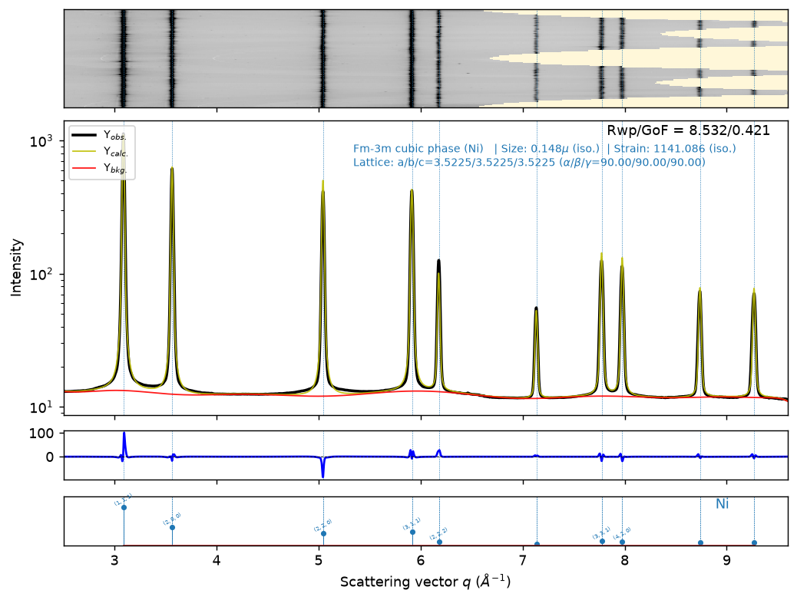

# Walkthrough: Ni — 2D integration and Rietveld refinement with easyXRD

**Notebook:** [Ni_integration_and_Rietveld.ipynb](Ni_integration_and_Rietveld.ipynb) (fully executed, outputs embedded)
**Environment:** Pixi env `/home/mt/mpixi` (Python 3.14, pyFAI 2026.9.0, GSAS-II, local `easyxrd`)
**Reference workflow:** [easyXRD_examples](https://github.com/MehmetTopsakal/easyXRD_examples) (`01_basic`, `02_intermediate`, `03_advanced-part-1/2`)

## Inputs

| File | Role |
|---|---|
| `Ni.tiff` | 2D image, Dexela 2923 (3888 × 3072 px) |
| `_calibration.poni` | pyFAI geometry — λ = 0.1799 Å, sample–detector distance ≈ 0.600 m |
| `_mask.edf` | bad-pixel mask (0.46 % of pixels masked) |
| `Ni.cif` | Ni, Fm-3m, a = 3.52558 Å (starting model) |
| `_instrument_parameters.gpx` | GSAS-II project from a LaB6 refinement at λ = 0.1799 Å (U, V, W, X, Y, Z, SH/L) |

## Steps

### 1. Integration (pyFAI via `exrd.load_xrd_data`)
- Integrated with `poni_file="_calibration.poni"` and `mask_file="_mask.edf"`, producing `i2d` (cake) and `i1d` (1D profile).
- The detector is off-centre, so full rings only reach q ≈ 6.5 Å⁻¹. Ring coverage falls to 79 % at Ni(400), 25 % at (511) and 10 % at (440).
- **Radial range chosen: q = 2.5–9.6 Å⁻¹.** This includes 10 Ni reflections, (111) to (511)/(333), and excludes (440) and the almost-empty edge of the detector.
- Exported to `Ni_i1d_q.xy`, `Ni_i1d_2theta.xy` and `Ni_integrated.nc`.

### 2. Phase matching
- `load_phases([{"cif": "Ni.cif", "label": "Ni"}])` assigns every observed peak to fcc Ni, so the sample is single-phase.

### 3. GSAS-II setup
- `setup_gsas2_refiner(instprm_from_gpx="_instrument_parameters.gpx")`.
- **Instrument parameters stay fixed** at the LaB6-calibrated values. Extra peak broadening is modelled with sample size and microstrain.

### 4. Le Bail stage
| Step | Rwp (%) |
|---|---|
| Initial Le Bail | 26.81 |
| Background, 5 → 10 Chebyshev coefficients | 22.32 |
| Lattice parameter | 13.78 |
| Isotropic size + microstrain | 10.14 |

### 5. Rietveld stage
| Step | Rwp (%) |
|---|---|
| `set_LeBail(to=False)` (intensities from the structure) | 17.90 |
| Uiso without texture correction → **rejected** (Uiso = −0.0015 Ų) | — |
| Preferred orientation, spherical harmonics order 6 | 13.95 |
| Uiso (Ni) | 11.66 |
| Size + strain, background 15 coeffs, lattice | **8.53** |

**Why preferred orientation was needed:** with a random-powder model, (111) is over-calculated and the high-q peaks are under-calculated. That pushes Uiso negative. The cake shows spotty rings, so the sample has coarse grains and/or texture. An order-6 spherical-harmonics model fixes this with only two coefficients for m3m symmetry. I tested five other strategies: no correction, order-4 harmonics, refining Zero, refining X/Y, and a shorter q range. None of them gave both a positive Uiso and a fit as good as this one.

## Final results

| Quantity | Value |
|---|---|
| Rwp / GoF | 8.53 % / 0.42 (converged) |
| a (Ni) | **3.52254 Å** |
| Uiso (Ni) | 0.0030 Ų |
| Crystallite size (isotropic) | 0.148 µm |
| Microstrain (isotropic) | ≈ 1141 × 10⁻⁶ |
| Pref. orientation (SH, L = 6) | C(4,1) = 0.030, C(6,1) = 0.405 |

## Notes / caveats
- **GoF < 1** because the pyFAI intensities are azimuthal averages, not raw counts. GSAS-II's default weights (w = 1/I) therefore overstate the uncertainties. Judge the fit by Rwp and the difference curve.
- **Lattice parameter** is ~0.04 % below the room-temperature literature value for Ni (~3.524 Å). The LaB6 refinement in `_instrument_parameters.gpx` also came out ~0.1 % below NIST (4.1524 vs 4.1568 Å). That suggests a small scale offset in the distance/wavelength calibration, which would affect absolute lattice values.
- **NetCDF export workaround:** after refinement, `exrd.ds.attrs` contains dict values (e.g. `lastShifts`) that NetCDF can't store. The export cell writes a copy with those attributes converted to strings.

## Output files

| File | Content |
|---|---|
| `Ni_integration_and_Rietveld.ipynb` | Documented, executed notebook |
| `Ni_i1d_q.xy`, `Ni_i1d_2theta.xy` | Integrated 1D profile (q and 2θ) |
| `Ni_integrated.nc` | xarray dataset after integration (i2d + i1d) |
| `Ni_refined.gpx` | Refined GSAS-II project |
| `Ni_refined.nc` | xarray dataset with fit, background and refinement attributes |
| `Ni_rietveld_fit.dat` | q, Yobs, Ycalc, Ybkg table |
| `Ni_rietveld.pdf`, `Ni_rietveld.png` | Final refinement figure |
| `walkthrough.md` | This summary |
