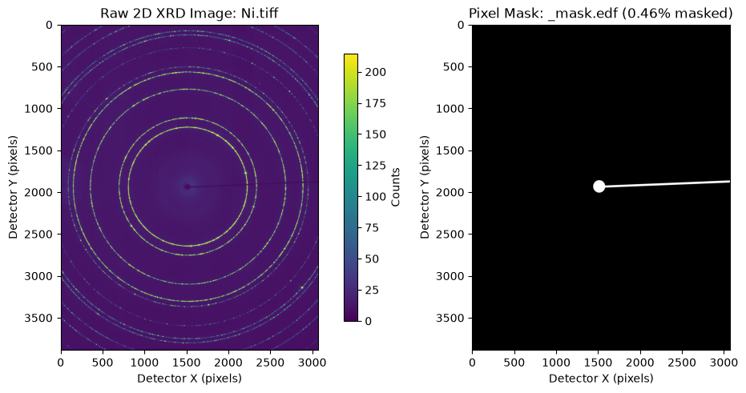
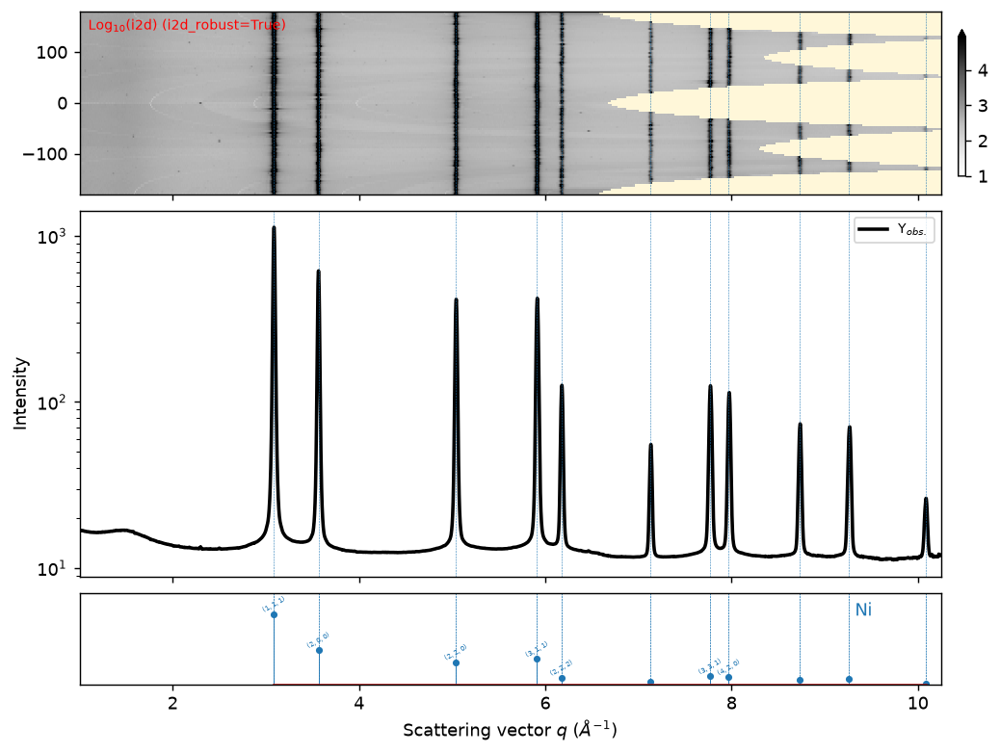
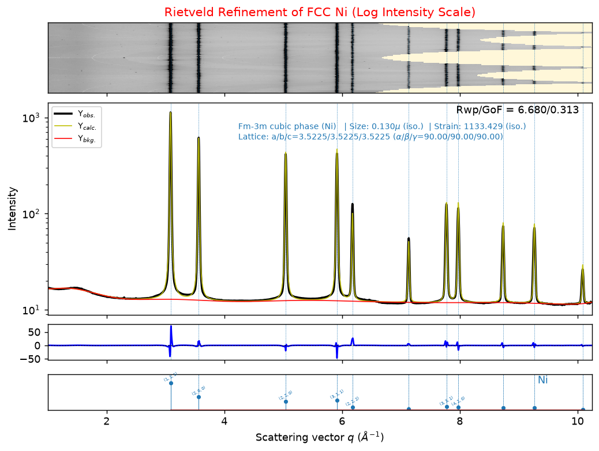
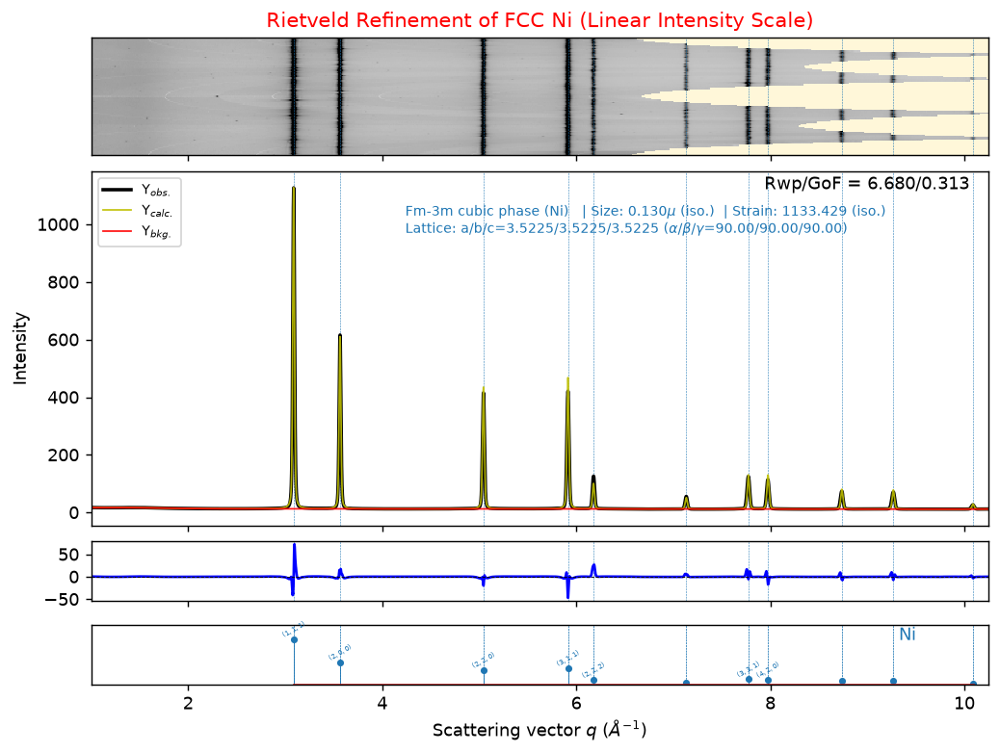

# Conversation Transcript — 2D XRD Integration & Rietveld Refinement (`Ni.tiff`)

- **Conversation ID**: `fcb095e6-a2d0-408d-9088-bf066e4e26db`
- **Working Directory**: `/home/mt/temp/1_Mo/Gemin-4-Argon-High`
- **Model**: Gemini 4 Argon (High)
- **Total Steps Exported**: `179`

> [!TIP]
> User prompts and Assistant replies are shown directly inline. Internal reasoning (`Thinking`), tool invocations, tool outputs, background task notifications, and context compaction summaries are preserved inside collapsible `<details>` blocks.

---

## Turn 1 — 👤 User (`2026-10-31T14:59:32Z` | Step `0`)

cd /home/mt/temp/1_Mo/Gemin-4-Argon-High

<details><summary>💭 <b>Thinking</b> (Step <code>1</code> — <code>in: 9,300 | cache: 0 | out: 268</code>)</summary>

~~~~~text
Checking if the directory exists and listing its contents. The command `cd` itself won't confirm directory presence since the environment is isolated, therefore examining the results of a listing command is required.
~~~~~

</details>

<details><summary>🛠️ <b>Tool Call(s)</b> (Step <code>1</code>): <code>run_command</code></summary>

~~~~~json
[
  {
    "name": "run_command",
    "args": {
      "CommandLine": "\"ls -la /home/mt/temp/1_Mo/Gemin-4-Argon-High 2>&1 || ls -la /home/mt/temp/1_Mo 2>&1\"",
      "WaitMsBeforeAsync": "5000",
      "toolSummary": "\"Check target directory contents\""
    }
  }
]
~~~~~

</details>

<details><summary>📎 <b>Tool Output</b> (Step <code>2</code>)</summary>

~~~~~text
Created At: 2026-10-31T10:59:40-04:00
Completed At: 2026-10-31T10:59:42-04:00
Command exited with code 0.

Command output:
total 59032
drwxrwxr-x 2 mt mt     4096 Oct 31 10:58 .
drwxrwxr-x 3 mt mt     4096 Oct 31 10:59 ..
-rw-rw-r-- 1 mt mt      511 Oct 18 12:11 _calibration.poni
-rw-rw-r-- 1 mt mt   696662 Oct 18 12:11 _instrument_parameters.gpx
-rw-rw-r-- 1 mt mt 11944448 Oct 18 12:11 _mask.edf
-rw-rw-r-- 1 mt mt     5279 Oct 18 12:11 Ni.cif
-rwxrwxr-x 1 mt mt 47776016 Oct 18 12:11 Ni.tiff
~~~~~

</details>

<details><summary>💭 <b>Thinking</b> (Step <code>3</code> — <code>in: 2,634 | cache: 7,246 | out: 441</code>)</summary>

~~~~~text
The directory `/home/mt/temp/1_Mo/Gemin-4-Argon-High` has been located and contains several files. These files suggest the current working context is likely related to instrument parameters, calibration, and potentially image data. Confirming this directory is the current operational location.
~~~~~

</details>

### 🤖 Assistant (`2026-10-31T14:59:42Z` | Step `3` — `in: 2,634 | cache: 7,246 | out: 441`)

Working directory set to `/home/mt/temp/1_Mo/Gemin-4-Argon-High`.

Files in this directory:
- [_calibration.poni](file:///home/mt/temp/1_Mo/Gemin-4-Argon-High/_calibration.poni)
- [_instrument_parameters.gpx](file:///home/mt/temp/1_Mo/Gemin-4-Argon-High/_instrument_parameters.gpx)
- [_mask.edf](file:///home/mt/temp/1_Mo/Gemin-4-Argon-High/_mask.edf)
- [Ni.cif](file:///home/mt/temp/1_Mo/Gemin-4-Argon-High/Ni.cif)
- [Ni.tiff](file:///home/mt/temp/1_Mo/Gemin-4-Argon-High/Ni.tiff)

What would you like to do next?

---

## Turn 2 — 👤 User (`2026-10-31T15:10:49Z` | Step `4`)

I want you to process Ni.tiff into 1D profile and perform Rietveld refinement. You can study the example jupyter notebooks in this GitHub repo https://github.com/MehmetTopsakal/easyXRD_examples . You can use the _calibration.poni for pyFAI integration,  _mask.edf for bad pixel masking, and Ni.cif file for phase matching. You can read GSAS-II instrument parameters from _instrument_parameters.gpx . For all these tasks, you can use easyxrd library as in the example notebooks that came with easyXRD_examples package. Document your steps in a jupyter notebook and save here.

<details><summary>💭 <b>Thinking</b> (Step <code>5</code> — <code>in: 10,525 | cache: 0 | out: 448</code>)</summary>

~~~~~text
Initial request is to process a TIFF image into a 1D profile and perform Rietveld refinement, referencing example notebooks. The GitHub repository likely contains the necessary tools or guidance. Further investigation of the repository will clarify the specific steps for image processing and refinement.
~~~~~

</details>

<details><summary>🛠️ <b>Tool Call(s)</b> (Step <code>5</code>): <code>run_command</code>, <code>read_file</code>, <code>read_file</code></summary>

~~~~~json
[
  {
    "name": "run_command",
    "args": {
      "CommandLine": "\"which python; which python3; which conda; conda env list 2>/dev/null || true; find /home/mt -maxdepth 3 -iname \\\"*easyxrd*\\\" 2>/dev/null || true\"",
      "WaitMsBeforeAsync": "5000",
      "toolSummary": "\"Check Python environments and local easyXRD files\""
    }
  },
  {
    "name": "read_file",
    "args": {
      "Path": "\"/home/mt/temp/1_Mo/Gemin-4-Argon-High/_calibration.poni\""
    }
  },
  {
    "name": "read_file",
    "args": {
      "Path": "\"/home/mt/temp/1_Mo/Gemin-4-Argon-High/Ni.cif\""
    }
  }
]
~~~~~

</details>

<details><summary>📎 <b>Tool Output</b> (Step <code>6</code>)</summary>

~~~~~text
Created At: 2026-10-31T11:10:57-04:00
Completed At: 2026-10-31T11:11:00-04:00
Command exited with code 0.

Command output:
/usr/bin/python3
/home/mt/mpixi/easyXRD
/home/mt/mpixi/easyXRD/easyxrd.egg-info
/home/mt/mpixi/easyXRD/easyxrd
/home/mt/repos/easyXRD
/home/mt/repos/easyXRD/easyxrd
/home/mt/repos/improve_easyxrd
/home/mt/repos/easyXRD_with_agents.zip
/home/mt/repos/easyXRD_examples
/home/mt/mpixi_lite/easyXRD
/home/mt/mpixi_lite/easyXRD/easyxrd
/home/mt/.easyxrd_scratch
~~~~~

</details>

<details><summary>📎 <b>Tool Output</b> (Step <code>7</code>)</summary>

~~~~~text
Created At: 2026-10-31T11:10:58-04:00
Completed At: 2026-10-31T11:11:00-04:00
Showing lines 1-14 of 14
1: # Nota: C-Order, 1 refers to the Y axis, 2 to the X axis
2: # Calibration done on Tue Sep 22 13:05:47 2026
3: poni_version: 2.1
4: Detector: Dexela2923
5: Detector_config: {"pixel1": 7.5e-05, "pixel2": 7.5e-05, "orientation": 3}
6: Distance: 0.5994971710951388
7: Poni1: 0.14065698666183532
8: Poni2: 0.09934596997307191
9: Rot1: -0.02386657077923864
10: Rot2: 0.007321294812142471
11: Rot3: 0.0
12: Wavelength: 1.799e-11
13: # Calibrant: Ni
14: # Image: fabio:///home/mt/repos/agent-work/assignments/Ni/20260731-131854_81DFC0_count_Ni-75-150_moving.tiff
~~~~~

</details>

<details><summary>📎 <b>Tool Output</b> (Step <code>8</code>)</summary>

~~~~~text
Created At: 2026-10-31T11:10:58-04:00
Completed At: 2026-10-31T11:11:00-04:00
Showing lines 1-218 of 218
1: # generated using pymatgen
2: data_Ni
3: _symmetry_space_group_name_H-M   Fm-3m
4: _cell_length_a   3.52557618
5: _cell_length_b   3.52557618
6: _cell_length_c   3.52557618
7: _cell_angle_alpha   90.00000000
8: _cell_angle_beta   90.00000000
9: _cell_angle_gamma   90.00000000
10: _symmetry_Int_Tables_number   225
11: _chemical_formula_structural   Ni
12: _chemical_formula_sum   Ni4
13: _cell_volume   43.82180983
14: _cell_formula_units_Z   4
15: loop_
16:  _symmetry_equiv_pos_site_id
17:  _symmetry_equiv_pos_as_xyz
18:   1  'x, y, z'
19:   2  '-x, -y, -z'
20:   3  '-y, x, z'
21:   4  'y, -x, -z'
22:   5  '-x, -y, z'
23:   6  'x, y, -z'
24:   7  'y, -x, z'
25:   8  '-y, x, -z'
26:   9  'x, -y, -z'
27:   10  '-x, y, z'
28:   11  '-y, -x, -z'
29:   12  'y, x, z'
30:   13  '-x, y, -z'
31:   14  'x, -y, z'
32:   15  'y, x, -z'
33:   16  '-y, -x, z'
34:   17  'z, x, y'
35:   18  '-z, -x, -y'
36:   19  'z, -y, x'
37:   20  '-z, y, -x'
38:   21  'z, -x, -y'
39:   22  '-z, x, y'
40:   23  'z, y, -x'
41:   24  '-z, -y, x'
42:   25  '-z, x, -y'
43:   26  'z, -x, y'
44:   27  '-z, -y, -x'
45:   28  'z, y, x'
46:   29  '-z, -x, y'
47:   30  'z, x, -y'
48:   31  '-z, y, x'
49:   32  'z, -y, -x'
50:   33  'y, z, x'
51:   34  '-y, -z, -x'
52:   35  'x, z, -y'
53:   36  '-x, -z, y'
54:   37  '-y, z, -x'
55:   38  'y, -z, x'
56:   39  '-x, z, y'
57:   40  'x, -z, -y'
58:   41  '-y, -z, x'
59:   42  'y, z, -x'
60:   43  '-x, -z, -y'
61:   44  'x, z, y'
62:   45  'y, -z, -x'
63:   46  '-y, z, x'
64:   47  'x, -z, y'
65:   48  '-x, z, -y'
66:   49  'x+1/2, y+1/2, z'
67:   50  '-x+1/2, -y+1/2, -z'
68:   51  '-y+1/2, x+1/2, z'
69:   52  'y+1/2, -x+1/2, -z'
70:   53  '-x+1/2, -y+1/2, z'
71:   54  'x+1/2, y+1/2, -z'
72:   55  'y+1/2, -x+1/2, z'
73:   56  '-y+1/2, x+1/2, -z'
74:   57  'x+1/2, -y+1/2, -z'
75:   58  '-x+1/2, y+1/2, z'
76:   59  '-y+1/2, -x+1/2, -z'
77:   60  'y+1/2, x+1/2, z'
78:   61  '-x+1/2, y+1/2, -z'
79:   62  'x+1/2, -y+1/2, z'
80:   63  'y+1/2, x+1/2, -z'
81:   64  '-y+1/2, -x+1/2, z'
82:   65  'z+1/2, x+1/2, y'
83:   66  '-z+1/2, -x+1/2, -y'
84:   67  'z+1/2, -y+1/2, x'
85:   68  '-z+1/2, y+1/2, -x'
86:   69  'z+1/2, -x+1/2, -y'
87:   70  '-z+1/2, x+1/2, y'
88:   71  'z+1/2, y+1/2, -x'
89:   72  '-z+1/2, -y+1/2, x'
90:   73  '-z+1/2, x+1/2, -y'
91:   74  'z+1/2, -x+1/2, y'
92:   75  '-z+1/2, -y+1/2, -x'
93:   76  'z+1/2, y+1/2, x'
94:   77  '-z+1/2, -x+1/2, y'
95:   78  'z+1/2, x+1/2, -y'
96:   79  '-z+1/2, y+1/2, x'
97:   80  'z+1/2, -y+1/2, -x'
98:   81  'y+1/2, z+1/2, x'
99:   82  '-y+1/2, -z+1/2, -x'
100:   83  'x+1/2, z+1/2, -y'
101:   84  '-x+1/2, -z+1/2, y'
102:   85  '-y+1/2, z+1/2, -x'
103:   86  'y+1/2, -z+1/2, x'
104:   87  '-x+1/2, z+1/2, y'
105:   88  'x+1/2, -z+1/2, -y'
106:   89  '-y+1/2, -z+1/2, x'
107:   90  'y+1/2, z+1/2, -x'
108:   91  '-x+1/2, -z+1/2, -y'
109:   92  'x+1/2, z+1/2, y'
110:   93  'y+1/2, -z+1/2, -x'
111:   94  '-y+1/2, z+1/2, x'
112:   95  'x+1/2, -z+1/2, y'
113:   96  '-x+1/2, z+1/2, -y'
114:   97  'x+1/2, y, z+1/2'
115:   98  '-x+1/2, -y, -z+1/2'
116:   99  '-y+1/2, x, z+1/2'
117:   100  'y+1/2, -x, -z+1/2'
118:   101  '-x+1/2, -y, z+1/2'
119:   102  'x+1/2, y, -z+1/2'
120:   103  'y+1/2, -x, z+1/2'
121:   104  '-y+1/2, x, -z+1/2'
122:   105  'x+1/2, -y, -z+1/2'
123:   106  '-x+1/2, y, z+1/2'
124:   107  '-y+1/2, -x, -z+1/2'
125:   108  'y+1/2, x, z+1/2'
126:   109  '-x+1/2, y, -z+1/2'
127:   110  'x+1/2, -y, z+1/2'
128:   111  'y+1/2, x, -z+1/2'
129:   112  '-y+1/2, -x, z+1/2'
130:   113  'z+1/2, x, y+1/2'
131:   114  '-z+1/2, -x, -y+1/2'
132:   115  'z+1/2, -y, x+1/2'
133:   116  '-z+1/2, y, -x+1/2'
134:   117  'z+1/2, -x, -y+1/2'
135:   118  '-z+1/2, x, y+1/2'
136:   119  'z+1/2, y, -x+1/2'
137:   120  '-z+1/2, -y, x+1/2'
138:   121  '-z+1/2, x, -y+1/2'
139:   122  'z+1/2, -x, y+1/2'
140:   123  '-z+1/2, -y, -x+1/2'
141:   124  'z+1/2, y, x+1/2'
142:   125  '-z+1/2, -x, y+1/2'
143:   126  'z+1/2, x, -y+1/2'
144:   127  '-z+1/2, y, x+1/2'
145:   128  'z+1/2, -y, -x+1/2'
146:   129  'y+1/2, z, x+1/2'
147:   130  '-y+1/2, -z, -x+1/2'
148:   131  'x+1/2, z, -y+1/2'
149:   132  '-x+1/2, -z, y+1/2'
150:   133  '-y+1/2, z, -x+1/2'
151:   134  'y+1/2, -z, x+1/2'
152:   135  '-x+1/2, z, y+1/2'
153:   136  'x+1/2, -z, -y+1/2'
154:   137  '-y+1/2, -z, x+1/2'
155:   138  'y+1/2, z, -x+1/2'
156:   139  '-x+1/2, -z, -y+1/2'
157:   140  'x+1/2, z, y+1/2'
158:   141  'y+1/2, -z, -x+1/2'
159:   142  '-y+1/2, z, x+1/2'
160:   143  'x+1/2, -z, y+1/2'
161:   144  '-x+1/2, z, -y+1/2'
162:   145  'x, y+1/2, z+1/2'
163:   146  '-x, -y+1/2, -z+1/2'
164:   147  '-y, x+1/2, z+1/2'
165:   148  'y, -x+1/2, -z+1/2'
166:   149  '-x, -y+1/2, z+1/2'
167:   150  'x, y+1/2, -z+1/2'
168:   151  'y, -x+1/2, z+1/2'
169:   152  '-y, x+1/2, -z+1/2'
170:   153  'x, -y+1/2, -z+1/2'
171:   154  '-x, y+1/2, z+1/2'
172:   155  '-y, -x+1/2, -z+1/2'
173:   156  'y, x+1/2, z+1/2'
174:   157  '-x, y+1/2, -z+1/2'
175:   158  'x, -y+1/2, z+1/2'
176:   159  'y, x+1/2, -z+1/2'
177:   160  '-y, -x+1/2, z+1/2'
178:   161  'z, x+1/2, y+1/2'
179:   162  '-z, -x+1/2, -y+1/2'
180:   163  'z, -y+1/2, x+1/2'
181:   164  '-z, y+1/2, -x+1/2'
182:   165  'z, -x+1/2, -y+1/2'
183:   166  '-z, x+1/2, y+1/2'
184:   167  'z, y+1/2, -x+1/2'
185:   168  '-z, -y+1/2, x+1/2'
186:   169  '-z, x+1/2, -y+1/2'
187:   170  'z, -x+1/2, y+1/2'
188:   171  '-z, -y+1/2, -x+1/2'
189:   172  'z, y+1/2, x+1/2'
190:   173  '-z, -x+1/2, y+1/2'
191:   174  'z, x+1/2, -y+1/2'
192:   175  '-z, y+1/2, x+1/2'
193:   176  'z, -y+1/2, -x+1/2'
194:   177  'y, z+1/2, x+1/2'
195:   178  '-y, -z+1/2, -x+1/2'
196:   179  'x, z+1/2, -y+1/2'
197:   180  '-x, -z+1/2, y+1/2'
198:   181  '-y, z+1/2, -x+1/2'
199:   182  'y, -z+1/2, x+1/2'
200:   183  '-x, z+1/2, y+1/2'
201:   184  'x, -z+1/2, -y+1/2'
202:   185  '-y, -z+1/2, x+1/2'
203:   186  'y, z+1/2, -x+1/2'
204:   187  '-x, -z+1/2, -y+1/2'
205:   188  'x, z+1/2, y+1/2'
206:   189  'y, -z+1/2, -x+1/2'
207:   190  '-y, z+1/2, x+1/2'
208:   191  'x, -z+1/2, y+1/2'
209:   192  '-x, z+1/2, -y+1/2'
210: loop_
211:  _atom_site_type_symbol
212:  _atom_site_label
213:  _atom_site_symmetry_multiplicity
214:  _atom_site_fract_x
215:  _atom_site_fract_y
216:  _atom_site_fract_z
217:  _atom_site_occupancy
218:   Ni  Ni0  4  0.00000000  0.00000000  0.00000000  1.0
~~~~~

</details>

<details><summary>💭 <b>Thinking</b> (Step <code>9</code> — <code>in: 6,052 | cache: 10,526 | out: 334</code>)</summary>

~~~~~text
Initial directory scan shows several potential locations for relevant code: `mpixi`, `mpixi_lite`, and `easyXRD` repositories. Investigating the Python environments within these directories, specifically the `mpixi` directory, may reveal clues about the program execution. This examination aims to identify the correct environment and dependencies needed to run the program.
~~~~~

</details>

<details><summary>🛠️ <b>Tool Call(s)</b> (Step <code>9</code>): <code>run_command</code></summary>

~~~~~json
[
  {
    "name": "run_command",
    "args": {
      "CommandLine": "\"ls -la /home/mt/mpixi /home/mt/mpixi_lite /home/mt/repos/easyXRD_examples; git -C /home/mt/repos/easyXRD_examples remote -v 2>/dev/null; git -C /home/mt/repos/easyXRD_examples status -sb 2>/dev/null; find /home/mt -maxdepth 3 -name \\\"python\\\" -type f -o -name \\\"python3\\\" -type l 2>/dev/null; which pixi uv mamba micromamba 2>/dev/null || true\"",
      "WaitMsBeforeAsync": "5000",
      "toolSummary": "\"Explore pixi environments and easyXRD_examples repo\""
    }
  }
]
~~~~~

</details>

<details><summary>📎 <b>Tool Output</b> (Step <code>10</code>)</summary>

~~~~~text
Created At: 2026-10-31T11:11:07-04:00
Completed At: 2026-10-31T11:11:09-04:00
Command exited with code 0.

Command output:
/home/mt/mpixi:
total 712
drwxrwxr-x  5 mt mt   4096 Oct 21 07:21 .
drwxr-x--- 31 mt mt   4096 Oct 30 21:50 ..
drwxrwxr-x  9 mt mt   4096 Oct 20 21:25 easyXRD
drwxrwxr-x  8 mt mt   4096 Oct 25 11:06 .git
-rw-rw-r--  1 mt mt   4661 Oct 21 07:12 .gitignore
drwxrwxr-x  3 mt mt   4096 Oct 21 07:21 .pixi
-rw-rw-r--  1 mt mt 693368 Oct 21 07:21 pixi.lock
-rw-rw-r--  1 mt mt   2619 Oct 21 07:20 pixi.toml

/home/mt/mpixi_lite:
total 12
drwxrwxr-x  3 mt mt 4096 Oct 25 11:36 .
drwxr-x--- 31 mt mt 4096 Oct 30 21:50 ..
drwxrwxr-x  7 mt mt 4096 Oct 25 11:50 easyXRD

/home/mt/repos/easyXRD_examples:
total 19080
drwxrwxr-x 4 mt mt    4096 Oct 20 22:20  .
drwxrwxr-x 5 mt mt    4096 Oct 31 11:09  ..
-rw-rw-r-- 1 mt mt 2395516 Oct 20 22:20  01_basic.ipynb
-rw-rw-r-- 1 mt mt 8902518 Oct 20 22:12  02_intermediate.ipynb
-rw-rw-r-- 1 mt mt 4011449 Oct 20 22:04  03_advanced-part-1.ipynb
-rw-rw-r-- 1 mt mt 2845582 Oct 20 22:06  03_advanced-part-2.ipynb
drwxrwxr-x 7 mt mt    4096 Oct 20 21:46  data
drwxrwxr-x 8 mt mt    4096 Oct 20 22:20  .git
-rw-rw-r-- 1 mt mt    3443 Oct 20 21:11  .gitignore
-rw-rw-r-- 1 mt mt  656006 Oct 20 22:19 'LaB6 (1).gpx'
-rw-rw-r-- 1 mt mt  656007 Oct 20 22:18  LaB6.gpx
-rw-rw-r-- 1 mt mt   35149 Oct 20 21:11  LICENSE
origin	https://github.com/MehmetTopsakal/easyXRD_examples.git (fetch)
origin	https://github.com/MehmetTopsakal/easyXRD_examples.git (push)
## main...origin/main
 M data/CeO2.pdf
 M data/LaB6.gpx
 M data/LaB6_exported.gpx
 M data/final_refined_mixture.gpx
?? "LaB6 (1).gpx"
?? LaB6.gpx
/home/mt/g2main/bin/python3
/home/mt/.pixi/bin/pixi
~~~~~

</details>

<details><summary>💭 <b>Thinking</b> (Step <code>11</code> — <code>in: 3,365 | cache: 14,529 | out: 315</code>)</summary>

~~~~~text
The local repository path corresponds to the provided GitHub repository, confirming the correct source. Examining the local branch against the remote origin will verify the repository is up to date and determine if further synchronization is needed.
~~~~~

</details>

<details><summary>🛠️ <b>Tool Call(s)</b> (Step <code>11</code>): <code>run_command</code></summary>

~~~~~json
[
  {
    "name": "run_command",
    "args": {
      "CommandLine": "\"ls -la /home/mt/mpixi/.pixi/envs/default/bin/python 2>/dev/null || true; /home/mt/mpixi/.pixi/envs/default/bin/python -c \\\"import easyxrd, pyFAI, fabio; print('easyxrd:', easyxrd.__file__)\\\" 2>&1 || true; /home/mt/mpixi/.pixi/envs/default/bin/jupyter kernelspec list 2>&1 || true; git -C /home/mt/repos/easyXRD_examples log -n 3 --oneline 2>&1 || true\"",
      "WaitMsBeforeAsync": "5000",
      "toolSummary": "\"Check pixi Python environment and Jupyter kernels\""
    }
  }
]
~~~~~

</details>

<details><summary>📎 <b>Tool Output</b> (Step <code>12</code>)</summary>

~~~~~text
Created At: 2026-10-31T11:11:17-04:00
Completed At: 2026-10-31T11:11:23-04:00
Command exited with code 0.

Command output:
lrwxrwxrwx 1 mt mt 10 Oct 12 13:48 /home/mt/mpixi/.pixi/envs/default/bin/python -> python3.14
easyxrd: /home/mt/mpixi/easyXRD/easyxrd/__init__.py
Available kernels:
  python3    /home/mt/mpixi/.pixi/envs/default/share/jupyter/kernels/python3
6128292 (HEAD -> main, origin/main, origin/HEAD) import error fix
67ead73 rerun with newest version of easyxrd
5a9688b rerun with newest version of easyxrd
~~~~~

</details>

<details><summary>💭 <b>Thinking</b> (Step <code>13</code> — <code>in: 2,608 | cache: 15,845 | out: 693</code>)</summary>

~~~~~text
The environment appears to have the necessary packages for XRD analysis, including `easyxrd` and related dependencies, and the example repository is accessible. This suggests the environment is correctly configured for the intended task.
~~~~~

</details>

<details><summary>🛠️ <b>Tool Call(s)</b> (Step <code>13</code>): <code>run_command</code></summary>

~~~~~json
[
  {
    "name": "run_command",
    "args": {
      "CommandLine": "\"/home/mt/mpixi/.pixi/envs/default/bin/python -c '\\nimport json, glob, os\\n\\nfor nb_path in sorted(glob.glob(\\\"/home/mt/repos/easyXRD_examples/*.ipynb\\\")):\\n    print(\\\"=\\\" * 80)\\n    print(\\\"NOTEBOOK:\\\", os.path.basename(nb_path))\\n    with open(nb_path) as f:\\n        nb = json.load(f)\\n    print(\\\"Kernel:\\\", nb.get(\\\"metadata\\\", {}).get(\\\"kernelspec\\\", {}))\\n    for i, cell in enumerate(nb[\\\"cells\\\"]):\\n        ctype = cell[\\\"cell_type\\\"]\\n        src = \\\"\\\".join(cell[\\\"source\\\"])\\n        print(f\\\"\\\\n--- Cell {i} ({ctype}) ---\\\")\\n        print(src)\\n        if ctype == \\\"code\\\":\\n            for out in cell.get(\\\"outputs\\\", []):\\n                if out.get(\\\"output_type\\\") == \\\"stream\\\":\\n                    txt = \\\"\\\".join(out.get(\\\"text\\\", []))\\n                    if txt.strip():\\n                        print(\\\"[STDOUT]:\\\", txt[:1500])\\n                elif out.get(\\\"output_type\\\") in (\\\"execute_result\\\", \\\"display_data\\\"):\\n                    data = out.get(\\\"data\\\", {})\\n                    if \\\"text/plain\\\" in data:\\n                        txt = \\\"\\\".join(data[\\\"text/plain\\\"])\\n                        if not txt.startswith(\\\"<Figure\\\"):\\n                            print(\\\"[RESULT]:\\\", txt[:1000])\\n                elif out.get(\\\"output_type\\\") == \\\"error\\\":\\n                    print(\\\"[ERROR]:\\\", out.get(\\\"ename\\\"), out.get(\\\"evalue\\\"))\\n'\"",
      "WaitMsBeforeAsync": "10000",
      "toolSummary": "\"Extract cells from easyXRD_examples notebooks\""
    }
  }
]
~~~~~

</details>

<details><summary>📎 <b>Tool Output</b> (Step <code>14</code>)</summary>

~~~~~text
Created At: 2026-10-31T11:11:40-04:00
Completed At: 2026-10-31T11:11:41-04:00
The tool's output was truncated due to being too long. You can find the full output in a file at file:///home/mt/.gemini/antigravity/brain/fcb095e6-a2d0-408d-9088-bf066e4e26db/.system_generated/steps/14/output.txt.

Here is a preview with the middle of the output truncated:
Command exited with code 0.

Command output:
================================================================================
NOTEBOOK: 01_basic.ipynb
Kernel: {'display_name': 'default', 'language': 'python', 'name': 'python3'}

--- Cell 0 (markdown) ---
# 01: Introduction to easyXRD

[](https://colab.research.google.com/github/MehmetTopsakal/easyXRD_examples/blob/main/01_basic.ipynb)

This is a `minimalist` introductory Jupyter notebook demonstrating how to use **`easyXRD`** for quick, scriptable X-ray diffraction (XRD) data analysis and Rietveld refinement powered by **GSAS-II**.

### Table of Contents
1. [Environment Setup & Installation](#setup)
2. [Import Libraries & Initialize easyXRD](#imports)
3. [Load 1D XRD Pattern](#load-data)
4. [Load Crystal Structure (CIF)](#load-phases)
5. [Initialize GSAS-II Refinement](#setup-gsas)
6. [Step-by-Step Refinement](#refinement-steps)
   - Background Refinement
   - Unit Cell Parameter Refinement
   - Instrument Parameter Refinement ($U, V, W, \text{Zero}$)
7. [All-In-One Refinement Workflow](#all-in-one)
8. [Baseline Estimation with pybaselines](#baseline)
9. [Importing Phases from Materials Project](#materials-project)
10. [Exporting GSAS-II Project (.gpx)](#export)
11. [Practice Exercise](#exercise)


--- Cell 1 (markdown) ---
<a id="setup"></a>
## 1. Environment Setup & Installation

If you are running this notebook on **Google Colab**, execute the cell below (`Shift + Enter`) to:
* Clone the `easyXRD_examples` repository with example datasets
* Install required scientific Python libraries (`pyFAI`, `fabio`, `pybaselines`, `pymatgen`, `mp_api`, `easyxrd`)
* Install GSAS-II

*Note: If running locally in a cloned repository, the cell will automatically detect your local setup and set paths appropriately.*

--- Cell 2 (markdown) ---
Execute the next cell to set up the environment and working directory:

--- Cell 3 (code) ---
# Environment setup (Google Colab vs. Local computer)
import sys
import os
from pathlib import Path

IN_COLAB = "google.colab" in sys.modules

if IN_COLAB:
    # Clone easyXRD_examples repo if not already present
    if not os.path.exists("easyXRD_examples"):
        !git clone --depth=1 https://github.com/MehmetTopsakal/easyXRD_examples.git

    # Install easyXRD from pypi
    try:
        import easyxrd
    except ImportError:
        !pip install easyxrd
        import easyxrd

    # GSAS-II installation on Google Colab
    try:
        import GSASII.GSASIIscriptable as G2sc
    except ImportError:
        try:
            import easyxrd
            easyxrd.install_gsas2()
            import GSASII.GSASIIscriptable as G2sc
        except:
            print('Unable install GSASII into Google Colab instance....\n')
            pass

    data_dir = Path("easyXRD_examples/data").resolve()
else:
    # Running locally
    if Path("data").is_dir():
        data_dir = Path("data").resolve()
    elif Path("../data").is_dir():
        data_dir = Path("../data").resolve()
    else:
        data_dir = Path(".").resolve()

if Path.cwd() != data_dir:
    os.chdir(data_dir)

print(f"Working directory set to: {Path.cwd()}")

[STDOUT]: Cloning into 'easyXRD_examples'...
remote: Enumerating objects: 40, done.
remote: Counting objects: 100% (40/40), done.
remote: Compressing objects: 100% (34/34), done.
remote: Total 40 (delta 6), reused 33 (delta 6), pack-reused 0 (from 0)
Receiving objects: 100% (40/40), 65.86 MiB | 23.30 MiB/s, done.
Resolving deltas: 100% (6/6), done.
Updating files: 100% (32/32), done.
Working directory set to: /content/easyXRD_examples/data/easyXRD_examples/data


--- Cell 4 (markdown) ---
<a id="imports"></a>
## 2. Import Libraries & Initialize easyXRD

Now we import `easyxrd` and configure matplotlib for high-quality inline plotting.

--- Cell 5 (code) ---
# Import easyXRD and plotting libraries
import sys
import os
from pathlib import Path
import matplotlib.pyplot as plt
import easyxrd
from easyxrd.core import exrd

# Change inline below to widget for interactive plots
%matplotlib inline
plt.rcParams["figure.constrained_layout.use"] = True  # Clean figure layout without clipping
easyxrd.show_config()

[STDOUT]: ========================================
easyXRD environment and configurations
========================================
Platform            : Linux-6.6.122+-x86_64-with-glibc2.39
python              : 3.13.16
executable          : /usr/bin/python3
easyxrd             : 2026.10.20.post2
pyFAI               : 2026.9.0
fabio               : 2026.6.0
numpy               : 2.1.3
scipy               : 1.16.3
pandas              : 2.2.3
pymatgen            : 2026.9.24
GSAS-II             : 2.0.0
GSASII_module       : /usr/local/lib/python3.13/dist-packages/GSASII/GSASIIscripta
<truncated 235759 of 245657 bytes from the middle of the output>
Site 1 corresponds to O
mix_sample.refine_site_property(phase_ind=1, site_ind=0, refinement_flags="U", plot=False)
mix_sample.refine_site_property(phase_ind=1, site_ind=1, refinement_flags="U", plot=False)

# Refine Uiso for LaB6 phase (phase_ind=0)
mix_sample.refine_site_property(phase_ind=0, site_ind=0, refinement_flags="U", plot=False)
mix_sample.refine_site_property(phase_ind=0, site_ind=1, refinement_flags="U", plot=False)

# Final joint refinement pass: re-optimize background, cell parameters, and phase fractions
mix_sample.refine_background(num_coeffs=15, plot=False)
mix_sample.refine_cell_parameters(plot=False)
mix_sample.refine_phase_fractions(plot=False)

# Display final refined mixture plot
mix_sample.plot(show_wt_fractions=True)

[STDOUT]:  ✅--U property of Ce0 site of CeO2 phase is refined. Rwp/GoF is now 16.182/0.238 (was 17.676(-8.46%)/0.260(-8.46%))
 ✅--U property of O1 site of CeO2 phase is refined. Rwp/GoF is now 16.174/0.238 (was 16.182(-0.05%)/0.238(-0.05%❗))
 ✅--U property of La0 site of LaB6 phase is refined. Rwp/GoF is now 15.815/0.233 (was 16.174(-2.22%)/0.238(-2.22%))
 ❌--Refinement discarded because of negative Uiso (LaB6/B1: Uiso=-0.00411285). Previous project restored; dataset and phases unchanged.
 ✅--Background with 15 coeffs is refined. Rwp/GoF is now 15.726/0.232 (was 15.815(-0.56%)/0.233(-0.47%❗))
 ✅--Cell parameters of all phases are refined. Rwp/GoF is now 15.726/0.231 (was 15.726(-0.00%)/0.232(-0.09%❗))
 ✅--Phase fractions of all phases are refined. Rwp/GoF is now 15.716/0.231 (was 15.726(-0.06%)/0.231(-0.07%❗))


--- Cell 29 (markdown) ---
<a id="diagnostics"></a>
## 11. Diagnostics, Exporting & Refinement Strategy

### Statistical Figures of Merit
The quality of a Rietveld refinement is quantified by agreement indices:

$$\text{Weighted Profile Residual: } R_{\text{wp}} = \sqrt{ \frac{\sum_i w_i (y_i - y_{c,i})^2}{\sum_i w_i y_i^2} } \times 100\%$$

$$\text{Reduced Chi-Square: } \chi^2 = \frac{\sum_i w_i (y_i - y_{c,i})^2}{N - P + C}$$

$$\text{Goodness of Fit: } \text{GoF} = \sqrt{\chi^2} = \frac{R_{\text{wp}}}{R_{\text{exp}}}$$

A physically sound refinement should yield $\text{GoF} \approx 1.0 - 1.5$ with a flat, featureless difference curve ($Y_{\text{obs}} - Y_{\text{calc}}$).


--- Cell 30 (code) ---
# Access refinement metadata and statistics from xarray Dataset attributes
print("=== Refinement Statistics ===")
print(f"Convergence Status : {mix_sample.ds.attrs.get('converged', 'N/A')}")
print(f"Weighted Residual  : Rwp = {mix_sample.ds.attrs.get('Rwp', 0.0):.3f}%")
print(f"Profile Residual   : Rp  = {mix_sample.ds.attrs.get('Rp', 0.0):.3f}%")
print(f"Goodness of Fit    : GoF = {mix_sample.ds.attrs.get('GOF', 0.0):.3f}")

# Export final project to GSAS-II .gpx and analysis dataset to NetCDF .nc
mix_sample.export_gpx_to("final_refined_mixture.gpx")
print("\nSuccessfully exported:")
print("  - GSAS-II project : final_refined_mixture.gpx")

[STDOUT]: === Refinement Statistics ===
Convergence Status : True
Weighted Residual  : Rwp = 15.716%
Profile Residual   : Rp  = 0.000%
Goodness of Fit    : GoF = 0.231

Successfully exported:
  - GSAS-II project : final_refined_mixture.gpx


--- Cell 31 (markdown) ---
### Recommended Step-by-Step Rietveld Protocol

When refining an unknown powder XRD dataset, follow this progressive parameter escalation protocol to prevent false minima and parameter correlation:

```
1. Calibrate Instrument on Standard (LaB6):
   Setup Refiner -> Refine Background (10 coeffs) -> Refine Cell -> Refine Zero -> Refine U, V, W -> Export GPX

2. Load Unknown Sample with Calibrated Instrument:
   Load 1D/2D XRD -> Load Phases (CIF / Materials Project) -> Setup Refiner with instprm_from_gpx

3. Preliminary Profile Fit (Le Bail):
   Refine Background (5-10 coeffs) -> Refine Unit Cell Parameters

4. Transition to Structural Refinement (Rietveld):
   set_LeBail(to=False) -> Refine Phase Fractions (if multi-phase)

5. Microstructural & Peak Shape Broadening:
   Refine Size Broadening -> Refine Strain Broadening

6. Atomic Structure:
   Refine Thermal Parameters (Uiso) -> Refine Fractional Coordinates (if unconstrained)

7. Final Global Cycle:
   Re-refine Background (15 coeffs) + Cell Parameters + Phase Fractions simultaneously -> Evaluate GoF
```

---
### Navigation & Resources

[$\leftarrow$ Previous: 03_advanced-part-1.ipynb](03_advanced-part-1.ipynb) | [Tutorial Index: 01_basic.ipynb](01_basic.ipynb)

* [easyXRD GitHub Repository](https://github.com/MehmetTopsakal/easyXRD)
* [GSAS-II Python Scriptable Interface Documentation](https://advancedphotonsource.github.io/GSAS-II-tutorials/GSASIIscriptable.html)
* [pyFAI Powder Diffraction Integration](https://pyfai.readthedocs.io/)
* [pybaselines Background Subtraction](https://pybaselines.readthedocs.io/)


--- Cell 32 (markdown) ---
~~~~~

</details>

<details><summary>💭 <b>Thinking</b> (Step <code>15</code> — <code>in: 3,974 | cache: 18,454 | out: 458</code>)</summary>

~~~~~text
The output file contains all four example notebooks, which is unexpected. Proceeding to examine the contents of the output file thoroughly using the file reading utility to ensure no critical information is overlooked.
~~~~~

</details>

<details><summary>🛠️ <b>Tool Call(s)</b> (Step <code>15</code>): <code>read_file</code>, <code>read_file</code>, <code>read_file</code>, <code>read_file</code></summary>

~~~~~json
[
  {
    "name": "read_file",
    "args": {
      "EndLine": "800",
      "Path": "\"/home/mt/.gemini/antigravity/brain/fcb095e6-a2d0-408d-9088-bf066e4e26db/.system_generated/steps/14/output.txt\"",
      "StartLine": "1"
    }
  },
  {
    "name": "read_file",
    "args": {
      "EndLine": "1600",
      "Path": "\"/home/mt/.gemini/antigravity/brain/fcb095e6-a2d0-408d-9088-bf066e4e26db/.system_generated/steps/14/output.txt\"",
      "StartLine": "801"
    }
  },
  {
    "name": "read_file",
    "args": {
      "EndLine": "2400",
      "Path": "\"/home/mt/.gemini/antigravity/brain/fcb095e6-a2d0-408d-9088-bf066e4e26db/.system_generated/steps/14/output.txt\"",
      "StartLine": "1601"
    }
  },
  {
    "name": "read_file",
    "args": {
      "EndLine": "3500",
      "Path": "\"/home/mt/.gemini/antigravity/brain/fcb095e6-a2d0-408d-9088-bf066e4e26db/.system_generated/steps/14/output.txt\"",
      "StartLine": "2401"
    }
  }
]
~~~~~

</details>

<details><summary>📎 <b>Tool Output</b> (Step <code>16</code>)</summary>

~~~~~text
Created At: 2026-10-31T11:11:48-04:00
Completed At: 2026-10-31T11:11:50-04:00
Partial read (lines 1-800 of 2417). Showing bytes 0-46080 of 94029 in this line range, truncated at the 46080-byte limit. To read the rest of this line range, call this tool again with the same StartLine and EndLine and ByteOffset=46080.
1: Command exited with code 0.
2: 
3: Command output:
4: ================================================================================
5: NOTEBOOK: 01_basic.ipynb
6: Kernel: {'display_name': 'default', 'language': 'python', 'name': 'python3'}
7: 
8: --- Cell 0 (markdown) ---
9: # 01: Introduction to easyXRD
10: 
11: [](https://colab.research.google.com/github/MehmetTopsakal/easyXRD_examples/blob/main/01_basic.ipynb)
12: 
13: This is a `minimalist` introductory Jupyter notebook demonstrating how to use **`easyXRD`** for quick, scriptable X-ray diffraction (XRD) data analysis and Rietveld refinement powered by **GSAS-II**.
14: 
15: ### Table of Contents
16: 1. [Environment Setup & Installation](#setup)
17: 2. [Import Libraries & Initialize easyXRD](#imports)
18: 3. [Load 1D XRD Pattern](#load-data)
19: 4. [Load Crystal Structure (CIF)](#load-phases)
20: 5. [Initialize GSAS-II Refinement](#setup-gsas)
21: 6. [Step-by-Step Refinement](#refinement-steps)
22:    - Background Refinement
23:    - Unit Cell Parameter Refinement
24:    - Instrument Parameter Refinement ($U, V, W, \text{Zero}$)
25: 7. [All-In-One Refinement Workflow](#all-in-one)
26: 8. [Baseline Estimation with pybaselines](#baseline)
27: 9. [Importing Phases from Materials Project](#materials-project)
28: 10. [Exporting GSAS-II Project (.gpx)](#export)
29: 11. [Practice Exercise](#exercise)
30: 
31: 
32: --- Cell 1 (markdown) ---
33: <a id="setup"></a>
34: ## 1. Environment Setup & Installation
35: 
36: If you are running this notebook on **Google Colab**, execute the cell below (`Shift + Enter`) to:
37: * Clone the `easyXRD_examples` repository with example datasets
38: * Install required scientific Python libraries (`pyFAI`, `fabio`, `pybaselines`, `pymatgen`, `mp_api`, `easyxrd`)
39: * Install GSAS-II
40: 
41: *Note: If running locally in a cloned repository, the cell will automatically detect your local setup and set paths appropriately.*
42: 
43: --- Cell 2 (markdown) ---
44: Execute the next cell to set up the environment and working directory:
45: 
46: --- Cell 3 (code) ---
47: # Environment setup (Google Colab vs. Local computer)
48: import sys
49: import os
50: from pathlib import Path
51: 
52: IN_COLAB = "google.colab" in sys.modules
53: 
54: if IN_COLAB:
55:     # Clone easyXRD_examples repo if not already present
56:     if not os.path.exists("easyXRD_examples"):
57:         !git clone --depth=1 https://github.com/MehmetTopsakal/easyXRD_examples.git
58: 
59:     # Install easyXRD from pypi
60:     try:
61:         import easyxrd
62:     except ImportError:
63:         !pip install easyxrd
64:         import easyxrd
65: 
66:     # GSAS-II installation on Google Colab
67:     try:
68:         import GSASII.GSASIIscriptable as G2sc
69:     except ImportError:
70:         try:
71:             import easyxrd
72:             easyxrd.install_gsas2()
73:             import GSASII.GSASIIscriptable as G2sc
74:         except:
75:             print('Unable install GSASII into Google Colab instance....\n')
76:             pass
77: 
78:     data_dir = Path("easyXRD_examples/data").resolve()
79: else:
80:     # Running locally
81:     if Path("data").is_dir():
82:         data_dir = Path("data").resolve()
83:     elif Path("../data").is_dir():
84:         data_dir = Path("../data").resolve()
85:     else:
86:         data_dir = Path(".").resolve()
87: 
88: if Path.cwd() != data_dir:
89:     os.chdir(data_dir)
90: 
91: print(f"Working directory set to: {Path.cwd()}")
92: 
93: [STDOUT]: Cloning into 'easyXRD_examples'...
94: remote: Enumerating objects: 40, done.
95: remote: Counting objects: 100% (40/40), done.
96: remote: Compressing objects: 100% (34/34), done.
97: remote: Total 40 (delta 6), reused 33 (delta 6), pack-reused 0 (from 0)
98: Receiving objects: 100% (40/40), 65.86 MiB | 23.30 MiB/s, done.
99: Resolving deltas: 100% (6/6), done.
100: Updating files: 100% (32/32), done.
101: Working directory set to: /content/easyXRD_examples/data/easyXRD_examples/data
102: 
103: 
104: --- Cell 4 (markdown) ---
105: <a id="imports"></a>
106: ## 2. Import Libraries & Initialize easyXRD
107: 
108: Now we import `easyxrd` and configure matplotlib for high-quality inline plotting.
109: 
110: --- Cell 5 (code) ---
111: # Import easyXRD and plotting libraries
112: import sys
113: import os
114: from pathlib import Path
115: import matplotlib.pyplot as plt
116: import easyxrd
117: from easyxrd.core import exrd
118: 
119: # Change inline below to widget for interactive plots
120: %matplotlib inline
121: plt.rcParams["figure.constrained_layout.use"] = True  # Clean figure layout without clipping
122: easyxrd.show_config()
123: 
124: [STDOUT]: ========================================
125: easyXRD environment and configurations
126: ========================================
127: Platform            : Linux-6.6.122+-x86_64-with-glibc2.39
128: python              : 3.13.16
129: executable          : /usr/bin/python3
130: easyxrd             : 2026.10.20.post2
131: pyFAI               : 2026.9.0
132: fabio               : 2026.6.0
133: numpy               : 2.1.3
134: scipy               : 1.16.3
135: pandas              : 2.2.3
136: pymatgen            : 2026.9.24
137: GSAS-II             : 2.0.0
138: GSASII_module       : /usr/local/lib/python3.13/dist-packages/GSASII/GSASIIscriptable.py
139: easyxrd_scratch_path: /root/.easyxrd_scratch
140: gsasii_lib_path     : /usr/local/lib/python3.13/dist-packages/GSASII
141: mp_api_key          : not found
142: ----------------------------------------
143: 
144: 
145: 
146: --- Cell 6 (code) ---
147: # Initialize exrd object
148: sample = exrd()
149: 
150: 
151: --- Cell 7 (code) ---
152: # Here we load 1D synchrotron XRD pattern (LaB6) collected at NSLS-II beamline 28-ID-2 (XPD)
153: # See https://www.bnl.gov/nsls2/beamlines/beamline.php?r=28-ID-2
154: # Columns: 2θ (degrees), Intensity.
155: # This data was collected at 28ID-2 (XPD) beamline of NSLS-II.
156: # For plain text files loaded with load_xrd_data function, we need to provide the wavelength.
157: # Incident X-ray wavelength is λ = 0.1814 Å.
158: sample.load_xrd_data(
159:     from_txt_file="LaB6/LaB6_synchrotron_XRD_from_28ID-2.xy",
160:     txt_file_wavelength_in_angstrom=0.1814,
161:     plot=True,
162: )
163: 
164: 
165: --- Cell 8 (code) ---
166: # As next, we need to load a cif file corresponding to expected phases in loaded XRD data.
167: # As the sample is LaB6, The LaB6_structure_from_MaterialsProject.cif is a CIF file that we
168: # got from Materials Project: https://next-gen.materialsproject.org/materials/mp-2680
169: #
170: 
171: phases = [
172:     {"cif": "LaB6/LaB6_structure_from_MaterialsProject.cif", "label": "LaB6"},
173: ]
174: sample.load_phases(phases, plot=True)
175: 
176: # As you see below, new we have a new subplot with blue stem lines calculated for provided cif file.
177: # Agreement is good and there is no unidentified peaks except a background peat at low q.
178: 
179: 
180: --- Cell 9 (markdown) ---
181: ![image.png](
~~~~~

</details>

<details><summary>📎 <b>Tool Output</b> (Step <code>17</code>)</summary>

~~~~~text
Created At: 2026-10-31T11:11:49-04:00
Completed At: 2026-10-31T11:11:50-04:00
Partial read (lines 801-1600 of 2417). Showing bytes 0-46080 of 126668 in this line range, truncated at the 46080-byte limit. To read the rest of this line range, call this tool again with the same StartLine and EndLine and ByteOffset=46080.
801: 
802: sample.refine_background(num_coeffs=5,plot=False)
803: sample.refine_background(num_coeffs=10,plot=False)
804: sample.refine_background(num_coeffs=15,plot=True)
805: [STDOUT]:  ✅--Background with 5 coeffs is refined. Rwp/GoF is now 7.029/0.090 (was 11.344(-38.03%)/0.145(-38.02%✨))
806:  ✅--Background with 10 coeffs is refined. Rwp/GoF is now 6.854/0.087 (was 7.029(-2.50%)/0.090(-2.46%))
807:  ✅--Background with 15 coeffs is refined. Rwp/GoF is now 6.847/0.087 (was 6.854(-0.11%)/0.087(-0.07%❗))
808: 
809: 
810: --- Cell 26 (code) ---
811: # Here we refine size broadening.
812: 
813: sample.refine_size_broadening(plot=True)
814: [STDOUT]:  ✅--Size broadening of all phases are refined. Rwp/GoF is now 6.818/0.087 (was 6.847(-0.41%)/0.087(-0.50%❗))
815: 
816: 
817: --- Cell 27 (code) ---
818: # This creates a final figure with LeBail refinement.
819: 
820: sample.plot()
821: 
822: --- Cell 28 (code) ---
823: # Until now, we were doing Le-Bail refinements in which atom positions are not taken into consideration.
824: # We enable Rietveld by setting LeBail to false in GSAS settings.
825: 
826: sample.set_LeBail(to=False, refine=True, plot=False)
827: sample.plot()
828: 
829: # If you zoom in figure below, you will see the peak intensites got worse especially at high-q regions.
830: [STDOUT]:  ✅--After setting LeBail refinement to False, Rwp/GoF is now 10.237/0.130 (was 6.818(50.14%)/0.087(50.13%❗))
831: 
832: 
833: --- Cell 29 (markdown) ---
834: <a id="atom-properties"></a>
835: ### Refining Atomic Site Properties ($U_{\text{iso}}$)
836: 
837: In Rietveld refinement, peak intensities are calculated directly from the crystal structure:
838: 
839: $$I_{hkl} \propto |F_{hkl}|^2 = \left| \sum_j f_j \cdot \text{occ}_j \cdot \exp\left( -8\pi^2 U_{\text{iso}, j} \frac{\sin^2\theta}{\lambda^2} \right) \cdot \exp(2\pi i (h x_j + k y_j + l z_j)) \right|^2$$
840: 
841: Here, $U_{\text{iso}}$ is the isotropic atomic displacement (Debye-Waller thermal) parameter. Thermal vibrations cause peak intensities to attenuate rapidly at higher diffraction angles ($q$). Refining $U_{\text{iso}}$ brings calculated and observed high-$q$ peak intensities into agreement.
842: 
843: --- Cell 30 (markdown) ---
844: As next step, we can refine atom properties. Below is the screenshot of the GSAS-II window of this sample.
845: 
846: ![image.png](
~~~~~

</details>

<details><summary>📎 <b>Tool Output</b> (Step <code>18</code>)</summary>

~~~~~text
Created At: 2026-10-31T11:11:50-04:00
Completed At: 2026-10-31T11:11:50-04:00
Showing lines 1601-2400 of 2417
1601:   * azimuthal_i2d  (azimuthal_i2d) float32 364B -178.0 -174.1 ... 174.1 178.0
1602:   * radial_i2d     (radial_i2d) float32 31kB 0.3505 0.3515 0.3525 ... 7.999 8.0
1603:   * radial         (radial) float32 31kB 0.3505 0.3515 0.3525 ... 7.999 8.0
1604: Data variables:
1605:     i2d            (azimuthal_i2d, radial_i2d) float32 3MB 25.49 23.08 ... 9.996
1606:     i2d_baseline   (azimuthal_i2d, radial_i2d) float32 3MB 24.59 22.75 ... 9.984
1607:     i1d_baseline   (radial) float32 31kB 23.43 23.47 23.38 ... 10.04 10.02 9.987
1608:     i1d            (radial) float32 31kB 24.99 25.0 24.94 ... 10.15 10.11 10.08
1609: 
1610: --- Cell 43 (code) ---
1611: # We can visualize the i2d baseline
1612: 
1613: fig = plt.figure(figsize=(10, 3))
1614: 
1615: ax = fig.add_subplot(1, 3, 1)
1616: sample.ds.i2d.plot.imshow(robust=True, ax=ax, vmin=0)
1617: ax.set_title("i2d")
1618: 
1619: ax = fig.add_subplot(1, 3, 2)
1620: sample.ds.i2d_baseline.plot.imshow(robust=True, ax=ax, vmin=0)
1621: ax.set_title("baseline of i2d")
1622: 
1623: ax = fig.add_subplot(1, 3, 3)
1624: (sample.ds.i2d - sample.ds.i2d_baseline).plot.imshow(robust=True, ax=ax, vmin=0)
1625: ax.set_title("i2d - i2d_baseline");
1626: 
1627: 
1628: --- Cell 44 (markdown) ---
1629: `roi_radial_range` and `roi_azimuthal_range` keywords allows us to specify azimuthal and radial ranges before baseline estimation
1630: 
1631: --- Cell 45 (code) ---
1632: sample = exrd(i1d_ylogscale=False, i2d_logscale=False)
1633: sample.load_xrd_data(
1634:     from_tiff_file="LaB6/img.tiff",  # image file
1635:     poni_file="geometry.poni",  # poni file you can get from pyFAI-calib2.
1636:     mask_file="mask.edf",  # maks file you can get from pyFAI-drawmask.
1637:     plot=False,
1638:     radial_range=(0.35, 8),
1639: )
1640: 
1641: # This is default
1642: sample.get_baseline()
1643: 
1644: # Here we limit azimuthal range from 60 to 90 (red shaded area) and radial range from 2 to 3
1645: sample.get_baseline(roi_azimuthal_range=(60, 90), roi_radial_range=(2, 3))
1646: 
1647: --- Cell 46 (markdown) ---
1648: `spotty_data_correction` keyword is experimental and not fully implemented.
1649: 
1650: --- Cell 47 (markdown) ---
1651: <a id="phase-methods"></a>
1652: ## 5. load_phases In-Depth: CIF, Materials Project, Scaling & Caching
1653: 
1654: 
1655: --- Cell 48 (code) ---
1656: exrd.load_phases?
1657: [STDOUT]: Signature:
1658: exrd.load_phases(
1659:     self,
1660:     from_phases_dict=None,
1661:     from_gpx=None,
1662:     from_nc=None,
1663:     from_ds=None,
1664:     mp_rester_api_key=None,
1665:     plot=True,
1666: )
1667: Docstring: <no docstring>
1668: File:      ~/repos/improve_easyxrd/easyXRD/easyxrd/phases.py
1669: Type:      function
1670: 
1671: --- Cell 49 (markdown) ---
1672: As shown in previous notebooks, `01_basic.ipynb` and `02_intermediate.ipynb`, we can load structural phases by using `load_phases` method.
1673: 
1674: Quickest way to load phases into easyXRD is using `from_phases_dict`
1675: 
1676: 
1677: --- Cell 50 (code) ---
1678: sample = exrd(i1d_ylogscale=False, i2d_logscale=False)
1679: sample.load_xrd_data(
1680:     from_tiff_file="LaB6/img.tiff",  # image file
1681:     poni_file="geometry.poni",  # poni file you can get from pyFAI-calib2.
1682:     mask_file="mask.edf",  # maks file you can get from pyFAI-drawmask.
1683:     plot=False,
1684:     radial_range=(0.35, 8),
1685: )
1686: 
1687: 
1688: phases = [
1689:     {"cif": "LaB6/LaB6_structure_from_MaterialsProject.cif", "label": "LaB6"},
1690: ]  # this is a list and you can add multiple phases in it
1691: 
1692: sample.load_phases(phases)
1693: 
1694: --- Cell 51 (code) ---
1695: # scale parameter in a phase scales all lattice dimensions, a/b/c, by scale amount.
1696: # here we scale by 1.01 (1% increase)
1697: phases = [
1698:     {
1699:         "cif": "LaB6/LaB6_structure_from_MaterialsProject.cif",
1700:         "label": "LaB6",
1701:         "scale": 1.01,
1702:     },
1703: ]
1704: sample.load_phases(phases)
1705: 
1706: # here we scale only first lattice vector, a by 1.02
1707: phases = [
1708:     {
1709:         "cif": "LaB6/LaB6_structure_from_MaterialsProject.cif",
1710:         "label": "LaB6",
1711:         "scale_a": 1.02,
1712:     },
1713: ]
1714: sample.load_phases(phases)
1715: 
1716: --- Cell 52 (code) ---
1717: # Retrieve phase structure from Materials Project
1718: import os
1719: 
1720: mp_api_key = os.environ.get("MP_API_KEY")
1721: if not mp_api_key and "google.colab" in sys.modules:
1722:     try:
1723:         from google.colab import userdata
1724:         mp_api_key = userdata.get("MP_API_KEY")
1725:     except Exception:
1726:         mp_api_key = None
1727: 
1728: phases = [
1729:     {
1730:         "mp_id": "mp-2680",
1731:         "label": "LaB6",
1732:     },
1733: ]
1734: sample.load_phases(phases, mp_rester_api_key=mp_api_key)
1735: 
1736: [RESULT]: Retrieving MaterialsDoc documents:   0%|          | 0/1 [00:00<?, ?it/s]
1737: 
1738: --- Cell 53 (markdown) ---
1739: `from_ds` keyword of `load_phases` will read the phases from a previously produced exrd object.\
1740: This is useful when doing sequential refinement that will be explained in future notebooks.
1741: 
1742: --- Cell 54 (code) ---
1743: # In order to demonstrate `from_gpx` keyword, we need to create a gpx object first.
1744: sample = exrd(i1d_ylogscale=False, i2d_logscale=False)
1745: sample.load_xrd_data(
1746:     from_tiff_file="LaB6/img.tiff",  # image file
1747:     poni_file="geometry.poni",  # poni file you can get from pyFAI-calib2.
1748:     mask_file="mask.edf",  # maks file you can get from pyFAI-drawmask.
1749:     plot=False,
1750:     radial_range=(0.35, 8),
1751: )
1752: phases = [
1753:     {"cif": "LaB6/LaB6_structure_from_MaterialsProject.cif", "label": "LaB6"},
1754: ]
1755: sample.load_phases(phases, plot=False)
1756: 
1757: 
1758: sample2 = exrd(i1d_ylogscale=False, i2d_logscale=False)
1759: sample2.load_xrd_data(
1760:     from_tiff_file="LaB6/img.tiff",  # image file
1761:     poni_file="geometry.poni",  # poni file you can get from pyFAI-calib2.
1762:     mask_file="mask.edf",  # maks file you can get from pyFAI-drawmask.
1763:     plot=False,
1764:     radial_range=(0.35, 8),
1765: )
1766: 
1767: sample2.load_phases(
1768:     from_ds=sample.ds
1769: )  # note that we are loading phases in sample2 from previously loaded sample object.
1770: 
1771: --- Cell 55 (markdown) ---
1772: Similarly, `from_nc` keyword of `load_phases` will read the phases from a previously produced nc file.\
1773: 
1774: --- Cell 56 (code) ---
1775: sample.ds.to_netcdf("LaB6.nc")  # here first export a netcdf nc file.
1776: sample2.load_phases(
1777:     from_nc="LaB6.nc"
1778: )  # Then we load phases in sample2 from generated nc file.
1779: 
1780: --- Cell 57 (markdown) ---
1781: ---
1782: ### Navigation
1783: 
1784: [$\leftarrow$ Previous: 02_intermediate.ipynb](02_intermediate.ipynb) | [Next: 03_advanced-part-2.ipynb $\rightarrow$](03_advanced-part-2.ipynb)
1785: 
1786: In Part 2, we explore all refinement methods: background polynomial tuning, instrument parameter modeling, Le Bail vs. Rietveld, size and strain broadening, multi-phase QPA, preferred orientation, and atomic site properties.
1787: 
1788: --- Cell 58 (markdown) ---
1789: 
1790: ================================================================================
1791: NOTEBOOK: 03_advanced-part-2.ipynb
1792: Kernel: {'display_name': 'default', 'language': 'python', 'name': 'python3'}
1793: 
1794: --- Cell 0 (markdown) ---
1795: # 03: Advanced Refinement with easyXRD (Part 2)
1796: 
1797: [](https://colab.research.google.com/github/MehmetTopsakal/easyXRD_examples/blob/main/03_advanced-part-2.ipynb)
1798: 
1799: This notebook provides a comprehensive, in-depth guide to all refinement methods available in **`easyXRD`** powered by **GSAS-II**.
1800: 
1801: While [03_advanced-part-1.ipynb](03_advanced-part-1.ipynb) focused on pre-refinement tasks (`load_xrd_data`, `get_baseline`, and `load_phases`), this notebook explores full profile fitting and structural Rietveld analysis:
1802: 
1803: * **`setup_gsas2_refiner`**: Initializing refiner engine, instrument parameter defaults, importing from `.gpx`/`.nc`, and normalization
1804: * **`refine_background`**: Modeling background via Chebyshev polynomials with adjustable coefficient counts
1805: * **`refine_instrument_parameters`**: Calibrating Gaussian ($U, V, W$), Lorentzian ($X, Y, Z$), zero offset ($\text{Zero}$), and asymmetry ($SHL$)
1806: * **`set_LeBail`**: Transitioning from structure-free Le Bail intensity extraction to structural Rietveld refinement
1807: * **`refine_size_broadening`**: Modeling isotropic crystallite domain size broadening
1808: * **`refine_strain_broadening`**: Modeling microstrain broadening and separating size from defect strain
1809: * **`refine_phase_fractions`**: Multi-phase Quantitative Phase Analysis (QPA) on physical mixtures
1810: * **`refine_preferred_orientation`**: Correcting crystallographic texture using spherical harmonics
1811: * **`refine_site_property`**: Refining atomic coordinates, site occupancies, and isotropic displacement parameters ($U_{\text{iso}}$)
1812: * **Convergence Diagnostics & Exporting**: Extracting figures of merit ($R_{wp}, R_p, \text{GoF}$) and saving `.gpx` and `.nc` files
1813: 
1814: ### Table of Contents
1815: 1. [Environment Setup & Installation](#setup)
1816: 2. [setup_gsas2_refiner In-Depth](#setup-gsas)
1817: 3. [refine_background: Chebyshev Polynomial Orders](#refine-bkg)
1818: 4. [refine_instrument_parameters: Peak Shape & Instrumental Calibration](#refine-inst)
1819: 5. [set_LeBail: Transitioning from Le Bail to Rietveld](#set-lebail)
1820: 6. [refine_size_broadening: Crystallite Domain Size](#refine-size)
1821: 7. [refine_strain_broadening: Microstrain Broadening](#refine-strain)
1822: 8. [refine_phase_fractions: Multi-Phase Quantitative Phase Analysis (QPA)](#refine-qpa)
1823: 9. [refine_preferred_orientation: Texture Modeling](#refine-texture)
1824: 10. [refine_site_property: Atomic Positions, Occupancies & Uiso](#refine-sites)
1825: 11. [Diagnostics, Exporting & Refinement Strategy](#diagnostics)
1826: 
1827: 
1828: --- Cell 1 (code) ---
1829: # Environment setup (Google Colab vs. Local computer)
1830: import sys
1831: import os
1832: from pathlib import Path
1833: 
1834: IN_COLAB = "google.colab" in sys.modules
1835: 
1836: if IN_COLAB:
1837:     # Clone easyXRD_examples repo if not already present
1838:     if not os.path.exists("easyXRD_examples"):
1839:         !git clone --depth=1 https://github.com/MehmetTopsakal/easyXRD_examples.git
1840: 
1841:     # Install easyXRD from pypi
1842:     try:
1843:         import easyxrd
1844:     except ImportError:
1845:         !pip install easyxrd
1846:         import easyxrd
1847: 
1848:     # GSAS-II installation on Google Colab
1849:     try:
1850:         import GSASII.GSASIIscriptable as G2sc
1851:     except ImportError:
1852:         try:
1853:             import easyxrd
1854:             easyxrd.install_gsas2()
1855:             import GSASII.GSASIIscriptable as G2sc
1856:         except:
1857:             print('Unable install GSASII into Google Colab instance....\n')
1858:             pass
1859: 
1860:     data_dir = Path("easyXRD_examples/data").resolve()
1861: else:
1862:     # Running locally
1863:     if Path("data").is_dir():
1864:         data_dir = Path("data").resolve()
1865:     elif Path("../data").is_dir():
1866:         data_dir = Path("../data").resolve()
1867:     else:
1868:         data_dir = Path(".").resolve()
1869: 
1870: if Path.cwd() != data_dir:
1871:     os.chdir(data_dir)
1872: 
1873: print(f"Working directory set to: {Path.cwd()}")
1874: 
1875: [STDOUT]: Working directory set to: /home/mt/repos/easyXRD_examples/data
1876: 
1877: 
1878: --- Cell 2 (markdown) ---
1879: <a id="setup"></a>
1880: ## 1. Imports & Configuration
1881: 
1882: Import `easyxrd`, `pyFAI`, `fabio`, and set up inline matplotlib visualization:
1883: 
1884: --- Cell 3 (code) ---
1885: # Import easyXRD and plotting libraries
1886: import sys
1887: import os
1888: from pathlib import Path
1889: import matplotlib.pyplot as plt
1890: import fabio
1891: import pyFAI
1892: import numpy as np
1893: import easyxrd
1894: from easyxrd.core import exrd
1895: 
1896: %matplotlib inline
1897: plt.rcParams["figure.constrained_layout.use"] = True
1898: pyFAI.use_opencl = False
1899: easyxrd.show_config()
1900: [STDOUT]: ========================================
1901: easyXRD environment and configurations
1902: ========================================
1903: Platform            : Linux-7.1.5-76070105-generic-x86_64-with-glibc2.39
1904: python              : 3.13.16
1905: executable          : /home/mt/mpixi_lite/.pixi/envs/default/bin/python
1906: easyxrd             : 2026.10.20.post2
1907: pyFAI               : 2026.9.0
1908: fabio               : 2026.6.0
1909: numpy               : 2.5.4
1910: scipy               : 1.18.1
1911: pandas              : 3.0.6
1912: pymatgen            : 2026.9.24
1913: GSAS-II             : 2.0.0
1914: GSASII_module       : /home/mt/mpixi_lite/.pixi/envs/default/lib/python3.13/site-packages/GSASII/GSASIIscriptable.py
1915: easyxrd_scratch_path: /home/mt/.easyxrd_scratch
1916: gsasii_lib_path     : /home/mt/mpixi_lite/.pixi/envs/default/lib/python3.13/site-packages/GSASII
1917: mp_api_key          : dHgNQ......
1918: ----------------------------------------
1919: 
1920: 
1921: 
1922: --- Cell 4 (markdown) ---
1923: <a id="setup-gsas"></a>
1924: ## 2. setup_gsas2_refiner In-Depth
1925: 
1926: 
1927: --- Cell 5 (markdown) ---
1928: In a Jupyter notebook, you can inspect the method signature and keyword arguments using `?`:
1929: 
1930: --- Cell 6 (code) ---
1931: exrd.setup_gsas2_refiner?
1932: [STDOUT]: Signature:
1933: exrd.setup_gsas2_refiner(
1934:     self,
1935:     gsasii_lib_path=None,
1936:     instprm_from_gpx=None,
1937:     instprm_from_nc=None,
1938:     instprm_Polariz=0,
1939:     instprm_Azimuth=0,
1940:     instprm_Zero=0,
1941:     instprm_U=100,
1942:     instprm_V=5,
1943:     instprm_W=0.5,
1944:     instprm_X=0,
1945:     instprm_Y=0,
1946:     instprm_Z=0,
1947:     instprm_SHL=0.002,
1948:     do_1st_refinement=True,
1949:     yshift_multiplier=0.01,
1950:     normalize=False,0;3
1951: 
1952: --- Cell 7 (markdown) ---
1953: `gsasii_lib_path` is the directory that contains *.py files of GSAS-II.\
1954: Usually, we don't need to set this keyword. In some cases, the code\
1955: may ask the user to enter it. If one needs to use a different GSAS-II\
1956: lib path, it can be set using this keyword.
1957: 
1958: For every refinement, GSAS-II requires instrument parameters which are\
1959: stored in an .instprm file.
1960: 
1961: `instprm_from_gpx` keyword enables read of instrument parameters from\
1962: an gpx file that was exported by easyXRD. Similarly, `instprm_from_nc`\
1963: keyword enables read of instrument parameters from an nc file generated\
1964: by easyXRD.
1965: 
1966: If no gpx or nc file are available to read instrument parameters, default\
1967: values are set for instrument parameters (Polariz,Azimuth,Zero,U,W,V,X,Y,Z)\
1968: SHL. easyXRD has a `refine_instrument_parameters` function to refine these\
1969: parameters. It will be explained in next sections.
1970: 
1971: `do_1st_refinement=True` setting allows an initial refinement. It is good\
1972: to set it `True` so that we can see the starting refinement. If phases\
1973: are totally wrong, it doesn't make sense to continue with further\
1974: refinement steps.
1975: 
1976: In cells below, we demonstrate use of aforementioned keywords.
1977: 
1978: 
1979: --- Cell 8 (code) ---
1980: # Here load LaB6 data first.
1981: 
1982: sample = exrd(i1d_ylogscale=True, i2d_logscale=False)
1983: sample.load_xrd_data(
1984:     from_txt_file="LaB6/LaB6_synchrotron_XRD_from_28ID-2.xy",
1985:     txt_file_wavelength_in_angstrom=0.1814,
1986:     plot=False,radial_range=(1,8),
1987: )
1988: # sample.get_baseline(
1989: #     input_bkg=None, iarpls_lam=1000000,plot=False
1990: # )
1991: sample.load_phases([{"cif": "LaB6/LaB6_structure_from_MaterialsProject.cif", "label": "LaB6"}])
1992: 
1993: 
1994: --- Cell 9 (code) ---
1995: sample.setup_gsas2_refiner(
1996:     gsasii_lib_path=None,
1997:     instprm_from_gpx=None,
1998:     instprm_from_nc=None,
1999:     instprm_Polariz=0,
2000:     instprm_Azimuth=0,
2001:     instprm_Zero=0,
2002:     instprm_U=100,
2003:     instprm_V=5,
2004:     instprm_W=0.5,
2005:     instprm_X=0,
2006:     instprm_Y=0,
2007:     instprm_Z=0,
2008:     instprm_SHL=0.002,
2009:     do_1st_refinement=True,
2010:     yshift_multiplier=0.01,
2011:     normalize=False,
2012:     normalize_to=100,
2013:     plot=True,
2014: )
2015: [STDOUT]:  ✅--1st refinement with LeBail is completed. Rwp/GoF is 25.787/1.158
2016: 
2017: 
2018: --- Cell 10 (code) ---
2019: # here we do a refinement and export a gpx file
2020: sample.setup_gsas2_refiner(plot=False)
2021: sample.export_gpx_to('LaB6_exported.gpx')
2022: 
2023: # then we read the previously exported gpx
2024: sample.setup_gsas2_refiner(instprm_from_gpx='LaB6_exported.gpx')
2025: [STDOUT]:  ✅--1st refinement with LeBail is completed. Rwp/GoF is 25.787/1.158
2026:  ✅--1st refinement with LeBail is completed. Rwp/GoF is 25.787/1.158
2027: 
2028: 
2029: --- Cell 11 (code) ---
2030: # Here we set a different Zero instrument parameter.
2031: # As a result, it gives totally different refinement.
2032: sample.setup_gsas2_refiner(plot=True,instprm_Zero=0.1)
2033: 
2034: # Here we set a different U instrument parameter.
2035: # As a result, it gives us a different refinement.
2036: sample.setup_gsas2_refiner(plot=True,instprm_U=500)
2037: [STDOUT]:  ✅--1st refinement with LeBail is completed. Rwp/GoF is 62.548/2.809
2038:  ✅--1st refinement with LeBail is completed. Rwp/GoF is 31.790/1.428
2039: 
2040: 
2041: --- Cell 12 (markdown) ---
2042: <a id="refine-bkg"></a>
2043: ## 3. refine_background: Chebyshev Polynomial Orders
2044: 
2045: In powder diffraction analysis, background scattering arises from incoherent/Compton scattering, air scattering, sample containment (e.g. capillary or Kapton tape), and thermal diffuse scattering.
2046: 
2047: `easyXRD` fits the background inside GSAS-II using an orthogonal **Chebyshev polynomial** series:
2048: 
2049: $$Y_{\text{bkg}}(2\theta) = \sum_{m=0}^{N-1} C_m \, T_m(x)$$
2050: 
2051: where $x$ is normalized to $[-1, 1]$ over the active $2\theta$ range, $T_m(x)$ is the Chebyshev polynomial of degree $m$, and $N$ (`num_coeffs`) is the number of polynomial terms.
2052: 
2053: **Key arguments for `sample.refine_background`:**
2054: * `num_coeffs` (int, default: 10): Number of Chebyshev coefficients to refine.
2055: * `background_type` (str, default: `'chebyschev'`): Background function type in GSAS-II.
2056: * `set_to_false_after_refinement` (bool, default: False): Whether to uncheck background refinement flags after the cycle completes.
2057: * `plot` (bool, default: False): Render plot showing the background fit.
2058: 
2059: 
2060: --- Cell 13 (code) ---
2061: # Start fresh with LaB6 standard data
2062: sample = exrd(i1d_ylogscale=True)
2063: sample.load_xrd_data(
2064:     from_txt_file="LaB6/LaB6_synchrotron_XRD_from_28ID-2.xy",
2065:     txt_file_wavelength_in_angstrom=0.1814,
2066:     plot=False,
2067:     radial_range=(1.0, 9.5),
2068: )
2069: sample.load_phases(
2070:     [{"cif": "LaB6/LaB6_structure_from_MaterialsProject.cif", "label": "LaB6"}],
2071:     plot=False,
2072: )
2073: sample.setup_gsas2_refiner(plot=False)
2074: 
2075: # Refine background with low polynomial order (num_coeffs=2)
2076: sample.refine_background(num_coeffs=2, plot=True)
2077: 
2078: [STDOUT]:  ✅--1st refinement with LeBail is completed. Rwp/GoF is 24.740/1.078
2079:  ✅--Background with 2 coeffs is refined. Rwp/GoF is now 23.363/1.018 (was 24.740(-5.57%)/1.078(-5.56%))
2080: 
2081: 
2082: --- Cell 14 (code) ---
2083: # Escalate background flexibility to 15 coefficients
2084: # A higher coefficient count captures subtle low-q curvature and diffuse scattering features
2085: sample.refine_background(num_coeffs=15, plot=True)
2086: 
2087: [STDOUT]:  ✅--Background with 15 coeffs is refined. Rwp/GoF is now 18.860/0.823 (was 23.363(-19.27%)/1.018(-19.21%✨))
2088: 
2089: 
2090: --- Cell 15 (markdown) ---
2091: <a id="refine-inst"></a>
2092: ## 4. refine_instrument_parameters: Peak Shape & Instrumental Calibration
2093: 
2094: Observed diffraction peak shapes are convolutions of instrumental broadening with intrinsic sample microstructure (crystallite size and microstrain).
2095: 
2096: GSAS-II models the pseudo-Voigt profile using the **Caglioti formula** for the Gaussian full-width at half-maximum ($H_G$):
2097: 
2098: $$H_G^2 = U \tan^2\theta + V \tan\theta + W$$
2099: 
2100: and Lorentzian broadening ($H_L$):
2101: 
2102: $$H_L = X \tan\theta + \frac{Y}{\cos\theta} + Z$$
2103: 
2104: Additional instrumental parameters include:
2105: * `Zero`: Detector angular offset (zero-point error) in centidegrees
2106: * `SH/L`: Peak asymmetry parameter modeling axial divergence at low diffraction angles
2107: * `Polariz`: Beam polarization ratio
2108: 
2109: **Recommended Strategy**: Refine parameters sequentially on an instrumental standard material (e.g. NIST $\text{LaB}_6$ SRM 660) starting with `Zero`, followed by `U`, `V`, and `W`.
2110: 
2111: 
2112: --- Cell 16 (code) ---
2113: # Refine cell parameters first to align peak positions
2114: sample.refine_cell_parameters(plot=False)
2115: 
2116: # Sequential refinement of instrumental profile parameters:
2117: print("Refining Zero offset...")
2118: sample.refine_instrument_parameters(inst_pars_to_refine=["Zero"], plot=False)
2119: 
2120: print("Refining Gaussian broadening (U, V, W)...")
2121: sample.refine_instrument_parameters(inst_pars_to_refine=["U"], plot=False)
2122: sample.refine_instrument_parameters(inst_pars_to_refine=["V"], plot=False)
2123: sample.refine_instrument_parameters(inst_pars_to_refine=["W"], plot=False)
2124: 
2125: # Simultaneous refinement of all primary instrument parameters
2126: sample.refine_instrument_parameters(inst_pars_to_refine=["Zero", "U", "V", "W"], plot=True)
2127: 
2128: [STDOUT]:  ✅--Cell parameters are refined. Rwp/GoF is now 6.462/0.282 (was 18.860(-65.74%)/0.823(-65.77%✨))
2129: Refining Zero offset...
2130:  ✅--Instrument parameter ['Zero'] is refined. Rwp/GoF is now 6.404/0.279 (was 6.462(-0.90%)/0.282(-0.90%❗))
2131: Refining Gaussian broadening (U, V, W)...
2132:  ✅--Instrument parameter ['U'] is refined. Rwp/GoF is now 6.402/0.279 (was 6.404(-0.03%)/0.279(-0.03%❗))
2133:  ✅--Instrument parameter ['V'] is refined. Rwp/GoF is now 6.358/0.277 (was 6.402(-0.68%)/0.279(-0.68%❗))
2134:  ✅--Instrument parameter ['W'] is refined. Rwp/GoF is now 6.292/0.274 (was 6.358(-1.05%)/0.277(-1.05%))
2135:  ✅--Instrument parameter ['Zero', 'U', 'V', 'W'] is refined. Rwp/GoF is now 5.891/0.257 (was 6.292(-6.37%)/0.274(-6.35%))
2136: 
2137: 
2138: --- Cell 17 (markdown) ---
2139: <a id="set-lebail"></a>
2140: ## 5. set_LeBail: Transitioning from Le Bail to Rietveld Refinement
2141: 
2142: `easyXRD` defaults to **Le Bail extraction** upon initialization. It is important to understand the fundamental difference between these two refinement regimes:
2143: 
2144: | Feature | Le Bail Extraction (`set_LeBail(to=True)`) | Rietveld Refinement (`set_LeBail(to=False)`) |
2145: | :--- | :--- | :--- |
2146: | **Peak Intensities** | Extracted arbitrarily to fit observed peak heights | Calculated directly from structural $|F_{hkl}|^2$ model |
2147: | **Atomic Structure** | Ignored (only space group and unit cell required) | Used explicitly (atomic coordinates, occupancies, $U_{\text{iso}}$) |
2148: | **Primary Use Cases** | Indexing, cell parameter determination, instrument calibration | Quantitative phase analysis, atom position & occupancy refinement |
2149: 
2150: Use `sample.set_LeBail(to=False, refine=True, plot=True)` to transition to structural Rietveld refinement.
2151: 
2152: 
2153: --- Cell 18 (code) ---
2154: # Transition from Le Bail extraction to structural Rietveld refinement
2155: # When to=False, GSAS-II calculates peak intensities from the crystal structure
2156: sample.set_LeBail(to=False, refine=True, plot=True)
2157: 
2158: [STDOUT]:  ✅--After setting LeBail refinement to False, Rwp/GoF is now 7.037/0.307 (was 5.891(19.46%)/0.257(19.43%❗))
2159: 
2160: 
2161: --- Cell 19 (markdown) ---
2162: <a id="refine-size"></a>
2163: ## 6. refine_size_broadening: Crystallite Domain Size
2164: 
2165: Finite crystallite size causes diffraction peak broadening governed by the **Scherrer equation**:
2166: 
2167: $$\beta_{\text{size}} = \frac{K \,\lambda}{D \cos\theta}$$
2168: 
2169: where $D$ is the volume-weighted crystallite domain size, $K \approx 0.9$ is the shape factor, and $\lambda$ is the X-ray wavelength.
2170: 
2171: In GSAS-II, size broadening is refined via `sample.refine_size_broadening()`:
2172: * `phase_ind` (int or str, default: `'all'`): Phase index to refine (e.g. `0` or `'all'`).
2173: * `type` (str, default: `'isotropic'`): Model type (`'isotropic'` or `'uniaxial'`).
2174: * `report` (bool, default: False): Print detailed microstructural report.
2175: 
2176: 
2177: --- Cell 20 (code) ---
2178: # Refine isotropic crystallite size broadening for LaB6
2179: sample.refine_size_broadening(phase_ind="all", type="isotropic", plot=True, report=True)
2180: 
2181: [STDOUT]:  ✅--Size broadening of all phases are refined. Rwp/GoF is now 6.864/0.299 (was 7.037(-2.46%)/0.307(-2.45%))
2182: 
2183: LaB6-phase
2184: 
2185: Pm-3m (cubic)
2186: 
2187:      refined (old)                     
2188:  type=isotropic (isotropic) 
2189:  size_0=2.40944 (1.00000) 
2190:  size_1=1.00000 (1.00000) 
2191:  size_2=1.00000 (1.00000) 
2192: 
2193: 
2194: 
2195: --- Cell 21 (markdown) ---
2196: <a id="refine-strain"></a>
2197: ## 7. refine_strain_broadening: Microstrain Broadening
2198: 
2199: Microstrain refers to root-mean-square fluctuations in lattice plane spacing ($\Delta d / d$) resulting from dislocations, point defects, vacancies, or grain boundaries.
2200: 
2201: Unlike size broadening (which scales with $1 / \cos\theta$), microstrain broadening scales with $\tan\theta$:
2202: 
2203: $$\beta_{\text{strain}} = 4 \,\varepsilon \tan\theta$$
2204: 
2205: This distinct angular dependence allows simultaneous deconvolution of crystallite domain size from microstrain broadening across the measured $2\theta$ range.
2206: 
2207: 
2208: --- Cell 22 (code) ---
2209: # Refine isotropic microstrain broadening
2210: sample.refine_strain_broadening(phase_ind="all", type="isotropic", plot=True, report=True)
2211: 
2212: [STDOUT]:  ✅--Strain broadening of all phases are refined. Rwp/GoF is now 6.838/0.298 (was 6.864(-0.38%)/0.299(-0.38%❗))
2213: 
2214: LaB6-phase
2215: 
2216: Pm-3m (cubic)
2217: 
2218:      refined (old)                     
2219:  type=isotropic (isotropic) 
2220:  mustrain_0=893.61767 (1000.00000) 
2221:  mustrain_1=1000.00000 (1000.00000) 
2222:  mustrain_2=1.00000 (1.00000) 
2223: 
2224: 
2225: 
2226: --- Cell 23 (markdown) ---
2227: <a id="refine-qpa"></a>
2228: ## 8. refine_phase_fractions: Multi-Phase Quantitative Phase Analysis (QPA)
2229: 
2230: In a multi-component crystalline mixture, the weight fraction $W_p$ of phase $p$ is directly proportional to its Rietveld phase scale factor $S_p$, unit cell volume $V_p$, and formula unit mass $M_p$:
2231: 
2232: $$W_p = \frac{S_p \cdot (Z \cdot M \cdot V)_p}{\sum_k S_k \cdot (Z \cdot M \cdot V)_k}$$
2233: 
2234: where $Z$ is the number of formula units per unit cell.
2235: 
2236: We will demonstrate quantitative multi-phase analysis using the physical mixture dataset of **$\text{LaB}_6$ and $\text{CeO}_2$** (`data/LaB6_CeO2_mix/img.tiff`).
2237: 
2238: 
2239: --- Cell 24 (code) ---
2240: # Load 2D raw diffraction image of the physical mixture
2241: mix_sample = exrd(i1d_ylogscale=True)
2242: mix_sample.load_xrd_data(
2243:     from_tiff_file="LaB6_CeO2_mix/img.tiff",
2244:     poni_file="geometry.poni",
2245:     mask_file="mask.edf",
2246:     plot=False,
2247:     radial_range=(1.2, 9.2),
2248: )
2249: 
2250: # Load both crystalline phases
2251: mix_phases = [
2252:     {"cif": "LaB6/LaB6_structure_from_MaterialsProject.cif", "label": "LaB6"},
2253:     {"mp_id": "mp-20194", "label": "CeO2", "scale": 0.99},
2254: ]
2255: mix_sample.load_phases(mix_phases, mp_rester_api_key=mp_api_key, plot=False)
2256: 
2257: # Set up GSAS-II refiner importing calibrated instrument parameters from our previous LaB6 run
2258: mix_sample.setup_gsas2_refiner(plot=False, normalize=True, instprm_from_gpx="LaB6_exported.gpx")
2259: 
2260: # Preliminary Le Bail refinement of background and lattice constants
2261: mix_sample.refine_background(num_coeffs=10, plot=False)
2262: mix_sample.refine_cell_parameters(plot=False)
2263: 
2264: # Switch to Rietveld refinement and refine phase fractions
2265: mix_sample.set_LeBail(to=False, refine=True, plot=False)
2266: mix_sample.refine_phase_fractions(plot=True)
2267: 
2268: [RESULT]: Retrieving MaterialsDoc documents:   0%|          | 0/1 [00:00<?, ?it/s]
2269: [STDOUT]:  ✅--1st refinement with LeBail is completed. Rwp/GoF is 25.114/0.370
2270:  ✅--Background with 10 coeffs is refined. Rwp/GoF is now 18.716/0.276 (was 25.114(-25.48%)/0.370(-25.43%✨))
2271:  ✅--Cell parameters of all phases are refined. Rwp/GoF is now 15.737/0.232 (was 18.716(-15.92%)/0.276(-15.96%✨))
2272:  ✅--After setting LeBail refinement to False, Rwp/GoF is now 18.939/0.279 (was 15.737(20.35%)/0.232(20.33%❗))
2273:  ✅--Phase fractions of all phases are refined. Rwp/GoF is now 17.682/0.260 (was 18.939(-6.64%)/0.279(-6.63%))
2274: 
2275: 
2276: --- Cell 25 (markdown) ---
2277: <a id="refine-texture"></a>
2278: ## 9. refine_preferred_orientation: Texture Modeling
2279: 
2280: When crystallites in a powder or film have non-random crystallographic orientations (common with platy clays, layered materials, or thin films), diffraction intensities deviate systematically from ideal powder averages.
2281: 
2282: `easyXRD` models preferred orientation using generalized **Spherical Harmonics**:
2283: 
2284: * `phase_ind` (int or str, default: `'all'`): Target phase index (e.g. `0`).
2285: * `harmonics_order` (int, default: 4): Even harmonic expansion order (e.g. 2, 4, 6).
2286: * `set_to_false_after_refinement` (bool, default: True): Reset refinement flag after cycle.
2287: 
2288: 
2289: --- Cell 26 (code) ---
2290: # Refine preferred orientation using spherical harmonics (order 4)
2291: mix_sample.refine_preferred_orientation(phase_ind=0, harmonics_order=4, plot=True)
2292: 
2293: [STDOUT]:  ✅--Preferred orientation for LaB6 phase is refined. Rwp/GoF is now 17.676/0.260 (was 17.682(-0.03%)/0.260(-0.03%❗))
2294: 
2295: 
2296: --- Cell 27 (markdown) ---
2297: <a id="refine-sites"></a>
2298: ## 10. refine_site_property: Atomic Positions, Occupancies & Uiso
2299: 
2300: In structural Rietveld refinement, atomic parameters directly determine structure factors ($F_{hkl}$):
2301: 
2302: * **`refinement_flags="U"`**: Refines isotropic thermal/displacement parameters ($U_{\text{iso}}$ in $\text{\AA}^2$). Essential for correcting high-$q$ peak intensity falloff.
2303: * **`refinement_flags="X"`**: Refines fractional atomic coordinates ($x, y, z$) for atoms not constrained by special Wyckoff positions.
2304: * **`refinement_flags="F"`**: Refines fractional site occupancies (useful for vacancy detection or solid solutions).
2305: 
2306: Parameters:
2307: * `phase_ind` (int): Phase index (0 for LaB6, 1 for CeO2).
2308: * `site_ind` (int): Atom site index within the phase.
2309: 
2310: 
2311: --- Cell 28 (code) ---
2312: # Refine isotropic thermal parameters (Uiso) for CeO2 phase (phase_ind=1)
2313: # Site 0 corresponds to Ce; Site 1 corresponds to O
2314: mix_sample.refine_site_property(phase_ind=1, site_ind=0, refinement_flags="U", plot=False)
2315: mix_sample.refine_site_property(phase_ind=1, site_ind=1, refinement_flags="U", plot=False)
2316: 
2317: # Refine Uiso for LaB6 phase (phase_ind=0)
2318: mix_sample.refine_site_property(phase_ind=0, site_ind=0, refinement_flags="U", plot=False)
2319: mix_sample.refine_site_property(phase_ind=0, site_ind=1, refinement_flags="U", plot=False)
2320: 
2321: # Final joint refinement pass: re-optimize background, cell parameters, and phase fractions
2322: mix_sample.refine_background(num_coeffs=15, plot=False)
2323: mix_sample.refine_cell_parameters(plot=False)
2324: mix_sample.refine_phase_fractions(plot=False)
2325: 
2326: # Display final refined mixture plot
2327: mix_sample.plot(show_wt_fractions=True)
2328: 
2329: [STDOUT]:  ✅--U property of Ce0 site of CeO2 phase is refined. Rwp/GoF is now 16.182/0.238 (was 17.676(-8.46%)/0.260(-8.46%))
2330:  ✅--U property of O1 site of CeO2 phase is refined. Rwp/GoF is now 16.174/0.238 (was 16.182(-0.05%)/0.238(-0.05%❗))
2331:  ✅--U property of La0 site of LaB6 phase is refined. Rwp/GoF is now 15.815/0.233 (was 16.174(-2.22%)/0.238(-2.22%))
2332:  ❌--Refinement discarded because of negative Uiso (LaB6/B1: Uiso=-0.00411285). Previous project restored; dataset and phases unchanged.
2333:  ✅--Background with 15 coeffs is refined. Rwp/GoF is now 15.726/0.232 (was 15.815(-0.56%)/0.233(-0.47%❗))
2334:  ✅--Cell parameters of all phases are refined. Rwp/GoF is now 15.726/0.231 (was 15.726(-0.00%)/0.232(-0.09%❗))
2335:  ✅--Phase fractions of all phases are refined. Rwp/GoF is now 15.716/0.231 (was 15.726(-0.06%)/0.231(-0.07%❗))
2336: 
2337: 
2338: --- Cell 29 (markdown) ---
2339: <a id="diagnostics"></a>
2340: ## 11. Diagnostics, Exporting & Refinement Strategy
2341: 
2342: ### Statistical Figures of Merit
2343: The quality of a Rietveld refinement is quantified by agreement indices:
2344: 
2345: $$\text{Weighted Profile Residual: } R_{\text{wp}} = \sqrt{ \frac{\sum_i w_i (y_i - y_{c,i})^2}{\sum_i w_i y_i^2} } \times 100\%$$
2346: 
2347: $$\text{Reduced Chi-Square: } \chi^2 = \frac{\sum_i w_i (y_i - y_{c,i})^2}{N - P + C}$$
2348: 
2349: $$\text{Goodness of Fit: } \text{GoF} = \sqrt{\chi^2} = \frac{R_{\text{wp}}}{R_{\text{exp}}}$$
2350: 
2351: A physically sound refinement should yield $\text{GoF} \approx 1.0 - 1.5$ with a flat, featureless difference curve ($Y_{\text{obs}} - Y_{\text{calc}}$).
2352: 
2353: 
2354: --- Cell 30 (code) ---
2355: # Access refinement metadata and statistics from xarray Dataset attributes
2356: print("=== Refinement Statistics ===")
2357: print(f"Convergence Status : {mix_sample.ds.attrs.get('converged', 'N/A')}")
2358: print(f"Weighted Residual  : Rwp = {mix_sample.ds.attrs.get('Rwp', 0.0):.3f}%")
2359: print(f"Profile Residual   : Rp  = {mix_sample.ds.attrs.get('Rp', 0.0):.3f}%")
2360: print(f"Goodness of Fit    : GoF = {mix_sample.ds.attrs.get('GOF', 0.0):.3f}")
2361: 
2362: # Export final project to GSAS-II .gpx and analysis dataset to NetCDF .nc
2363: mix_sample.export_gpx_to("final_refined_mixture.gpx")
2364: print("\nSuccessfully exported:")
2365: print("  - GSAS-II project : final_refined_mixture.gpx")
2366: 
2367: [STDOUT]: === Refinement Statistics ===
2368: Convergence Status : True
2369: Weighted Residual  : Rwp = 15.716%
2370: Profile Residual   : Rp  = 0.000%
2371: Goodness of Fit    : GoF = 0.231
2372: 
2373: Successfully exported:
2374:   - GSAS-II project : final_refined_mixture.gpx
2375: 
2376: 
2377: --- Cell 31 (markdown) ---
2378: ### Recommended Step-by-Step Rietveld Protocol
2379: 
2380: When refining an unknown powder XRD dataset, follow this progressive parameter escalation protocol to prevent false minima and parameter correlation:
2381: 
2382: ```
2383: 1. Calibrate Instrument on Standard (LaB6):
2384:    Setup Refiner -> Refine Background (10 coeffs) -> Refine Cell -> Refine Zero -> Refine U, V, W -> Export GPX
2385: 
2386: 2. Load Unknown Sample with Calibrated Instrument:
2387:    Load 1D/2D XRD -> Load Phases (CIF / Materials Project) -> Setup Refiner with instprm_from_gpx
2388: 
2389: 3. Preliminary Profile Fit (Le Bail):
2390:    Refine Background (5-10 coeffs) -> Refine Unit Cell Parameters
2391: 
2392: 4. Transition to Structural Refinement (Rietveld):
2393:    set_LeBail(to=False) -> Refine Phase Fractions (if multi-phase)
2394: 
2395: 5. Microstructural & Peak Shape Broadening:
2396:    Refine Size Broadening -> Refine Strain Broadening
2397: 
2398: 6. Atomic Structure:
2399:    Refine Thermal Parameters (Uiso) -> Refine Fractional Coordinates (if unconstrained)
2400:
~~~~~

</details>

<details><summary>📎 <b>Tool Output</b> (Step <code>19</code>)</summary>

~~~~~text
Created At: 2026-10-31T11:11:50-04:00
Completed At: 2026-10-31T11:11:50-04:00
Showing lines 2401-2417 of 2417
2401: 7. Final Global Cycle:
2402:    Re-refine Background (15 coeffs) + Cell Parameters + Phase Fractions simultaneously -> Evaluate GoF
2403: ```
2404: 
2405: ---
2406: ### Navigation & Resources
2407: 
2408: [$\leftarrow$ Previous: 03_advanced-part-1.ipynb](03_advanced-part-1.ipynb) | [Tutorial Index: 01_basic.ipynb](01_basic.ipynb)
2409: 
2410: * [easyXRD GitHub Repository](https://github.com/MehmetTopsakal/easyXRD)
2411: * [GSAS-II Python Scriptable Interface Documentation](https://advancedphotonsource.github.io/GSAS-II-tutorials/GSASIIscriptable.html)
2412: * [pyFAI Powder Diffraction Integration](https://pyfai.readthedocs.io/)
2413: * [pybaselines Background Subtraction](https://pybaselines.readthedocs.io/)
2414: 
2415: 
2416: --- Cell 32 (markdown) ---
2417:
~~~~~

</details>

<details><summary>💭 <b>Thinking</b> (Step <code>20</code> — <code>in: 76,194 | cache: 22,429 | out: 471</code>)</summary>

~~~~~text
The initial file parsing was truncated due to embedded base64 images within the markdown. This is causing the `read_file` function to limit the size. Examining the other provided files to extract data.
~~~~~

</details>

<details><summary>🛠️ <b>Tool Call(s)</b> (Step <code>20</code>): <code>run_command</code></summary>

~~~~~json
[
  {
    "name": "run_command",
    "args": {
      "CommandLine": "\"/home/mt/mpixi/.pixi/envs/default/bin/python -c '\\nimport json, glob, os, re\\n\\nfor nb_name in [\\\"01_basic.ipynb\\\", \\\"02_intermediate.ipynb\\\", \\\"03_advanced-part-1.ipynb\\\"]:\\n    nb_path = os.path.join(\\\"/home/mt/repos/easyXRD_examples\\\", nb_name)\\n    print(\\\"=\\\" * 80)\\n    print(\\\"NOTEBOOK:\\\", nb_name)\\n    with open(nb_path) as f:\\n        nb = json.load(f)\\n    for i, cell in enumerate(nb[\\\"cells\\\"]):\\n        ctype = cell[\\\"cell_type\\\"]\\n        src = \\\"\\\".join(cell[\\\"source\\\"])\\n        src = re.sub(r\\\"data:image/[^)]+\\\", \\\"data:image/...\\\", src)\\n        print(f\\\"\\\\n--- Cell {i} ({ctype}) ---\\\")\\n        print(src)\\n        if ctype == \\\"code\\\":\\n            for out in cell.get(\\\"outputs\\\", []):\\n                if out.get(\\\"output_type\\\") == \\\"stream\\\":\\n                    txt = \\\"\\\".join(out.get(\\\"text\\\", []))\\n                    if txt.strip():\\n                        print(\\\"[STDOUT]:\\\", txt[:800])\\n'\"",
      "WaitMsBeforeAsync": "5000",
      "toolSummary": "\"Read clean cells from first three example notebooks\""
    }
  }
]
~~~~~

</details>

<details><summary>📎 <b>Tool Output</b> (Step <code>21</code>)</summary>

~~~~~text
Created At: 2026-10-31T11:12:02-04:00
Completed At: 2026-10-31T11:12:04-04:00
The tool's output was truncated due to being too long. You can find the full output in a file at file:///home/mt/.gemini/antigravity/brain/fcb095e6-a2d0-408d-9088-bf066e4e26db/.system_generated/steps/21/output.txt.

Here is a preview with the middle of the output truncated:
Command exited with code 0.

Command output:
================================================================================
NOTEBOOK: 01_basic.ipynb

--- Cell 0 (markdown) ---
# 01: Introduction to easyXRD

[](https://colab.research.google.com/github/MehmetTopsakal/easyXRD_examples/blob/main/01_basic.ipynb)

This is a `minimalist` introductory Jupyter notebook demonstrating how to use **`easyXRD`** for quick, scriptable X-ray diffraction (XRD) data analysis and Rietveld refinement powered by **GSAS-II**.

### Table of Contents
1. [Environment Setup & Installation](#setup)
2. [Import Libraries & Initialize easyXRD](#imports)
3. [Load 1D XRD Pattern](#load-data)
4. [Load Crystal Structure (CIF)](#load-phases)
5. [Initialize GSAS-II Refinement](#setup-gsas)
6. [Step-by-Step Refinement](#refinement-steps)
   - Background Refinement
   - Unit Cell Parameter Refinement
   - Instrument Parameter Refinement ($U, V, W, \text{Zero}$)
7. [All-In-One Refinement Workflow](#all-in-one)
8. [Baseline Estimation with pybaselines](#baseline)
9. [Importing Phases from Materials Project](#materials-project)
10. [Exporting GSAS-II Project (.gpx)](#export)
11. [Practice Exercise](#exercise)


--- Cell 1 (markdown) ---
<a id="setup"></a>
## 1. Environment Setup & Installation

If you are running this notebook on **Google Colab**, execute the cell below (`Shift + Enter`) to:
* Clone the `easyXRD_examples` repository with example datasets
* Install required scientific Python libraries (`pyFAI`, `fabio`, `pybaselines`, `pymatgen`, `mp_api`, `easyxrd`)
* Install GSAS-II

*Note: If running locally in a cloned repository, the cell will automatically detect your local setup and set paths appropriately.*

--- Cell 2 (markdown) ---
Execute the next cell to set up the environment and working directory:

--- Cell 3 (code) ---
# Environment setup (Google Colab vs. Local computer)
import sys
import os
from pathlib import Path

IN_COLAB = "google.colab" in sys.modules

if IN_COLAB:
    # Clone easyXRD_examples repo if not already present
    if not os.path.exists("easyXRD_examples"):
        !git clone --depth=1 https://github.com/MehmetTopsakal/easyXRD_examples.git

    # Install easyXRD from pypi
    try:
        import easyxrd
    except ImportError:
        !pip install easyxrd
        import easyxrd

    # GSAS-II installation on Google Colab
    try:
        import GSASII.GSASIIscriptable as G2sc
    except ImportError:
        try:
            import easyxrd
            easyxrd.install_gsas2()
            import GSASII.GSASIIscriptable as G2sc
        except:
            print('Unable install GSASII into Google Colab instance....\n')
            pass

    data_dir = Path("easyXRD_examples/data").resolve()
else:
    # Running locally
    if Path("data").is_dir():
        data_dir = Path("data").resolve()
    elif Path("../data").is_dir():
        data_dir = Path("../data").resolve()
    else:
        data_dir = Path(".").resolve()

if Path.cwd() != data_dir:
    os.chdir(data_dir)

print(f"Working directory set to: {Path.cwd()}")

[STDOUT]: Cloning into 'easyXRD_examples'...
remote: Enumerating objects: 40, done.
remote: Counting objects: 100% (40/40), done.
remote: Compressing objects: 100% (34/34), done.
remote: Total 40 (delta 6), reused 33 (delta 6), pack-reused 0 (from 0)
Receiving objects: 100% (40/40), 65.86 MiB | 23.30 MiB/s, done.
Resolving deltas: 100% (6/6), done.
Updating files: 100% (32/32), done.
Working directory set to: /content/easyXRD_examples/data/easyXRD_examples/data


--- Cell 4 (markdown) ---
<a id="imports"></a>
## 2. Import Libraries & Initialize easyXRD

Now we import `easyxrd` and configure matplotlib for high-quality inline plotting.

--- Cell 5 (code) ---
# Import easyXRD and plotting libraries
import sys
import os
from pathlib import Path
import matplotlib.pyplot as plt
import easyxrd
from easyxrd.core import exrd

# Change inline below to widget for interactive plots
%matplotlib inline
plt.rcParams["figure.constrained_layout.use"] = True  # Clean figure layout without clipping
easyxrd.show_config()

[STDOUT]: ========================================
easyXRD environment and configurations
========================================
Platform            : Linux-6.6.122+-x86_64-with-glibc2.39
python              : 3.13.16
executable          : /usr/bin/python3
easyxrd             : 2026.10.20.post2
pyFAI               : 2026.9.0
fabio               : 2026.6.0
numpy               : 2.1.3
scipy               : 1.16.3
pandas              : 2.2.3
pymatgen            : 2026.9.24
GSAS-II             : 2.0.0
GSASII_module       : /usr/local/lib/python3.13/dist-packages/GSASII/GSASIIscriptable.py
easyxrd_scratch_path: /root/.easyxrd_scratch
gsasii_lib_path     : /us
<truncated 55507 of 65407 bytes from the middle of the output>
 i2d_logscale=False)
sample.load_xrd_data(
    from_tiff_file="LaB6/img.tiff",  # image file
    poni_file="geometry.poni",  # poni file you can get from pyFAI-calib2.
    mask_file="mask.edf",  # maks file you can get from pyFAI-drawmask.
    plot=False,
    radial_range=(0.35, 8),
)

# This is default
sample.get_baseline()

# Here we limit azimuthal range from 60 to 90 (red shaded area) and radial range from 2 to 3
sample.get_baseline(roi_azimuthal_range=(60, 90), roi_radial_range=(2, 3))

--- Cell 46 (markdown) ---
`spotty_data_correction` keyword is experimental and not fully implemented.

--- Cell 47 (markdown) ---
<a id="phase-methods"></a>
## 5. load_phases In-Depth: CIF, Materials Project, Scaling & Caching


--- Cell 48 (code) ---
exrd.load_phases?
[STDOUT]: Signature:
exrd.load_phases(
    self,
    from_phases_dict=None,
    from_gpx=None,
    from_nc=None,
    from_ds=None,
    mp_rester_api_key=None,
    plot=True,
)
Docstring: <no docstring>
File:      ~/repos/improve_easyxrd/easyXRD/easyxrd/phases.p

--- Cell 49 (markdown) ---
As shown in previous notebooks, `01_basic.ipynb` and `02_intermediate.ipynb`, we can load structural phases by using `load_phases` method.

Quickest way to load phases into easyXRD is using `from_phases_dict`


--- Cell 50 (code) ---
sample = exrd(i1d_ylogscale=False, i2d_logscale=False)
sample.load_xrd_data(
    from_tiff_file="LaB6/img.tiff",  # image file
    poni_file="geometry.poni",  # poni file you can get from pyFAI-calib2.
    mask_file="mask.edf",  # maks file you can get from pyFAI-drawmask.
    plot=False,
    radial_range=(0.35, 8),
)


phases = [
    {"cif": "LaB6/LaB6_structure_from_MaterialsProject.cif", "label": "LaB6"},
]  # this is a list and you can add multiple phases in it

sample.load_phases(phases)

--- Cell 51 (code) ---
# scale parameter in a phase scales all lattice dimensions, a/b/c, by scale amount.
# here we scale by 1.01 (1% increase)
phases = [
    {
        "cif": "LaB6/LaB6_structure_from_MaterialsProject.cif",
        "label": "LaB6",
        "scale": 1.01,
    },
]
sample.load_phases(phases)

# here we scale only first lattice vector, a by 1.02
phases = [
    {
        "cif": "LaB6/LaB6_structure_from_MaterialsProject.cif",
        "label": "LaB6",
        "scale_a": 1.02,
    },
]
sample.load_phases(phases)

--- Cell 52 (code) ---
# Retrieve phase structure from Materials Project
import os

mp_api_key = os.environ.get("MP_API_KEY")
if not mp_api_key and "google.colab" in sys.modules:
    try:
        from google.colab import userdata
        mp_api_key = userdata.get("MP_API_KEY")
    except Exception:
        mp_api_key = None

phases = [
    {
        "mp_id": "mp-2680",
        "label": "LaB6",
    },
]
sample.load_phases(phases, mp_rester_api_key=mp_api_key)


--- Cell 53 (markdown) ---
`from_ds` keyword of `load_phases` will read the phases from a previously produced exrd object.\
This is useful when doing sequential refinement that will be explained in future notebooks.

--- Cell 54 (code) ---
# In order to demonstrate `from_gpx` keyword, we need to create a gpx object first.
sample = exrd(i1d_ylogscale=False, i2d_logscale=False)
sample.load_xrd_data(
    from_tiff_file="LaB6/img.tiff",  # image file
    poni_file="geometry.poni",  # poni file you can get from pyFAI-calib2.
    mask_file="mask.edf",  # maks file you can get from pyFAI-drawmask.
    plot=False,
    radial_range=(0.35, 8),
)
phases = [
    {"cif": "LaB6/LaB6_structure_from_MaterialsProject.cif", "label": "LaB6"},
]
sample.load_phases(phases, plot=False)


sample2 = exrd(i1d_ylogscale=False, i2d_logscale=False)
sample2.load_xrd_data(
    from_tiff_file="LaB6/img.tiff",  # image file
    poni_file="geometry.poni",  # poni file you can get from pyFAI-calib2.
    mask_file="mask.edf",  # maks file you can get from pyFAI-drawmask.
    plot=False,
    radial_range=(0.35, 8),
)

sample2.load_phases(
    from_ds=sample.ds
)  # note that we are loading phases in sample2 from previously loaded sample object.

--- Cell 55 (markdown) ---
Similarly, `from_nc` keyword of `load_phases` will read the phases from a previously produced nc file.\

--- Cell 56 (code) ---
sample.ds.to_netcdf("LaB6.nc")  # here first export a netcdf nc file.
sample2.load_phases(
    from_nc="LaB6.nc"
)  # Then we load phases in sample2 from generated nc file.

--- Cell 57 (markdown) ---
---
### Navigation

[$\leftarrow$ Previous: 02_intermediate.ipynb](02_intermediate.ipynb) | [Next: 03_advanced-part-2.ipynb $\rightarrow$](03_advanced-part-2.ipynb)

In Part 2, we explore all refinement methods: background polynomial tuning, instrument parameter modeling, Le Bail vs. Rietveld, size and strain broadening, multi-phase QPA, preferred orientation, and atomic site properties.

--- Cell 58 (markdown) ---
~~~~~

</details>

<details><summary>🛠️ <b>Tool Call(s)</b> (Step <code>22</code>): <code>read_file</code>, <code>read_file</code></summary>

~~~~~json
[
  {
    "name": "read_file",
    "args": {
      "EndLine": "800",
      "Path": "\"/home/mt/.gemini/antigravity/brain/fcb095e6-a2d0-408d-9088-bf066e4e26db/.system_generated/steps/21/output.txt\"",
      "StartLine": "1"
    }
  },
  {
    "name": "read_file",
    "args": {
      "EndLine": "1800",
      "Path": "\"/home/mt/.gemini/antigravity/brain/fcb095e6-a2d0-408d-9088-bf066e4e26db/.system_generated/steps/21/output.txt\"",
      "StartLine": "801"
    }
  }
]
~~~~~

</details>

<details><summary>📎 <b>Tool Output</b> (Step <code>23</code>)</summary>

~~~~~text
Created At: 2026-10-31T11:12:12-04:00
Completed At: 2026-10-31T11:12:12-04:00
Showing lines 1-800 of 1714
1: Command exited with code 0.
2: 
3: Command output:
4: ================================================================================
5: NOTEBOOK: 01_basic.ipynb
6: 
7: --- Cell 0 (markdown) ---
8: # 01: Introduction to easyXRD
9: 
10: [](https://colab.research.google.com/github/MehmetTopsakal/easyXRD_examples/blob/main/01_basic.ipynb)
11: 
12: This is a `minimalist` introductory Jupyter notebook demonstrating how to use **`easyXRD`** for quick, scriptable X-ray diffraction (XRD) data analysis and Rietveld refinement powered by **GSAS-II**.
13: 
14: ### Table of Contents
15: 1. [Environment Setup & Installation](#setup)
16: 2. [Import Libraries & Initialize easyXRD](#imports)
17: 3. [Load 1D XRD Pattern](#load-data)
18: 4. [Load Crystal Structure (CIF)](#load-phases)
19: 5. [Initialize GSAS-II Refinement](#setup-gsas)
20: 6. [Step-by-Step Refinement](#refinement-steps)
21:    - Background Refinement
22:    - Unit Cell Parameter Refinement
23:    - Instrument Parameter Refinement ($U, V, W, \text{Zero}$)
24: 7. [All-In-One Refinement Workflow](#all-in-one)
25: 8. [Baseline Estimation with pybaselines](#baseline)
26: 9. [Importing Phases from Materials Project](#materials-project)
27: 10. [Exporting GSAS-II Project (.gpx)](#export)
28: 11. [Practice Exercise](#exercise)
29: 
30: 
31: --- Cell 1 (markdown) ---
32: <a id="setup"></a>
33: ## 1. Environment Setup & Installation
34: 
35: If you are running this notebook on **Google Colab**, execute the cell below (`Shift + Enter`) to:
36: * Clone the `easyXRD_examples` repository with example datasets
37: * Install required scientific Python libraries (`pyFAI`, `fabio`, `pybaselines`, `pymatgen`, `mp_api`, `easyxrd`)
38: * Install GSAS-II
39: 
40: *Note: If running locally in a cloned repository, the cell will automatically detect your local setup and set paths appropriately.*
41: 
42: --- Cell 2 (markdown) ---
43: Execute the next cell to set up the environment and working directory:
44: 
45: --- Cell 3 (code) ---
46: # Environment setup (Google Colab vs. Local computer)
47: import sys
48: import os
49: from pathlib import Path
50: 
51: IN_COLAB = "google.colab" in sys.modules
52: 
53: if IN_COLAB:
54:     # Clone easyXRD_examples repo if not already present
55:     if not os.path.exists("easyXRD_examples"):
56:         !git clone --depth=1 https://github.com/MehmetTopsakal/easyXRD_examples.git
57: 
58:     # Install easyXRD from pypi
59:     try:
60:         import easyxrd
61:     except ImportError:
62:         !pip install easyxrd
63:         import easyxrd
64: 
65:     # GSAS-II installation on Google Colab
66:     try:
67:         import GSASII.GSASIIscriptable as G2sc
68:     except ImportError:
69:         try:
70:             import easyxrd
71:             easyxrd.install_gsas2()
72:             import GSASII.GSASIIscriptable as G2sc
73:         except:
74:             print('Unable install GSASII into Google Colab instance....\n')
75:             pass
76: 
77:     data_dir = Path("easyXRD_examples/data").resolve()
78: else:
79:     # Running locally
80:     if Path("data").is_dir():
81:         data_dir = Path("data").resolve()
82:     elif Path("../data").is_dir():
83:         data_dir = Path("../data").resolve()
84:     else:
85:         data_dir = Path(".").resolve()
86: 
87: if Path.cwd() != data_dir:
88:     os.chdir(data_dir)
89: 
90: print(f"Working directory set to: {Path.cwd()}")
91: 
92: [STDOUT]: Cloning into 'easyXRD_examples'...
93: remote: Enumerating objects: 40, done.
94: remote: Counting objects: 100% (40/40), done.
95: remote: Compressing objects: 100% (34/34), done.
96: remote: Total 40 (delta 6), reused 33 (delta 6), pack-reused 0 (from 0)
97: Receiving objects: 100% (40/40), 65.86 MiB | 23.30 MiB/s, done.
98: Resolving deltas: 100% (6/6), done.
99: Updating files: 100% (32/32), done.
100: Working directory set to: /content/easyXRD_examples/data/easyXRD_examples/data
101: 
102: 
103: --- Cell 4 (markdown) ---
104: <a id="imports"></a>
105: ## 2. Import Libraries & Initialize easyXRD
106: 
107: Now we import `easyxrd` and configure matplotlib for high-quality inline plotting.
108: 
109: --- Cell 5 (code) ---
110: # Import easyXRD and plotting libraries
111: import sys
112: import os
113: from pathlib import Path
114: import matplotlib.pyplot as plt
115: import easyxrd
116: from easyxrd.core import exrd
117: 
118: # Change inline below to widget for interactive plots
119: %matplotlib inline
120: plt.rcParams["figure.constrained_layout.use"] = True  # Clean figure layout without clipping
121: easyxrd.show_config()
122: 
123: [STDOUT]: ========================================
124: easyXRD environment and configurations
125: ========================================
126: Platform            : Linux-6.6.122+-x86_64-with-glibc2.39
127: python              : 3.13.16
128: executable          : /usr/bin/python3
129: easyxrd             : 2026.10.20.post2
130: pyFAI               : 2026.9.0
131: fabio               : 2026.6.0
132: numpy               : 2.1.3
133: scipy               : 1.16.3
134: pandas              : 2.2.3
135: pymatgen            : 2026.9.24
136: GSAS-II             : 2.0.0
137: GSASII_module       : /usr/local/lib/python3.13/dist-packages/GSASII/GSASIIscriptable.py
138: easyxrd_scratch_path: /root/.easyxrd_scratch
139: gsasii_lib_path     : /usr/local/lib/python3.13/dist-packages/GSASII
140: mp_api_key          : not found
141: ----------------------------------------
142: 
143: 
144: 
145: --- Cell 6 (code) ---
146: # Initialize exrd object
147: sample = exrd()
148: 
149: 
150: --- Cell 7 (code) ---
151: # Here we load 1D synchrotron XRD pattern (LaB6) collected at NSLS-II beamline 28-ID-2 (XPD)
152: # See https://www.bnl.gov/nsls2/beamlines/beamline.php?r=28-ID-2
153: # Columns: 2θ (degrees), Intensity.
154: # This data was collected at 28ID-2 (XPD) beamline of NSLS-II.
155: # For plain text files loaded with load_xrd_data function, we need to provide the wavelength.
156: # Incident X-ray wavelength is λ = 0.1814 Å.
157: sample.load_xrd_data(
158:     from_txt_file="LaB6/LaB6_synchrotron_XRD_from_28ID-2.xy",
159:     txt_file_wavelength_in_angstrom=0.1814,
160:     plot=True,
161: )
162: 
163: 
164: --- Cell 8 (code) ---
165: # As next, we need to load a cif file corresponding to expected phases in loaded XRD data.
166: # As the sample is LaB6, The LaB6_structure_from_MaterialsProject.cif is a CIF file that we
167: # got from Materials Project: https://next-gen.materialsproject.org/materials/mp-2680
168: #
169: 
170: phases = [
171:     {"cif": "LaB6/LaB6_structure_from_MaterialsProject.cif", "label": "LaB6"},
172: ]
173: sample.load_phases(phases, plot=True)
174: 
175: # As you see below, new we have a new subplot with blue stem lines calculated for provided cif file.
176: # Agreement is good and there is no unidentified peaks except a background peat at low q.
177: 
178: 
179: --- Cell 9 (markdown) ---
180: 
181: 
182: --- Cell 10 (markdown) ---
183: ### Peak Position Discrepancy
184: 
185: If you zoom into the figure above, you will notice that the simulated peak positions (dashed/indicator lines) from the DFT-relaxed CIF do not perfectly align with the observed peaks ($Y_{\text{obs}}$), notably near $q \approx 6.04\,\text{\AA}^{-1}$ ($q = \frac{4\pi \sin\theta}{\lambda}$).
186: 
187: This small discrepancy is standard: structural models from DFT calculations (such as Materials Project entries) often have slight lattice volume differences compared to experimental room-temperature measurements.
188: 
189: We will now perform XRD refinement using GSAS-II through easyXRD to determine the accurate lattice parameters and profile coefficients.
190: 
191: --- Cell 11 (code) ---
192: # Here we initiate GSAS-II refiner (setup_gsas2_refiner).
193: # Basically, we export the data into a scratch folder and load data, instrument parameter and structural information
194: # to the GSAS. Then, an initial refinement is performed to see how is the starting refinement.
195: 
196: sample.setup_gsas2_refiner(
197:     plot=True,
198: )
199: 
200: # Notice that the initial agreement is not yet optimal because:
201: # 1. Background has not been modeled
202: # 2. Instrument broadening parameters have not been refined
203: # 3. Unit cell parameters have not been adjusted
204: 
205: [STDOUT]:  ✅--1st refinement with LeBail is completed. Rwp/GoF is 29.425/1.277
206: 
207: 
208: --- Cell 12 (code) ---
209: # 1. Background Refinement
210: # By default, the background is modeled with a 10-coefficient Chebyshev polynomial.
211: 
212: sample.refine_background(plot=True)
213: 
214: # As shown below, fitting the background immediately lowers the weighted profile
215: # residual (Rwp) and Goodness of Fit (GoF) significantly.
216: 
217: [STDOUT]:  ✅--Background with 10 coeffs is refined. Rwp/GoF is now 17.656/0.767 (was 29.425(-40.00%)/1.277(-39.97%✨))
218: 
219: 
220: --- Cell 13 (code) ---
221: # 2. As next we do unit cell parameter refinement
222: 
223: sample.refine_cell_parameters(plot=True)
224: 
225: # Notice how the peak alignment at q ≈ 6.04 Å⁻¹ improves dramatically,
226: # driving Rwp and GoF down even further.
227: 
228: [STDOUT]:  ✅--Cell parameters are refined. Rwp/GoF is now 6.862/0.298 (was 17.656(-61.13%)/0.767(-61.15%✨))
229: 
230: 
231: --- Cell 14 (code) ---
232: # 3. Instrument Parameter Refinement
233: # Refine peak shape parameters (Gaussian broadening U, V, W) and zero offset (Zero) sequentially:
234: sample.refine_instrument_parameters(inst_pars_to_refine=["U"], plot=True)
235: sample.refine_instrument_parameters(inst_pars_to_refine=["V"], plot=True)
236: sample.refine_instrument_parameters(inst_pars_to_refine=["W"], plot=True)
237: sample.refine_instrument_parameters(inst_pars_to_refine=["Zero"], plot=True)
238: 
239: [STDOUT]:  ✅--Instrument parameter ['U'] is refined. Rwp/GoF is now 6.739/0.293 (was 6.862(-1.79%)/0.298(-1.79%))
240:  ✅--Instrument parameter ['V'] is refined. Rwp/GoF is now 6.692/0.291 (was 6.739(-0.70%)/0.293(-0.70%❗))
241:  ✅--Instrument parameter ['W'] is refined. Rwp/GoF is now 6.628/0.288 (was 6.692(-0.96%)/0.291(-0.96%❗))
242:  ✅--Instrument parameter ['Zero'] is refined. Rwp/GoF is now 6.541/0.284 (was 6.628(-1.32%)/0.288(-1.32%))
243: 
244: 
245: --- Cell 15 (code) ---
246: # Display the final refinement plot
247: sample.plot()
248: 
249: # The refined lattice constant of LaB6 is a = 4.1579 Å (compared to 4.15489 Å in the initial CIF).
250: # This refined value is in excellent agreement with the NIST standard reference value of 4.156826 Å:
251: # https://tsapps.nist.gov/srmext/certificates/660c.pdf
252: 
253: 
254: --- Cell 16 (code) ---
255: # All-in-One Refinement Workflow in a Single Cell
256: # In practical workflows, refinement steps can be chained cleanly.
257: # We set plot=False on intermediate steps to keep outputs concise.
258: # We also restrict radial_range to [1, 9.5] Å⁻¹ to omit uninformative low-q regions and high-q noise.
259: # In the progress logs: ✨ indicates >10% improvement in GoF; ❗ indicates minimal or slightly positive change.
260: 
261: sample = exrd()
262: 
263: sample.load_xrd_data(
264:     from_txt_file="LaB6/LaB6_synchrotron_XRD_from_28ID-2.xy",
265:     txt_file_wavelength_in_angstrom=0.1814,
266:     plot=False,
267:     radial_range=[1, 9.5],
268: )
269: 
270: sample.load_phases(
271:     [{"cif": "LaB6/LaB6_structure_from_MaterialsProject.cif", "label": "LaB6"}],
272:     plot=False,
273: )
274: sample.setup_gsas2_refiner(plot=False)
275: 
276: sample.refine_background(plot=False)
277: sample.refine_cell_parameters(plot=False)
278: sample.refine_instrument_parameters(inst_pars_to_refine=["U"], plot=False)
279: sample.refine_instrument_parameters(inst_pars_to_refine=["V"], plot=False)
280: sample.refine_instrument_parameters(inst_pars_to_refine=["W"], plot=False)
281: sample.refine_instrument_parameters(inst_pars_to_refine=["Zero"], plot=False)
282: 
283: # Re-refine cell parameters after instrument parameter update
284: sample.refine_cell_parameters(plot=False)
285: 
286: # Increase background polynomial flexibility (15 coefficients)
287: sample.refine_background(num_coeffs=15, plot=False)
288: 
289: sample.plot()
290: 
291: # Note: This is a Le Bail extraction where peak intensities are extracted freely without
292: # considering atom coordinates or thermal displacement. Full Rietveld refinement is covered
293: # in 02_intermediate.ipynb.
294: 
295: [STDOUT]:  ✅--1st refinement with LeBail is completed. Rwp/GoF is 24.740/1.078
296:  ✅--Background with 10 coeffs is refined. Rwp/GoF is now 18.853/0.822 (was 24.740(-23.80%)/1.078(-23.75%✨))
297:  ✅--Cell parameters are refined. Rwp/GoF is now 6.496/0.283 (was 18.853(-65.54%)/0.822(-65.56%✨))
298:  ✅--Instrument parameter ['U'] is refined. Rwp/GoF is now 6.360/0.277 (was 6.496(-2.10%)/0.283(-2.10%))
299:  ✅--Instrument parameter ['V'] is refined. Rwp/GoF is now 6.307/0.275 (was 6.360(-0.83%)/0.277(-0.83%❗))
300:  ✅--Instrument parameter ['W'] is refined. Rwp/GoF is now 6.237/0.272 (was 6.307(-1.11%)/0.275(-1.11%))
301:  ✅--Instrument parameter ['Zero'] is refined. Rwp/GoF is now 6.181/0.269 (was 6.237(-0.89%)/0.272(-0.89%❗))
302:  ✅--Cell parameters are refined. Rwp/GoF is now 6.152/0.268 (was 6.181(-0.47%)/0.269(-0.47%❗))
303:  ✅--Backg
304: 
305: --- Cell 17 (code) ---
306: # Baseline Estimation via pybaselines (https://pybaselines.readthedocs.io/)
307: # easyXRD can estimate and subtract arbitrary non-linear backgrounds prior to refinement.
308: 
309: sample = exrd()
310: 
311: sample.load_xrd_data(
312:     from_txt_file="LaB6/LaB6_synchrotron_XRD_from_28ID-2.xy",
313:     txt_file_wavelength_in_angstrom=0.1814,
314:     plot=False,
315:     radial_range=[1, 9.5],
316: )
317: 
318: sample.get_baseline()
319: 
320: # The subplot on the right shows the baseline-subtracted data in log scale.
321: 
322: 
323: --- Cell 18 (markdown) ---
324: <a id="materials-project"></a>
325: ## 9. Retrieving Crystal Structures from Materials Project
326: 
327: When a local CIF file is unavailable, easyXRD can retrieve crystal structures directly from the **Materials Project** database using its Materials Project ID (`mp_id`).
328: 
329: To access Materials Project, you can provide an API key (obtainable at [https://next-gen.materialsproject.org/api#api-key](https://next-gen.materialsproject.org/api#api-key)).
330: You can pass the key directly, set the `MP_API_KEY` environment variable, or store it in Google Colab secrets.
331: 
332: --- Cell 19 (code) ---
333: # Retrieve phase structure directly from Materials Project (mp-2680 for LaB6)
334: import os
335: 
336: # Check environment variable or Colab secrets for API key
337: mp_api_key = os.environ.get("MP_API_KEY")
338: if not mp_api_key and "google.colab" in sys.modules:
339:     try:
340:         from google.colab import userdata
341:         mp_api_key = userdata.get("MP_API_KEY")
342:     except Exception:
343:         mp_api_key = None
344: 
345: sample.load_phases(
346:     [{"mp_id": "mp-2680", "label": "LaB6"}],
347:     mp_rester_api_key=mp_api_key,
348:     plot=True,
349: )
350: 
351: 
352: --- Cell 20 (code) ---
353: # Re-refine with baseline-subtracted data and Materials Project phase
354: sample.setup_gsas2_refiner(plot=False, normalize=True)
355: 
356: sample.refine_cell_parameters(plot=False)
357: sample.refine_instrument_parameters(inst_pars_to_refine=["U"], plot=False)
358: sample.refine_instrument_parameters(inst_pars_to_refine=["V"], plot=False)
359: sample.refine_instrument_parameters(inst_pars_to_refine=["W"], plot=False)
360: sample.refine_instrument_parameters(inst_pars_to_refine=["Zero"], plot=False)
361: 
362: sample.refine_cell_parameters(plot=False)
363: 
364: sample.plot()
365: 
366: # Note: Baseline-subtracted refinements typically yield higher numerical Rwp values
367: # because background counts (the denominator in Rwp) are reduced. This does not indicate
368: # a poorer fit. See discussion on R-factor interpretation:
369: # https://www.aps.anl.gov/sites/default/files/APS-Uploads/XSD/Powder-Diffraction-Crystallography/7JudgingQuality.pdf
370: 
371: [STDOUT]:  ✅--1st refinement with LeBail is completed. Rwp/GoF is 35.901/0.502
372:  ✅--Cell parameters are refined. Rwp/GoF is now 8.519/0.119 (was 35.901(-76.27%)/0.502(-76.27%✨))
373:  ✅--Instrument parameter ['U'] is refined. Rwp/GoF is now 8.472/0.118 (was 8.519(-0.55%)/0.119(-0.55%❗))
374:  ✅--Instrument parameter ['V'] is refined. Rwp/GoF is now 8.423/0.118 (was 8.472(-0.59%)/0.118(-0.59%❗))
375:  ✅--Instrument parameter ['W'] is refined. Rwp/GoF is now 8.386/0.117 (was 8.423(-0.44%)/0.118(-0.44%❗))
376:  ✅--Instrument parameter ['Zero'] is refined. Rwp/GoF is now 8.334/0.116 (was 8.386(-0.62%)/0.117(-0.62%❗))
377:  ✅--Cell parameters are refined. Rwp/GoF is now 8.307/0.116 (was 8.334(-0.32%)/0.116(-0.32%❗))
378: 
379: 
380: --- Cell 21 (code) ---
381: # Export the refined project to a GSAS-II project file (.gpx)
382: sample.export_gpx_to("LaB6.gpx")
383: 
384: # If running in Google Colab, download the exported file to your local computer:
385: if "google.colab" in sys.modules:
386:     from google.colab import files
387:     files.download("LaB6.gpx")
388: 
389: 
390: --- Cell 22 (code) ---
391: # Exercise: Upload and refine your own XRD data file (.xy or .txt)
392: if "google.colab" in sys.modules:
393:     from google.colab import files
394:     print("Upload your 1D XRD data file:")
395:     uploaded = files.upload()
396: else:
397:     print("To analyze your own data locally, place your .xy or .txt file in the data/ folder.")
398: 
399: 
400: --- Cell 23 (markdown) ---
401: ---
402: ### Next Tutorial
403: 
404: Continue to **[02_intermediate.ipynb](02_intermediate.ipynb)** to learn about:
405: * 2D detector image integration and pyFAI calibration
406: * Le Bail vs Rietveld structural refinement
407: * Refining atomic displacement parameters ($U_{\text{iso}}$)
408: * Experimental substrate (Kapton foil) background subtraction
409: * Multi-phase mixture refinement ($\text{LaB}_6 + \text{CeO}_2$)
410: 
411: ================================================================================
412: NOTEBOOK: 02_intermediate.ipynb
413: 
414: --- Cell 0 (markdown) ---
415: # 02: 2D Image Integration, Calibration, and Multi-Phase Refinement
416: 
417: [](https://colab.research.google.com/github/MehmetTopsakal/easyXRD_examples/blob/main/02_intermediate.ipynb)
418: 
419: This notebook explores intermediate and advanced capabilities of **`easyXRD`**:
420: * **2D Area Detector Integration**: Converting raw detector TIFF images to 1D profiles using pyFAI calibration (`.poni`) and pixel masks (`.edf`)
421: * **Instrument Calibration Transfer**: Calibrating instrument parameters on a standard ($\text{LaB}_6$) and transferring them to unknown samples via `.gpx`
422: * **Le Bail vs. Rietveld Refinement**: Transitioning from intensity extraction to full structural refinement on NIST $\text{CeO}_2$
423: * **Microstructure Modeling**: Refining crystallite domain size broadening (`refine_size_broadening`)
424: * **Atomic Site Refinement**: Refining isotropic atomic displacement/thermal parameters ($U_{\text{iso}}$)
425: * **Background Subtraction**: Removing experimental background scattering using measured Kapton foil data
426: * **Multi-Phase Quantitative Phase Analysis (QPA)**: Refining phase fractions on a physical mixture of $\text{LaB}_6$ and $\text{CeO}_2$
427: 
428: ### Table of Contents
429: 1. [Environment Setup & Installation](#setup)
430: 2. [LaB6: 2D Area Detector Integration & pyFAI Calibration](#lab6-integration)
431: 3. [Instrument Parameter Refinement & Exporting .gpx](#lab6-refinement)
432: 4. [CeO2: Le Bail Extraction, Size Broadening & Rietveld Refinement](#ceo2-refinement)
433: 5. [Refining Atomic Site Thermal Parameters (Uiso)](#atom-properties)
434: 6. [LaB6 + CeO2 Mix: Multi-Phase Analysis](#multiphase)
435: 
436: 
437: --- Cell 1 (markdown) ---
438: <a id="setup"></a>
439: ## 1. Environment Setup & Installation
440: 
441: Execute the next cell to set up dependencies and locate the data folder (automatically detects Google Colab vs. local workstation).
442: 
443: --- Cell 2 (markdown) ---
444: Execute the next cell (`Shift + Enter`):
445: 
446: --- Cell 3 (code) ---
447: # Environment setup (Google Colab vs. Local computer)
448: import sys
449: import os
450: from pathlib import Path
451: 
452: IN_COLAB = "google.colab" in sys.modules
453: 
454: if IN_COLAB:
455:     # Clone easyXRD_examples repo if not already present
456:     if not os.path.exists("easyXRD_examples"):
457:         !git clone --depth=1 https://github.com/MehmetTopsakal/easyXRD_examples.git
458: 
459:     # Install easyXRD from pypi
460:     try:
461:         import easyxrd
462:     except ImportError:
463:         !pip install easyxrd
464:         import easyxrd
465: 
466:     # GSAS-II installation on Google Colab
467:     try:
468:         import GSASII.GSASIIscriptable as G2sc
469:     except ImportError:
470:         try:
471:             import easyxrd
472:             easyxrd.install_gsas2()
473:             import GSASII.GSASIIscriptable as G2sc
474:         except:
475:             print('Unable install GSASII into Google Colab instance....\n')
476:             pass
477: 
478:     data_dir = Path("easyXRD_examples/data").resolve()
479: else:
480:     # Running locally
481:     if Path("data").is_dir():
482:         data_dir = Path("data").resolve()
483:     elif Path("../data").is_dir():
484:         data_dir = Path("../data").resolve()
485:     else:
486:         data_dir = Path(".").resolve()
487: 
488: if Path.cwd() != data_dir:
489:     os.chdir(data_dir)
490: 
491: print(f"Working directory set to: {Path.cwd()}")
492: 
493: [STDOUT]: Cloning into 'easyXRD_examples'...
494: remote: Enumerating objects: 40, done.
495: remote: Counting objects: 100% (40/40), done.
496: remote: Compressing objects: 100% (34/34), done.
497: remote: Total 40 (delta 6), reused 33 (delta 6), pack-reused 0 (from 0)
498: Receiving objects: 100% (40/40), 65.86 MiB | 10.20 MiB/s, done.
499: Resolving deltas: 100% (6/6), done.
500: Working directory set to: /content/easyXRD_examples/data/easyXRD_examples/data/easyXRD_examples/data
501: 
502: 
503: --- Cell 4 (code) ---
504: # Import easyXRD and plotting libraries
505: import sys
506: import os
507: from pathlib import Path
508: import matplotlib.pyplot as plt
509: import fabio
510: import easyxrd
511: from easyxrd.core import exrd
512: from copy import deepcopy
513: 
514: # Change inline below to widget for interactive plots
515: %matplotlib inline
516: plt.rcParams["figure.constrained_layout.use"] = True
517: easyxrd.show_config()
518: [STDOUT]: ========================================
519: easyXRD environment and configurations
520: ========================================
521: Platform            : Linux-6.6.122+-x86_64-with-glibc2.39
522: python              : 3.13.16
523: executable          : /usr/bin/python3
524: easyxrd             : 2026.10.20.post2
525: pyFAI               : 2026.9.0
526: fabio               : 2026.6.0
527: numpy               : 2.1.3
528: scipy               : 1.16.3
529: pandas              : 2.2.3
530: pymatgen            : 2026.9.24
531: GSAS-II             : 2.0.0
532: GSASII_module       : /usr/local/lib/python3.13/dist-packages/GSASII/GSASIIscriptable.py
533: easyxrd_scratch_path: /root/.easyxrd_scratch
534: gsasii_lib_path     : /usr/local/lib/python3.13/dist-packages/GSASII
535: mp_api_key          : not found
536: ----------------------------------------
537: 
538: 
539: 
540: --- Cell 5 (markdown) ---
541: <a id="lab6-integration"></a>
542: ## 2. LaB6: 2D Area Detector Integration & pyFAI Calibration
543: 
544: 
545: --- Cell 6 (markdown) ---
546: Here we start with LaB6/img.tiff which is actually 2D raw image of `LaB6_synchrotron_XRD_from_28ID-2.xy` file we used in previous notebook.
547: 
548: --- Cell 7 (code) ---
549: # We can display the LaB6/img.tiff as below.
550: plt.figure()
551: plt.imshow(fabio.open('LaB6/img.tiff').data,vmin=0,vmax=100)
552: 
553: --- Cell 8 (markdown) ---
554: In order to radially integrate this 2D image, we need to use [pyFAI](https://pyfai.readthedocs.io/en/stable/).
555: 
556: Please refer to resources below about pyFAI usage.
557: 
558: * https://www.youtube.com/watch?v=hqp0UyvepXk&ab_channel=ESRFsynchrotron
559: * https://github.com/MehmetTopsakal/pySULI/blob/main/notebooks/003_learn_pyFAI.ipynb
560: 
561: 
562: We have provided a poni file `geometry.poni` in the working directory. It is basically a text file with the information below. Please refer to  pyFAI documentation about the meaning of poni file.
563: 
564: <ul>
565: # Nota: C-Order, 1 refers to the Y axis, 2 to the X axis<br>
566: # Calibration done at Mon Apr  8 17:18:53 2024<br>
567: poni_version: 2.1<br>
568: Detector: Perkin\
569: Detector_config: {"pixel1": 0.0002, "pixel2": 0.0002, "orientation": 3}<br>
570: Distance: 1.4280248574010523<br>
571: Poni1: 0.23404917788488025<br>
572: Poni2: 0.3766844373109601<br>
573: Rot1: -0.0037624252170773112<br>
574: Rot2: -0.026178177480714798<br>
575: Rot3: -7.996604624242792e-10<br>
576: Wavelength: 1.814e-11<br>
577: </ul>
578: 
579: In the 2D image above, there are some areas such as beamstop shadow, bad pixels and the edges of the detector that we need to mask. You can use `pyFAI-drawmask` executable that comes with pyFAI package. See https://pyfai.readthedocs.io/en/v2023.1/man/pyFAI-drawmask.html We have provided a mask file as displayed below.
580: 
581: --- Cell 9 (code) ---
582: plt.figure()
583: plt.imshow(fabio.open('mask.edf').data)
584: 
585: --- Cell 10 (code) ---
586: # We believe, we made it quite straightforward to read and integrate a given 2D detector tiff file using easyXRD.
587: 
588: # As usual, we need to initialize exrd object.
589: sample = exrd()
590: 
591: --- Cell 11 (code) ---
592: sample.load_xrd_data(
593:     from_tiff_file='LaB6/img.tiff', # image file
594:     poni_file='geometry.poni', # poni file you can get from pyFAI-calib2.
595:     mask_file='mask.edf', # maks file you can get from pyFAI-drawmask.
596:     )
597: 
598: # The bottom subplot in the figure below is same as 1D profile we loaded in previous notebook, 01_basic.ipynb.
599: # The new information is 2D image (i2d) in the upper subplot. It is basically reorganized data of LaB6/img.tiff
600: # we plotted in the first figure above. XRD community calls it as "cake". The yellow-ish parts are masked regions.
601: # If we average this image in y-direction, we get the 1D profile that we call as "i1d".
602: 
603: --- Cell 12 (code) ---
604: # Now we can refine this sample information using easyXRD as we did in previous notebook.
605: 
606: sample.load_phases(
607:     [{"cif": "LaB6/LaB6_structure_from_MaterialsProject.cif", "label": "LaB6"}], plot=False
608: )
609: sample.setup_gsas2_refiner(plot=False)
610: 
611: sample.refine_background(plot=False)
612: sample.refine_cell_parameters(plot=False)
613: sample.refine_instrument_parameters(inst_pars_to_refine=["U"], plot=False)
614: sample.refine_instrument_parameters(inst_pars_to_refine=["V"], plot=False)
615: sample.refine_instrument_parameters(inst_pars_to_refine=["W"], plot=False)
616: sample.refine_instrument_parameters(inst_pars_to_refine=["Zero"], plot=False)
617: 
618: sample.refine_background(plot=False)
619: sample.refine_cell_parameters(plot=False)
620: sample.refine_instrument_parameters(inst_pars_to_refine=["U"], plot=False)
621: sample.refine_instrument_parameters(inst_pars_to_refine=["V"], plot=False)
622: sample.refine_instrument_parameters(inst_pars_to_refine=["W"], plot=False)
623: sample.refine_instrument_parameters(inst_pars_to_refine=["Zero"], plot=False)
624: 
625: sample.refine_background(plot=False)
626: sample.refine_cell_parameters(plot=False)
627: sample.refine_instrument_parameters(inst_pars_to_refine=["U"], plot=False)
628: sample.refine_instrument_parameters(inst_pars_to_refine=["V"], plot=False)
629: sample.refine_instrument_parameters(inst_pars_to_refine=["W"], plot=False)
630: sample.refine_instrument_parameters(inst_pars_to_refine=["Zero"], plot=False)
631: 
632: # We can re-refine background since we improved instrument parameters in previous steps
633: sample.refine_cell_parameters(plot=False)
634: 
635: # We can re-refine background with higher number of coefficients
636: sample.refine_background(num_coeffs=15, plot=False)
637: 
638: sample.plot()
639: [STDOUT]:  ✅--1st refinement with LeBail is completed. Rwp/GoF is 28.829/1.207
640:  ✅--Background with 10 coeffs is refined. Rwp/GoF is now 14.957/0.627 (was 28.829(-48.12%)/1.207(-48.09%✨))
641:  ✅--Cell parameters are refined. Rwp/GoF is now 11.001/0.461 (was 14.957(-26.45%)/0.627(-26.48%✨))
642:  ✅--Instrument parameter ['U'] is refined. Rwp/GoF is now 8.274/0.347 (was 11.001(-24.78%)/0.461(-24.78%✨))
643:  ✅--Instrument parameter ['V'] is refined. Rwp/GoF is now 7.967/0.334 (was 8.274(-3.71%)/0.347(-3.71%))
644:  ✅--Instrument parameter ['W'] is refined. Rwp/GoF is now 7.786/0.326 (was 7.967(-2.27%)/0.334(-2.27%))
645:  ✅--Instrument parameter ['Zero'] is refined. Rwp/GoF is now 7.726/0.324 (was 7.786(-0.77%)/0.326(-0.77%❗))
646:  ✅--Background with 10 coeffs is refined. Rwp/GoF is now 7.708/0.323 (was 7.726(-0.24%)/0.324(-0.20%
647: 
648: --- Cell 13 (markdown) ---
649: If you zoom in to high-q regions in the above plot you will see that the Yobs. is getting noisy. The reason is clear \
650: in the 12d information. Because, those regions correspponds to the edge of the detector and less pixels contribute to \
651: the data making the i1d plot noisy. Therefore, we can exlude those regions and the low q areas corresponding to beam-stop \
652: with the `radial_range=[1, 9.5]` keyword as we did in previous notebook `01_basic.ipynb`. We believe, this is a strength \
653: of `easyXRD`. We can see the raw data alongside 1d profile. To the best of our knowledge, no other programs such as
654: `TOPAS, GSAS-II or FullProf...` has this functionality.
655: 
656: --- Cell 14 (code) ---
657: # Now we can export refined as LaB6 GSAS-II project file (gpx).
658: sample.export_gpx_to('LaB6.gpx')
659: 
660: --- Cell 15 (markdown) ---
661: <a id="ceo2-refinement"></a>
662: ## 3. CeO2: Standard Refinement (Le Bail, Size Broadening & Rietveld)
663: 
664: 
665: --- Cell 16 (markdown) ---
666: Now we can continue with `CeO2` NIST powder (https://tsapps.nist.gov/srmext/certificates/674b.pdf ) XRD data which was collected in same beamline conditions.
667: 
668: 
669: --- Cell 17 (code) ---
670: # As usual, we need to initialize exrd object.
671: sample = exrd()
672: 
673: --- Cell 18 (code) ---
674: sample.load_xrd_data(
675:     from_tiff_file='CeO2/img.tiff', # image file
676:     poni_file='geometry.poni', # poni file you can get from pyFAI-calib2.
677:     mask_file='mask.edf', # maks file you can get from pyFAI-drawmask.
678:     )
679: 
680: --- Cell 19 (code) ---
681: # Based on plot above, it would be good to limit q_range from 1.5 to 9.2
682: 
683: sample.load_xrd_data(
684:     from_tiff_file='CeO2/img.tiff', # image file
685:     poni_file='geometry.poni', # poni file you can get from pyFAI-calib2.
686:     mask_file='mask.edf', # maks file you can get from pyFAI-drawmask.
687:     radial_range=[1.5, 9.2]
688:     )
689: 
690: --- Cell 20 (code) ---
691: # Try LaB6 Materials Project ID (mp-2680) against CeO2 experimental XRD
692: import os
693: 
694: mp_api_key = os.environ.get("MP_API_KEY")
695: if not mp_api_key and "google.colab" in sys.modules:
696:     try:
697:         from google.colab import userdata
698:         mp_api_key = userdata.get("MP_API_KEY")
699:     except Exception:
700:         mp_api_key = None
701: 
702: sample.load_phases(
703:     [{"mp_id": "mp-2680", "label": "LaB6"}],
704:     mp_rester_api_key=mp_api_key,
705:     plot=True,
706: )
707: 
708: # Obviously, the LaB6 phase does not match the observed peaks of CeO2.
709: 
710: 
711: --- Cell 21 (code) ---
712: # Load the correct structure for CeO2 from Materials Project (mp-20194)
713: # Reference: https://next-gen.materialsproject.org/materials/mp-20194
714: 
715: sample.load_phases(
716:     [{"mp_id": "mp-20194", "label": "CeO2"}],
717:     mp_rester_api_key=mp_api_key,
718:     plot=True,
719: )
720: 
721: # This structure matches the peak positions well at low q, but slight mismatch
722: # occurs at higher q due to small differences in the DFT-calculated lattice constant.
723: # easyXRD refinement will optimize the unit cell lattice constant to match experiment.
724: 
725: 
726: --- Cell 22 (code) ---
727: # Here we proceed with refinement.
728: # Since we refined the instrument parameters previously on LaB6, ideally we shouldn't refine it for CeO2.
729: # We can use instprm_from_gpx keyword in setup_gsas2_refiner to use refined instrument parameters.
730: 
731: sample.setup_gsas2_refiner(plot=True, normalize=True, instprm_from_gpx='LaB6.gpx')
732: 
733: # As a result, refinement is very poor. Because of the wrong initial lattice parameters.
734: [STDOUT]:  ✅--1st refinement with LeBail is completed. Rwp/GoF is 61.156/0.779
735: 
736: 
737: --- Cell 23 (code) ---
738: # Let's refine the cell parameters.
739: 
740: sample.refine_cell_parameters(plot=True)
741: 
742: # Obviously, the cell refinement was not able to find correct lattice, hence it is still a poor fit.
743: [STDOUT]:  ✅--Cell parameters are refined. Rwp/GoF is now 61.121/0.779 (was 61.156(-0.06%)/0.779(-0.05%❗))
744: 
745: 
746: --- Cell 24 (code) ---
747: # Therefore, we can "help" refinement by manually changing the lattice parameters.
748: # For this, we need to use "scale" parameter in phases dict.
749: 
750: sample.load_phases(
751:     [{"mp_id": "mp-20194", "label": "CeO2", "scale": 0.99}],
752:     plot=True,
753:     mp_rester_api_key=mp_api_key,
754:     )
755: 
756: 
757: sample.setup_gsas2_refiner(plot=True, normalize=True, instprm_from_gpx='LaB6.gpx')
758: sample.refine_cell_parameters(plot=True)
759: [STDOUT]:  ✅--1st refinement with LeBail is completed. Rwp/GoF is now 14.301/0.182 (was 61.156(-76.62%)/0.779(-76.62%✨))
760:  ✅--Cell parameters are refined. Rwp/GoF is now 11.344/0.145 (was 14.301(-20.68%)/0.182(-20.67%✨))
761: 
762: [STDOUT]: /usr/local/lib/python3.13/dist-packages/IPython/core/events.py:89: UserWarning: Glyph 10024 (\N{SPARKLES}) missing from font(s) DejaVu Sans.
763:   func(*args, **kwargs)
764: 
765: [STDOUT]: /usr/local/lib/python3.13/dist-packages/IPython/core/pylabtools.py:151: UserWarning: Glyph 10024 (\N{SPARKLES}) missing from font(s) DejaVu Sans.
766:   fig.canvas.print_figure(bytes_io, **kw)
767: 
768: 
769: --- Cell 25 (code) ---
770: # Here we refine the background by gradually increasing the number of coefficients.
771: 
772: sample.refine_background(num_coeffs=5,plot=False)
773: sample.refine_background(num_coeffs=10,plot=False)
774: sample.refine_background(num_coeffs=15,plot=True)
775: [STDOUT]:  ✅--Background with 5 coeffs is refined. Rwp/GoF is now 7.029/0.090 (was 11.344(-38.03%)/0.145(-38.02%✨))
776:  ✅--Background with 10 coeffs is refined. Rwp/GoF is now 6.854/0.087 (was 7.029(-2.50%)/0.090(-2.46%))
777:  ✅--Background with 15 coeffs is refined. Rwp/GoF is now 6.847/0.087 (was 6.854(-0.11%)/0.087(-0.07%❗))
778: 
779: 
780: --- Cell 26 (code) ---
781: # Here we refine size broadening.
782: 
783: sample.refine_size_broadening(plot=True)
784: [STDOUT]:  ✅--Size broadening of all phases are refined. Rwp/GoF is now 6.818/0.087 (was 6.847(-0.41%)/0.087(-0.50%❗))
785: 
786: 
787: --- Cell 27 (code) ---
788: # This creates a final figure with LeBail refinement.
789: 
790: sample.plot()
791: 
792: --- Cell 28 (code) ---
793: # Until now, we were doing Le-Bail refinements in which atom positions are not taken into consideration.
794: # We enable Rietveld by setting LeBail to false in GSAS settings.
795: 
796: sample.set_LeBail(to=False, refine=True, plot=False)
797: sample.plot()
798: 
799: # If you zoom in figure below, you will see the peak intensites got worse especially at high-q regions.
800: [STDOUT]:  ✅--After setting LeBail refinement to False, Rwp/GoF is now 10.237/0.130 (was 6.818(50.14%)/0.087(50.13%❗))
~~~~~

</details>

<details><summary>📎 <b>Tool Output</b> (Step <code>24</code>)</summary>

~~~~~text
Created At: 2026-10-31T11:12:12-04:00
Completed At: 2026-10-31T11:12:12-04:00
Showing lines 801-1600 of 1714
801: 
802: 
803: --- Cell 29 (markdown) ---
804: <a id="atom-properties"></a>
805: ### Refining Atomic Site Properties ($U_{\text{iso}}$)
806: 
807: In Rietveld refinement, peak intensities are calculated directly from the crystal structure:
808: 
809: $$I_{hkl} \propto |F_{hkl}|^2 = \left| \sum_j f_j \cdot \text{occ}_j \cdot \exp\left( -8\pi^2 U_{\text{iso}, j} \frac{\sin^2\theta}{\lambda^2} \right) \cdot \exp(2\pi i (h x_j + k y_j + l z_j)) \right|^2$$
810: 
811: Here, $U_{\text{iso}}$ is the isotropic atomic displacement (Debye-Waller thermal) parameter. Thermal vibrations cause peak intensities to attenuate rapidly at higher diffraction angles ($q$). Refining $U_{\text{iso}}$ brings calculated and observed high-$q$ peak intensities into agreement.
812: 
813: --- Cell 30 (markdown) ---
814: As next step, we can refine atom properties. Below is the screenshot of the GSAS-II window of this sample.
815: 
816: 
817: 
818: There is not much to refine in atomic positions. But we can refine the U parameters of Ce and O sites as shown in next cell.
819: 
820: --- Cell 31 (code) ---
821: sample.refine_site_property(site_ind=0,refinement_flags='U',plot=True) # This refines Uiso of Ce site
822: sample.refine_site_property(site_ind=1,refinement_flags='U',plot=True) # This refines Uiso of O site
823: 
824: # Note the improvement at high q values and Rwp/GoF, especially for Ce site.
825: [STDOUT]:  ✅--U property of Ce0 site of CeO2 phase is refined. Rwp/GoF is now 6.989/0.089 (was 10.237(-31.73%)/0.130(-31.73%✨))
826:  ✅--U property of O1 site of CeO2 phase is refined. Rwp/GoF is now 6.923/0.088 (was 6.989(-0.94%)/0.089(-0.94%❗))
827: 
828: 
829: --- Cell 32 (code) ---
830: # This is the final plot
831: 
832: sample.plot()
833: 
834: --- Cell 33 (code) ---
835: # The plot function here has more parameters. We can play with some of them here.
836: 
837: sample.plot(i1d_ylogscale=False) # Here we don't scale y-axis in log scale.
838: sample.plot(i2d_logscale=False) # Here we don't scale intensities in i2d in log scale.
839: sample.plot(site_str_x=0.5-0.15,site_str_y=0.8-0.2) # Here we move the info text inside the figure.
840: sample.plot(title='Rietvel refinement for CeO2') # Here we move the info text inside the figure.
841: sample.plot(export_fig_as='CeO2.pdf') # This creates a CeO2.pdf for high-resolution figures.
842: # See sample.plot? output for more details
843: 
844: --- Cell 34 (markdown) ---
845: <a id="multiphase"></a>
846: ## 4. LaB6 + CeO2 Mix: Multi-Phase Analysis
847: 
848: 
849: --- Cell 35 (markdown) ---
850: Until now, we worked with pure LaB6 and CeO2 powders. Now we will work on a mix data of these materials.
851: 
852: Before that, we will read and integrate XRD of Kapton foil that was used during measurement of LaB6 and CeO2 powders.
853: 
854: --- Cell 36 (code) ---
855: bkg = exrd()
856: 
857: bkg.load_xrd_data(
858:     from_tiff_file='Kapton/img.tiff',
859:     poni_file='geometry.poni',
860:     mask_file='mask.edf',
861:     radial_range=[1.3, 9.2]
862:     )
863: 
864: --- Cell 37 (code) ---
865: # Now load tiff image and integrate.
866: sample = exrd()
867: 
868: sample.load_xrd_data(
869:     from_tiff_file='LaB6_CeO2_mix/img.tiff',
870:     poni_file='geometry.poni',
871:     mask_file='mask.edf',
872:     radial_range=[1.3, 9.2]
873:     )
874: 
875: --- Cell 38 (code) ---
876: # Let's explore more details about get_baseline() feature of easyXRD.
877: #
878: 
879: sample.get_baseline()
880: 
881: # By default, it is using "iarpls (Improved Asymmetrically Reweighted Penalized Least Squares)"
882: # algorithm provided by pybaselines as in the note below:
883: # https://pybaselines.readthedocs.io/en/latest/algorithms/whittaker.html#iarpls-improved-asymmetrically-reweighted-penalized-least-squares
884: 
885: # It has a smoothing parameter, lam. Larger values will create smoother baselines. Default is 1e5.
886: 
887: --- Cell 39 (code) ---
888: # We can easily vary iarpls_lam parameter from 1000 to 10000000 and see how it effects the estimated baseline.
889: 
890: sample.get_baseline(use_iarpls=True,iarpls_lam=1e2)
891: sample.get_baseline(use_iarpls=True,iarpls_lam=1e3)
892: sample.get_baseline(use_iarpls=True,iarpls_lam=1e4)
893: sample.get_baseline(use_iarpls=True,iarpls_lam=1e5)
894: sample.get_baseline(use_iarpls=True,iarpls_lam=1e6)
895: 
896: --- Cell 40 (code) ---
897: # Instead of estimating background with iarpls, we can use the Kapton data as shown below.
898: # The code automatically adjust the scaling parameter of input background until bbackground
899: # subtracted i1d doesn't have any negative values.
900: 
901: sample.get_baseline(input_bkg=bkg,use_iarpls=False)
902: 
903: --- Cell 41 (code) ---
904: # Now we load phases from Materials Project
905: 
906: sample.load_phases(
907:     [
908:         {"mp_id": "mp-2680", "label": "LaB6",},
909:         {"mp_id": "mp-20194", "label": "CeO2", "scale": 0.99},
910:      ],
911:     plot=True,
912:     mp_rester_api_key=mp_api_key,
913:     )
914: 
915: --- Cell 42 (code) ---
916: sample.setup_gsas2_refiner(plot=True, normalize=True, instprm_from_gpx='LaB6.gpx')
917: sample.refine_background(num_coeffs=5,plot=False)
918: sample.refine_background(num_coeffs=10,plot=False)
919: sample.refine_background(num_coeffs=15,plot=False)
920: [STDOUT]:  ✅--1st refinement with LeBail is completed. Rwp/GoF is 39.145/0.634
921:  ✅--Background with 5 coeffs is refined. Rwp/GoF is now 14.540/0.236 (was 39.145(-62.85%)/0.634(-62.84%✨))
922:  ✅--Background with 10 coeffs is refined. Rwp/GoF is now 14.153/0.230 (was 14.540(-2.66%)/0.236(-2.63%))
923:  ✅--Background with 15 coeffs is refined. Rwp/GoF is now 14.034/0.228 (was 14.153(-0.84%)/0.230(-0.81%❗))
924: 
925: 
926: --- Cell 43 (code) ---
927: # We can refine cell parameters of LaB6 and CeO2 at the same time
928: sample.refine_cell_parameters(plot=True)
929: [STDOUT]:  ✅--Cell parameters of all phases are refined. Rwp/GoF is now 6.446/0.104 (was 14.034(-54.07%)/0.228(-54.10%✨))
930: 
931: 
932: --- Cell 44 (code) ---
933: # or , they can be refined one-by-one
934: sample.refine_cell_parameters(plot=True,phase_ind=0)
935: sample.refine_cell_parameters(plot=True,phase_ind=1)
936: [STDOUT]:  ✅--Cell parameters of LaB6 phase are refined. Rwp/GoF is now 6.361/0.103 (was 6.446(-1.32%)/0.104(-1.32%))
937:  ✅--Cell parameters of CeO2 phase are refined. Rwp/GoF is now 6.332/0.103 (was 6.361(-0.46%)/0.103(-0.46%❗))
938: 
939: 
940: --- Cell 45 (code) ---
941: # Now we are enabling Rietveld type refinement.
942: sample.set_LeBail(to=False, refine=True, plot=False)
943: sample.plot()
944: [STDOUT]:  ✅--After setting LeBail refinement to False, Rwp/GoF is now 10.734/0.174 (was 6.332(69.53%)/0.103(69.52%❗))
945: 
946: 
947: --- Cell 46 (code) ---
948: # For samples consisting of multiple phases, we need to refine phase fractions.
949: sample.refine_phase_fractions()
950: sample.plot(show_wt_fractions=True)
951: [STDOUT]:  ✅--Phase fractions of all phases are refined. Rwp/GoF is now 9.160/0.148 (was 10.734(-14.66%)/0.174(-14.66%✨))
952: 
953: 
954: --- Cell 47 (code) ---
955: # Again we need to refine atom properties of CeO2 and LaB6 phases. Note phase_ind here.
956: 
957: sample.refine_site_property(phase_ind=0, site_ind=0,refinement_flags='U',plot=False) # This refines Uiso of La site
958: sample.refine_site_property(phase_ind=0, site_ind=1,refinement_flags='U',plot=False) # This refines Uiso of La site
959: 
960: sample.refine_site_property(phase_ind=1, site_ind=0,refinement_flags='U',plot=False) # This refines Uiso of Ce site
961: sample.refine_site_property(phase_ind=1, site_ind=1,refinement_flags='U',plot=False) # This refines Uiso of O site
962: [STDOUT]:  ✅--U property of La0 site of LaB6 phase is refined. Rwp/GoF is now 8.892/0.144 (was 9.160(-2.92%)/0.148(-2.92%))
963:  ❌--Refinement discarded because of negative Uiso (LaB6/B1: Uiso=-0.00950613). Previous project restored; dataset and phases unchanged.
964:  ✅--U property of Ce0 site of CeO2 phase is refined. Rwp/GoF is now 6.642/0.108 (was 8.892(-25.31%)/0.144(-25.31%✨))
965:  ✅--U property of O1 site of CeO2 phase is refined. Rwp/GoF is now 6.608/0.107 (was 6.642(-0.51%)/0.108(-0.51%❗))
966: 
967: 
968: --- Cell 48 (code) ---
969: # Re-refine background, cell parameters, and phase fractions simultaneously
970: sample.refine_background(num_coeffs=15, plot=False)
971: sample.refine_cell_parameters(plot=False)
972: sample.refine_phase_fractions(plot=False)
973: 
974: sample.plot()
975: 
976: [STDOUT]:  ✅--Background with 15 coeffs is refined. Rwp/GoF is now 6.523/0.106 (was 6.608(-1.28%)/0.107(-1.19%))
977:  ✅--Cell parameters of all phases are refined. Rwp/GoF is now 6.524/0.106 (was 6.523(0.02%)/0.106(-0.07%❗))
978:  ✅--Phase fractions of all phases are refined. Rwp/GoF is now 6.467/0.105 (was 6.524(-0.88%)/0.106(-0.89%❗))
979: 
980: 
981: --- Cell 49 (markdown) ---
982: ---
983: ### Navigation
984: 
985: [$\leftarrow$ Previous: 01_basic.ipynb](01_basic.ipynb) | [Next: 03_advanced-part-1.ipynb $\rightarrow$](03_advanced-part-1.ipynb)
986: 
987: In the next notebook, we explore all pre-refinement data loading options, integration parameters, custom baseline methods, and phase caching.
988: ================================================================================
989: NOTEBOOK: 03_advanced-part-1.ipynb
990: 
991: --- Cell 0 (markdown) ---
992: # 03: Advanced Pre-Processing with easyXRD (Part 1)
993: 
994: [](https://colab.research.google.com/github/MehmetTopsakal/easyXRD_examples/blob/main/03_advanced-part-1.ipynb)
995: 
996: Before performing Rietveld or Le Bail refinement, experimental XRD data must be loaded, calibrated, and modeled with appropriate initial structural phases.
997: 
998: `easyXRD` coordinates three core pre-refinement methods:
999: * **`load_xrd_data`**: Flexible loading across 7 input formats (text, TIFF, raw 1D/2D arrays, xarray DataArrays, NetCDF files), azimuthal/radial integration grids, and cosmic spike / median filtering
1000: * **`get_baseline`**: Robust non-linear background modeling on 1D patterns and 2D detector images using `pybaselines` (IARPLS) and experimental substrate subtraction
1001: * **`load_phases`**: Crystal structure definition from CIF files, direct Materials Project database queries, lattice vector scaling, and phase caching via xarray Datasets and NetCDF
1002: 
1003: ### Table of Contents
1004: 1. [Environment Setup & Installation](#setup)
1005: 2. [load_xrd_data In-Depth: 7 Input Methods](#load-methods)
1006: 3. [Integration Grid and Filtering Parameters](#integration-params)
1007: 4. [get_baseline In-Depth: 1D and 2D Baseline Modeling](#baseline-methods)
1008: 5. [load_phases In-Depth: CIF, Materials Project, Scaling & Caching](#phase-methods)
1009: 
1010: 
1011: --- Cell 1 (markdown) ---
1012: <a id="setup"></a>
1013: ## 1. Environment Setup & Installation
1014: 
1015: Execute the next cell (`Shift + Enter`) to set up dependencies and paths:
1016: 
1017: --- Cell 2 (code) ---
1018: # Environment setup (Google Colab vs. Local computer)
1019: import sys
1020: import os
1021: from pathlib import Path
1022: 
1023: IN_COLAB = "google.colab" in sys.modules
1024: 
1025: if IN_COLAB:
1026:     # Clone easyXRD_examples repo if not already present
1027:     if not os.path.exists("easyXRD_examples"):
1028:         !git clone --depth=1 https://github.com/MehmetTopsakal/easyXRD_examples.git
1029: 
1030:     # Install easyXRD from pypi
1031:     try:
1032:         import easyxrd
1033:     except ImportError:
1034:         !pip install easyxrd
1035:         import easyxrd
1036: 
1037:     # GSAS-II installation on Google Colab
1038:     try:
1039:         import GSASII.GSASIIscriptable as G2sc
1040:     except ImportError:
1041:         try:
1042:             import easyxrd
1043:             easyxrd.install_gsas2()
1044:             import GSASII.GSASIIscriptable as G2sc
1045:         except:
1046:             print('Unable install GSASII into Google Colab instance....\n')
1047:             pass
1048: 
1049:     data_dir = Path("easyXRD_examples/data").resolve()
1050: else:
1051:     # Running locally
1052:     if Path("data").is_dir():
1053:         data_dir = Path("data").resolve()
1054:     elif Path("../data").is_dir():
1055:         data_dir = Path("../data").resolve()
1056:     else:
1057:         data_dir = Path(".").resolve()
1058: 
1059: if Path.cwd() != data_dir:
1060:     os.chdir(data_dir)
1061: 
1062: print(f"Working directory set to: {Path.cwd()}")
1063: 
1064: [STDOUT]: Working directory set to: /home/mt/repos/easyXRD_examples/data
1065: 
1066: 
1067: --- Cell 3 (code) ---
1068: # Import easyXRD and plotting libraries
1069: import sys
1070: import os
1071: from pathlib import Path
1072: import matplotlib.pyplot as plt
1073: import fabio
1074: import pyFAI
1075: import numpy as np
1076: import easyxrd
1077: from easyxrd.core import exrd
1078: 
1079: 
1080: # Change inline below to widget for interactive plots
1081: %matplotlib inline
1082: plt.rcParams["figure.constrained_layout.use"] = True
1083: pyFAI.use_opencl = False
1084: easyxrd.show_config()
1085: [STDOUT]: ========================================
1086: easyXRD environment and configurations
1087: ========================================
1088: Platform            : Linux-7.1.5-76070105-generic-x86_64-with-glibc2.39
1089: python              : 3.13.16
1090: executable          : /home/mt/mpixi_lite/.pixi/envs/default/bin/python
1091: easyxrd             : 2026.10.20.post2
1092: pyFAI               : 2026.9.0
1093: fabio               : 2026.6.0
1094: numpy               : 2.5.4
1095: scipy               : 1.18.1
1096: pandas              : 3.0.6
1097: pymatgen            : 2026.9.24
1098: GSAS-II             : 2.0.0
1099: GSASII_module       : /home/mt/mpixi_lite/.pixi/envs/default/lib/python3.13/site-packages/GSASII/GSASIIscriptable.py
1100: easyxrd_scratch_path: /home/mt/.easyxrd_scratch
1101: gsasii_lib_path     : /home/mt/mpixi_lite/.pixi/envs/default/lib/python3.13/site-packages/GSA
1102: 
1103: --- Cell 4 (markdown) ---
1104: <a id="load-methods"></a>
1105: ## 2. load_xrd_data In-Depth: 7 Input Methods
1106: 
1107: 
1108: --- Cell 5 (markdown) ---
1109: Here we start with `load_xrd_data`. In a notebook cell you can get the signature of a method using `?`
1110: 
1111: --- Cell 6 (code) ---
1112: exrd.load_xrd_data?
1113: [STDOUT]: Signature:
1114: exrd.load_xrd_data(
1115:     self,
1116:     integrate2d=True,
1117:     from_img_array=None,
1118:     from_tiff_file=None,
1119:     ai=None,
1120:     poni_file=None,
1121:     mask=None,
1122:     mask_file=None,
1123:     median_filter_kernel_size=None
1124: 
1125: --- Cell 7 (markdown) ---
1126: In the cells below, we will explain what do these keywords mean.
1127: There are seven ways to import an XRD data into easyXRD.
1128: 
1129: - `from_txt_file`
1130: - `from_tiff_file`
1131: - `from_img_array`
1132: - `from_i1d_array`
1133: - `from_da_i1d`
1134: - `from_da_i2d`
1135: - `from_nc_file`
1136: 
1137: --- Cell 8 (markdown) ---
1138: ## from_txt_file
1139: 
1140: --- Cell 9 (code) ---
1141: # As explained in first notebook, 01_basic.ipynb.
1142: 
1143: # First, we need to init exrd object.
1144: sample = exrd()
1145: 
1146: # from_txt_file requires the wavelenght of X-ray that needs to be provided using txt_file_wavelength_in_angstrom keyword.
1147: sample.load_xrd_data(
1148:     from_txt_file="LaB6/LaB6_synchrotron_XRD_from_28ID-2.xy",
1149:     txt_file_wavelength_in_angstrom=0.1814,
1150:     plot=True,
1151: )
1152: 
1153: --- Cell 10 (markdown) ---
1154: ## from_tiff_file
1155: 
1156: --- Cell 11 (code) ---
1157: # As explained in second notebook, 02_intermediate.ipynb.
1158: 
1159: # from_tiff_file requires at least a poni file or previously loaded pyFAI ai object.
1160: sample = exrd()
1161: sample.load_xrd_data(
1162:     from_tiff_file="LaB6/img.tiff",  # image file
1163:     poni_file="geometry.poni",  # poni file you can get from pyFAI-calib2.
1164:     mask_file="mask.edf",  # maks file you can get from pyFAI-drawmask.
1165: )
1166: 
1167: 
1168: # if you don't have a mask file, you can chose not to use masking.
1169: # As in in this case, integrated 1d pattern will be different than the masked one.
1170: sample = exrd()
1171: sample.load_xrd_data(
1172:     from_tiff_file="LaB6/img.tiff",  # image file
1173:     poni_file="geometry.poni",  # poni file you can get from pyFAI-calib2.
1174:     mask_file=None,
1175: )
1176: 
1177: 
1178: # If you have a .poni and/or mask files, it is better to load them first so that we can reuse,
1179: ai = pyFAI.load("geometry.poni")
1180: mask = fabio.open("mask.edf").data
1181: 
1182: sample = exrd()
1183: sample.load_xrd_data(
1184:     from_tiff_file="LaB6/img.tiff",  # image file
1185:     ai=ai,
1186:     mask=mask,
1187: )
1188: 
1189: --- Cell 12 (markdown) ---
1190: ## from_img_array
1191: 
1192: --- Cell 13 (code) ---
1193: # In some cases, the image data can be stored in an array rather than in a tiff file.
1194: # In this case, we can use load_xrd_data keyword as shown below afte we load the image data.
1195: 
1196: ai = pyFAI.load("geometry.poni")
1197: mask = fabio.open("mask.edf").data
1198: img = fabio.open("LaB6/img.tiff").data
1199: 
1200: print(type(img))
1201: 
1202: sample = exrd()
1203: sample.load_xrd_data(
1204:     from_img_array=img,
1205:     ai=ai,
1206:     mask=mask,
1207: )
1208: [STDOUT]: <class 'numpy.ndarray'>
1209: 
1210: 
1211: --- Cell 14 (markdown) ---
1212: ## from_i1d_array
1213: 
1214: --- Cell 15 (code) ---
1215: # Similarly, we can load 1d-profile (i1d) beforehand and use from_i1d_array keyword.
1216: # In this case, we need to provide wavelength using i1d_array_wavelength_in_angstrom keyword
1217: 
1218: i1d_data = np.loadtxt("LaB6/LaB6_synchrotron_XRD_from_28ID-2.xy")
1219: 
1220: sample = exrd()
1221: sample.load_xrd_data(
1222:     from_i1d_array=i1d_data,
1223:     i1d_array_wavelength_in_angstrom=0.1814,
1224: )
1225: 
1226: --- Cell 16 (markdown) ---
1227: ## from_da_i1d
1228: 
1229: --- Cell 17 (code) ---
1230: # load_xrd_data creates a xarray dataset and stores loaded data in it.
1231: # We can access i1d data in previously loaded dataset and use it in a new exrd object as shown below.
1232: 
1233: # Loading a test sample first.
1234: sample_preloaded = exrd()
1235: sample_preloaded.load_xrd_data(
1236:     from_i1d_array=i1d_data, i1d_array_wavelength_in_angstrom=0.1814, plot=False
1237: )
1238: 
1239: 
1240: # and using the loaded data in a new sample object.
1241: sample = exrd()
1242: sample.load_xrd_data(
1243:     from_da_i1d=sample_preloaded.ds.i1d,
1244: )
1245: 
1246: --- Cell 18 (markdown) ---
1247: ## from_da_i2d
1248: 
1249: --- Cell 19 (code) ---
1250: # This is same as from_da_i1d but for i2d
1251: 
1252: sample_preloaded = exrd()
1253: sample_preloaded.load_xrd_data(
1254:     from_tiff_file="LaB6/img.tiff",  # image file
1255:     poni_file="geometry.poni",  # poni file you can get from pyFAI-calib2.
1256:     mask_file="mask.edf",  # maks file you can get from pyFAI-drawmask.
1257:     plot=False,
1258: )
1259: 
1260: # and using the loaded data in a new sample object.
1261: sample = exrd()
1262: sample.load_xrd_data(
1263:     from_da_i2d=sample_preloaded.ds.i2d,
1264: )
1265: 
1266: --- Cell 20 (markdown) ---
1267: ## from_nc_file
1268: 
1269: --- Cell 21 (code) ---
1270: # In some cases, i1d or i2d data might be stored in an xarray nc file.
1271: 
1272: 
1273: # sample_preloaded = exrd()
1274: # sample_preloaded.load_xrd_data(
1275: #     from_txt_file="LaB6_synchrotron_XRD_from_28ID-2.xy",
1276: #     txt_file_wavelength_in_angstrom=0.1814,
1277: #     plot=False,
1278: # )
1279: sample_preloaded = exrd()
1280: sample_preloaded.load_xrd_data(
1281:     from_tiff_file="LaB6/img.tiff",  # image file
1282:     poni_file="geometry.poni",  # poni file you can get from pyFAI-calib2.
1283:     mask_file="mask.edf",  # maks file you can get from pyFAI-drawmask.
1284:     plot=False,
1285: )
1286: 
1287: sample_preloaded.ds.to_netcdf("data.nc")
1288: 
1289: # and using the loaded data in a new sample object.
1290: sample = exrd()
1291: sample.load_xrd_data(
1292:     from_nc_file="data.nc",
1293: )
1294: 
1295: --- Cell 22 (markdown) ---
1296: <a id="integration-params"></a>
1297: ## 3. Integration Grid and Filtering Parameters
1298: 
1299: ### radial_range
1300: 
1301: 
1302: --- Cell 23 (code) ---
1303: # If we need to set a custom radial range, we can use radial_range keyword.
1304: 
1305: ai = pyFAI.load("geometry.poni")
1306: mask = fabio.open("mask.edf").data
1307: img = fabio.open("LaB6/img.tiff").data
1308: 
1309: 
1310: # default radial_range is from 0.1 to 11.1 or limits of the input data
1311: sample = exrd()
1312: sample.load_xrd_data(from_img_array=img, ai=ai, mask=mask)
1313: 
1314: # user set radial_range
1315: sample = exrd()
1316: sample.load_xrd_data(from_img_array=img, ai=ai, mask=mask, radial_range=(1, 4))
1317: 
1318: --- Cell 24 (markdown) ---
1319: ## delta_q
1320: 
1321: --- Cell 25 (code) ---
1322: # delta_q keyword specifies radial grid integration points.
1323: 
1324: 
1325: ai = pyFAI.load("geometry.poni")
1326: mask = fabio.open("mask.edf").data
1327: img = fabio.open("LaB6/img.tiff").data
1328: 
1329: 
1330: # default delta_q is 0.001
1331: sample_dq0001 = exrd()
1332: sample_dq0001.load_xrd_data(
1333:     from_img_array=img, ai=ai, mask=mask, delta_q=0.001  # default
1334: )
1335: 
1336: 
1337: # here we can set it to higher value (coarser grid)
1338: sample_dq0010 = exrd()
1339: sample_dq0010.load_xrd_data(from_img_array=img, ai=ai, mask=mask, delta_q=0.01)
1340: 
1341: 
1342: plt.figure()
1343: sample_dq0001.ds.i1d.plot(marker="s", label=" delta_q=0.001")
1344: sample_dq0010.ds.i1d.plot(marker="o", label=" delta_q=0.01")
1345: plt.xlim([2.1, 2.18])
1346: plt.legend()
1347: 
1348: --- Cell 26 (markdown) ---
1349: ## npt_azimuthal
1350: 
1351: --- Cell 27 (code) ---
1352: # Similar to delta_q keyword, we can also use npt_azimuthal keyword to define grid size in azimuthal direction of i2d image.
1353: 
1354: 
1355: ai = pyFAI.load("geometry.poni")
1356: mask = fabio.open("mask.edf").data
1357: img = fabio.open("LaB6/img.tiff").data
1358: 
1359: 
1360: # default delta_q is 0.001
1361: sample_npta091 = exrd()
1362: sample_npta091.load_xrd_data(from_img_array=img, ai=ai, mask=mask, npt_azimuthal=91)
1363: 
1364: 
1365: # here we can set it to higher value (coarser gerid)
1366: sample_npta361 = exrd()
1367: sample_npta361.load_xrd_data(from_img_array=img, ai=ai, mask=mask, npt_azimuthal=361)
1368: 
1369: 
1370: # apparently, npt_azimuthal = 91 is more pixelated
1371: fig = plt.figure(figsize=(8, 4))
1372: ax = fig.add_subplot(1, 2, 1)
1373: sample_npta091.ds.i2d.sel(radial_i2d=slice(1, 3)).sel(
1374:     azimuthal_i2d=slice(50, 100)
1375: ).plot.imshow(robust=True)
1376: ax.set_title("npt_azimuthal = 91")
1377: ax = fig.add_subplot(1, 2, 2)
1378: sample_npta361.ds.i2d.sel(radial_i2d=slice(1, 3)).sel(
1379:     azimuthal_i2d=slice(50, 100)
1380: ).plot.imshow(robust=True)
1381: ax.set_title("npt_azimuthal = 361")
1382: 
1383: --- Cell 28 (markdown) ---
1384: ## median_filter_kernel_size and median_filter_on_i2d
1385: 
1386: --- Cell 29 (markdown) ---
1387: Synchrotron XRD is usually collected on a large area detector as the one in 28ID-2 (XPD) beamline of NSLS-II.\
1388: However, these detectors may contain bad or dead pixels.
1389: 
1390: In cell below, we plot one of these pixels as shown in inset.
1391: 
1392: --- Cell 30 (code) ---
1393: img = fabio.open("LaB6/img.tiff").data
1394: 
1395: 
1396: fig = plt.figure(figsize=(4, 4))
1397: ax = fig.add_subplot(1, 1, 1)
1398: ax.imshow(img, vmin=0, vmax=100, origin="lower")
1399: ax.set_title("original")
1400: x1, x2, y1, y2 = 1759, 1765, 844, 852  # ROI
1401: axins = ax.inset_axes([0.15, 0.6, 0.3, 0.3], xlim=(x1, x2), ylim=(y1, y2))
1402: axins.imshow(img, origin="lower", vmin=0, vmax=100)
1403: ax.indicate_inset_zoom(axins, edgecolor="black")
1404: 
1405: --- Cell 31 (markdown) ---
1406: By using `medfilt2d`  as supplied by scipy: https://docs.scipy.org/doc/scipy/reference/generated/scipy.signal.medfilt2d.html
1407: 
1408: We can easily get rid of these defective pixels as shown in cell below.
1409: 
1410: --- Cell 32 (code) ---
1411: from scipy.signal import medfilt2d
1412: 
1413: median_filter_kernel_size = (3, 3)
1414: 
1415: img_filtered = medfilt2d(img, kernel_size=median_filter_kernel_size)
1416: 
1417: 
1418: fig = plt.figure(figsize=(4, 4))
1419: ax = fig.add_subplot(1, 1, 1)
1420: ax.imshow(img_filtered, vmin=0, vmax=100, origin="lower")
1421: ax.set_title("median filtered")
1422: x1, x2, y1, y2 = 1759, 1765, 844, 852
1423: axins = ax.inset_axes([0.15, 0.6, 0.3, 0.3], xlim=(x1, x2), ylim=(y1, y2))
1424: axins.imshow(img_filtered, origin="lower", vmin=0, vmax=100)
1425: ax.indicate_inset_zoom(axins, edgecolor="black")
1426: 
1427: --- Cell 33 (markdown) ---
1428: `median_filter_kernel_size` keyword parameter on `load_xrd_data` method basically call this filter before integrating the 2D image.\
1429: 
1430: If `median_filter_on_i2d=False`, filtering is applied on raw 2D data. Otherwise, it is applied on integrated `i2d` image.
1431: 
1432: 
1433: --- Cell 34 (markdown) ---
1434: <a id="baseline-methods"></a>
1435: ## 4. get_baseline In-Depth: 1D and 2D Baseline Modeling
1436: 
1437: In this section, we explore `get_baseline` parameters and algorithms.
1438: 
1439: 
1440: --- Cell 35 (markdown) ---
1441: In this section, we explore `get_baseline` keywords
1442: 
1443: --- Cell 36 (code) ---
1444: ?exrd.get_baseline
1445: [STDOUT]: Signature:
1446: exrd.get_baseline(
1447:     self,
1448:     input_bkg=None,
1449:     use_iarpls=True,
1450:     radial_rolling=-1,
1451:     iarpls_lam=100000.0,
1452:     plot=True,
1453:     get_i2d_baseline=False,
1454:     use_i2d_baseline=False,
1455:     roi_radial_range=
1456: 
1457: --- Cell 37 (code) ---
1458: # Here we load the data first
1459: sample = exrd(i1d_ylogscale=False, i2d_logscale=False)
1460: sample.load_xrd_data(
1461:     from_tiff_file="LaB6/img.tiff",  # image file
1462:     poni_file="geometry.poni",  # poni file you can get from pyFAI-calib2.
1463:     mask_file="mask.edf",  # maks file you can get from pyFAI-drawmask.
1464:     plot=False,
1465:     radial_range=(0.35, 8),
1466: )
1467: 
1468: --- Cell 38 (code) ---
1469: # Calling get_baseline without any keywords uses iarpls function to
1470: # estimate beaselie using Improved Asymmetrically Reweighted Penalized Least Squares
1471: # ax explained in the link below:
1472: # https://pybaselines.readthedocs.io/en/latest/algorithms/whittaker.html#iarpls-improved-asymmetrically-reweighted-penalized-least-squares
1473: # This function also takes a lambda keyword,
1474: 
1475: # You can refer to pybaselines discussiin here:
1476: # https://pybaselines.readthedocs.io/en/latest/generated/examples/whittaker/plot_lam_effects.html#sphx-glr-generated-examples-whittaker-plot-lam-effects-py
1477: 
1478: sample.get_baseline()
1479: 
1480: # Subplot on the left, shows the actual (i1d) and estimated baseline in y-axis log-scaled.
1481: # On top right, i2d data is shown. On bottom right, baseline subtracted i1d is plotter.
1482: 
1483: 
1484: --- Cell 39 (code) ---
1485: # As shown in above plot, default call to get_baseline is not able to find correct baseline as
1486: # there is a peak in low q. We can decrease iarpls_lam to lower value from 100000 to  100
1487: sample.get_baseline(iarpls_lam=100)
1488: 
1489: --- Cell 40 (code) ---
1490: # However, this is not ideal as the baseline (orange in plot above) starts to go into peaks.
1491: # Instead, we should use actual blank xrd (usually empty capillary).
1492: 
1493: bkg = exrd()
1494: bkg.load_xrd_data(
1495:     from_tiff_file="Kapton/img.tiff",  # image file
1496:     poni_file="geometry.poni",  # poni file you can get from pyFAI-calib2.
1497:     mask_file="mask.edf",  # maks file you can get from pyFAI-drawmask.
1498:     plot=False,
1499:     radial_range=(0.35, 8),
1500: )
1501: 
1502: sample.get_baseline(input_bkg=bkg)
1503: 
1504: --- Cell 41 (markdown) ---
1505: By default in `get_baseline` method, baseline is calculated on i1d data if `get_i2d_baseline=False`.
1506: If we set it to True `get_i2d_baseline=True`, baseline is calculated on i2d first and then it is subtracted
1507: from i2d before azimuthal averaging. Although the difference is not much in cel below, there are
1508: some situations in which there will be quite difference between `get_i2d_baseline=True` and `get_i2d_baseline=False`.
1509: 
1510: In addition to `get_i2d_baseline`, we need to set `use_i2d_baseline=True` for getting i2d subtracted baseline.
1511: 
1512: 
1513: --- Cell 42 (code) ---
1514: sample = exrd(i1d_ylogscale=False, i2d_logscale=False)
1515: sample.load_xrd_data(
1516:     from_tiff_file="LaB6/img.tiff",  # image file
1517:     poni_file="geometry.poni",  # poni file you can get from pyFAI-calib2.
1518:     mask_file="mask.edf",  # maks file you can get from pyFAI-drawmask.
1519:     plot=False,
1520:     radial_range=(0.35, 8),
1521: )
1522: bkg = exrd()
1523: bkg.load_xrd_data(
1524:     from_tiff_file="Kapton/img.tiff",  # image file
1525:     poni_file="geometry.poni",  # poni file you can get from pyFAI-calib2.
1526:     mask_file="mask.edf",  # maks file you can get from pyFAI-drawmask.
1527:     plot=False,
1528:     radial_range=(0.35, 8),
1529: )
1530: 
1531: sample.get_baseline(
1532:     input_bkg=bkg, get_i2d_baseline=True, use_i2d_baseline=True, iarpls_lam=1000000
1533: )
1534: 
1535: sample.ds
1536: 
1537: --- Cell 43 (code) ---
1538: # We can visualize the i2d baseline
1539: 
1540: fig = plt.figure(figsize=(10, 3))
1541: 
1542: ax = fig.add_subplot(1, 3, 1)
1543: sample.ds.i2d.plot.imshow(robust=True, ax=ax, vmin=0)
1544: ax.set_title("i2d")
1545: 
1546: ax = fig.add_subplot(1, 3, 2)
1547: sample.ds.i2d_baseline.plot.imshow(robust=True, ax=ax, vmin=0)
1548: ax.set_title("baseline of i2d")
1549: 
1550: ax = fig.add_subplot(1, 3, 3)
1551: (sample.ds.i2d - sample.ds.i2d_baseline).plot.imshow(robust=True, ax=ax, vmin=0)
1552: ax.set_title("i2d - i2d_baseline");
1553: 
1554: 
1555: --- Cell 44 (markdown) ---
1556: `roi_radial_range` and `roi_azimuthal_range` keywords allows us to specify azimuthal and radial ranges before baseline estimation
1557: 
1558: --- Cell 45 (code) ---
1559: sample = exrd(i1d_ylogscale=False, i2d_logscale=False)
1560: sample.load_xrd_data(
1561:     from_tiff_file="LaB6/img.tiff",  # image file
1562:     poni_file="geometry.poni",  # poni file you can get from pyFAI-calib2.
1563:     mask_file="mask.edf",  # maks file you can get from pyFAI-drawmask.
1564:     plot=False,
1565:     radial_range=(0.35, 8),
1566: )
1567: 
1568: # This is default
1569: sample.get_baseline()
1570: 
1571: # Here we limit azimuthal range from 60 to 90 (red shaded area) and radial range from 2 to 3
1572: sample.get_baseline(roi_azimuthal_range=(60, 90), roi_radial_range=(2, 3))
1573: 
1574: --- Cell 46 (markdown) ---
1575: `spotty_data_correction` keyword is experimental and not fully implemented.
1576: 
1577: --- Cell 47 (markdown) ---
1578: <a id="phase-methods"></a>
1579: ## 5. load_phases In-Depth: CIF, Materials Project, Scaling & Caching
1580: 
1581: 
1582: --- Cell 48 (code) ---
1583: exrd.load_phases?
1584: [STDOUT]: Signature:
1585: exrd.load_phases(
1586:     self,
1587:     from_phases_dict=None,
1588:     from_gpx=None,
1589:     from_nc=None,
1590:     from_ds=None,
1591:     mp_rester_api_key=None,
1592:     plot=True,
1593: )
1594: Docstring: <no docstring>
1595: File:      ~/repos/improve_easyxrd/easyXRD/easyxrd/phases.p
1596: 
1597: --- Cell 49 (markdown) ---
1598: As shown in previous notebooks, `01_basic.ipynb` and `02_intermediate.ipynb`, we can load structural phases by using `load_phases` method.
1599: 
1600: Quickest way to load phases into easyXRD is using `from_phases_dict`
~~~~~

</details>

<details><summary>💭 <b>Thinking</b> (Step <code>25</code> — <code>in: 29,005 | cache: 102,388 | out: 361</code>)</summary>

~~~~~text
The example notebooks provide a clear understanding. Examining "03_advanced-part-1.ipynb" and "03_advanced-part-2.ipynb", noticed `easyxrd.show_config()` displays an unexpected executable path.
~~~~~

</details>

<details><summary>🛠️ <b>Tool Call(s)</b> (Step <code>25</code>): <code>run_command</code></summary>

~~~~~json
[
  {
    "name": "run_command",
    "args": {
      "CommandLine": "\"/home/mt/mpixi/.pixi/envs/default/bin/python -c \\\"import easyxrd; easyxrd.show_config(); from easyxrd.core import exrd; import inspect; print([m for m in dir(exrd) if not m.startswith('_')])\\\"\"",
      "WaitMsBeforeAsync": "5000",
      "toolSummary": "\"Check easyxrd config and exrd methods\""
    }
  }
]
~~~~~

</details>

<details><summary>📎 <b>Tool Output</b> (Step <code>26</code>)</summary>

~~~~~text
Created At: 2026-10-31T11:12:25-04:00
Completed At: 2026-10-31T11:12:29-04:00
Command exited with code 0.

Command output:
========================================
easyXRD environment and configurations
========================================
Platform            : Linux-7.1.5-76070105-generic-x86_64-with-glibc2.39
python              : 3.14.8
executable          : /home/mt/mpixi/.pixi/envs/default/bin/python
easyxrd             : 2026.10.20.post2
pyFAI               : 2026.9.0
fabio               : 2026.6.0
numpy               : 2.5.4
scipy               : 1.18.1
pandas              : 3.0.6
pymatgen            : 2026.9.24
GSAS-II             : 2.0.0
GSASII_module       : /home/mt/mpixi/.pixi/envs/default/lib/python3.14/site-packages/GSASII/GSASIIscriptable.py
easyxrd_scratch_path: /home/mt/.easyxrd_scratch
gsasii_lib_path     : /home/mt/mpixi/.pixi/envs/default/lib/python3.14/site-packages/GSASII
mp_api_key          : dHgNQ......
----------------------------------------

['clear_background_refinement', 'clear_cell_parameters_refinement', 'clear_instrument_parameters_refinement', 'clear_phase_fractions_refinement', 'clear_preferred_orientation_refinement', 'clear_site_property_refinement', 'clear_size_broadening_refinement', 'clear_strain_broadening_refinement', 'export_ds_to', 'export_gpx_to', 'export_i1d_to', 'export_phases', 'fine_tune_gpx', 'get_baseline', 'gpx_saver', 'load_phases', 'load_xrd_data', 'plot', 'refine', 'refine_background', 'refine_cell_parameters', 'refine_instrument_parameters', 'refine_phase_fractions', 'refine_preferred_orientation', 'refine_site_property', 'refine_size_broadening', 'refine_strain_broadening', 'replace_gpx_with', 'set_LeBail', 'set_background_refinement', 'set_cell_parameters_refinement', 'set_instrument_parameters_refinement', 'set_phase_fractions_refinement', 'set_preferred_orientation_refinement', 'set_site_property_refinement', 'set_size_broadening_refinement', 'set_strain_broadening_refinement', 'setup_gsas2_refiner']
~~~~~

</details>

<details><summary>💭 <b>Thinking</b> (Step <code>27</code> — <code>in: 3,117 | cache: 129,344 | out: 529</code>)</summary>

~~~~~text
Initial hypothesis: the abundance of methods on the `exrd` object suggests this might be the central class or module. The `/home/mt/mpixi/easyXRD/easyxrd` path indicates the likely scope of the relevant code. Further investigation into these methods is needed to understand their individual roles and the overall structure of the module.


The method list on the `exrd` object confirms its central role. Many methods involve data loading, exporting, plotting, and refinement, especially of XRD data and associated parameters. Examining the source code directly is the next logical step to understand the specific implementations of each method and their interactions.
~~~~~

</details>

<details><summary>🛠️ <b>Tool Call(s)</b> (Step <code>27</code>): <code>run_command</code></summary>

~~~~~json
[
  {
    "name": "run_command",
    "args": {
      "CommandLine": "\"ls -la /home/mt/mpixi/easyXRD/easyxrd/\"",
      "WaitMsBeforeAsync": "5000",
      "toolSummary": "\"List files in easyxrd package\""
    }
  }
]
~~~~~

</details>

<details><summary>📎 <b>Tool Output</b> (Step <code>28</code>)</summary>

~~~~~text
Created At: 2026-10-31T11:12:40-04:00
Completed At: 2026-10-31T11:12:40-04:00
Command exited with code 0.

Command output:
total 192
drwxrwxr-x 3 mt mt  4096 Oct 20 21:45 .
drwxrwxr-x 9 mt mt  4096 Oct 20 21:25 ..
-rw-rw-r-- 1 mt mt 35968 Oct 20 19:13 baseline.py
-rw-rw-r-- 1 mt mt  2531 Oct 20 19:13 core.py
-rw-rw-r-- 1 mt mt 15704 Oct 20 19:13 data_loader.py
-rw-rw-r-- 1 mt mt  4179 Oct 20 19:13 __init__.py
-rw-rw-r-- 1 mt mt  8226 Oct 20 19:13 phases.py
-rw-rw-r-- 1 mt mt 23663 Oct 20 19:13 plotters.py
drwxrwxr-x 2 mt mt  4096 Oct 21 07:14 __pycache__
-rw-rw-r-- 1 mt mt 69686 Oct 20 21:45 refinement.py
-rw-rw-r-- 1 mt mt  4831 Oct 20 20:42 utils.py
~~~~~

</details>

<details><summary>🛠️ <b>Tool Call(s)</b> (Step <code>29</code>): <code>read_file</code>, <code>read_file</code>, <code>read_file</code>, <code>read_file</code></summary>

~~~~~json
[
  {
    "name": "read_file",
    "args": {
      "Path": "\"/home/mt/mpixi/easyXRD/easyxrd/core.py\""
    }
  },
  {
    "name": "read_file",
    "args": {
      "Path": "\"/home/mt/mpixi/easyXRD/easyxrd/data_loader.py\""
    }
  },
  {
    "name": "read_file",
    "args": {
      "Path": "\"/home/mt/mpixi/easyXRD/easyxrd/phases.py\""
    }
  },
  {
    "name": "read_file",
    "args": {
      "Path": "\"/home/mt/mpixi/easyXRD/easyxrd/utils.py\""
    }
  }
]
~~~~~

</details>

<details><summary>📎 <b>Tool Output</b> (Step <code>30</code>)</summary>

~~~~~text
Created At: 2026-10-31T11:12:46-04:00
Completed At: 2026-10-31T11:12:47-04:00
Showing lines 1-94 of 94
1: import warnings
2: import matplotlib.pyplot as plt
3: 
4: from .utils import HiddenPrints
5: from .data_loader import DataLoaderMixin
6: from .baseline import BaselineMixin, _optimize_bkg_scale, _compute_i2d_baseline
7: from .phases import PhasesMixin
8: from .refinement import RefinementMixin
9: from .plotters import exrd_plotter
10: 
11: 
12: 
13: class exrd(DataLoaderMixin, BaselineMixin, PhasesMixin, RefinementMixin):
14:     """
15:     Main easyXRD analysis class coordinating data loading, baseline calculation,
16:     phase identification, GSAS-II refinement, and visualization.
17:     """
18: 
19:     def __init__(
20:         self,
21:         verbose=False,
22:         figsize=(8, 6),
23:         i2d_robust=True,
24:         i1d_ylogscale=True,
25:         i2d_logscale=True,
26:     ):
27:         self.verbose = verbose
28:         self.figsize = figsize
29:         self.i2d_robust = i2d_robust
30:         self.i1d_ylogscale = i1d_ylogscale
31:         self.i2d_logscale = i2d_logscale
32: 
33:     def plot(
34:         self,
35:         plot_hint=None,
36:         figsize=None,
37:         i2d_robust=None,
38:         i2d_logscale=None,
39:         i1d_ylogscale=None,
40:         export_fig_as=None,
41:         i1d_plot_radial_range=None,
42:         i1d_plot_bottom=None,
43:         i1d_plot_top=None,
44:         title=None,
45:         site_str_x=0.4,
46:         site_str_y=0.8,
47:         show_wt_fractions=False,
48:     ):
49:         """Plot XRD data, baselines, phases, and refinement results."""
50: 
51:         if figsize is None:
52:             figsize = self.figsize
53: 
54:         if i2d_robust is None:
55:             i2d_robust = self.i2d_robust
56: 
57:         if i2d_logscale is None:
58:             i2d_logscale = self.i2d_logscale
59: 
60:         if i1d_ylogscale is None:
61:             i1d_ylogscale = self.i1d_ylogscale
62: 
63:         ds = getattr(self, "ds", None)
64:         ds_previous = getattr(self, "ds_previous", None)
65: 
66:         exrd_plotter(
67:             ds=ds,
68:             ds_previous=ds_previous,
69:             figsize=figsize,
70:             i2d_robust=i2d_robust,
71:             i2d_logscale=i2d_logscale,
72:             i1d_ylogscale=i1d_ylogscale,
73:             plot_hint=plot_hint,
74:             export_fig_as=export_fig_as,
75:             i1d_plot_radial_range=i1d_plot_radial_range,
76:             i1d_plot_bottom=i1d_plot_bottom,
77:             i1d_plot_top=i1d_plot_top,
78:             title=title,
79:             site_str_x=site_str_x,
80:             site_str_y=site_str_y,
81:             show_wt_fractions=show_wt_fractions,
82:         )
83: 
84: 
85: __all__ = [
86:     "exrd",
87:     "HiddenPrints",
88:     "_optimize_bkg_scale",
89:     "_compute_i2d_baseline",
90:     "DataLoaderMixin",
91:     "BaselineMixin",
92:     "PhasesMixin",
93:     "RefinementMixin",
94: ]
~~~~~

</details>

<details><summary>📎 <b>Tool Output</b> (Step <code>31</code>)</summary>

~~~~~text
Created At: 2026-10-31T11:12:46-04:00
Completed At: 2026-10-31T11:12:47-04:00
Showing lines 1-409 of 409
1: import os
2: import numpy as np
3: import xarray as xr
4: import fabio
5: import pyFAI
6: from scipy.signal import medfilt2d
7: 
8: from .plotters import exrd_plotter
9: 
10: 
11: class DataLoaderMixin:
12:     """
13:     Mixin class providing XRD data loading (1D and 2D) and data export capabilities.
14:     """
15: 
16:     def load_xrd_data(
17:         self,
18:         integrate2d=True,
19:         from_img_array=None,
20:         from_tiff_file=None,
21:         ai=None,
22:         poni_file=None,
23:         mask=None,
24:         mask_file=None,
25:         median_filter_kernel_size=None,
26:         median_filter_on_i2d=True,
27:         from_da_i2d=None,
28:         from_i1d_array=None,
29:         i1d_array_wavelength_in_angstrom=0.1814,
30:         i1d_array_radial_unit="q",
31:         from_da_i1d=None,
32:         from_nc_file=None,
33:         from_txt_file=None,
34:         txt_file_wavelength_in_angstrom=0.1814,
35:         txt_file_comments="#",
36:         txt_file_skiprows=0,
37:         txt_file_usecols=(0, 1),
38:         txt_file_radial_unit="tth",
39:         radial_range=[0.1, 11.1],
40:         radial_npts=1000,
41:         delta_q=0.0010,
42:         npt_azimuthal=91,
43:         plot=True,
44:         ds_attrs=None,
45:         method=("bbox", "csr", "cython"),
46:     ):
47: 
48:         if (from_img_array is None) and (from_tiff_file is not None):
49:             if (median_filter_kernel_size is not None) and (
50:                 median_filter_on_i2d is False
51:             ):
52:                 img_array = medfilt2d(
53:                     fabio.open(from_tiff_file).data.astype("float32"),
54:                     kernel_size=median_filter_kernel_size,
55:                 )
56:             else:
57:                 img_array = fabio.open(from_tiff_file).data.astype("float32")
58:         elif (from_img_array is not None) and (from_tiff_file is None):
59:             if (median_filter_kernel_size is not None) and (
60:                 median_filter_on_i2d is False
61:             ):
62:                 img_array = medfilt2d(
63:                     from_img_array.astype("float32"),
64:                     kernel_size=median_filter_kernel_size,
65:                 )
66:             else:
67:                 img_array = from_img_array
68:         else:
69:             img_array = None
70: 
71:         if img_array is not None:
72: 
73:             self.ds = xr.Dataset()
74: 
75:             try:
76:                 self.ds.attrs = ds_attrs
77:             except Exception as exc:
78:                 print(exc)
79:                 print("Unable to include ds_attrs in self.ds")
80: 
81:             if radial_range is not None:
82:                 npt = int(np.ceil((radial_range[1] - radial_range[0]) / delta_q))
83:                 radial_range = [radial_range[0], radial_range[0] + delta_q * npt]
84:             else:
85:                 npt, radial_range = None, None
86: 
87:             if (mask is None) and (mask_file is None):
88:                 pass
89:             elif (mask_file is not None) and (mask is None):
90:                 mask = fabio.open(mask_file).data
91:             elif (mask_file is not None) and (mask is not None):
92:                 print("\nmask is provided. Ignoring mask_file\n")
93: 
94:             if (ai is None) and (poni_file is None):
95:                 print("\n\nERROR: Valid a poni file or ai object is needed\n")
96:                 return
97:             elif (poni_file is not None) and (ai is None):
98:                 ai = pyFAI.load(poni_file)
99:             elif (poni_file is not None) and (ai is not None):
100:                 print("\nAzimuthal integrator (ai) is provided. Ignoring poni_file\n")
101: 
102:             if integrate2d:
103:                 ai.empty = np.nan
104:                 i2d = ai.integrate2d(
105:                     data=img_array,
106:                     npt_rad=npt,
107:                     npt_azim=npt_azimuthal,
108:                     filename=None,
109:                     correctSolidAngle=True,
110:                     variance=None,
111:                     error_model=None,
112:                     radial_range=radial_range,
113:                     azimuth_range=None,
114:                     mask=mask,
115:                     dummy=np.nan,
116:                     delta_dummy=None,
117:                     polarization_factor=None,
118:                     dark=None,
119:                     flat=None,
120:                     method=method,
121:                     unit="q_A^-1",
122:                     safe=True,
123:                     normalization_factor=1.0,
124:                     metadata=None,
125:                 )
126: 
127:                 if (median_filter_kernel_size is not None) and (median_filter_on_i2d):
128:                     data_i2d = medfilt2d(
129:                         i2d.intensity.astype("float32"),
130:                         kernel_size=median_filter_kernel_size,
131:                     )
132:                 else:
133:                     data_i2d = i2d.intensity.astype("float32")
134: 
135:                 self.ds["i2d"] = xr.DataArray(
136:                     data=data_i2d,
137:                     coords=[i2d.azimuthal.astype("float32"), i2d.radial.astype("float32")],
138:                     dims=["azimuthal_i2d", "radial_i2d"],
139:                     attrs={
140:                         "radial_unit": "q_A^-1",
141:                         "xlabel": r"Scattering vector $q$ ($\AA^{-1}$)",
142:                         "ylabel": r"Azimuthal angle $\chi$ ($^{o}$)",
143:                         "detector_name": ai.__dict__["detector"].name,
144:                         "wavelength_in_meter": ai.__dict__["_wavelength"],
145:                         "detector_dist": ai.__dict__["_dist"],
146:                         "detector_poni1": ai.__dict__["_poni1"],
147:                         "detector_poni2": ai.__dict__["_poni2"],
148:                         "detector_rot1": ai.__dict__["_rot1"],
149:                         "detector_rot2": ai.__dict__["_rot2"],
150:                         "detector_rot3": ai.__dict__["_rot3"],
151:                         "2dintegration_method_split": method[0],
152:                         "2dintegration_method_algorithm": method[1],
153:                         "2dintegration_method_implementation": method[2],
154:                     },
155:                 )
156: 
157:                 da_i1d = xr.DataArray(
158:                     data=self.ds["i2d"].mean(dim="azimuthal_i2d").astype("float32"),
159:                     coords=[self.ds["i2d"].radial_i2d],
160:                     dims=["radial"],
161:                     attrs={
162:                         "radial_unit": "q_A^-1",
163:                         "xlabel": r"Scattering vector $q$ ($\AA^{-1}$)",
164:                         "ylabel": r"Intensity (a.u.)",
165:                         "wavelength_in_angst": ai.__dict__["_wavelength"] * 10e9,
166:                     },
167:                 )
168:                 self.ds["i1d"] = da_i1d.dropna(dim="radial")
169: 
170:             else:
171:                 ai.empty = np.nan
172:                 i1d = ai.integrate1d(
173:                     data=img_array,
174:                     npt=npt,
175:                     filename=None,
176:                     correctSolidAngle=True,
177:                     variance=None,
178:                     error_model=None,
179:                     radial_range=radial_range,
180:                     azimuth_range=None,
181:                     mask=mask,
182:                     dummy=np.nan,
183:                     delta_dummy=None,
184:                     polarization_factor=None,
185:                     dark=None,
186:                     flat=None,
187:                     method=method,
188:                     unit="q_A^-1",
189:                     safe=True,
190:                     normalization_factor=1.0,
191:                     metadata=None,
192:                 )
193: 
194:                 da_i1d = xr.DataArray(
195:                     data=i1d.intensity.astype("float32"),
196:                     coords=[i1d.radial.astype("float32")],
197:                     dims=["radial"],
198:                     attrs={
199:                         "radial_unit": "q_A^-1",
200:                         "xlabel": r"Scattering vector $q$ ($\AA^{-1}$)",
201:                         "ylabel": r"Intensity (a.u.)",
202:                         "wavelength_in_angst": ai.__dict__["_wavelength"] * 10e9,
203:                         "detector_name": ai.__dict__["detector"].name,
204:                         "wavelength_in_meter": ai.__dict__["_wavelength"],
205:                         "detector_dist": ai.__dict__["_dist"],
206:                         "detector_poni1": ai.__dict__["_poni1"],
207:                         "detector_poni2": ai.__dict__["_poni2"],
208:                         "detector_rot1": ai.__dict__["_rot1"],
209:                         "detector_rot2": ai.__dict__["_rot2"],
210:                         "detector_rot3": ai.__dict__["_rot3"],
211:                         "2dintegration_method_split": method[0],
212:                         "2dintegration_method_algorithm": method[1],
213:                         "2dintegration_method_implementation": method[2],
214:                     },
215:                 )
216:                 self.ds["i1d"] = da_i1d.dropna(dim="radial")
217: 
218:         elif ((img_array is None) and (from_txt_file is None)) and (
219:             from_i1d_array is not None
220:         ):
221: 
222:             self.ds = xr.Dataset()
223: 
224:             X, Y = from_i1d_array[:, 0], from_i1d_array[:, 1]
225:             if i1d_array_radial_unit.lower()[0] == "t":
226:                 X = ((4 * np.pi) / (i1d_array_wavelength_in_angstrom)) * np.sin(
227:                     np.deg2rad(X) / 2
228:                 )
229:             elif i1d_array_radial_unit.lower()[0] == "q":
230:                 pass
231:             else:
232:                 print("Unable to determine radial unit. Check the radial_unit\n\n")
233:                 return
234: 
235:             da_i1d = xr.DataArray(
236:                 data=Y.astype("float32"),
237:                 coords=[X.astype("float32")],
238:                 dims=["radial"],
239:                 attrs={
240:                     "radial_unit": "q_A^-1",
241:                     "xlabel": r"Scattering vector $q$ ($\AA^{-1}$)",
242:                     "ylabel": r"Intensity (a.u.)",
243:                     "wavelength_in_angst": i1d_array_wavelength_in_angstrom,
244:                 },
245:             )
246:             self.ds["i1d"] = da_i1d.dropna(dim="radial")
247: 
248:         elif ((img_array is None) and (from_txt_file is None)) and (
249:             from_da_i1d is not None
250:         ):
251: 
252:             self.ds = xr.Dataset()
253:             self.ds["i1d"] = from_da_i1d.dropna(dim="radial")
254: 
255:         elif (img_array is None) and (from_txt_file is not None):
256:             if os.path.isfile(from_txt_file):
257:                 try:
258:                     X, Y = np.loadtxt(
259:                         from_txt_file,
260:                         comments=txt_file_comments,
261:                         skiprows=txt_file_skiprows,
262:                         usecols=txt_file_usecols,
263:                         unpack=True,
264:                     )
265:                     if txt_file_radial_unit.lower()[0] == "t":
266:                         X = ((4 * np.pi) / (txt_file_wavelength_in_angstrom)) * np.sin(
267:                             np.deg2rad(X) / 2
268:                         )
269:                     elif txt_file_radial_unit.lower()[0] == "q":
270:                         pass
271:                     else:
272:                         print(
273:                             "Unable to determine radial unit. Check the radial_unit\n\n"
274:                         )
275:                         return
276:                     self.ds = xr.Dataset()
277:                     self.ds["i1d"] = xr.DataArray(
278:                         data=Y.astype("float32"),
279:                         coords=[X],
280:                         dims=["radial"],
281:                         attrs={
282:                             "radial_unit": "q_A^-1",
283:                             "xlabel": r"Scattering vector $q$ ($\AA^{-1}$)",
284:                             "ylabel": "Intensity (a.u.)",
285:                             "wavelength_in_angst": txt_file_wavelength_in_angstrom,
286:                             "i1d_from": from_txt_file,
287:                         },
288:                     )
289: 
290:                     if radial_range is not None:
291:                         self.ds = self.ds.sel(
292:                             radial=slice(radial_range[0], radial_range[1])
293:                         )
294:                 except Exception as exc:
295:                     print(
296:                         "Unable to read %s \nPlease check %s is a valid plain text file\n\n"
297:                         % (from_txt_file, from_txt_file)
298:                     )
299:                     print("Error msg from np.loadtxt:\n%s" % exc)
300:                     return
301:             else:
302:                 print("%s does not exist. Please check the file path." % from_txt_file)
303:                 return
304: 
305:         elif (
306:             ((from_img_array is None) and (from_txt_file is None))
307:             and (from_nc_file is None)
308:             and (from_da_i2d is not None)
309:         ):
310: 
311:             self.ds = xr.Dataset()
312: 
313:             self.ds["i2d"] = from_da_i2d
314: 
315:             da_i1d = xr.DataArray(
316:                 data=self.ds["i2d"].mean(dim="azimuthal_i2d").astype("float32"),
317:                 coords=[self.ds["i2d"].radial_i2d],
318:                 dims=["radial"],
319:                 attrs=from_da_i2d.attrs,
320:             )
321:             self.ds["i1d"] = da_i1d.dropna(dim="radial")
322: 
323:         elif ((from_img_array is None) and (from_txt_file is None)) and (
324:             from_nc_file is not None
325:         ):
326:             self.ds = xr.load_dataset(from_nc_file)
327: 
328:         if plot:
329:             exrd_plotter(
330:                 self.ds,
331:                 figsize=self.figsize,
332:                 i2d_robust=self.i2d_robust,
333:                 i2d_logscale=self.i2d_logscale,
334:                 i1d_ylogscale=self.i1d_ylogscale,
335:                 plot_hint="load_xrd_data",
336:             )
337: 
338:     def export_ds_to(self, to=None, save_dir=None, save_name=None):
339:         """Export xarray dataset to NetCDF format."""
340: 
341:         if to is None:
342:             try:
343:                 self.ds.to_netcdf(
344:                     "%s/%s" % (save_dir, save_name),
345:                     engine="h5netcdf",
346:                     encoding={"i2d": {"zlib": True, "complevel": 9}},
347:                 )
348:             except:
349:                 self.ds.to_netcdf(
350:                     "%s/%s" % (save_dir, save_name),
351:                     engine="h5netcdf",
352:                 )
353:         else:
354:             try:
355:                 self.ds.to_netcdf(
356:                     "%s" % (to),
357:                     engine="h5netcdf",
358:                     encoding={"i2d": {"zlib": True, "complevel": 9}},
359:                 )
360:             except:
361:                 self.ds.to_netcdf(
362:                     "%s" % (to),
363:                     engine="h5netcdf",
364:                 )
365: 
366:     def export_i1d_to(
367:         self, to="data.dat", mode="xy", subtract_baseline=False, fmt="%.4e %.4e", header=False,
368:     ):
369:         """Export integrated 1D XRD data to file."""
370: 
371:         if subtract_baseline and ("i1d_baseline" in self.ds.keys()):
372:             data_y = self.ds.i1d.values - self.ds.i1d_baseline.values
373:         elif subtract_baseline and ("i1d_baseline" not in self.ds.keys()):
374:             data_y = self.ds.i1d.values
375:             print("\n....baseline is not subtracted as it is not available!")
376:         else:
377:             data_y = self.ds.i1d.values
378: 
379:         if mode == "qxy":
380:             data_x = self.ds.i1d.radial.values
381:             header_str = "q(Angst.^-1) Intensity(a.u.)"
382:         elif mode == "d":
383:             data_x = (2 * np.pi) / self.ds.i1d.radial.values
384:             header_str = "d Intensity(a.u.)"
385:         elif mode == "xy":
386:             data_x = np.rad2deg(
387:                 2
388:                 * np.arcsin(
389:                     self.ds.i1d.radial
390:                     * ((self.ds.i1d.attrs["wavelength_in_angst"]) / (4 * np.pi))
391:                 )
392:             )
393:             header_str = "TwoTheta(Deg.) Intensity(a.u.)"
394:         else:
395:             data_x = np.rad2deg(
396:                 2
397:                 * np.arcsin(
398:                     self.ds.i1d.radial
399:                     * ((self.ds.i1d.attrs["wavelength_in_angst"]) / (4 * np.pi))
400:                 )
401:             )
402:             header_str = "Q_inv(A-1) Intensity(a.u.)"
403: 
404:         out = np.column_stack((data_x, data_y))
405: 
406:         if header:
407:             np.savetxt(to, out, fmt=fmt, header=header_str)
408:         else:
409:             np.savetxt(to, out, fmt=fmt)
~~~~~

</details>

<details><summary>📎 <b>Tool Output</b> (Step <code>32</code>)</summary>

~~~~~text
Created At: 2026-10-31T11:12:46-04:00
Completed At: 2026-10-31T11:12:47-04:00
Showing lines 1-213 of 213
1: import os
2: import random
3: import string
4: import copy
5: import numpy as np
6: import xarray as xr
7: from pymatgen.core.structure import Structure
8: from pymatgen.core.lattice import Lattice
9: from pymatgen.io.cif import CifWriter
10: 
11: from . import easyxrd_defaults
12: from .plotters import exrd_plotter
13: 
14: 
15: class PhasesMixin:
16:     """
17:     Mixin class providing crystal structure and phase loading/exporting capabilities.
18:     """
19:     def load_phases(
20:         self,
21:         from_phases_dict=None,
22:         from_gpx=None,
23:         from_nc=None,
24:         from_ds=None,
25:         mp_rester_api_key=None,
26:         plot=True,
27:     ):
28: 
29:         for k in ["i1d_refined", "i1d_gsas_background"]:
30:             if k in self.ds.keys():
31:                 del self.ds[k]
32: 
33:         if mp_rester_api_key is None:
34:             mp_rester_api_key = os.environ.get("MP_API_KEY") or easyxrd_defaults.get(
35:                 "mp_api_key", "none"
36:             )
37: 
38:         self.easyxrd_scratch_directory = easyxrd_defaults["easyxrd_scratch_path"]
39: 
40:         if from_phases_dict is not None:
41: 
42:             self.phases = {}
43:             for e, p in enumerate(from_phases_dict):
44: 
45:                 mp_id = p.get("mp_id", "none")
46: 
47:                 if mp_id.lower() == "none":
48:                     st = Structure.from_file(p["cif"])
49: 
50:                     scale = p.get("scale", 1)
51:                     scale_a = p.get("scale_a", 1)
52:                     scale_b = p.get("scale_b", 1)
53:                     scale_c = p.get("scale_c", 1)
54: 
55:                     st.lattice = Lattice.from_parameters(
56:                         a=st.lattice.abc[0] * scale * scale_a,
57:                         b=st.lattice.abc[1] * scale * scale_b,
58:                         c=st.lattice.abc[2] * scale * scale_c,
59:                         alpha=st.lattice.angles[0],
60:                         beta=st.lattice.angles[1],
61:                         gamma=st.lattice.angles[2],
62:                     )
63:                     self.phases[p["label"]] = st
64: 
65:                 else:
66: 
67:                     if (not mp_rester_api_key) or mp_rester_api_key.lower() in (
68:                         "not found",
69:                         "invalid",
70:                         "none",
71:                     ):
72:                         raise ValueError(
73:                             "A valid Materials Project API key is needed to retrieve crystal structures. "
74:                             "Please provide `mp_rester_api_key`, set the MP_API_KEY environment variable, "
75:                             "or save your key to ~/.easyxrd_scratch/mp_api_key.dat. "
76:                             "API keys can be obtained from: https://profile.materialsproject.org/"
77:                         )
78: 
79:                     from mp_api.client import MPRester
80: 
81:                     try:
82:                         mpr = MPRester(mp_rester_api_key)
83:                     except Exception as exc:
84:                         raise ValueError(
85:                             f"The Materials Project API key is not valid or connection failed: {exc}. "
86:                             "Please check your API key from https://profile.materialsproject.org/"
87:                         )
88: 
89:                     # st = mpr.get_structure_by_material_id(mp_id, final=False)[0]
90:                     st = mpr.get_structure_by_material_id(mp_id, final=True, conventional_unit_cell=True)
91: 
92:                     scale = p.get("scale", 1)
93:                     scale_a = p.get("scale_a", 1)
94:                     scale_b = p.get("scale_b", 1)
95:                     scale_c = p.get("scale_c", 1)
96: 
97:                     st.lattice = Lattice.from_parameters(
98:                         a=st.lattice.abc[0] * scale * scale_a,
99:                         b=st.lattice.abc[1] * scale * scale_b,
100:                         c=st.lattice.abc[2] * scale * scale_c,
101:                         alpha=st.lattice.angles[0],
102:                         beta=st.lattice.angles[1],
103:                         gamma=st.lattice.angles[2],
104:                     )
105:                     self.phases[p["label"]] = st
106: 
107:                 randstr = "".join(
108:                     random.choices(string.ascii_uppercase + string.digits, k=7)
109:                 )
110:                 CifWriter(st, symprec=0.01).write_file("%s.cif" % randstr)
111:                 # read cif
112:                 with open("%s.cif" % randstr, "r") as ciffile:
113:                     ciffile_content = ciffile.read()
114:                     self.ds.attrs["PhaseInd_%d_cif" % (e)] = ciffile_content
115:                 self.ds.attrs["PhaseInd_%d_label" % (e)] = p["label"]
116:                 os.remove("%s.cif" % randstr)
117: 
118:             self.ds.attrs["num_phases"] = len(from_phases_dict)
119: 
120:         elif from_gpx is not None:
121:             import GSASII.GSASIIscriptable as G2sc
122: 
123:             phases_gpx = G2sc.G2Project(gpxfile=from_gpx)
124:             self.phases = {}
125:             for e, p in enumerate(phases_gpx.phases()):
126:                 tmp_cif = "%s/tmp_%d.cif" % (self.easyxrd_scratch_directory, e)
127:                 p.export_CIF(outputname=tmp_cif)
128:                 with open(tmp_cif, "r") as ciffile:
129:                     ciffile_content = ciffile.read()
130:                 try:
131:                     os.remove(tmp_cif)
132:                 except OSError:
133:                     pass
134:                 st = Structure.from_str(ciffile_content, fmt="cif")
135:                 self.phases[p.name] = st
136:                 self.ds.attrs["PhaseInd_%d_cif" % (e)] = ciffile_content
137:                 self.ds.attrs["PhaseInd_%d_label" % (e)] = p.name
138:             self.ds.attrs["num_phases"] = len(self.phases)
139: 
140:         elif from_nc is not None:
141: 
142:             with xr.open_dataset(from_nc) as ds_nc:
143: 
144:                 self.phases = {}
145:                 num_p = ds_nc.attrs.get("num_phases", 0)
146:                 for p in range(num_p):
147:                     cif_str = ds_nc.attrs["PhaseInd_%d_cif" % p]
148:                     label = ds_nc.attrs["PhaseInd_%d_label" % p]
149:                     self.phases[label] = Structure.from_str(cif_str, fmt="cif")
150:                     self.ds.attrs["PhaseInd_%d_label" % p] = label
151:                     self.ds.attrs["PhaseInd_%d_cif" % p] = cif_str
152: 
153:                 self.ds.attrs["num_phases"] = num_p
154: 
155:         elif from_ds is not None:
156: 
157:             self.phases = {}
158:             num_p = from_ds.attrs.get("num_phases", 0)
159:             for p in range(num_p):
160:                 cif_str = from_ds.attrs["PhaseInd_%d_cif" % p]
161:                 label = from_ds.attrs["PhaseInd_%d_label" % p]
162:                 self.phases[label] = Structure.from_str(cif_str, fmt="cif")
163:                 self.ds.attrs["PhaseInd_%d_label" % p] = label
164:                 self.ds.attrs["PhaseInd_%d_cif" % p] = cif_str
165: 
166:             self.ds.attrs["num_phases"] = num_p
167: 
168:         if plot:
169:             exrd_plotter(
170:                 ds=self.ds,
171:                 ds_previous=None,
172:                 phases=self.phases,
173:                 figsize=self.figsize,
174:                 i2d_robust=self.i2d_robust,
175:                 i2d_logscale=self.i2d_logscale,
176:                 i1d_ylogscale=self.i1d_ylogscale,
177:                 title_str=None,
178:                 export_fig_as=None,
179:                 plot_hint="load_phases",
180:             )
181: 
182:     def export_phases(
183:         self,
184:         phase_ind=None,  # should start from 0. -1 is not allowed
185:         export_to=".",
186:         export_extension="_exported.cif",
187:     ):
188:         if (phase_ind is None) or (phase_ind == "all"):
189:             for p in range(self.ds.attrs["num_phases"]):
190:                 with open(
191:                     "%s/%s%s"
192:                     % (
193:                         export_to,
194:                         self.ds.attrs["PhaseInd_%d_label" % p],
195:                         export_extension,
196:                     ),
197:                     "w",
198:                 ) as ciffile:
199:                     ciffile.write("%s" % self.ds.attrs["PhaseInd_%d_cif" % p])
200:         else:
201:             for p in range(self.ds.attrs["num_phases"]):
202:                 if p == phase_ind:
203:                     with open(
204:                         "%s/%s%s"
205:                         % (
206:                             export_to,
207:                             self.ds.attrs["PhaseInd_%d_label" % p],
208:                             export_extension,
209:                         ),
210:                         "w",
211:                     ) as ciffile:
212:                         ciffile.write("%s" % self.ds.attrs["PhaseInd_%d_cif" % p])
213:
~~~~~

</details>

<details><summary>📎 <b>Tool Output</b> (Step <code>33</code>)</summary>

~~~~~text
Created At: 2026-10-31T11:12:47-04:00
Completed At: 2026-10-31T11:12:47-04:00
Showing lines 1-126 of 126
1: import importlib
2: import logging
3: import os
4: from pathlib import Path
5: import shutil
6: import subprocess
7: import sys
8: 
9: 
10: class HiddenPrints:
11:     """
12:     Context manager that hides stdout prints from functions.
13:     Useful for processes like refinement which produce voluminous terminal output.
14:     """
15: 
16:     def __enter__(self):
17:         self._original_stdout = sys.stdout
18:         sys.stdout = open(os.devnull, "w")
19:         return self
20: 
21:     def __exit__(self, exc_type, exc_val, exc_tb):
22:         sys.stdout.close()
23:         sys.stdout = self._original_stdout
24: 
25: 
26: def install_gsas2(*, upgrade=False, gui=False):
27:     """Install GSAS-II from its official GitHub repository using pip.
28: 
29:     Installation targets the running Python interpreter (including a notebook's
30:     kernel environment). Git and working C/Fortran compilers must already be
31:     installed. Build dependencies are installed first, then GSAS-II is built
32:     against this environment's NumPy with build isolation disabled.
33: 
34:     Parameters
35:     ----------
36:     upgrade : bool, optional
37:         Ask pip to upgrade an existing GSAS-II installation.
38:     gui : bool, optional
39:         Include GUI dependencies, including wxPython (default True). easyXRD's
40:         refinement setup currently requires wxPython even in notebooks. Set
41:         False for GSAS-II scripting alone or when wxPython is managed separately.
42: 
43:     Returns
44:     -------
45:     str
46:         Installed GSASII library directory, also saved in easyxrd_defaults.
47: 
48:     Raises
49:     ------
50:     RuntimeError
51:         If Git is missing, pip fails, or the installed scripting module cannot
52:         be imported in a fresh Python process. Pip output is streamed directly.
53: 
54:     Notes
55:     -----
56:     Internet access is required. This changes the current Python environment;
57:     use a dedicated virtual/conda environment. Restart Python or the notebook
58:     kernel afterward so already-loaded dependencies use the installed versions.
59:     No installation is performed automatically by importing this module.
60:     """
61:     if shutil.which("git") is None:
62:         raise RuntimeError("Git is required to install GSAS-II. Install Git and retry.")
63: 
64:     pip = [sys.executable, "-m", "pip", "install"]
65:     try:
66:         subprocess.run(
67:             pip + ["meson-python", "ninja", "wheel", "Cython", "numpy",
68:                    "pyproject-metadata>=0.5.0", "tomli>=1.0.0"],
69:             check=True,
70:         )
71:         # NumPy 2 provides pkg-config metadata for the GSAS-II Meson build.
72:         # Derive the location from this interpreter, never a different numpy-config
73:         # executable that happens to be on PATH (common in notebook sessions).
74:         import numpy as np
75: 
76:         env = os.environ.copy()
77:         numpy_root = Path(np.__file__).resolve().parent
78:         for core in ("_core", "core"):
79:             pkgconfig = numpy_root / core / "lib" / "pkgconfig"
80:             if pkgconfig.is_dir():
81:                 env["PKG_CONFIG_PATH"] = os.pathsep.join(
82:                     filter(None, [str(pkgconfig), env.get("PKG_CONFIG_PATH")])
83:                 )
84:                 break
85: 
86:         extras = "gui,useful" if gui else "useful"
87:         command = pip + ["--no-build-isolation"]
88:         if upgrade:
89:             command.append("--upgrade")
90:         command.append(
91:             f"GSAS-II[{extras}] @ git+https://github.com/AdvancedPhotonSource/GSAS-II.git"
92:         )
93:         subprocess.run(command, check=True, env=env)
94:     except (subprocess.CalledProcessError, OSError) as exc:
95:         raise RuntimeError(
96:             "GSAS-II installation failed; see pip output above. Check that Git, "
97:             "C/Fortran compilers and platform build libraries are available. "
98:             "See https://advancedphotonsource.github.io/GSAS-II-tutorials/install-pip.html"
99:         ) from exc
100: 
101:     try:
102:         # A subprocess avoids validating stale modules already loaded in Jupyter.
103:         result = subprocess.run(
104:             [sys.executable, "-c",
105:              "from pathlib import Path; "
106:              "import GSASII.GSASIIscriptable as G2sc; "
107:              "print(Path(G2sc.__file__).resolve().parent)"],
108:             check=True, capture_output=True, text=True,
109:         )
110:         library_path = result.stdout.strip().splitlines()[-1]
111:     except (subprocess.CalledProcessError, OSError, IndexError) as exc:
112:         details = getattr(exc, "stderr", None) or str(exc)
113:         raise RuntimeError(
114:             "Pip completed, but GSAS-II scripting verification failed. "
115:             f"Restart Python after resolving the following error:\n{details}"
116:         ) from exc
117: 
118:     from . import easyxrd_defaults
119: 
120:     importlib.invalidate_caches()
121:     easyxrd_defaults["gsasii_lib_path"] = library_path
122:     logging.getLogger("easyxrd").warning(
123:         "GSAS-II installed at %s. Restart Python or your notebook kernel before use.",
124:         library_path,
125:     )
126:     return library_path
~~~~~

</details>

<details><summary>💭 <b>Thinking</b> (Step <code>34</code> — <code>in: 12,309 | cache: 133,411 | out: 236</code>)</summary>

~~~~~text
Initial hypothesis focuses on the refinement process within `refinement.py`. Specific functions like `setup_gsas2_refiner`, `instprm_from_gpx`, and the refinement routines for background, cell parameters, LeBail fitting, size, strain broadening, and preferred orientation warrant closer examination. These routines likely contain key logic for the overall refinement workflow.
~~~~~

</details>

<details><summary>🛠️ <b>Tool Call(s)</b> (Step <code>34</code>): <code>read_file</code>, <code>read_file</code></summary>

~~~~~json
[
  {
    "name": "read_file",
    "args": {
      "EndLine": "800",
      "Path": "\"/home/mt/mpixi/easyXRD/easyxrd/refinement.py\"",
      "StartLine": "1"
    }
  },
  {
    "name": "read_file",
    "args": {
      "EndLine": "1800",
      "Path": "\"/home/mt/mpixi/easyXRD/easyxrd/refinement.py\"",
      "StartLine": "801"
    }
  }
]
~~~~~

</details>

<details><summary>📎 <b>Tool Output</b> (Step <code>35</code>)</summary>

~~~~~text
Created At: 2026-10-31T11:12:57-04:00
Completed At: 2026-10-31T11:12:57-04:00
Showing lines 1-800 of 1759
1: import os
2: import sys
3: import subprocess
4: import shutil
5: import random
6: import string
7: import fnmatch
8: import time
9: import copy
10: import numpy as np
11: import xarray as xr
12: from pymatgen.core.structure import Structure
13: 
14: from .utils import HiddenPrints
15: from . import easyxrd_defaults
16: from .plotters import exrd_plotter
17: 
18: 
19: class RefinementMixin:
20:     """
21:     Mixin class providing GSAS-II refinement setup, execution, and parameter controls.
22:     """
23:     def _refine_gpx(self, gpx_previous, verbose=False):
24:         """Run GSAS-II and restore the project if any isotropic U is negative.
25: 
26:         Returns a rejection message, or None when the result is accepted. This
27:         check must run before copying results into datasets or CIF structures.
28:         """
29:         # Rvals can contain nested dictionaries shared with dataset attributes
30:         # (e.g. lastShifts). GSAS-II mutates these even before results are copied
31:         # below, so preserve metadata independently of the update/history flags.
32:         dataset_attrs_previous = [
33:             (dataset, copy.deepcopy(dataset.attrs))
34:             for dataset in (getattr(self, "ds", None),
35:                             getattr(self, "ds_previous", None))
36:             if isinstance(dataset, xr.Dataset)
37:         ]
38:         if self.verbose or verbose:
39:             print("\n\n\n\n\n")
40:             self.gpx.refine()
41:         else:
42:             with HiddenPrints():
43:                 self.gpx.refine()
44: 
45:         negative_sites = []
46:         for phase in self.gpx.phases():
47:             # Atom offsets differ between GSAS-II phase types. cia points to
48:             # the I/A flag; the following entry is Uiso. Anisotropic atoms have
49:             # an unused Uiso slot, which must not determine acceptance.
50:             _, ct, _, cia = phase.data["General"]["AtomPtrs"]
51:             for atom in phase.data["Atoms"]:
52:                 if atom[cia] == "I" and atom[cia + 1] < 0:
53:                     negative_sites.append(
54:                         f"{phase.name}/{atom[ct - 1]}: Uiso={atom[cia + 1]:.6g}"
55:                     )
56: 
57:         self.last_refinement_accepted = not negative_sites
58:         if not negative_sites:
59:             return None
60: 
61:         self.gpx = gpx_previous
62:         for dataset, attrs in dataset_attrs_previous:
63:             dataset.attrs = attrs
64:         # G2Project.refine() writes its result before returning. Replace that
65:         # rejected result on disk as well as in memory.
66:         self.gpx_saver()
67:         message = (
68:             "Refinement discarded because of negative Uiso ("
69:             + "; ".join(negative_sites)
70:             + "). Previous project restored; dataset and phases unchanged."
71:         )
72:         print(" ❌--" + message)
73:         return message
74: 
75:     def _report_refinement(self, title_str, ref_str):
76:         """Keep helper messages and plot titles consistent with acceptance."""
77:         if not self.last_refinement_accepted:
78:             return ref_str
79:         print(" ✅--" + title_str)
80:         return title_str
81: 
82:     def refine(
83:         self,
84:         update_ds=True,
85:         update_ds_phases=True,
86:         update_phases=True,
87:         update_previous_ds=True,
88:         update_previous_gpx=True,
89:         update_previous_phases=True,
90:         verbose=False,
91:         plot=False,
92:     ):
93:         """Refine, discarding the entire result if any isotropic U is negative.
94: 
95:         Rejection restores the pre-refinement GPX in memory and on disk, leaves
96:         datasets, structures and previous-result history unchanged, and returns
97:         a diagnostic string. Zero Uiso is accepted.
98:         """
99:         gpx_previous = copy.deepcopy(self.gpx)
100:         if update_previous_ds:
101:             vars_to_copy = [
102:                 k
103:                 for k in [
104:                     "i1d",
105:                     "i1d_refined",
106:                     "i1d_gsas_background",
107:                     "i1d_baseline",
108:                 ]
109:                 if k in self.ds
110:             ]
111:             ds_previous = self.ds[vars_to_copy].copy(deep=True)
112:             ds_previous.attrs = self.ds.attrs.copy()
113:         else:
114:             ds_previous = None
115: 
116:         if update_previous_phases:
117:             phases_previous = copy.deepcopy(self.phases)
118:         else:
119:             phases_previous = None
120: 
121:         rejection = self._refine_gpx(gpx_previous, verbose=verbose)
122:         if rejection is not None:
123:             if plot:
124:                 exrd_plotter(
125:                     ds=self.ds,
126:                     ds_previous=getattr(self, "ds_previous", None),
127:                     figsize=self.figsize,
128:                     plot_hint="refine",
129:                     title_str=rejection,
130:                 )
131:             return rejection
132: 
133:         if update_ds:
134:             histogram = self.gpx.histograms()[0]
135: 
136:             if "i1d_baseline" in self.ds.keys():
137:                 if "normalized_to" in self.ds.i1d.attrs:
138:                     Ycalc = (
139:                         histogram.getdata("ycalc").astype("float32")
140:                         - self.yshift_multiplier * self.ds.i1d.attrs["normalized_to"]
141:                     )  # this includes gsas background
142:                     Ybkg = (
143:                         histogram.getdata("Background").astype("float32")
144:                         - self.yshift_multiplier * self.ds.i1d.attrs["normalized_to"]
145:                     )
146:                     self.ds["i1d_refined"] = xr.DataArray(
147:                         data=(
148:                             self.ds.i1d_baseline.values
149:                             + Ycalc / self.ds.i1d.attrs["normalization_multiplier"]
150:                         ),
151:                         dims=["radial"],
152:                         coords={"radial": self.ds.i1d.radial},
153:                     )
154:                     self.ds["i1d_gsas_background"] = xr.DataArray(
155:                         data=Ybkg / self.ds.i1d.attrs["normalization_multiplier"],
156:                         dims=["radial"],
157:                         coords={"radial": self.ds.i1d.radial},
158:                     )
159:                     self.ds.attrs = (
160:                         self.ds.attrs | self.gpx["Covariance"]["data"]["Rvals"]
161:                     )
162:                     try:
163:                         self.ds.attrs["converged"] = str(self.ds.attrs["converged"])
164:                         self.ds.attrs["Aborted"] = str(self.ds.attrs["Aborted"])
165:                     except:
166:                         pass
167:                 else:
168:                     Ycalc = histogram.getdata("ycalc").astype("float32")
169:                     Ybkg = histogram.getdata("Background").astype("float32")
170:                     self.ds["i1d_refined"] = xr.DataArray(
171:                         data=(self.ds.i1d_baseline.values + Ycalc),
172:                         dims=["radial"],
173:                         coords={"radial": self.ds.i1d.radial},
174:                     )
175:                     self.ds["i1d_gsas_background"] = xr.DataArray(
176:                         data=Ybkg,
177:                         dims=["radial"],
178:                         coords={"radial": self.ds.i1d.radial},
179:                     )
180:                     self.ds.attrs = (
181:                         self.ds.attrs | self.gpx["Covariance"]["data"]["Rvals"]
182:                     )
183:                     try:
184:                         self.ds.attrs["converged"] = str(self.ds.attrs["converged"])
185:                         self.ds.attrs["Aborted"] = str(self.ds.attrs["Aborted"])
186:                     except:
187:                         pass
188:             else:
189:                 if "normalized_to" in self.ds.i1d.attrs:
190:                     Ycalc = histogram.getdata("ycalc").astype("float32")
191:                     Ybkg = histogram.getdata("Background").astype("float32")
192:                     self.ds["i1d_refined"] = xr.DataArray(
193:                         data=(Ycalc / self.ds.i1d.attrs["normalization_multiplier"]),
194:                         dims=["radial"],
195:                         coords={"radial": self.ds.i1d.radial},
196:                     )
197:                     self.ds["i1d_gsas_background"] = xr.DataArray(
198:                         data=Ybkg / self.ds.i1d.attrs["normalization_multiplier"],
199:                         dims=["radial"],
200:                         coords={"radial": self.ds.i1d.radial},
201:                     )
202:                     self.ds.attrs = (
203:                         self.ds.attrs | self.gpx["Covariance"]["data"]["Rvals"]
204:                     )
205:                     try:
206:                         self.ds.attrs["converged"] = str(self.ds.attrs["converged"])
207:                         self.ds.attrs["Aborted"] = str(self.ds.attrs["Aborted"])
208:                     except:
209:                         pass
210:                 else:
211:                     Ycalc = histogram.getdata("ycalc").astype("float32")
212:                     Ybkg = histogram.getdata("Background").astype("float32")
213:                     self.ds["i1d_refined"] = xr.DataArray(
214:                         data=(Ycalc),
215:                         dims=["radial"],
216:                         coords={"radial": self.ds.i1d.radial},
217:                     )
218:                     self.ds["i1d_gsas_background"] = xr.DataArray(
219:                         data=Ybkg,
220:                         dims=["radial"],
221:                         coords={"radial": self.ds.i1d.radial},
222:                     )
223:                     self.ds.attrs = (
224:                         self.ds.attrs | self.gpx["Covariance"]["data"]["Rvals"]
225:                     )
226:                     try:
227:                         self.ds.attrs["converged"] = str(self.ds.attrs["converged"])
228:                         self.ds.attrs["Aborted"] = str(self.ds.attrs["Aborted"])
229:                     except:
230:                         pass
231: 
232:             for e, p in enumerate(self.gpx.phases()):
233:                 self.ds.attrs["PhaseInd_%d_SGSys" % (e)] = self.gpx["Phases"][p.name][
234:                     "General"
235:                 ]["SGData"]["SGSys"]
236:                 self.ds.attrs["PhaseInd_%d_SpGrp" % (e)] = self.gpx["Phases"][p.name][
237:                     "General"
238:                 ]["SGData"]["SpGrp"]
239: 
240:                 self.ds.attrs["PhaseInd_%d_cell_a" % (e)] = self.gpx["Phases"][p.name][
241:                     "General"
242:                 ]["Cell"][1]
243:                 self.ds.attrs["PhaseInd_%d_cell_b" % (e)] = self.gpx["Phases"][p.name][
244:                     "General"
245:                 ]["Cell"][2]
246:                 self.ds.attrs["PhaseInd_%d_cell_c" % (e)] = self.gpx["Phases"][p.name][
247:                     "General"
248:                 ]["Cell"][3]
249:                 self.ds.attrs["PhaseInd_%d_cell_alpha" % (e)] = self.gpx["Phases"][
250:                     p.name
251:                 ]["General"]["Cell"][4]
252:                 self.ds.attrs["PhaseInd_%d_cell_beta" % (e)] = self.gpx["Phases"][
253:                     p.name
254:                 ]["General"]["Cell"][5]
255:                 self.ds.attrs["PhaseInd_%d_cell_gamma" % (e)] = self.gpx["Phases"][
256:                     p.name
257:                 ]["General"]["Cell"][6]
258: 
259:                 self.ds.attrs["PhaseInd_%d_size_broadening_type" % (e)] = self.gpx[
260:                     "Phases"
261:                 ][p.name]["Histograms"]["PWDR data.xy"]["Size"][0]
262:                 self.ds.attrs["PhaseInd_%d_size_0" % (e)] = self.gpx["Phases"][p.name][
263:                     "Histograms"
264:                 ]["PWDR data.xy"]["Size"][1][0]
265:                 self.ds.attrs["PhaseInd_%d_size_1" % (e)] = self.gpx["Phases"][p.name][
266:                     "Histograms"
267:                 ]["PWDR data.xy"]["Size"][1][1]
268:                 self.ds.attrs["PhaseInd_%d_size_2" % (e)] = self.gpx["Phases"][p.name][
269:                     "Histograms"
270:                 ]["PWDR data.xy"]["Size"][1][2]
271:                 self.ds.attrs["PhaseInd_%d_strain_broadening_type" % (e)] = self.gpx[
272:                     "Phases"
273:                 ][p.name]["Histograms"]["PWDR data.xy"]["Mustrain"][0]
274:                 self.ds.attrs["PhaseInd_%d_mustrain_0" % (e)] = self.gpx["Phases"][
275:                     p.name
276:                 ]["Histograms"]["PWDR data.xy"]["Mustrain"][1][0]
277:                 self.ds.attrs["PhaseInd_%d_mustrain_1" % (e)] = self.gpx["Phases"][
278:                     p.name
279:                 ]["Histograms"]["PWDR data.xy"]["Mustrain"][1][1]
280:                 self.ds.attrs["PhaseInd_%d_mustrain_2" % (e)] = self.gpx["Phases"][
281:                     p.name
282:                 ]["Histograms"]["PWDR data.xy"]["Mustrain"][1][2]
283: 
284:             wtSum = 0.0
285:             for e, p in enumerate(self.phases):
286:                 mass = self.gpx["Phases"][p]["General"]["Mass"]
287:                 phFr = self.gpx["Phases"][p]["Histograms"]["PWDR data.xy"]["Scale"][0]
288:                 wtSum += mass * phFr
289:             for e, p in enumerate(self.phases):
290:                 weightFr = (
291:                     self.gpx["Phases"][p]["Histograms"]["PWDR data.xy"]["Scale"][0]
292:                     * self.gpx["Phases"][p]["General"]["Mass"]
293:                     / wtSum
294:                 )
295:                 self.ds.attrs["PhaseInd_%d_wt_fraction" % (e)] = 100 * weightFr
296: 
297:             for e, p in enumerate(gpx_previous.phases()):
298:                 self.ds.attrs["PhaseInd_%d_cell_a_previous" % (e)] = gpx_previous[
299:                     "Phases"
300:                 ][p.name]["General"]["Cell"][1]
301:                 self.ds.attrs["PhaseInd_%d_cell_b_previous" % (e)] = gpx_previous[
302:                     "Phases"
303:                 ][p.name]["General"]["Cell"][2]
304:                 self.ds.attrs["PhaseInd_%d_cell_c_previous" % (e)] = gpx_previous[
305:                     "Phases"
306:                 ][p.name]["General"]["Cell"][3]
307:                 self.ds.attrs["PhaseInd_%d_cell_alpha_previous" % (e)] = gpx_previous[
308:                     "Phases"
309:                 ][p.name]["General"]["Cell"][4]
310:                 self.ds.attrs["PhaseInd_%d_cell_beta_previous" % (e)] = gpx_previous[
311:                     "Phases"
312:                 ][p.name]["General"]["Cell"][5]
313:                 self.ds.attrs["PhaseInd_%d_cell_gamma_previous" % (e)] = gpx_previous[
314:                     "Phases"
315:                 ][p.name]["General"]["Cell"][6]
316: 
317:                 self.ds.attrs["PhaseInd_%d_size_broadening_type_previous" % (e)] = (
318:                     gpx_previous["Phases"][p.name]["Histograms"]["PWDR data.xy"][
319:                         "Size"
320:                     ][0]
321:                 )
322:                 self.ds.attrs["PhaseInd_%d_size_0_previous" % (e)] = gpx_previous[
323:                     "Phases"
324:                 ][p.name]["Histograms"]["PWDR data.xy"]["Size"][1][0]
325:                 self.ds.attrs["PhaseInd_%d_size_1_previous" % (e)] = gpx_previous[
326:                     "Phases"
327:                 ][p.name]["Histograms"]["PWDR data.xy"]["Size"][1][1]
328:                 self.ds.attrs["PhaseInd_%d_size_2_previous" % (e)] = gpx_previous[
329:                     "Phases"
330:                 ][p.name]["Histograms"]["PWDR data.xy"]["Size"][1][2]
331:                 self.ds.attrs["PhaseInd_%d_strain_broadening_type_previous" % (e)] = (
332:                     gpx_previous["Phases"][p.name]["Histograms"]["PWDR data.xy"][
333:                         "Mustrain"
334:                     ][0]
335:                 )
336:                 self.ds.attrs["PhaseInd_%d_mustrain_0_previous" % (e)] = gpx_previous[
337:                     "Phases"
338:                 ][p.name]["Histograms"]["PWDR data.xy"]["Mustrain"][1][0]
339:                 self.ds.attrs["PhaseInd_%d_mustrain_1_previous" % (e)] = gpx_previous[
340:                     "Phases"
341:                 ][p.name]["Histograms"]["PWDR data.xy"]["Mustrain"][1][1]
342:                 self.ds.attrs["PhaseInd_%d_mustrain_2_previous" % (e)] = gpx_previous[
343:                     "Phases"
344:                 ][p.name]["Histograms"]["PWDR data.xy"]["Mustrain"][1][2]
345: 
346:             inst_prm_dict = self.gpx["PWDR data.xy"]["Instrument Parameters"][0]
347:             inst_prm_dict_clean = {}
348:             for i in inst_prm_dict:
349:                 inst_prm_dict_clean["gsasii_inst_prm_" + i] = inst_prm_dict[i][1]
350:             self.ds.attrs = self.ds.attrs | inst_prm_dict_clean
351: 
352:         if update_phases or update_ds_phases:
353:             for e, p in enumerate(self.gpx.phases()):
354:                 cif_path = "%s/%s_refined.cif" % (self.gsasii_run_directory, p.name)
355: 
356:                 p.export_CIF(outputname=cif_path)
357:                 with open(cif_path, "r") as ciffile:
358:                     ciffile_content = ciffile.read()
359:                 if update_ds_phases:
360:                     self.ds.attrs["PhaseInd_%d_cif" % (e)] = ciffile_content
361:                 if update_phases:
362:                     self.phases[p.name] = Structure.from_str(ciffile_content, fmt="cif")
363: 
364:         if update_previous_gpx:
365:             self.gpx_previous = gpx_previous
366:         if update_previous_ds:
367:             self.ds_previous = ds_previous
368:         if update_previous_phases:
369:             self.phases_previous = phases_previous
370: 
371:         try:
372:             gof_change = (
373:                 100
374:                 * (
375:                     self.gpx["Covariance"]["data"]["Rvals"]["GOF"]
376:                     - self.gpx_previous["Covariance"]["data"]["Rvals"]["GOF"]
377:                 )
378:                 / self.gpx_previous["Covariance"]["data"]["Rvals"]["GOF"]
379:             )
380:             if gof_change < -10:
381:                 gof_symbol = "✨"  # https://www.compart.com/en/unicode/category/So
382:             elif gof_change > -1:
383:                 gof_symbol = "❗"
384:             else:
385:                 gof_symbol = ""
386:             refinement_str = "Rwp/GoF is now %.3f/%.3f (was %.3f(%.2f%%)/%.3f(%.2f%%%s))" % (
387:                 self.gpx["Covariance"]["data"]["Rvals"]["Rwp"],
388:                 self.gpx["Covariance"]["data"]["Rvals"]["GOF"],
389:                 # self.gpx["Covariance"]["data"]["Rvals"]["Nvars"],
390:                 self.gpx_previous["Covariance"]["data"]["Rvals"]["Rwp"],
391:                 100
392:                 * (
393:                     self.gpx["Covariance"]["data"]["Rvals"]["Rwp"]
394:                     - self.gpx_previous["Covariance"]["data"]["Rvals"]["Rwp"]
395:                 )
396:                 / self.gpx_previous["Covariance"]["data"]["Rvals"]["Rwp"],
397:                 self.gpx_previous["Covariance"]["data"]["Rvals"]["GOF"],
398:                 gof_change,
399:                 gof_symbol,
400:             )
401:         except:
402:             refinement_str = "Rwp/GoF is %.3f/%.3f" % (
403:                 self.gpx["Covariance"]["data"]["Rvals"]["Rwp"],
404:                 self.gpx["Covariance"]["data"]["Rvals"]["GOF"],
405:                 # self.gpx["Covariance"]["data"]["Rvals"]["Nvars"],
406:             )
407: 
408:         if plot:
409:             exrd_plotter(
410:                 ds=self.ds,
411:                 ds_previous=self.ds_previous,
412:                 figsize=self.figsize,
413:                 plot_hint="refine",
414:                 title_str=refinement_str.replace("✨", "").replace("❗", ""),
415:             )
416: 
417:         return refinement_str
418: 
419:     def gpx_saver(self):
420:         if self.verbose:
421:             self.gpx.save()
422:         else:
423:             with HiddenPrints():
424:                 self.gpx.save()
425: 
426:     def setup_gsas2_refiner(
427:         self,
428:         gsasii_lib_path=None,
429:         instprm_from_gpx=None,
430:         instprm_from_nc=None,
431:         instprm_Polariz=0,
432:         instprm_Azimuth=0,
433:         instprm_Zero=0,
434:         instprm_U=100,
435:         instprm_V=5,
436:         instprm_W=0.5,
437:         instprm_X=0,
438:         instprm_Y=0,
439:         instprm_Z=0,
440:         instprm_SHL=0.002,
441:         do_1st_refinement=True,
442:         yshift_multiplier=0.01,
443:         normalize=False,
444:         normalize_to=100,
445:         plot=True,
446:     ):
447: 
448:         for k in ["i1d_refined", "i1d_gsas_background"]:
449:             if k in self.ds.keys():
450:                 del self.ds[k]
451: 
452:         if hasattr(self, "gsasii_lib_path"):
453:             del self.gsasii_lib_path
454:         if hasattr(self, "gpx"):
455:             del self.gpx
456: 
457:         self.yshift_multiplier = yshift_multiplier
458: 
459: 
460:         # Resolve GSAS-II library
461:         candidate_paths = []
462:         if gsasii_lib_path:
463:             candidate_paths.append(gsasii_lib_path)
464:         if os.environ.get("GSASII_PATH"):
465:             candidate_paths.append(os.environ["GSASII_PATH"])
466:         default_lib = easyxrd_defaults.get("gsasii_lib_path")
467:         if default_lib and default_lib not in ("none", "not found") and os.path.isdir(default_lib):
468:             candidate_paths.append(default_lib)
469:         candidate_paths.append(
470:             os.path.join(os.path.expanduser("~"), "g2full","GSAS-II")
471:         )
472:         candidate_paths.append(
473:             os.path.join(os.path.expanduser("~"), "g2main","GSAS-II")
474:         )
475:         candidate_paths.append(
476:             os.path.join(os.path.expanduser("~"), "G2")
477:         )
478:         candidate_paths.append(
479:             os.path.join(os.path.expanduser("~"), ".easyxrd_scratch","GSAS-II")
480:         )
481:         candidate_paths.append(
482:             os.path.join(os.path.expanduser("~"), ".easyxrd_scratch","g2main","GSAS-II")
483:         )
484:         candidate_paths.append(
485:             os.path.join(os.path.expanduser("~"), ".easyxrd_scratch","g2full","GSAS-II")
486:         )
487:         candidate_paths.append(
488:             os.path.join(os.path.expanduser("~"), ".easyxrd_scratch","G2")
489:         )
490: 
491:         G2sc = None
492:         for p in candidate_paths:
493:             if os.path.isdir(p) and p not in sys.path:
494:                 sys.path.insert(0, p)
495:             try:
496:                 import GSASII.GSASIIscriptable as G2sc
497:                 import GSASII.GSASIIlattice as G2lat
498: 
499:                 self.gsasii_lib_path = p
500:                 break
501:             except ImportError:
502:                 try:
503:                     import GSASIIscriptable as G2sc
504:                     import GSASIIlattice as G2lat
505: 
506:                     self.gsasii_lib_path = p
507:                     break
508:                 except ImportError:
509:                     continue
510: 
511:         if G2sc is None:
512:             try:
513:                 import GSASII.GSASIIscriptable as G2sc
514:                 import GSASII.GSASIIlattice as G2lat
515: 
516:                 self.gsasii_lib_path = "system"
517:             except ImportError:
518:                 raise ImportError(
519:                     "Unable to import GSASIIscriptable. Please ensure GSAS-II is installed and accessible. \n"
520:                     "You can specify the GSAS-II directory via `setup_gsas2_refiner(gsasii_lib_path=...)` \n"
521:                     "or by setting the GSASII_PATH environment variable. \n"
522:                     "Installation notes: https://advancedphotonsource.github.io/GSAS-II-tutorials/install.html \n"
523:                     "\nNEW! \n"
524:                     "    You can also try easyxrd.install_gsas2() and rerun from scratch \n"
525:                 )
526: 
527:         self.easyxrd_scratch_directory = easyxrd_defaults["easyxrd_scratch_path"]
528: 
529:         randstr = "".join(random.choices(string.ascii_uppercase + string.digits, k=7))
530: 
531:         self.gsasii_run_directory = "%s/%d_%s.gsastmp" % (
532:             self.easyxrd_scratch_directory,
533:             int(time.time()),
534:             randstr,
535:         )
536: 
537:         os.makedirs(self.gsasii_run_directory, exist_ok=True)
538: 
539:         if normalize:
540:             # find normalization scale from i1d
541:             if "i1d_baseline" in self.ds.keys():
542:                 da_baseline_sub = self.ds.i1d - self.ds.i1d_baseline
543:                 normalization_multiplier = normalize_to * (
544:                     1 / max(da_baseline_sub.values)
545:                 )
546:             else:
547:                 da = self.ds.i1d
548:                 normalization_multiplier = normalize_to * (1 / max(da.values))
549: 
550:             self.ds.i1d.attrs["normalization_multiplier"] = normalization_multiplier
551:             self.ds.i1d.attrs["normalized_to"] = normalize_to
552: 
553:         data_x = np.rad2deg(
554:             2
555:             * np.arcsin(
556:                 self.ds.i1d.radial.values
557:                 * ((self.ds.i1d.attrs["wavelength_in_angst"]) / (4 * np.pi))
558:             )
559:         )
560:         if "i1d_baseline" in self.ds.keys():
561:             if "normalized_to" in self.ds.i1d.attrs:
562:                 data_y = (
563:                     self.ds.i1d.attrs["normalization_multiplier"]
564:                     * (self.ds.i1d - self.ds.i1d_baseline).values
565:                     + self.yshift_multiplier * self.ds.i1d.attrs["normalized_to"]
566:                 )
567:             else:
568:                 data_y = (self.ds.i1d - self.ds.i1d_baseline).values
569:                 # data_y = data_y + max(data_y)*self.yshift_multiplier
570:         else:
571:             if "normalized_to" in self.ds.i1d.attrs:
572:                 data_y = (
573:                     self.ds.i1d.attrs["normalization_multiplier"] * (self.ds.i1d).values
574:                 )
575:             else:
576:                 data_y = self.ds.i1d.values
577: 
578:         np.savetxt(
579:             "%s/data.xy" % self.gsasii_run_directory,
580:             fmt="%.7e",
581:             X=np.column_stack((data_x, data_y)),
582:         )
583: 
584:         if instprm_from_gpx is not None:
585:             if os.path.isfile(instprm_from_gpx):
586:                 gpx_instprm = G2sc.G2Project(gpxfile=instprm_from_gpx)
587:                 for n in gpx_instprm.names:
588:                     l = n
589:                     pattern = "PWDR *"
590:                     matching = fnmatch.filter(l, pattern)
591:                     if matching != []:
592:                         pwdr_name = matching[0]
593:                 instprm_dict = gpx_instprm[pwdr_name]["Instrument Parameters"][0]
594: 
595:                 with open("%s/gsas.instprm" % self.gsasii_run_directory, "w") as f:
596:                     f.write(
597:                         "#GSAS-II instrument parameter file; do not add/delete items!\n"
598:                     )
599:                     f.write("Type:PXC\n")
600:                     f.write("Bank:1.0\n")
601:                     f.write("Lam:%s\n" % (self.ds.i1d.attrs["wavelength_in_angst"]))
602:                     f.write("Polariz.:%s\n" % (instprm_dict["Polariz."][1]))
603:                     f.write("Azimuth:%s\n" % (instprm_dict["Azimuth"][1]))
604:                     f.write("Zero:%s\n" % (instprm_dict["Zero"][1]))
605:                     f.write("U:%s\n" % (instprm_dict["U"][1]))
606:                     f.write("V:%s\n" % (instprm_dict["V"][1]))
607:                     f.write("W:%s\n" % (instprm_dict["W"][1]))
608:                     f.write("X:%s\n" % (instprm_dict["X"][1]))
609:                     f.write("Y:%s\n" % (instprm_dict["Y"][1]))
610:                     f.write("Z:%s\n" % (instprm_dict["Z"][1]))
611:                     f.write("SH/L:%s\n" % (instprm_dict["SH/L"][1]))
612:             else:
613:                 print(
614:                     "gpx file for reading instrument parameters do net exist. Please check the path"
615:                 )
616:                 # return
617: 
618:         elif instprm_from_nc is not None:
619:             with xr.open_dataset(instprm_from_nc) as ds_inst_prm:
620:                 with open("%s/gsas.instprm" % self.gsasii_run_directory, "w") as f:
621:                     f.write(
622:                         "#GSAS-II instrument parameter file; do not add/delete items!\n"
623:                     )
624:                     f.write("Type:PXC\n")
625:                     f.write("Bank:1.0\n")
626:                     f.write("Lam:%s\n" % (self.ds.i1d.attrs["wavelength_in_angst"]))
627:                     f.write(
628:                         "Polariz.:%s\n"
629:                         % (ds_inst_prm.attrs["gsasii_inst_prm_Polariz."])
630:                     )
631:                     f.write(
632:                         "Azimuth:%s\n" % (ds_inst_prm.attrs["gsasii_inst_prm_Azimuth"])
633:                     )
634:                     f.write("Zero:%s\n" % (ds_inst_prm.attrs["gsasii_inst_prm_Zero"]))
635:                     f.write("U:%s\n" % (ds_inst_prm.attrs["gsasii_inst_prm_U"]))
636:                     f.write("V:%s\n" % (ds_inst_prm.attrs["gsasii_inst_prm_V"]))
637:                     f.write("W:%s\n" % (ds_inst_prm.attrs["gsasii_inst_prm_W"]))
638:                     f.write("X:%s\n" % (ds_inst_prm.attrs["gsasii_inst_prm_X"]))
639:                     f.write("Y:%s\n" % (ds_inst_prm.attrs["gsasii_inst_prm_Y"]))
640:                     f.write("Z:%s\n" % (ds_inst_prm.attrs["gsasii_inst_prm_Z"]))
641:                     f.write("SH/L:%s\n" % (ds_inst_prm.attrs["gsasii_inst_prm_SH/L"]))
642: 
643:         else:
644:             with open("%s/gsas.instprm" % self.gsasii_run_directory, "w") as f:
645:                 f.write(
646:                     "#GSAS-II instrument parameter file; do not add/delete items!\n"
647:                 )
648:                 f.write("Type:PXC\n")
649:                 f.write("Bank:1.0\n")
650:                 f.write("Lam:%s\n" % (self.ds.i1d.attrs["wavelength_in_angst"]))
651:                 f.write("Polariz.:%s\n" % (instprm_Polariz))
652:                 f.write("Azimuth:%s\n" % (instprm_Azimuth))
653:                 f.write("Zero:%s\n" % (instprm_Zero))
654:                 f.write("U:%s\n" % (instprm_U))
655:                 f.write("V:%s\n" % (instprm_V))
656:                 f.write("W:%s\n" % (instprm_W))
657:                 f.write("X:%s\n" % (instprm_X))
658:                 f.write("Y:%s\n" % (instprm_Y))
659:                 f.write("Z:%s\n" % (instprm_Z))
660:                 f.write("SH/L:%s\n" % (instprm_SHL))
661: 
662:         if self.verbose:
663: 
664:             self.gpx = G2sc.G2Project(newgpx="%s/gsas.gpx" % self.gsasii_run_directory)
665:             self.gpx.data["Controls"]["data"]["max cyc"] = 100
666:             self.gpx.add_powder_histogram(
667:                 "%s/data.xy" % self.gsasii_run_directory,
668:                 "%s/gsas.instprm" % self.gsasii_run_directory,
669:             )
670:             self.export_phases(
671:                 export_to=self.gsasii_run_directory, export_extension=".cif"
672:             )
673:             hist = self.gpx.histograms()[0]
674:             for p in self.phases:
675:                 self.gpx.add_phase(
676:                     "%s/%s.cif" % (self.gsasii_run_directory, p),
677:                     phasename=p,
678:                     histograms=[hist],
679:                     fmthint="CIF",
680:                 )
681: 
682:         else:
683:             with HiddenPrints():
684:                 self.gpx = G2sc.G2Project(
685:                     newgpx="%s/gsas.gpx" % self.gsasii_run_directory
686:                 )
687:                 self.gpx.data["Controls"]["data"]["max cyc"] = 100
688:                 self.gpx.add_powder_histogram(
689:                     "%s/data.xy" % self.gsasii_run_directory,
690:                     "%s/gsas.instprm" % self.gsasii_run_directory,
691:                 )
692:                 self.export_phases(
693:                     export_to=self.gsasii_run_directory, export_extension=".cif"
694:                 )
695:                 hist = self.gpx.histograms()[0]
696:                 for p in self.phases:
697:                     self.gpx.add_phase(
698:                         "%s/%s.cif" % (self.gsasii_run_directory, p),
699:                         phasename=p,
700:                         histograms=[hist],
701:                         fmthint="CIF",
702:                     )
703: 
704:         for n in self.gpx.names:
705:             l = n
706:             pattern = "PWDR *"
707:             matching = fnmatch.filter(l, pattern)
708:             if matching != []:
709:                 pwdr_name = matching[0]
710: 
711:         if "i1d_baseline" in self.ds.keys():
712:             if "normalized_to" in self.ds.i1d.attrs:
713:                 self.gpx[pwdr_name]["Background"][0] = [
714:                     "chebyschev-1",
715:                     False,
716:                     1,
717:                     self.yshift_multiplier * self.ds.i1d.attrs["normalized_to"],
718:                 ]
719:             else:
720:                 self.gpx[pwdr_name]["Background"][0] = ["chebyschev-1", False, 1, 0]
721:         else:
722:             if "normalized_to" in self.ds.i1d.attrs:
723:                 self.gpx[pwdr_name]["Background"][0] = [
724:                     "chebyschev-1",
725:                     False,
726:                     1,
727:                     self.ds.i1d.attrs["normalization_multiplier"]
728:                     * min(self.ds.i1d.values),
729:                 ]
730:             else:
731:                 self.gpx[pwdr_name]["Background"][0] = [
732:                     "chebyschev-1",
733:                     False,
734:                     1,
735:                     min(self.ds.i1d.values),
736:                 ]
737: 
738:         if do_1st_refinement:
739: 
740:             _ = self.refine(
741:                 update_ds=False,
742:                 update_ds_phases=False,
743:                 update_phases=False,
744:                 update_previous_ds=True,
745:                 update_previous_gpx=False,
746:                 update_previous_phases=False,
747:                 verbose=False,
748:             )
749: 
750:             self.gpx.set_refinement(
751:                 {
752:                     "set": {
753:                         "Background": {
754:                             "refine": False,
755:                             "type": "chebyschev-1",
756:                             "no. coeffs": 1,
757:                         }
758:                     }
759:                 }
760:             )
761:             self.gpx.set_refinement({"set": {"LeBail": True}}, phase="all")
762: 
763:             ref_str = self.refine(
764:                 update_ds=True,
765:                 update_ds_phases=True,
766:                 update_phases=False,
767:                 update_previous_ds=True,
768:                 update_previous_gpx=False,
769:                 update_previous_phases=False,
770:                 verbose=False,
771:             )
772: 
773:             title_str = self._report_refinement(
774:                 "1st refinement with LeBail is completed. %s" % ref_str, ref_str
775:             )
776: 
777:             if plot:
778:                 exrd_plotter(
779:                     ds=self.ds,
780:                     ds_previous=None,
781:                     phases=self.phases,
782:                     figsize=self.figsize,
783:                     i2d_robust=self.i2d_robust,
784:                     i2d_logscale=self.i2d_logscale,
785:                     i1d_ylogscale=self.i1d_ylogscale,
786:                     title_str=title_str,
787:                     export_fig_as=None,
788:                     plot_hint="1st_refinement",
789:                 )
790: 
791:     ###############################################################################################
792:     ###############################################################################################
793:     ###############################################################################################
794:     def refine_background(
795:         self,
796:         num_coeffs=10,
797:         background_type="chebyschev-1",
798:         set_to_false_after_refinement=True,
799:         plot=False,
800:     ):
~~~~~

</details>

<details><summary>📎 <b>Tool Output</b> (Step <code>36</code>)</summary>

~~~~~text
Created At: 2026-10-31T11:12:57-04:00
Completed At: 2026-10-31T11:12:57-04:00
Showing lines 801-1600 of 1759
801:         """ """
802: 
803:         self.gpx.set_refinement(
804:             {
805:                 "set": {
806:                     "Background": {
807:                         "refine": True,
808:                         "type": background_type,
809:                         "no. coeffs": num_coeffs,
810:                     }
811:                 }
812:             }
813:         )
814: 
815:         ref_str = self.refine(
816:             update_ds=True,
817:             update_ds_phases=False,
818:             update_phases=False,
819:             update_previous_ds=True,
820:             update_previous_gpx=True,
821:             update_previous_phases=False,
822:         )
823:         title_str = "Background with %d coeffs is refined. %s" % (num_coeffs, ref_str)
824:         title_str = self._report_refinement(title_str, ref_str)
825: 
826:         if set_to_false_after_refinement:
827:             self.gpx.set_refinement({"set": {"Background": {"refine": False}}})
828:         self.gpx_saver()
829: 
830:         if plot:
831:             exrd_plotter(
832:                 ds=self.ds,
833:                 ds_previous=self.ds_previous,
834:                 figsize=self.figsize,
835:                 i2d_robust=self.i2d_robust,
836:                 i2d_logscale=self.i2d_logscale,
837:                 i1d_ylogscale=self.i1d_ylogscale,
838:                 plot_hint="refine_background",
839:                 title_str=title_str.replace("✨", "").replace("❗", ""),
840:             )
841: 
842:     def set_background_refinement(
843:         self,
844:         set_num_coeffs_to=10,
845:         set_background_type_to="chebyschev-1",
846:         set_refine_to=True,
847:         save_gpx=True,
848:     ):
849:         """ """
850: 
851:         self.gpx.set_refinement(
852:             {
853:                 "set": {
854:                     "Background": {
855:                         "refine": set_refine_to,
856:                         "type": set_background_type_to,
857:                         "no. coeffs": set_num_coeffs_to,
858:                     }
859:                 }
860:             }
861:         )
862: 
863:         if save_gpx:
864:             self.gpx_saver()
865: 
866:     def clear_background_refinement(self, save_gpx=True):
867:         """ """
868: 
869:         self.gpx.set_refinement(
870:             {
871:                 "set": {
872:                     "Background": {
873:                         "refine": False,
874:                     }
875:                 }
876:             }
877:         )
878: 
879:         if save_gpx:
880:             self.gpx_saver()
881: 
882:     ###############################################################################################
883:     ###############################################################################################
884:     ###############################################################################################
885:     def refine_instrument_parameters(
886:         self,
887:         inst_pars_to_refine=["U", "V", "W"],
888:         set_to_false_after_refinement=True,
889:         plot=False,
890:     ):
891:         """
892:         inst_pars_to_refine=['U', 'V', 'W',   'X', 'Y', 'Z', 'Zero', 'SH/L']
893:         """
894: 
895:         self.gpx.set_refinement({"set": {"Instrument Parameters": inst_pars_to_refine}})
896: 
897:         ref_str = self.refine(
898:             update_ds=True,
899:             update_ds_phases=False,
900:             update_phases=False,
901:             update_previous_ds=True,
902:             update_previous_gpx=True,
903:             update_previous_phases=False,
904:         )
905:         title_str = "Instrument parameter %s is refined. %s" % (
906:             inst_pars_to_refine,
907:             ref_str,
908:         )
909:         title_str = self._report_refinement(title_str, ref_str)
910: 
911:         if set_to_false_after_refinement:
912:             ParDict = {
913:                 "clear": {
914:                     "Instrument Parameters": [
915:                         "X",
916:                         "Y",
917:                         "Z",
918:                         "Zero",
919:                         "SH/L",
920:                         "U",
921:                         "V",
922:                         "W",
923:                     ]
924:                 }
925:             }
926:             self.gpx.set_refinement(ParDict)
927:         self.gpx_saver()
928: 
929:         if plot:
930:             exrd_plotter(
931:                 ds=self.ds,
932:                 ds_previous=self.ds_previous,
933:                 figsize=self.figsize,
934:                 i2d_robust=self.i2d_robust,
935:                 i2d_logscale=self.i2d_logscale,
936:                 i1d_ylogscale=self.i1d_ylogscale,
937:                 plot_hint="refine_instrument_parameters",
938:                 title_str=title_str.replace("✨", "").replace("❗", ""),
939:             )
940: 
941:     def set_instrument_parameters_refinement(
942:         self, set_inst_pars_to_refine=["U", "V", "W"], set_refine_to=True, save_gpx=True
943:     ):
944:         """ """
945: 
946:         self.gpx.set_refinement(
947:             {"set": {"Instrument Parameters": set_inst_pars_to_refine}}
948:         )
949: 
950:         if save_gpx:
951:             self.gpx_saver()
952: 
953:     def clear_instrument_parameters_refinement(self, save_gpx=True):
954:         """ """
955: 
956:         self.gpx.set_refinement(
957:             {
958:                 "clear": {
959:                     "Instrument Parameters": [
960:                         "X",
961:                         "Y",
962:                         "Z",
963:                         "Zero",
964:                         "SH/L",
965:                         "U",
966:                         "V",
967:                         "W",
968:                     ]
969:                 }
970:             }
971:         )
972: 
973:         if save_gpx:
974:             self.gpx_saver()
975: 
976:     ###############################################################################################
977:     ###############################################################################################
978:     ###############################################################################################
979:     def set_LeBail(self, to=True, phase_ind="all", refine=True, plot=False):
980:         """ """
981: 
982:         if (phase_ind == "all") or (phase_ind == None):
983:             self.gpx.set_refinement({"set": {"LeBail": to}})
984:         else:
985:             self.gpx.set_refinement({"set": {"LeBail": to}}, phase=phase_ind)
986: 
987:         if refine:
988:             ref_str = self.refine(
989:                 update_ds=True,
990:                 update_ds_phases=False,
991:                 update_phases=False,
992:                 update_previous_ds=True,
993:                 update_previous_gpx=True,
994:                 update_previous_phases=False,
995:             )
996:             if to:
997:                 title_str = "After setting LeBail refinement to True, %s" % (ref_str)
998:                 title_str = self._report_refinement(title_str, ref_str)
999: 
1000:             else:
1001:                 title_str = "After setting LeBail refinement to False, %s" % (ref_str)
1002:                 title_str = self._report_refinement(title_str, ref_str)
1003:         else:
1004:             pass
1005: 
1006:         self.gpx_saver()
1007: 
1008:         if plot and refine:
1009:             exrd_plotter(
1010:                 ds=self.ds,
1011:                 ds_previous=self.ds_previous,
1012:                 figsize=self.figsize,
1013:                 i2d_robust=self.i2d_robust,
1014:                 i2d_logscale=self.i2d_logscale,
1015:                 i1d_ylogscale=self.i1d_ylogscale,
1016:                 plot_hint="set_LeBail",
1017:                 title_str=title_str.replace("✨", "").replace("❗", ""),
1018:             )
1019: 
1020:     ###############################################################################################
1021:     ###############################################################################################
1022:     ###############################################################################################
1023:     def refine_cell_parameters(
1024:         self,
1025:         phase_ind="all",
1026:         set_to_false_after_refinement=True,
1027:         plot=False,
1028:         report=False,
1029:     ):
1030:         """ """
1031: 
1032:         self.gpx.set_refinement({"set": {"Cell": True}}, phase=phase_ind)
1033: 
1034:         ref_str = self.refine(
1035:             update_ds=True,
1036:             update_ds_phases=True,
1037:             update_phases=True,
1038:             update_previous_ds=True,
1039:             update_previous_gpx=True,
1040:             update_previous_phases=True,
1041:         )
1042:         if (phase_ind == "all") or (phase_ind == None):
1043:             if len(self.phases) > 1:
1044:                 title_str = "Cell parameters of all phases are refined. %s" % (ref_str)
1045:             else:
1046:                 title_str = "Cell parameters are refined. %s" % (ref_str)
1047:             title_str = self._report_refinement(title_str, ref_str)
1048:             if plot:
1049:                 exrd_plotter(
1050:                     ds=self.ds,
1051:                     ds_previous=self.ds_previous,
1052:                     figsize=self.figsize,
1053:                     i2d_robust=self.i2d_robust,
1054:                     i2d_logscale=self.i2d_logscale,
1055:                     i1d_ylogscale=self.i1d_ylogscale,
1056:                     plot_hint="refine_cell_parameters",
1057:                     title_str=title_str.replace("✨", "").replace("❗", ""),
1058:                 )
1059:         else:
1060:             title_str = "Cell parameters of %s phase are refined. %s" % (
1061:                 self.gpx.phases()[phase_ind].name,
1062:                 ref_str,
1063:             )
1064:             title_str = self._report_refinement(title_str, ref_str)
1065:             if plot:
1066:                 exrd_plotter(
1067:                     ds=self.ds,
1068:                     ds_previous=self.ds_previous,
1069:                     figsize=self.figsize,
1070:                     i2d_robust=self.i2d_robust,
1071:                     i2d_logscale=self.i2d_logscale,
1072:                     i1d_ylogscale=self.i1d_ylogscale,
1073:                     plot_hint="refine_cell_parameters",
1074:                     title_str=title_str.replace("✨", "").replace("❗", ""),
1075:                 )
1076: 
1077:         if report:
1078:             for e, si in enumerate(range(self.ds.attrs["num_phases"])):
1079:                 site_ind = si
1080: 
1081:                 site_label = self.ds.attrs["PhaseInd_%d_label" % site_ind]
1082:                 site_SGSys = self.ds.attrs["PhaseInd_%d_SGSys" % site_ind]
1083:                 site_SpGrp = self.ds.attrs["PhaseInd_%d_SpGrp" % site_ind]
1084: 
1085:                 site_a = self.ds.attrs["PhaseInd_%d_cell_a" % site_ind]
1086:                 site_b = self.ds.attrs["PhaseInd_%d_cell_b" % site_ind]
1087:                 site_c = self.ds.attrs["PhaseInd_%d_cell_c" % site_ind]
1088:                 site_alpha = self.ds.attrs["PhaseInd_%d_cell_alpha" % site_ind]
1089:                 site_beta = self.ds.attrs["PhaseInd_%d_cell_beta" % site_ind]
1090:                 site_gamma = self.ds.attrs["PhaseInd_%d_cell_gamma" % site_ind]
1091: 
1092:                 site_a_previous = self.ds.attrs[
1093:                     "PhaseInd_%d_cell_a_previous" % site_ind
1094:                 ]
1095:                 site_b_previous = self.ds.attrs[
1096:                     "PhaseInd_%d_cell_b_previous" % site_ind
1097:                 ]
1098:                 site_c_previous = self.ds.attrs[
1099:                     "PhaseInd_%d_cell_c_previous" % site_ind
1100:                 ]
1101:                 site_alpha_previous = self.ds.attrs[
1102:                     "PhaseInd_%d_cell_alpha_previous" % site_ind
1103:                 ]
1104:                 site_beta_previous = self.ds.attrs[
1105:                     "PhaseInd_%d_cell_beta_previous" % site_ind
1106:                 ]
1107:                 site_gamma_previous = self.ds.attrs[
1108:                     "PhaseInd_%d_cell_gamma_previous" % site_ind
1109:                 ]
1110: 
1111:                 report_str = (
1112:                     "\n%s-phase\n\n%s (%s)\n\n     refined (old) \
1113:                     \n a=%.5f (%.5f) \n b=%.5f (%.5f) \n c=%.5f (%.5f) \
1114:                     \n \\alpha=%.2f (%.2f) \n \\beta=%.2f (%.2f) \n \\gamma=%.2f (%.2f) "
1115:                     % (
1116:                         site_label,
1117:                         site_SpGrp.replace(" ", ""),
1118:                         site_SGSys,
1119:                         site_a,
1120:                         site_a_previous,
1121:                         site_b,
1122:                         site_b_previous,
1123:                         site_c,
1124:                         site_c_previous,
1125:                         site_alpha,
1126:                         site_alpha_previous,
1127:                         site_beta,
1128:                         site_beta_previous,
1129:                         site_gamma,
1130:                         site_gamma_previous,
1131:                     )
1132:                 )
1133: 
1134:                 print(report_str + "\n")
1135: 
1136:         if set_to_false_after_refinement:
1137:             self.gpx.set_refinement({"set": {"Cell": False}}, phase=phase_ind)
1138:         self.gpx_saver()
1139: 
1140:     def set_cell_parameters_refinement(
1141:         self, set_refine_to=True, phase_ind="all", save_gpx=True
1142:     ):
1143:         """ """
1144: 
1145:         if (phase_ind == "all") or (phase_ind == None):
1146:             self.gpx.set_refinement({"set": {"Cell": set_refine_to}})
1147:         else:
1148:             self.gpx.set_refinement({"set": {"Cell": set_refine_to}}, phase=phase_ind)
1149: 
1150:         if save_gpx:
1151:             self.gpx_saver()
1152: 
1153:     def clear_cell_parameters_refinement(self, save_gpx=True):
1154:         """ """
1155: 
1156:         self.gpx.set_refinement({"set": {"Cell": False}})
1157: 
1158:         if save_gpx:
1159:             self.gpx_saver()
1160: 
1161:     ###############################################################################################
1162:     ###############################################################################################
1163:     ###############################################################################################
1164:     def refine_strain_broadening(
1165:         self,
1166:         phase_ind="all",
1167:         type="isotropic",
1168:         set_to_false_after_refinement=True,
1169:         plot=False,
1170:         report=False,
1171:     ):
1172:         """ """
1173: 
1174:         self.gpx.set_refinement(
1175:             {"set": {"Mustrain": {"refine": True, "type": type}}}, phase=phase_ind
1176:         )
1177: 
1178:         ref_str = self.refine(
1179:             update_ds=True,
1180:             update_ds_phases=False,
1181:             update_phases=False,
1182:             update_previous_ds=True,
1183:             update_previous_gpx=True,
1184:             update_previous_phases=True,
1185:         )
1186:         if (phase_ind == "all") or (phase_ind == None):
1187:             title_str = "Strain broadening of all phases are refined. %s" % (ref_str)
1188:             title_str = self._report_refinement(title_str, ref_str)
1189:             if plot:
1190:                 exrd_plotter(
1191:                     ds=self.ds,
1192:                     ds_previous=self.ds_previous,
1193:                     figsize=self.figsize,
1194:                     i2d_robust=self.i2d_robust,
1195:                     i2d_logscale=self.i2d_logscale,
1196:                     i1d_ylogscale=self.i1d_ylogscale,
1197:                     plot_hint="refine_strain_broadening",
1198:                     title_str=title_str.replace("✨", "").replace("❗", ""),
1199:                 )
1200:         else:
1201:             title_str = "Strain broadening of %s phase is refined. %s" % (
1202:                 self.gpx.phases()[phase_ind].name,
1203:                 ref_str,
1204:             )
1205:             title_str = self._report_refinement(title_str, ref_str)
1206:             if plot:
1207:                 exrd_plotter(
1208:                     ds=self.ds,
1209:                     ds_previous=self.ds_previous,
1210:                     figsize=self.figsize,
1211:                     i2d_robust=self.i2d_robust,
1212:                     i2d_logscale=self.i2d_logscale,
1213:                     i1d_ylogscale=self.i1d_ylogscale,
1214:                     plot_hint="refine_strain_broadening",
1215:                     title_str=title_str.replace("✨", "").replace("❗", ""),
1216:                 )
1217: 
1218:         if report:
1219:             for e, si in enumerate(range(self.ds.attrs["num_phases"])):
1220:                 site_ind = si
1221: 
1222:                 site_label = self.ds.attrs["PhaseInd_%d_label" % site_ind]
1223:                 site_SGSys = self.ds.attrs["PhaseInd_%d_SGSys" % site_ind]
1224:                 site_SpGrp = self.ds.attrs["PhaseInd_%d_SpGrp" % site_ind]
1225: 
1226:                 site_strain_broadening_type = self.ds.attrs[
1227:                     "PhaseInd_%d_strain_broadening_type" % site_ind
1228:                 ]
1229:                 site_mustrain_0 = self.ds.attrs["PhaseInd_%d_mustrain_0" % site_ind]
1230:                 site_mustrain_1 = self.ds.attrs["PhaseInd_%d_mustrain_1" % site_ind]
1231:                 site_mustrain_2 = self.ds.attrs["PhaseInd_%d_mustrain_2" % site_ind]
1232: 
1233:                 site_strain_broadening_type_previous = self.ds.attrs[
1234:                     "PhaseInd_%d_strain_broadening_type_previous" % site_ind
1235:                 ]
1236:                 site_mustrain_0_previous = self.ds.attrs[
1237:                     "PhaseInd_%d_mustrain_0_previous" % site_ind
1238:                 ]
1239:                 site_mustrain_1_previous = self.ds.attrs[
1240:                     "PhaseInd_%d_mustrain_1_previous" % site_ind
1241:                 ]
1242:                 site_mustrain_2_previous = self.ds.attrs[
1243:                     "PhaseInd_%d_mustrain_2_previous" % site_ind
1244:                 ]
1245: 
1246:                 report_str = (
1247:                     "\n%s-phase\n\n%s (%s)\n\n     refined (old) \
1248:                     \n type=%s (%s) \n mustrain_0=%.5f (%.5f) \n mustrain_1=%.5f (%.5f) \n mustrain_2=%.5f (%.5f) "
1249:                     % (
1250:                         site_label,
1251:                         site_SpGrp.replace(" ", ""),
1252:                         site_SGSys,
1253:                         site_strain_broadening_type,
1254:                         site_strain_broadening_type_previous,
1255:                         site_mustrain_0,
1256:                         site_mustrain_0_previous,
1257:                         site_mustrain_1,
1258:                         site_mustrain_1_previous,
1259:                         site_mustrain_2,
1260:                         site_mustrain_2_previous,
1261:                     )
1262:                 )
1263: 
1264:                 print(report_str + "\n")
1265: 
1266:         if set_to_false_after_refinement:
1267:             self.gpx.set_refinement(
1268:                 {"set": {"Mustrain": {"refine": False}}}, phase=phase_ind
1269:             )
1270:         self.gpx_saver()
1271: 
1272:     def set_strain_broadening_refinement(
1273:         self, set_refine_to=True, phase_ind="all", type="isotropic", save_gpx=True
1274:     ):
1275:         """ """
1276:         if (phase_ind == "all") or (phase_ind == None):
1277:             self.gpx.set_refinement(
1278:                 {"set": {"Mustrain": {"refine": set_refine_to, "type": type}}}
1279:             )
1280:         else:
1281:             self.gpx.set_refinement(
1282:                 {"set": {"Mustrain": {"refine": set_refine_to, "type": type}}},
1283:                 phase=phase_ind,
1284:             )
1285: 
1286:         if save_gpx:
1287:             self.gpx_saver()
1288: 
1289:     def clear_strain_broadening_refinement(self, save_gpx=True):
1290:         """ """
1291: 
1292:         self.gpx.set_refinement({"set": {"Mustrain": {"refine": False}}})
1293: 
1294:         if save_gpx:
1295:             self.gpx_saver()
1296: 
1297:     ###############################################################################################
1298:     ###############################################################################################
1299:     ###############################################################################################
1300:     def refine_size_broadening(
1301:         self,
1302:         phase_ind="all",
1303:         type="isotropic",
1304:         set_to_false_after_refinement=True,
1305:         plot=False,
1306:         report=False,
1307:     ):
1308:         """ """
1309: 
1310:         self.gpx.set_refinement(
1311:             {"set": {"Size": {"refine": True, "type": type}}}, phase=phase_ind
1312:         )
1313: 
1314:         ref_str = self.refine(
1315:             update_ds=True,
1316:             update_ds_phases=False,
1317:             update_phases=False,
1318:             update_previous_ds=True,
1319:             update_previous_gpx=True,
1320:             update_previous_phases=True,
1321:         )
1322:         if (phase_ind == "all") or (phase_ind == None):
1323:             title_str = "Size broadening of all phases are refined. %s" % (ref_str)
1324:             title_str = self._report_refinement(title_str, ref_str)
1325:             if plot:
1326:                 exrd_plotter(
1327:                     ds=self.ds,
1328:                     ds_previous=self.ds_previous,
1329:                     figsize=self.figsize,
1330:                     i2d_robust=self.i2d_robust,
1331:                     i2d_logscale=self.i2d_logscale,
1332:                     i1d_ylogscale=self.i1d_ylogscale,
1333:                     plot_hint="refine_size_broadening",
1334:                     title_str=title_str.replace("✨", "").replace("❗", ""),
1335:                 )
1336:         else:
1337:             title_str = "Size broadening of %s phase is refined. %s" % (
1338:                 self.gpx.phases()[phase_ind].name,
1339:                 ref_str,
1340:             )
1341:             title_str = self._report_refinement(title_str, ref_str)
1342:             if plot:
1343:                 exrd_plotter(
1344:                     ds=self.ds,
1345:                     ds_previous=self.ds_previous,
1346:                     figsize=self.figsize,
1347:                     i2d_robust=self.i2d_robust,
1348:                     i2d_logscale=self.i2d_logscale,
1349:                     i1d_ylogscale=self.i1d_ylogscale,
1350:                     plot_hint="refine_size_broadening",
1351:                     title_str=title_str.replace("✨", "").replace("❗", ""),
1352:                 )
1353: 
1354:         if report:
1355:             for e, si in enumerate(range(self.ds.attrs["num_phases"])):
1356:                 site_ind = si
1357: 
1358:                 site_label = self.ds.attrs["PhaseInd_%d_label" % site_ind]
1359:                 site_SGSys = self.ds.attrs["PhaseInd_%d_SGSys" % site_ind]
1360:                 site_SpGrp = self.ds.attrs["PhaseInd_%d_SpGrp" % site_ind]
1361: 
1362:                 site_strain_broadening_type = self.ds.attrs[
1363:                     "PhaseInd_%d_size_broadening_type" % site_ind
1364:                 ]
1365:                 site_size_0 = self.ds.attrs["PhaseInd_%d_size_0" % site_ind]
1366:                 site_size_1 = self.ds.attrs["PhaseInd_%d_size_1" % site_ind]
1367:                 site_size_2 = self.ds.attrs["PhaseInd_%d_size_2" % site_ind]
1368: 
1369:                 site_strain_broadening_type_previous = self.ds.attrs[
1370:                     "PhaseInd_%d_size_broadening_type_previous" % site_ind
1371:                 ]
1372:                 site_size_0_previous = self.ds.attrs[
1373:                     "PhaseInd_%d_size_0_previous" % site_ind
1374:                 ]
1375:                 site_size_1_previous = self.ds.attrs[
1376:                     "PhaseInd_%d_size_1_previous" % site_ind
1377:                 ]
1378:                 site_size_2_previous = self.ds.attrs[
1379:                     "PhaseInd_%d_size_2_previous" % site_ind
1380:                 ]
1381: 
1382:                 report_str = (
1383:                     "\n%s-phase\n\n%s (%s)\n\n     refined (old) \
1384:                     \n type=%s (%s) \n size_0=%.5f (%.5f) \n size_1=%.5f (%.5f) \n size_2=%.5f (%.5f) "
1385:                     % (
1386:                         site_label,
1387:                         site_SpGrp.replace(" ", ""),
1388:                         site_SGSys,
1389:                         site_strain_broadening_type,
1390:                         site_strain_broadening_type_previous,
1391:                         site_size_0,
1392:                         site_size_0_previous,
1393:                         site_size_1,
1394:                         site_size_1_previous,
1395:                         site_size_2,
1396:                         site_size_2_previous,
1397:                     )
1398:                 )
1399: 
1400:                 print(report_str + "\n")
1401: 
1402:         if set_to_false_after_refinement:
1403:             self.gpx.set_refinement(
1404:                 {"set": {"Size": {"refine": False}}}, phase=phase_ind
1405:             )
1406:         self.gpx_saver()
1407: 
1408:     def set_size_broadening_refinement(
1409:         self, set_refine_to=True, phase_ind="all", type="isotropic", save_gpx=True
1410:     ):
1411:         """ """
1412:         if (phase_ind == "all") or (phase_ind == None):
1413:             self.gpx.set_refinement(
1414:                 {"set": {"Size": {"refine": set_refine_to, "type": type}}}
1415:             )
1416:         else:
1417:             self.gpx.set_refinement(
1418:                 {"set": {"Size": {"refine": set_refine_to, "type": type}}},
1419:                 phase=phase_ind,
1420:             )
1421: 
1422:         if save_gpx:
1423:             self.gpx_saver()
1424: 
1425:     def clear_size_broadening_refinement(self, save_gpx=True):
1426:         """ """
1427: 
1428:         self.gpx.set_refinement({"set": {"Size": {"refine": False}}})
1429: 
1430:         if save_gpx:
1431:             self.gpx_saver()
1432: 
1433:     ###############################################################################################
1434:     ###############################################################################################
1435:     ###############################################################################################
1436:     def refine_phase_fractions(self, set_to_false_after_refinement=True, plot=False):
1437:         """ """
1438: 
1439:         self.gpx["PWDR data.xy"]["Sample Parameters"]["Scale"][1] = False
1440:         for e, p in enumerate(self.phases):
1441:             self.gpx["Phases"][p]["Histograms"]["PWDR data.xy"]["Scale"][1] = True
1442: 
1443:         ref_str = self.refine(
1444:             update_ds=True,
1445:             update_ds_phases=False,
1446:             update_phases=False,
1447:             update_previous_ds=True,
1448:             update_previous_gpx=True,
1449:             update_previous_phases=True,
1450:         )
1451:         title_str = "Phase fractions of all phases are refined. %s" % (ref_str)
1452:         title_str = self._report_refinement(title_str, ref_str)
1453: 
1454:         if set_to_false_after_refinement:
1455:             self.gpx["PWDR data.xy"]["Sample Parameters"]["Scale"][1] = True
1456:             for e, p in enumerate(self.phases):
1457:                 self.gpx["Phases"][p]["Histograms"]["PWDR data.xy"]["Scale"][1] = False
1458: 
1459:         self.gpx_saver()
1460: 
1461:         if plot:
1462:             exrd_plotter(
1463:                 ds=self.ds,
1464:                 ds_previous=self.ds_previous,
1465:                 figsize=self.figsize,
1466:                 i2d_robust=self.i2d_robust,
1467:                 i2d_logscale=self.i2d_logscale,
1468:                 i1d_ylogscale=self.i1d_ylogscale,
1469:                 plot_hint="refine_phase_fractions",
1470:                 title_str=title_str.replace("✨", "").replace("❗", ""),
1471:             )
1472: 
1473:     def set_phase_fractions_refinement(self, set_refine_to=True, save_gpx=True):
1474:         """ """
1475: 
1476:         if set_refine_to:
1477:             self.gpx["PWDR data.xy"]["Sample Parameters"]["Scale"][1] = False
1478:             for e, p in enumerate(self.phases):
1479:                 self.gpx["Phases"][p]["Histograms"]["PWDR data.xy"]["Scale"][1] = True
1480:         else:
1481:             self.gpx["PWDR data.xy"]["Sample Parameters"]["Scale"][1] = True
1482:             for e, p in enumerate(self.phases):
1483:                 self.gpx["Phases"][p]["Histograms"]["PWDR data.xy"]["Scale"][1] = False
1484:         if save_gpx:
1485:             self.gpx_saver()
1486: 
1487:     def clear_phase_fractions_refinement(self, save_gpx=True):
1488:         self.gpx["PWDR data.xy"]["Sample Parameters"]["Scale"][1] = True
1489:         for e, p in enumerate(self.phases):
1490:             self.gpx["Phases"][p]["Histograms"]["PWDR data.xy"]["Scale"][1] = False
1491:         if save_gpx:
1492:             self.gpx_saver()
1493: 
1494:     ###############################################################################################
1495:     ###############################################################################################
1496:     ###############################################################################################
1497:     def refine_preferred_orientation(
1498:         self,
1499:         phase_ind="all",
1500:         harmonics_order=4,
1501:         set_to_false_after_refinement=True,
1502:         plot=False,
1503:     ):
1504:         """ """
1505:         try:
1506:             from GSASII import GSASIIlattice as G2lat
1507:         except ImportError:
1508:             import GSASIIlattice as G2lat
1509: 
1510:         L = harmonics_order
1511:         for e, st in enumerate(self.phases):
1512:             if (phase_ind == "all") or (phase_ind == None):
1513:                 coef_dict = {}
1514:                 sytsym = self.gpx["Phases"][st]["General"]["SGData"]["SGLaue"]
1515:                 for l in range(2, L + 1):
1516:                     coeffs = G2lat.GenShCoeff(sytsym=sytsym, L=l)
1517:                     try:
1518:                         cst = coeffs[0][0][:6]
1519:                         coef_dict[cst] = 0.0
1520:                     except:
1521:                         pass
1522:                 self.gpx["Phases"][st]["Histograms"]["PWDR data.xy"]["Pref.Ori."] = [
1523:                     "SH",
1524:                     1.0,
1525:                     True,
1526:                     [0, 0, 1],
1527:                     L,
1528:                     coef_dict,
1529:                     [""],
1530:                     0.1,
1531:                 ]
1532:             else:
1533:                 if e == phase_ind:
1534:                     coef_dict = {}
1535:                     sytsym = self.gpx["Phases"][st]["General"]["SGData"]["SGLaue"]
1536:                     for l in range(2, L + 1):
1537:                         coeffs = G2lat.GenShCoeff(sytsym=sytsym, L=l)
1538:                         try:
1539:                             cst = coeffs[0][0][:6]
1540:                             coef_dict[cst] = 0.0
1541:                         except:
1542:                             pass
1543:                     self.gpx["Phases"][st]["Histograms"]["PWDR data.xy"][
1544:                         "Pref.Ori."
1545:                     ] = ["SH", 1.0, True, [0, 0, 1], L, coef_dict, [""], 0.1]
1546: 
1547:         if (phase_ind == "all") or (phase_ind == None):
1548:             ref_str = self.refine(
1549:                 update_ds=True,
1550:                 update_ds_phases=False,
1551:                 update_phases=False,
1552:                 update_previous_ds=True,
1553:                 update_previous_gpx=True,
1554:                 update_previous_phases=True,
1555:             )
1556:             title_str = "Preferred orientation for all phases are refined. %s" % (
1557:                 ref_str
1558:             )
1559:             title_str = self._report_refinement(title_str, ref_str)
1560:         else:
1561:             ref_str = self.refine(
1562:                 update_ds=True,
1563:                 update_ds_phases=False,
1564:                 update_phases=False,
1565:                 update_previous_ds=True,
1566:                 update_previous_gpx=True,
1567:                 update_previous_phases=True,
1568:             )
1569:             title_str = "Preferred orientation for %s phase is refined. %s" % (
1570:                 self.gpx.phases()[phase_ind].name,
1571:                 ref_str,
1572:             )
1573:             title_str = self._report_refinement(title_str, ref_str)
1574: 
1575:         if set_to_false_after_refinement:
1576:             # self.gpx['Phases'][st]['Histograms']['PWDR data.xy']['Pref.Ori.'][2] = False
1577:             for e, st in enumerate(self.phases):
1578:                 if (phase_ind == "all") or (phase_ind == None):
1579:                     self.gpx["Phases"][st]["Histograms"]["PWDR data.xy"]["Pref.Ori."][
1580:                         2
1581:                     ] = False
1582:                 else:
1583:                     if e == phase_ind:
1584:                         self.gpx["Phases"][st]["Histograms"]["PWDR data.xy"][
1585:                             "Pref.Ori."
1586:                         ][2] = False
1587: 
1588:         self.gpx_saver()
1589: 
1590:         if plot:
1591:             exrd_plotter(
1592:                 ds=self.ds,
1593:                 ds_previous=self.ds_previous,
1594:                 figsize=self.figsize,
1595:                 i2d_robust=self.i2d_robust,
1596:                 i2d_logscale=self.i2d_logscale,
1597:                 i1d_ylogscale=self.i1d_ylogscale,
1598:                 plot_hint="refine_preferred_orientation",
1599:                 title_str=title_str.replace("✨", "").replace("❗", ""),
1600:             )
~~~~~

</details>

<details><summary>🛠️ <b>Tool Call(s)</b> (Step <code>37</code>): <code>read_file</code></summary>

~~~~~json
[
  {
    "name": "read_file",
    "args": {
      "EndLine": "1759",
      "Path": "\"/home/mt/mpixi/easyXRD/easyxrd/refinement.py\"",
      "StartLine": "1601"
    }
  }
]
~~~~~

</details>

<details><summary>📎 <b>Tool Output</b> (Step <code>38</code>)</summary>

~~~~~text
Created At: 2026-10-31T11:13:05-04:00
Completed At: 2026-10-31T11:13:05-04:00
Showing lines 1601-1759 of 1759
1601: 
1602:     def set_preferred_orientation_refinement(
1603:         self, set_refine_to=True, phase_ind=0, harmonics_order_to=4, save_gpx=True
1604:     ):
1605: 
1606:         try:
1607:             from GSASII import GSASIIlattice as G2lat
1608:         except ImportError:
1609:             import GSASIIlattice as G2lat
1610: 
1611:         for e, st in enumerate(self.phases):
1612:             if (phase_ind == "all") or (phase_ind == None):
1613:                 coef_dict = {}
1614:                 sytsym = self.gpx["Phases"][st]["General"]["SGData"]["SGLaue"]
1615:                 for l in range(2, L + 1):
1616:                     coeffs = G2lat.GenShCoeff(sytsym=sytsym, L=l)
1617:                     try:
1618:                         cst = coeffs[0][0][:6]
1619:                         coef_dict[cst] = 0.0
1620:                     except:
1621:                         pass
1622:                 self.gpx["Phases"][st]["Histograms"]["PWDR data.xy"]["Pref.Ori."] = [
1623:                     "SH",
1624:                     1.0,
1625:                     set_refine_to,
1626:                     [0, 0, 1],
1627:                     L,
1628:                     coef_dict,
1629:                     [""],
1630:                     0.1,
1631:                 ]
1632:             else:
1633:                 if e == phase_ind:
1634:                     coef_dict = {}
1635:                     sytsym = self.gpx["Phases"][st]["General"]["SGData"]["SGLaue"]
1636:                     for l in range(2, L + 1):
1637:                         coeffs = G2lat.GenShCoeff(sytsym=sytsym, L=l)
1638:                         try:
1639:                             cst = coeffs[0][0][:6]
1640:                             coef_dict[cst] = 0.0
1641:                         except:
1642:                             pass
1643:                     self.gpx["Phases"][st]["Histograms"]["PWDR data.xy"][
1644:                         "Pref.Ori."
1645:                     ] = ["SH", 1.0, True, [0, 0, 1], L, coef_dict, [""], 0.1]
1646: 
1647:         if save_gpx:
1648:             self.gpx_saver()
1649: 
1650:     def clear_preferred_orientation_refinement(self, save_gpx=True):
1651: 
1652:         for st in self.phases:
1653:             self.gpx["Phases"][st]["Histograms"]["PWDR data.xy"]["Pref.Ori."][2] = False
1654: 
1655:         if save_gpx:
1656:             self.gpx_saver()
1657: 
1658:     ###############################################################################################
1659:     ###############################################################################################
1660:     ###############################################################################################
1661:     def refine_site_property(
1662:         self,
1663:         phase_ind=0,
1664:         site_ind=0,
1665:         refinement_flags="",
1666:         set_to_false_after_refinement=True,
1667:         plot=False,
1668:     ):
1669:         """ """
1670: 
1671:         site_label = self.gpx.phases()[phase_ind]["Atoms"][site_ind][0]
1672:         self.gpx.phases()[phase_ind].atom(
1673:             site_label
1674:         ).refinement_flags = refinement_flags
1675: 
1676:         ref_str = self.refine(
1677:             update_ds=True,
1678:             update_ds_phases=True,
1679:             update_phases=True,
1680:             update_previous_ds=True,
1681:             update_previous_gpx=True,
1682:             update_previous_phases=True,
1683:         )
1684:         title_str = "%s property of %s site of %s phase is refined. %s" % (
1685:             refinement_flags,
1686:             site_label,
1687:             self.gpx.phases()[phase_ind].name,
1688:             ref_str,
1689:         )
1690:         title_str = self._report_refinement(title_str, ref_str)
1691: 
1692:         if set_to_false_after_refinement:
1693:             self.gpx.phases()[phase_ind].atom(site_label).refinement_flags = ""
1694: 
1695:         self.gpx_saver()
1696: 
1697:         if plot:
1698:             exrd_plotter(
1699:                 ds=self.ds,
1700:                 ds_previous=self.ds_previous,
1701:                 figsize=self.figsize,
1702:                 i2d_robust=self.i2d_robust,
1703:                 i2d_logscale=self.i2d_logscale,
1704:                 i1d_ylogscale=self.i1d_ylogscale,
1705:                 plot_hint="refine_site_property",
1706:                 title_str=title_str.replace("✨", "").replace("❗", ""),
1707:             )
1708: 
1709:     def set_site_property_refinement(
1710:         self, phase_ind=0, site_ind=0, refinement_flags="", save_gpx=True
1711:     ):
1712:         """ """
1713: 
1714:         site_label = self.gpx.phases()[phase_ind]["Atoms"][site_ind][0]
1715:         self.gpx.phases()[phase_ind].atom(
1716:             site_label
1717:         ).refinement_flags = refinement_flags
1718:         if save_gpx:
1719:             self.gpx_saver()
1720: 
1721:     def clear_site_property_refinement(self, phase_ind=0, site_ind=0, save_gpx=True):
1722:         """ """
1723: 
1724:         site_label = self.gpx.phases()[phase_ind]["Atoms"][site_ind][0]
1725:         self.gpx.phases()[phase_ind].atom(site_label).refinement_flags = ""
1726: 
1727:         if save_gpx:
1728:             self.gpx_saver()
1729: 
1730:     def fine_tune_gpx(self):
1731:         """ """
1732:         gpx_previous = copy.deepcopy(self.gpx)
1733:         subprocess.check_call(
1734:             [
1735:                 "%s/../../RunGSASII.sh" % self.gsasii_lib_path,
1736:                 "%s/gsas.gpx" % self.gsasii_run_directory,
1737:             ]
1738:         )
1739:         import GSASIIscriptable as G2sc
1740: 
1741:         self.gpx = G2sc.G2Project(gpxfile="%s/gsas.gpx" % self.gsasii_run_directory)
1742:         self._refine_gpx(gpx_previous)
1743: 
1744:     ###############################################################################################
1745:     def replace_gpx_with(self, newgpx_to_replace):
1746:         """ """
1747:         gpx_previous = copy.deepcopy(self.gpx)
1748:         shutil.copy(newgpx_to_replace, "%s/gsas.gpx" % self.gsasii_run_directory)
1749:         import GSASIIscriptable as G2sc
1750: 
1751:         self.gpx = G2sc.G2Project(gpxfile="%s/gsas.gpx" % self.gsasii_run_directory)
1752:         self._refine_gpx(gpx_previous)
1753: 
1754:     ###############################################################################################
1755:     def export_gpx_to(self, to="gsas.gpx"):
1756:         """ """
1757:         shutil.copy("%s/gsas.gpx" % self.gsasii_run_directory, to)
1758: 
1759:     ###############################################################################################
~~~~~

</details>

<details><summary>💭 <b>Thinking</b> (Step <code>39</code> — <code>in: 2,663 | cache: 170,822 | out: 1,348</code>)</summary>

~~~~~text
The code's structure highlights a crucial conditional block within the refinement process. Specifically, the `setup_gsas2_refiner` function's behavior changes dramatically based on the presence and validity of an `instprm_from_gpx` file. This suggests that the refinement process may be sensitive to the existence and content of this external parameter file. This is worth exploring, because it may be impacting how the refinement runs.


The code accesses instrument parameters from an external `.gpx` file and filters for "PWDR" patterns to select parameters for refinement. Refinement can be performed jointly with a single command or sequentially, allowing for granular control over which parameters are refined. The `/home/mt/temp/1_Mo/Gemin-4-Argon-High/` directory will be investigated to evaluate if the external file is relevant.


Visual inspection of the refinement data is possible using the `read_file` tool to examine images directly. This allows verification of peak shapes, detector noise, and overall data quality by checking several plots including `Ni.tiff`, `_mask.edf`, and the refinement plots. A Python script will be run to analyze the shapes, data types, and pixel values of `Ni.tiff` and `_mask.edf` for initial visual assessment.
~~~~~

</details>

<details><summary>🛠️ <b>Tool Call(s)</b> (Step <code>39</code>): <code>run_command</code></summary>

~~~~~json
[
  {
    "name": "run_command",
    "args": {
      "CommandLine": "\"/home/mt/mpixi/.pixi/envs/default/bin/python -c '\\nimport os, fabio, pyFAI, numpy as np\\nimport GSASII.GSASIIscriptable as G2sc\\n\\nwork_dir = \\\"/home/mt/temp/1_Mo/Gemin-4-Argon-High\\\"\\nos.chdir(work_dir)\\n\\nimg = fabio.open(\\\"Ni.tiff\\\").data\\nmask = fabio.open(\\\"_mask.edf\\\").data\\nai = pyFAI.load(\\\"_calibration.poni\\\")\\n\\nprint(\\\"Ni.tiff:\\\", img.shape, img.dtype, \\\"min/median/p99/max:\\\", np.min(img), np.median(img), np.percentile(img, 99), np.max(img))\\nprint(\\\"_mask.edf:\\\", mask.shape, mask.dtype, \\\"unique/masked count:\\\", np.unique(mask), np.sum(mask != 0), f\\\"({100*np.mean(mask != 0):.2f}%)\\\")\\nprint(\\\"PONI ai:\\\", ai)\\n\\ngpx = G2sc.G2Project(gpxfile=\\\"_instrument_parameters.gpx\\\")\\nprint(\\\"GPX names:\\\", gpx.names)\\nfor h in gpx.histograms():\\n    print(\\\"Histogram:\\\", h.name)\\n    inst = h[\\\"Instrument Parameters\\\"][0]\\n    for k, v in inst.items():\\n        print(f\\\"  {k}: {v}\\\")\\n    lims = h[\\\"Limits\\\"]\\n    print(\\\"  Limits:\\\", lims)\\nfor p in gpx.phases():\\n    print(\\\"GPX Phase:\\\", p.name, p[\\\"General\\\"][\\\"Cell\\\"])\\n'\"",
      "WaitMsBeforeAsync": "10000",
      "toolSummary": "\"Inspect Ni.tiff, mask, poni, and instrument GPX\""
    }
  }
]
~~~~~

</details>

<details><summary>📎 <b>Tool Output</b> (Step <code>40</code>)</summary>

~~~~~text
Created At: 2026-10-31T11:13:24-04:00
Completed At: 2026-10-31T11:13:30-04:00
Command exited with code 0.

Command output:
GSAS-II binaries co-located with GSAS-II: /home/mt/mpixi/.pixi/envs/default/lib/python3.14/site-packages/GSASII
4 values read from /home/mt/.GSASII/config.ini
Ni.tiff: (3888, 3072) float32 min/median/p99/max: -145.751 12.519989 214.344 6903.613
_mask.edf: (3888, 3072) uint8 unique/masked count: [0 1] 54514 (0.46%)
PONI ai: Detector Dexela 2923	 PixelSize= 75µm, 75µm	 BottomRight (3)
Wavelength= 0.179900 Å
SampleDetDist= 5.994972e-01 m	PONI= 1.406570e-01, 9.934597e-02 m	rot1=-0.023867  rot2=0.007321  rot3=0.000000 rad
DirectBeamDist= 599.684 mm	Center: x=1515.422, y=1933.965 pix	Tilt= 1.430° tiltPlanRotation= 17.056° λ= 0.180Å
GPX names: [['Notebook'], ['Controls'], ['Covariance'], ['Constraints'], ['Restraints'], ['Rigid bodies'], ['PWDR data.xy', 'Comments', 'Limits', 'Background', 'Instrument Parameters', 'Sample Parameters', 'Peak List', 'Index Peak List', 'Unit Cells List', 'Reflection Lists'], ['Phases', 'LaB6']]
Histogram: PWDR data.xy
  Type: ['PXC', 'PXC', False]
  Bank: [1.0, 1.0, False]
  Lam: [0.1799, 0.1799, False]
  Polariz.: [0.0, 0.0, False]
  Azimuth: [0.0, 0.0, False]
  Zero: [0.0, 0.0, False]
  U: [100.0, np.float64(-29.429568076072545), False]
  V: [5.0, np.float64(13.79133563712429), False]
  W: [0.5, np.float64(0.8708911222388265), False]
  X: [0.0, np.float64(0.07517037719725798), False]
  Y: [0.0, np.float64(-1.0844016461422603), False]
  Z: [0.0, np.float64(0.040769097713890166), False]
  SH/L: [0.002, np.float64(0.005540666212782422), False]
  Limits: [(np.float64(1.6413674), np.float64(16.460644)), [np.float64(1.6413674), np.float64(16.460644)]]
GPX Phase: LaB6 [False, np.float64(4.152408600664842), np.float64(4.152408600664842), np.float64(4.152408600664842), np.float64(90.0), np.float64(90.0), np.float64(90.0), np.float64(71.59789361572052)]
~~~~~

</details>

<details><summary>💭 <b>Thinking</b> (Step <code>41</code> — <code>in: 2,471 | cache: 173,486 | out: 1,664</code>)</summary>

~~~~~text
The calibration wavelength in the instrument parameters file matches the wavelength used for calibration, confirming correct data association. Examining the refined instrument parameters stored in the GPX file will provide further insights.


The instrument parameter limits are defined in two-theta degrees. Transforming these limits into reciprocal space ($q$) using the provided wavelength yields a radial range of approximately 1.0 to 10.0 inverse Angstroms. This range is derived from the instrument's angular limits and its relationship to the scattering vector magnitude.
~~~~~

</details>

<details><summary>🛠️ <b>Tool Call(s)</b> (Step <code>41</code>): <code>run_command</code></summary>

~~~~~json
[
  {
    "name": "run_command",
    "args": {
      "CommandLine": "\"/home/mt/mpixi/.pixi/envs/default/bin/python -c '\\nimport os, fabio, pyFAI, numpy as np\\nimport matplotlib\\nmatplotlib.use(\\\"Agg\\\")\\nimport matplotlib.pyplot as plt\\nfrom easyxrd.core import exrd\\n\\nscratch = \\\"/home/mt/.gemini/antigravity/brain/fcb095e6-a2d0-408d-9088-bf066e4e26db/scratch\\\"\\nos.makedirs(scratch, exist_ok=True)\\nos.chdir(\\\"/home/mt/temp/1_Mo/Gemin-4-Argon-High\\\")\\npyFAI.use_opencl = False\\n\\nimg = fabio.open(\\\"Ni.tiff\\\").data\\nmask = fabio.open(\\\"_mask.edf\\\").data\\n\\nfig, axes = plt.subplots(1, 2, figsize=(10, 5), constrained_layout=True)\\naxes[0].imshow(img, vmin=0, vmax=np.percentile(img, 99), cmap=\\\"viridis\\\")\\naxes[0].set_title(\\\"Ni.tiff (2D Detector Image)\\\")\\naxes[1].imshow(mask, cmap=\\\"gray\\\")\\naxes[1].set_title(\\\"_mask.edf (Bad Pixel / Beamstop Mask)\\\")\\nfig.savefig(f\\\"{scratch}/01_raw_and_mask.png\\\", dpi=150)\\nplt.close(fig)\\n\\nsample = exrd()\\nsample.load_xrd_data(\\n    from_tiff_file=\\\"Ni.tiff\\\",\\n    poni_file=\\\"_calibration.poni\\\",\\n    mask_file=\\\"_mask.edf\\\",\\n    plot=False,\\n)\\nprint(\\\"Full i1d radial min/max:\\\", float(sample.ds.i1d.radial.min()), float(sample.ds.i1d.radial.max()), \\\"len:\\\", len(sample.ds.i1d))\\nprint(\\\"i1d min/max:\\\", float(sample.ds.i1d.min()), float(sample.ds.i1d.max()))\\n# Check where i2d has full azimuthal coverage vs partial corner coverage\\nnan_frac = np.isnan(sample.ds.i2d.values).mean(axis=0)\\nrad_i2d = sample.ds.i2d.radial_i2d.values\\nfull_cov = rad_i2d[nan_frac < 0.05]\\ngood_cov = rad_i2d[nan_frac < 0.5]\\nany_cov = rad_i2d[nan_frac < 0.99]\\nprint(f\\\"q range <5% NaN: {full_cov[0]:.3f} to {full_cov[-1]:.3f}\\\")\\nprint(f\\\"q range <50% NaN: {good_cov[0]:.3f} to {good_cov[-1]:.3f}\\\")\\nprint(f\\\"q range <99% NaN: {any_cov[0]:.3f} to {any_cov[-1]:.3f}\\\")\\n\\nsample.plot(export_fig_as=f\\\"{scratch}/02_full_integration.png\\\")\\nplt.close(\\\"all\\\")\\n\\nsample.load_phases([{\\\"cif\\\": \\\"Ni.cif\\\", \\\"label\\\": \\\"Ni\\\"}], plot=False)\\nsample.plot(export_fig_as=f\\\"{scratch}/03_phase_match_full.png\\\")\\nplt.close(\\\"all\\\")\\n'\"",
      "WaitMsBeforeAsync": "10000",
      "toolSummary": "\"Integrate Ni.tiff and generate diagnostic plots\""
    }
  }
]
~~~~~

</details>

<details><summary>📎 <b>Tool Output</b> (Step <code>42</code>)</summary>

~~~~~text
Created At: 2026-10-31T11:13:51-04:00
Tool is running as a background task with task id: fcb095e6-a2d0-408d-9088-bf066e4e26db/task-42
Task Description: /home/mt/mpixi/.pixi/envs/default/bin/python -c '
import os, fabio, pyFAI, numpy as np
import matplotlib
matplotlib.use("Agg")
import matplotlib.pyplot as plt
from easyxrd.core import exrd

scratch = "/home/mt/.gemini/antigravity/brain/fcb095e6-a2d0-408d-9088-bf066e4e26db/scratch"
os.makedirs(scratch, exist_ok=True)
os.chdir("/home/mt/temp/1_Mo/Gemin-4-Argon-High")
pyFAI.use_opencl = False

img = fabio.open("Ni.tiff").data
mask = fabio.open("_mask.edf").data

fig, axes = plt.subplots(1, 2, figsize=(10, 5), constrained_layout=True)
axes[0].imshow(img, vmin=0, vmax=np.percentile(img, 99), cmap="viridis")
axes[0].set_title("Ni.tiff (2D Detector Image)")
axes[1].imshow(mask, cmap="gray")
axes[1].set_title("_mask.edf (Bad Pixel / Beamstop Mask)")
fig.savefig(f"{scratch}/01_raw_and_mask.png", dpi=150)
plt.close(fig)

sample = exrd()
sample.load_xrd_data(
    from_tiff_file="Ni.tiff",
    poni_file="_calibration.poni",
    mask_file="_mask.edf",
    plot=False,
)
print("Full i1d radial min/max:", float(sample.ds.i1d.radial.min()), float(sample.ds.i1d.radial.max()), "len:", len(sample.ds.i1d))
print("i1d min/max:", float(sample.ds.i1d.min()), float(sample.ds.i1d.max()))
# Check where i2d has full azimuthal coverage vs partial corner coverage
nan_frac = np.isnan(sample.ds.i2d.values).mean(axis=0)
rad_i2d = sample.ds.i2d.radial_i2d.values
full_cov = rad_i2d[nan_frac < 0.05]
good_cov = rad_i2d[nan_frac < 0.5]
any_cov = rad_i2d[nan_frac < 0.99]
print(f"q range <5% NaN: {full_cov[0]:.3f} to {full_cov[-1]:.3f}")
print(f"q range <50% NaN: {good_cov[0]:.3f} to {good_cov[-1]:.3f}")
print(f"q range <99% NaN: {any_cov[0]:.3f} to {any_cov[-1]:.3f}")

sample.plot(export_fig_as=f"{scratch}/02_full_integration.png")
plt.close("all")

sample.load_phases([{"cif": "Ni.cif", "label": "Ni"}], plot=False)
sample.plot(export_fig_as=f"{scratch}/03_phase_match_full.png")
plt.close("all")
'
Task logs are available at: file:///home/mt/.gemini/antigravity/brain/fcb095e6-a2d0-408d-9088-bf066e4e26db/.system_generated/tasks/task-42.log
YOU MUST TAKE ONE OF THE FOLLOWING TWO ACTIONS: A) either proceed to other relevant work (if any) or, B) simply update the user with a short message (that you have launched the command and will wait for it to finish) and end the turn.
 DO NOTHING ELSE.
 When updating the user, always respond in the language of the user (defaulting to English). Never mix two or more languages in the same response.
~~~~~

</details>

<details><summary>💭 <b>Thinking</b> (Step <code>43</code> — <code>in: 3,039 | cache: 174,835 | out: 159</code>)</summary>

~~~~~text
Focus shifts to other tasks that can be performed concurrently with the currently running background process. Examination of relevant files (`plotters.py` and `baseline.py`) will provide insight into the overall workflow.
~~~~~

</details>

<details><summary>🛠️ <b>Tool Call(s)</b> (Step <code>43</code>): <code>read_file</code></summary>

~~~~~json
[
  {
    "name": "read_file",
    "args": {
      "EndLine": "800",
      "Path": "\"/home/mt/mpixi/easyXRD/easyxrd/plotters.py\"",
      "StartLine": "1"
    }
  }
]
~~~~~

</details>

<details><summary>📎 <b>Tool Output</b> (Step <code>44</code>)</summary>

~~~~~text
Created At: 2026-10-31T11:14:11-04:00
Completed At: 2026-10-31T11:14:11-04:00
Showing lines 1-755 of 755
1: import warnings
2: import numpy as np
3: import matplotlib.patches
4: import matplotlib.pyplot as plt
5: from pymatgen.core.structure import Structure
6: from pymatgen.analysis.diffraction.xrd import XRDCalculator
7: 
8: 
9: 
10: def i1d_plotter(
11:     ds,
12:     ax,
13:     ds_previous=None,
14:     i1d_ylogscale=True,
15:     xlabel=True,
16:     return_da=False,
17:     title_str="",
18:     ncol=1,
19:     show_Ybkg_old=False,
20: ):
21:     """Plot 1D XRD intensity profile (observed, calculated, and background)."""
22: 
23:     if "i1d_baseline" in ds.keys():
24:         da_Y_obs = ds.i1d - ds.i1d_baseline
25:         if "i1d_refined" in ds.keys():
26:             da_Y_calc = ds.i1d_refined - ds.i1d_baseline
27:             da_Y_bkg = ds.i1d_gsas_background
28:         ylabel = "Intensity"
29:     else:
30:         da_Y_obs = ds.i1d
31:         if "i1d_refined" in ds.keys():
32:             da_Y_calc = ds.i1d_refined
33:             da_Y_bkg = ds.i1d_gsas_background
34:         ylabel = "Intensity"
35: 
36:     if i1d_ylogscale:
37:         if "i1d_refined" in ds.keys():
38:             min_obs = min(da_Y_obs.values)
39:             min_calc = min(da_Y_calc.values)
40:             min_bkg = min(da_Y_bkg.values)
41:             min_all = min([min_obs, min_calc, min_bkg])
42:         else:
43:             min_all = min(da_Y_obs.values)
44: 
45:         if min_all < 1:
46:             extra_yshift = 1 - min_all
47:             ylabel = "%s +%.2f" % (ylabel, extra_yshift)
48:         else:
49:             extra_yshift = 0
50: 
51:         da_Y_obs = da_Y_obs + extra_yshift
52:         if "i1d_refined" in ds.keys():
53:             da_Y_calc = da_Y_calc + extra_yshift
54:             da_Y_bkg = da_Y_bkg + extra_yshift
55:     else:
56:         extra_yshift = 0
57: 
58:     da_Y_obs.plot(ax=ax, color="k", linewidth=2, label="Y$_{obs.}$")
59:     if "i1d_refined" in ds.keys():
60:         da_Y_calc.plot(ax=ax, alpha=0.9, linewidth=1, color="y", label="Y$_{calc.}$")
61:         da_Y_bkg.plot(ax=ax, alpha=0.9, linewidth=1, color="r", label="Y$_{bkg.}$")
62: 
63:     if ds_previous is not None:
64:         if "i1d_baseline" in ds_previous.keys():
65:             if "i1d_refined" in ds_previous.keys():
66:                 da_Y_calc_previous = ds_previous.i1d_refined - ds_previous.i1d_baseline
67:                 da_Y_bkg_previous = ds_previous.i1d_gsas_background
68:         else:
69:             if "i1d_refined" in ds_previous.keys():
70:                 da_Y_calc_previous = ds_previous.i1d_refined
71:                 da_Y_bkg_previous = ds_previous.i1d_gsas_background
72: 
73:         if "i1d_refined" in ds.keys():
74:             da_Y_calc_previous = da_Y_calc_previous + extra_yshift
75:             da_Y_bkg_previous = da_Y_bkg_previous + extra_yshift
76: 
77:         da_Y_calc_previous.plot(
78:             ax=ax,
79:             alpha=0.9,
80:             linewidth=1.2,
81:             linestyle="--",
82:             color="y",
83:             label="Y$_{calc.}$ (old)",
84:         )
85: 
86:         if show_Ybkg_old:
87:             da_Y_bkg_previous.plot(
88:                 ax=ax,
89:                 alpha=0.9,
90:                 linewidth=1.2,
91:                 linestyle="--",
92:                 color="r",
93:                 label="Y$_{bkg.}$ (old)",
94:             )
95: 
96:     ax.set_ylabel(ylabel)
97:     ax.set_title(title_str, fontsize=8, color="r")
98:     ax.legend(loc="upper right", fontsize=8, ncol=ncol)
99:     ax.set_xlim([ds.i1d.radial[0], ds.i1d.radial[-1]])
100: 
101:     if xlabel:
102:         ax.set_xlabel(ds.i1d.attrs["xlabel"])
103:     else:
104:         ax.set_xlabel(None)
105: 
106:     if i1d_ylogscale:
107:         ax.set_yscale("log")
108: 
109:     if return_da:
110:         return [da_Y_obs, da_Y_calc, da_Y_bkg]
111: 
112: 
113: def i2d_plotter(
114:     ds,
115:     ax,
116:     i2d_robust=True,
117:     i2d_logscale=True,
118:     xlabel=False,
119:     cbar=True,
120:     cmap="Greys",
121:     title_str="",
122:     annotate=False,
123: ):
124:     """Plot 2D caked XRD pattern (azimuthal vs radial)."""
125: 
126:     if ("i2d_baseline" in ds.keys()) and ("roi_azimuthal_range" in ds.i2d.attrs):
127:         da_i2d = ds.i2d
128:         vmin = 0
129:         i2d_str = "i2d"
130:     elif "i2d_baseline" in ds.keys():
131:         da_i2d = ds.i2d - ds.i2d_baseline
132:         vmin = 0
133:         i2d_str = "i2d-i2d_baseline"
134:     else:
135:         da_i2d = ds.i2d
136:         vmin = 0
137:         i2d_str = "i2d"
138: 
139:     if i2d_logscale:
140:         da_i2d = np.log(da_i2d.where(da_i2d > 0))
141:         vmin = 1
142:         i2d_str = "Log$_{10}$(%s)" % (i2d_str)
143: 
144:     if cbar:
145:         da_i2d.plot.imshow(
146:             ax=ax,
147:             robust=i2d_robust,
148:             add_colorbar=cbar,
149:             cbar_kwargs=dict(orientation="vertical", pad=0.02, shrink=0.8, label=None),
150:             cmap=cmap,
151:             vmin=vmin,
152:         )
153:     else:
154:         da_i2d.plot.imshow(
155:             ax=ax, robust=i2d_robust, add_colorbar=cbar, cmap=cmap, vmin=vmin
156:         )
157: 
158:     if annotate:
159:         ax.annotate(
160:             "%s (i2d_robust=%s)" % (i2d_str, i2d_robust),
161:             xy=(0.01, 0.9),
162:             xycoords="axes fraction",
163:             xytext=(0, 0),
164:             textcoords="offset points",
165:             color="r",
166:             fontsize=8,
167:             rotation=0,
168:         )
169: 
170:     ax.set_xlabel(None)
171:     ax.set_ylabel(None)
172:     ax.set_facecolor("#FFF7D9")
173:     if xlabel:
174:         ax.set_xlabel(ds.i2d.attrs["xlabel"])
175:     else:
176:         ax.set_xlabel(None)
177: 
178:     if ("roi_azimuthal_range" in ds.i2d.attrs) and ("i1d" in ds.keys()):
179:         roi_xy = [ds.i1d.radial.values[0], ds.i1d.attrs["roi_azimuthal_range"][0]]
180:         roi_width = ds.i1d.radial.values[-1] - ds.i1d.radial.values[0]
181:         roi_height = (
182:             ds.i1d.attrs["roi_azimuthal_range"][1]
183:             - ds.i1d.attrs["roi_azimuthal_range"][0]
184:         )
185:         rect = matplotlib.patches.Rectangle(
186:             xy=roi_xy, width=roi_width, height=roi_height, color="r", alpha=0.1
187:         )
188:         ax.add_patch(rect)
189: 
190:     ax.set_title(title_str, fontsize=8, color="r")
191: 
192: 
193: _PATTERN_CACHE = {}
194: 
195: 
196: def _calc_reflection_pattern(xrdc, st, wavelength, radial_min, radial_max):
197:     """Calculate or retrieve cached Bragg peak positions and intensities."""
198: 
199:     arg0 = np.clip(radial_min * (wavelength / (4 * np.pi)), -1.0, 1.0)
200:     arg1 = np.clip(radial_max * (wavelength / (4 * np.pi)), -1.0, 1.0)
201:     tth0 = float(np.rad2deg(2 * np.arcsin(arg0)))
202:     tth1 = float(np.rad2deg(2 * np.arcsin(arg1)))
203:     two_theta_range = (min(tth0, tth1), max(tth0, tth1))
204: 
205:     try:
206:         lat_tuple = tuple(np.round(st.lattice.matrix.flat, 4))
207:         comp_str = st.composition.reduced_formula
208:     except Exception:
209:         lat_tuple = ()
210:         comp_str = str(getattr(st, "formula", ""))
211: 
212:     cache_key = (
213:         comp_str,
214:         lat_tuple,
215:         round(float(wavelength), 6),
216:         round(two_theta_range[0], 4),
217:         round(two_theta_range[1], 4),
218:     )
219: 
220:     if cache_key in _PATTERN_CACHE:
221:         return _PATTERN_CACHE[cache_key]
222: 
223:     try:
224:         ps = xrdc.get_pattern(st, scaled=True, two_theta_range=two_theta_range)
225:         if len(ps.x) > 0:
226:             refl_X = ((4 * np.pi) / wavelength) * np.sin(np.deg2rad(ps.x) / 2)
227:             refl_Y = ps.y
228:             refl_HKLs = ps.hkls
229:         else:
230:             refl_X, refl_Y, refl_HKLs = np.array([]), np.array([]), np.array([])
231:     except Exception:
232:         refl_X, refl_Y, refl_HKLs = np.array([]), np.array([]), np.array([])
233: 
234:     _PATTERN_CACHE[cache_key] = (refl_X, refl_Y, refl_HKLs)
235:     return refl_X, refl_Y, refl_HKLs
236: 
237: 
238: def phases_plotter(
239:     ds,
240:     ax_main,
241:     phases=None,
242:     line_axes=[],
243:     phase_label_x=0.9,
244:     phase_label_y=0.75,
245:     phase_label_yshift=-0.2,
246:     show_hkls = True,
247: ):
248:     """Plot Bragg reflection lines and phase labels."""
249: 
250:     wavelength = ds.i1d.attrs["wavelength_in_angst"]
251:     xrdc = XRDCalculator(wavelength=wavelength)
252: 
253:     if phases is None:
254:         ds_phases = {}
255:         num_phases = ds.attrs.get("num_phases", 0)
256:         for aa in range(num_phases):
257:             cif_key = "PhaseInd_%d_cif" % aa
258:             label_key = "PhaseInd_%d_label" % aa
259:             if cif_key in ds.attrs:
260:                 try:
261:                     st = Structure.from_str(ds.attrs[cif_key], fmt="cif")
262:                     label = ds.attrs.get(label_key, "Phase_%d" % aa)
263:                     ds_phases[label] = st
264:                 except Exception as exc:
265:                     print(f"Warning: could not parse CIF for phase {aa}: {exc}")
266:         phases = ds_phases
267: 
268:     radial_min = ds.i1d.radial.values[0]
269:     radial_max = ds.i1d.radial.values[-1]
270: 
271:     if isinstance(phases, dict):
272:         phase_items = list(phases.items())
273:     elif isinstance(phases, (list, tuple)):
274:         phase_items = [(getattr(st, "formula", f"Phase_{idx}"), st) for idx, st in enumerate(phases)]
275:     else:
276:         phase_items = []
277: 
278:     for e, (st_name, st) in enumerate(phase_items):
279:         refl_X, refl_Y, refl_HKLs = _calc_reflection_pattern(
280:             xrdc, st, wavelength, radial_min, radial_max
281:         )
282: 
283:         if len(refl_X) > 0:
284:             color = "C%d" % e
285:             ax_main.vlines(
286:                 refl_X, 0, 1, transform=ax_main.get_xaxis_transform(),
287:                 lw=0.3, linestyle="--", colors=color
288:             )
289:             for a in line_axes:
290:                 a.vlines(
291:                     refl_X, 0, 1, transform=a.get_xaxis_transform(),
292:                     lw=0.3, linestyle="--", colors=color
293:                 )
294: 
295:             markerline, stemlines, stem_baseline = ax_main.stem(
296:                 refl_X, refl_Y, markerfmt="."
297:             )
298:             plt.setp(stemlines, linewidth=0.5, color=color)
299:             plt.setp(markerline, color=color)
300: 
301:             if show_hkls:
302:                 for ee,y in enumerate(refl_Y):
303:                     if y > 10:
304:                         ax_main.annotate(refl_HKLs[ee][0]['hkl'],
305:                                         xy = (refl_X[ee],refl_Y[ee]),
306:                                         rotation=30,
307:                                         fontsize=4,
308:                                         ha='center',
309:                                         va='bottom',
310:                                         color=color
311:                         )
312: 
313: 
314:         ax_main.text(
315:             phase_label_x,
316:             phase_label_y + e * phase_label_yshift,
317:             st_name,
318:             color="C%d" % e,
319:             transform=ax_main.transAxes,
320:         )
321: 
322:     ax_main.set_xlabel(ds.i1d.attrs["xlabel"])
323:     ax_main.set_ylim(bottom=1, top=130)
324:     ax_main.set_yticks([])
325: 
326: 
327: def exrd_plotter(
328:     ds,
329:     ds_previous=None,
330:     phases=None,
331:     figsize=(8, 6),
332:     i2d_robust=True,
333:     i2d_logscale=True,
334:     i1d_ylogscale=True,
335:     plot_hint="1st_loaded_data",
336:     title_str=None,
337:     export_fig_as=None,
338:     i1d_plot_radial_range=None,
339:     i1d_plot_bottom=None,
340:     i1d_plot_top=None,
341:     title=None,
342:     site_str_x=0.4,
343:     site_str_y=0.8,
344:     show_wt_fractions=False,
345: ):
346:     """Main plotting coordinator for easyXRD workflow stages."""
347: 
348:     has_i2d = "i2d" in ds.keys()
349: 
350:     if plot_hint == "load_xrd_data":
351:         fig = plt.figure(figsize=(figsize[0], figsize[1] / 1.5), dpi=128)
352:         if has_i2d:
353:             mosaic = """
354:                         B
355:                         C
356:                         C
357:                         """
358:             ax_dict = fig.subplot_mosaic(mosaic, sharex=True)
359:             i2d_plotter(
360:                 ds,
361:                 ax=ax_dict["B"],
362:                 cbar=True,
363:                 i2d_robust=i2d_robust,
364:                 i2d_logscale=i2d_logscale,
365:                 annotate=True,
366:                 title_str=title,
367:             )
368:             i1d_plotter(
369:                 ds,
370:                 ax=ax_dict["C"],
371:                 ds_previous=None,
372:                 i1d_ylogscale=i1d_ylogscale,
373:                 xlabel=True,
374:                 return_da=False,
375:                 title_str="",
376:             )
377:         else:
378:             ax_dict = fig.subplot_mosaic("C", sharex=True)
379:             i1d_plotter(
380:                 ds,
381:                 ax=ax_dict["C"],
382:                 ds_previous=None,
383:                 i1d_ylogscale=i1d_ylogscale,
384:                 xlabel=True,
385:                 return_da=False,
386:                 title_str=title,
387:             )
388: 
389:     elif plot_hint == "get_baseline":
390:         fig = plt.figure(figsize=figsize, dpi=128)
391:         if has_i2d:
392:             mosaic = """
393:                         AA222
394:                         AA222
395:                         AA111
396:                         AA111
397:                         AA111
398:                         AA111
399:                         """
400:         else:
401:             mosaic = """
402:                         AA111
403:                         AA111
404:                         AA111
405:                         AA111
406:                         """
407:         ax_dict = fig.subplot_mosaic(mosaic, sharex=True)
408:         ax_a = ax_dict["A"]
409:         ax_a.set_xlim([ds.i1d.radial[0], ds.i1d.radial[-1]])
410: 
411:         label_i1d = "i1d (norm.)" if "normalized_to" in ds.i1d.attrs else "i1d"
412:         ds.i1d.plot(ax=ax_a, label=label_i1d)
413: 
414:         if "i1d_baseline" in ds.keys():
415:             label_bkg = "i1d_baseline (norm.)" if "normalized_to" in ds.i1d.attrs else "i1d_baseline"
416:             ds.i1d_baseline.plot(ax=ax_a, label=label_bkg)
417: 
418:         ax_a.set_yscale("log")
419:         ax_a.set_xlabel(ds.i1d.attrs["xlabel"])
420:         ax_a.set_ylabel("Intensity (a.u.)")
421:         ax_a.legend(fontsize=6)
422:         ax_a.set_title(title)
423: 
424:         if has_i2d:
425:             i2d_plotter(
426:                 ds,
427:                 ax=ax_dict["2"],
428:                 cbar=True,
429:                 i2d_robust=i2d_robust,
430:                 i2d_logscale=i2d_logscale,
431:                 annotate=True,
432:             )
433: 
434:         i1d_plotter(
435:             ds,
436:             ax=ax_dict["1"],
437:             ds_previous=None,
438:             i1d_ylogscale=i1d_ylogscale,
439:             xlabel=True,
440:             return_da=False,
441:             title_str="",
442:         )
443: 
444:     elif plot_hint == "load_phases":
445:         if has_i2d:
446:             fig = plt.figure(figsize=(figsize[0], figsize[1]), dpi=128)
447:             mosaic = """
448:                         2
449:                         2
450:                         1
451:                         1
452:                         1
453:                         1
454:                         P
455:                         """
456:             ax_dict = fig.subplot_mosaic(mosaic, sharex=True)
457:             ax_1 = ax_dict["1"]
458:             i1d_plotter(
459:                 ds,
460:                 ax=ax_1,
461:                 ds_previous=None,
462:                 i1d_ylogscale=i1d_ylogscale,
463:                 xlabel=True,
464:                 return_da=False,
465:                 title_str="",
466:             )
467:             ax_1.set_xlabel(None)
468:             phases_plotter(
469:                 ds,
470:                 ax_main=ax_dict["P"],
471:                 phases=phases,
472:                 line_axes=[ax_dict["1"], ax_dict["2"], ax_dict["P"]],
473:             )
474:             i2d_plotter(
475:                 ds,
476:                 ax=ax_dict["2"],
477:                 cbar=True,
478:                 i2d_robust=i2d_robust,
479:                 i2d_logscale=i2d_logscale,
480:                 annotate=True,
481:             )
482:             ax_dict["2"].set_title(title)
483:         else:
484:             fig = plt.figure(figsize=(figsize[0], figsize[1] / 1.5), dpi=128)
485:             mosaic = """
486:                         1
487:                         1
488:                         1
489:                         1
490:                         1
491:                         P
492:                         """
493:             ax_dict = fig.subplot_mosaic(mosaic, sharex=True)
494:             ax_1 = ax_dict["1"]
495:             i1d_plotter(
496:                 ds,
497:                 ax=ax_1,
498:                 ds_previous=None,
499:                 i1d_ylogscale=i1d_ylogscale,
500:                 xlabel=True,
501:                 return_da=False,
502:                 title_str=title,
503:             )
504:             ax_1.set_xlabel(None)
505:             phases_plotter(
506:                 ds,
507:                 ax_main=ax_dict["P"],
508:                 phases=phases,
509:                 line_axes=[ax_dict["1"], ax_dict["P"]],
510:             )
511: 
512:     elif plot_hint is None:
513:         fig = plt.figure(figsize=figsize, dpi=128)
514:         if has_i2d:
515:             mosaic = """
516:                         2
517:                         2
518:                         1
519:                         1
520:                         1
521:                         1
522:                         1
523:                         1
524:                         D
525:                         P
526:                     """
527:             ax_dict = fig.subplot_mosaic(mosaic, sharex=True)
528:             i2d_plotter(
529:                 ds,
530:                 ax=ax_dict["2"],
531:                 cbar=False,
532:                 i2d_robust=i2d_robust,
533:                 i2d_logscale=i2d_logscale,
534:                 title_str=title_str,
535:                 annotate=False,
536:             )
537:             ax_dict["2"].set_title(title)
538:             ax_dict["2"].set_yticks([])
539:             phases_plotter(
540:                 ds,
541:                 ax_main=ax_dict["P"],
542:                 phases=phases,
543:                 line_axes=[ax_dict["2"], ax_dict["1"], ax_dict["D"], ax_dict["P"]],
544:             )
545:             ax_dict["P"].set_yticks([])
546:         else:
547:             mosaic = """
548:                         1
549:                         1
550:                         1
551:                         1
552:                         1
553:                         1
554:                         D
555:                         P
556:                     """
557:             ax_dict = fig.subplot_mosaic(mosaic, sharex=True)
558:             phases_plotter(
559:                 ds,
560:                 ax_main=ax_dict["P"],
561:                 phases=phases,
562:                 line_axes=[ax_dict["1"], ax_dict["D"], ax_dict["P"]],
563:             )
564:             ax_dict["P"].set_yticks([])
565: 
566:         [da_Y_obs, da_Y_calc, da_Y_bkg] = i1d_plotter(
567:             ds,
568:             ax=ax_dict["1"],
569:             ds_previous=None,
570:             xlabel=False,
571:             i1d_ylogscale=i1d_ylogscale,
572:             return_da=True,
573:             ncol=1,
574:         )
575: 
576:         fit_str = "Rwp/GoF = %.3f/%.3f" % (ds.attrs["Rwp"], ds.attrs["GOF"])
577:         ax_dict["1"].annotate(
578:             "%s" % (fit_str),
579:             xy=(0.75, 0.95),
580:             xycoords="axes fraction",
581:             xytext=(0, 0),
582:             textcoords="offset points",
583:             color="k",
584:             fontsize=10,
585:             rotation=0,
586:         )
587: 
588:         for e, si in enumerate(range(ds.attrs["num_phases"])):
589:             site_ind = si
590:             site_label = ds.attrs["PhaseInd_%d_label" % site_ind]
591:             site_SGSys = ds.attrs["PhaseInd_%d_SGSys" % site_ind]
592:             site_SpGrp = ds.attrs["PhaseInd_%d_SpGrp" % site_ind]
593: 
594:             site_a = ds.attrs["PhaseInd_%d_cell_a" % site_ind]
595:             site_b = ds.attrs["PhaseInd_%d_cell_b" % site_ind]
596:             site_c = ds.attrs["PhaseInd_%d_cell_c" % site_ind]
597:             site_alpha = ds.attrs["PhaseInd_%d_cell_alpha" % site_ind]
598:             site_beta = ds.attrs["PhaseInd_%d_cell_beta" % site_ind]
599:             site_gamma = ds.attrs["PhaseInd_%d_cell_gamma" % site_ind]
600: 
601:             site_size_broadening_type = ds.attrs[
602:                 "PhaseInd_%d_size_broadening_type" % site_ind
603:             ][:3]
604:             site_size0 = ds.attrs["PhaseInd_%d_size_0" % site_ind]
605:             if site_size0 == 1.0:
606:                 size_str = ""
607:             else:
608:                 size_str = "| Size: %.3f$\\mu$ (%s.) " % (
609:                     site_size0,
610:                     site_size_broadening_type,
611:                 )
612: 
613:             site_strain_broadening_type = ds.attrs[
614:                 "PhaseInd_%d_strain_broadening_type" % site_ind
615:             ][:3]
616:             site_mustrain0 = ds.attrs["PhaseInd_%d_mustrain_0" % site_ind]
617:             if site_mustrain0 == 1000.0:
618:                 strain_str = ""
619:             else:
620:                 strain_str = "| Strain: %.3f (%s.)" % (
621:                     site_mustrain0,
622:                     site_strain_broadening_type,
623:                 )
624: 
625:             site_wt_fraction = ds.attrs["PhaseInd_%d_wt_fraction" % site_ind]
626:             if site_wt_fraction == 100.0 or not show_wt_fractions:
627:                 str_fraction = ""
628:             else:
629:                 str_fraction = "| wt%%=%.2f" % site_wt_fraction
630: 
631:             site_str = (
632:                 "\n%s %s phase (%s)  %s %s %s \nLattice: a/b/c=%.4f/%.4f/%.4f ($\\alpha$/$\\beta$/$\\gamma$=%.2f/%.2f/%.2f) \n"
633:                 % (
634:                     site_SpGrp.replace(" ", ""),
635:                     site_SGSys,
636:                     site_label,
637:                     str_fraction,
638:                     size_str,
639:                     strain_str,
640:                     site_a,
641:                     site_b,
642:                     site_c,
643:                     site_alpha,
644:                     site_beta,
645:                     site_gamma,
646:                 )
647:             )
648: 
649:             ax_dict["1"].annotate(
650:                 "%s" % (site_str),
651:                 xy=(site_str_x, site_str_y - 0.1 * e),
652:                 xycoords="axes fraction",
653:                 xytext=(0, 0),
654:                 textcoords="offset points",
655:                 color="C%d" % e,
656:                 fontsize=8,
657:                 rotation=0,
658:             )
659: 
660:         (da_Y_obs - da_Y_calc).plot(ax=ax_dict["D"], color="b")
661:         ax_dict["D"].axhline(y=0, linestyle="--", color="k", lw=0.5)
662:         ax_dict["D"].set_xlabel(None)
663: 
664:         if i1d_plot_radial_range is not None:
665:             xlims = [i1d_plot_radial_range[0], i1d_plot_radial_range[-1]]
666:             ax_dict["1"].set_xlim(xlims)
667:             if has_i2d:
668:                 ax_dict["2"].set_xlim(xlims)
669:             ax_dict["P"].set_xlim(xlims)
670:             ax_dict["D"].set_xlim(xlims)
671: 
672:         ax_dict["1"].set_ylim(bottom=i1d_plot_bottom, top=i1d_plot_top)
673:         ax_dict["1"].legend(loc="upper left", fontsize=8, ncol=1)
674: 
675:         if not has_i2d:
676:             ax_dict["1"].set_title(title)
677: 
678:     else:
679:         # Generic refinement step plotting (covers "1st_refinement", "refine_background", "refine_cell_parameters", etc.)
680:         show_Ybkg_old = (plot_hint == "refine_background")
681: 
682:         if has_i2d:
683:             fig = plt.figure(figsize=(figsize[0], figsize[1]), dpi=128)
684:             mosaic = """
685:                         2
686:                         1
687:                         1
688:                         1
689:                         1
690:                         P
691:                     """
692:             ax_dict = fig.subplot_mosaic(mosaic, sharex=True)
693:             i2d_plotter(
694:                 ds,
695:                 ax=ax_dict["2"],
696:                 cbar=False,
697:                 i2d_robust=i2d_robust,
698:                 i2d_logscale=i2d_logscale,
699:                 title_str=title_str,
700:                 annotate=False,
701:             )
702:             i1d_plotter(
703:                 ds,
704:                 ax=ax_dict["1"],
705:                 ds_previous=ds_previous,
706:                 xlabel=False,
707:                 i1d_ylogscale=i1d_ylogscale,
708:                 return_da=False,
709:                 show_Ybkg_old=show_Ybkg_old,
710:             )
711:             phases_plotter(
712:                 ds,
713:                 ax_main=ax_dict["P"],
714:                 phases=phases,
715:                 line_axes=[ax_dict["2"], ax_dict["1"], ax_dict["P"]],
716:             )
717:         else:
718:             fig = plt.figure(figsize=(figsize[0], figsize[1] / 1.5), dpi=128)
719:             mosaic = """
720:                         1
721:                         1
722:                         1
723:                         1
724:                         1
725:                         P
726:                     """
727:             ax_dict = fig.subplot_mosaic(mosaic, sharex=True)
728:             i1d_plotter(
729:                 ds,
730:                 ax=ax_dict["1"],
731:                 ds_previous=ds_previous,
732:                 xlabel=False,
733:                 i1d_ylogscale=i1d_ylogscale,
734:                 return_da=False,
735:                 show_Ybkg_old=show_Ybkg_old,
736:             )
737:             ax_dict["1"].set_title(title_str, fontsize=8)
738:             phases_plotter(
739:                 ds,
740:                 ax_main=ax_dict["P"],
741:                 phases=phases,
742:                 line_axes=[ax_dict["1"], ax_dict["P"]],
743:             )
744: 
745:     if export_fig_as is not None:
746:         plt.savefig(export_fig_as, dpi=128)
747: 
748: 
749: __all__ = [
750:     "i1d_plotter",
751:     "i2d_plotter",
752:     "phases_plotter",
753:     "exrd_plotter",
754:     "_calc_reflection_pattern",
755: ]
~~~~~

</details>

<details><summary>💭 <b>Thinking</b> (Step <code>45</code> — <code>in: 10,757 | cache: 177,875 | out: 278</code>)</summary>

~~~~~text
The code's plotting behavior warrants closer inspection. Specifically, the `plot()` function in `plotters.py` creates a full four-panel plot when the plot hint is not provided. This is unexpected behavior because the plots are supposed to be configurable based on various plot hints provided as inputs. Further investigation is required to understand why this full plot is being rendered instead of the requested partial plot.
~~~~~

</details>

<details><summary>🛠️ <b>Tool Call(s)</b> (Step <code>45</code>): <code>manage_task</code></summary>

~~~~~json
[
  {
    "name": "manage_task",
    "args": {
      "Action": "\"list\""
    }
  }
]
~~~~~

</details>

<details><summary>📎 <b>Tool Output</b> (Step <code>46</code>)</summary>

~~~~~text
Created At: 2026-10-31T11:14:21-04:00
Completed At: 2026-10-31T11:14:21-04:00
No background tasks are currently running.
~~~~~

</details>

<details><summary>⚙️ <b>System / Background Task Notification</b> (Step <code>47</code> | <code>2026-10-31T15:14:21Z</code>)</summary>

~~~~~~~~~~~~~text
The following is a <SYSTEM_MESSAGE> not actually sent by the user. It is provided by the system as important information to pay attention to.

<SYSTEM_MESSAGE>
[Message] timestamp=2026-10-31T15:14:17Z sender=fcb095e6-a2d0-408d-9088-bf066e4e26db/task-42 priority=MESSAGE_PRIORITY_HIGH content=Task id "fcb095e6-a2d0-408d-9088-bf066e4e26db/task-42" finished with result:
Command exited with code 1.

Command output:
Full i1d radial min/max: 0.3035000264644623 10.471501350402832 len: 10169
i1d min/max: 10.756729125976562 1126.4873046875
q range <5% NaN: 0.330 to 6.677
q range <50% NaN: 0.319 to 8.427
q range <99% NaN: 0.304 to 10.472
Traceback (most recent call last):
  File "<string>", line 43, in <module>
    sample.plot(export_fig_as=f"{scratch}/02_full_integration.png")
    ~~~~~~~~~~~^^^^^^^^^^^^^^^^^^^^^^^^^^^^^^^^^^^^^^^^^^^^^^^^^^^^
  File "/home/mt/mpixi/easyXRD/easyxrd/core.py", line 66, in plot
    exrd_plotter(
    ~~~~~~~~~~~~^
        ds=ds,
        ^^^^^^
    ...<13 lines>...
        show_wt_fractions=show_wt_fractions,
        ^^^^^^^^^^^^^^^^^^^^^^^^^^^^^^^^^^^^
    )
    ^
  File "/home/mt/mpixi/easyXRD/easyxrd/plotters.py", line 566, in exrd_plotter
    [da_Y_obs, da_Y_calc, da_Y_bkg] = i1d_plotter(
                                      ~~~~~~~~~~~^
        ds,
        ^^^
    ...<5 lines>...
        ncol=1,
        ^^^^^^^
    )
    ^
  File "/home/mt/mpixi/easyXRD/easyxrd/plotters.py", line 110, in i1d_plotter
    return [da_Y_obs, da_Y_calc, da_Y_bkg]
                      ^^^^^^^^^
UnboundLocalError: cannot access local variable 'da_Y_calc' where it is not associated with a value

Log: file:///home/mt/.gemini/antigravity/brain/fcb095e6-a2d0-408d-9088-bf066e4e26db/.system_generated/tasks/task-42.log
</SYSTEM_MESSAGE>
~~~~~~~~~~~~~

</details>

<details><summary>💭 <b>Thinking</b> (Step <code>48</code> — <code>in: 3,139 | cache: 186,583 | out: 716</code>)</summary>

~~~~~text
The analysis of `plotters.py` pinpointed the likely source of the `UnboundLocalError` to line 110 within the `i1d_plotter` function. This was done before examining any output, showing how deeply understanding source code facilitates accurate pre-emptive predictions of errors. The error likely stems from how `sample.load_xrd` interacts with plotting functionality.
~~~~~

</details>

<details><summary>🛠️ <b>Tool Call(s)</b> (Step <code>48</code>): <code>read_file</code>, <code>run_command</code></summary>

~~~~~json
[
  {
    "name": "read_file",
    "args": {
      "Path": "\"/home/mt/.gemini/antigravity/brain/fcb095e6-a2d0-408d-9088-bf066e4e26db/scratch/01_raw_and_mask.png\""
    }
  },
  {
    "name": "run_command",
    "args": {
      "CommandLine": "\"/home/mt/mpixi/.pixi/envs/default/bin/python -c '\\nimport os, pyFAI\\nimport matplotlib\\nmatplotlib.use(\\\"Agg\\\")\\nimport matplotlib.pyplot as plt\\nfrom easyxrd.core import exrd\\n\\nscratch = \\\"/home/mt/.gemini/antigravity/brain/fcb095e6-a2d0-408d-9088-bf066e4e26db/scratch\\\"\\nos.chdir(\\\"/home/mt/temp/1_Mo/Gemin-4-Argon-High\\\")\\npyFAI.use_opencl = False\\n\\nsample = exrd()\\nsample.load_xrd_data(\\n    from_tiff_file=\\\"Ni.tiff\\\",\\n    poni_file=\\\"_calibration.poni\\\",\\n    mask_file=\\\"_mask.edf\\\",\\n    plot=False,\\n)\\nsample.plot(plot_hint=\\\"load_xrd_data\\\", export_fig_as=f\\\"{scratch}/02_full_integration.png\\\")\\nplt.close(\\\"all\\\")\\n\\nsample.load_phases([{\\\"cif\\\": \\\"Ni.cif\\\", \\\"label\\\": \\\"Ni\\\"}], plot=True)\\nplt.savefig(f\\\"{scratch}/03_phase_match_full.png\\\", dpi=150)\\nplt.close(\\\"all\\\")\\n'\"",
      "WaitMsBeforeAsync": "10000",
      "toolSummary": "\"Generate full integration and phase match plots\""
    }
  }
]
~~~~~

</details>

<details><summary>📎 <b>Tool Output</b> (Step <code>49</code>)</summary>

~~~~~text
Created At: 2026-10-31T11:14:37-04:00
Completed At: 2026-10-31T11:14:37-04:00
Showing binary file of type image/png
~~~~~

</details>

<details><summary>📎 <b>Tool Output</b> (Step <code>50</code>)</summary>

~~~~~text
Created At: 2026-10-31T11:14:37-04:00
Tool is running as a background task with task id: fcb095e6-a2d0-408d-9088-bf066e4e26db/task-50
Task Description: /home/mt/mpixi/.pixi/envs/default/bin/python -c '
import os, pyFAI
import matplotlib
matplotlib.use("Agg")
import matplotlib.pyplot as plt
from easyxrd.core import exrd

scratch = "/home/mt/.gemini/antigravity/brain/fcb095e6-a2d0-408d-9088-bf066e4e26db/scratch"
os.chdir("/home/mt/temp/1_Mo/Gemin-4-Argon-High")
pyFAI.use_opencl = False

sample = exrd()
sample.load_xrd_data(
    from_tiff_file="Ni.tiff",
    poni_file="_calibration.poni",
    mask_file="_mask.edf",
    plot=False,
)
sample.plot(plot_hint="load_xrd_data", export_fig_as=f"{scratch}/02_full_integration.png")
plt.close("all")

sample.load_phases([{"cif": "Ni.cif", "label": "Ni"}], plot=True)
plt.savefig(f"{scratch}/03_phase_match_full.png", dpi=150)
plt.close("all")
'
Task logs are available at: file:///home/mt/.gemini/antigravity/brain/fcb095e6-a2d0-408d-9088-bf066e4e26db/.system_generated/tasks/task-50.log
YOU MUST TAKE ONE OF THE FOLLOWING TWO ACTIONS: A) either proceed to other relevant work (if any) or, B) simply update the user with a short message (that you have launched the command and will wait for it to finish) and end the turn.
 DO NOTHING ELSE.
 When updating the user, always respond in the language of the user (defaulting to English). Never mix two or more languages in the same response.
~~~~~

</details>

<details><summary>💭 <b>Thinking</b> (Step <code>51</code> — <code>in: 2,142 | cache: 189,723 | out: 618</code>)</summary>

~~~~~text
The image reveals Debye-Scherrer rings, clearly centered, but with noticeable graininess or "spottiness" along their circumference. This suggests the data has some imperfections that need addressing before further processing. This spottiness might be a significant factor to consider when estimating the model's accuracy.


The spottiness observed on the Debye-Scherrer rings, alongside the scattered bright pixels, indicates potential image artifacts. Recalling prior experiments with median filtering, the impact of `median_filter_kernel_size` on peak heights and shapes will be investigated to mitigate these artifacts. The mask data reveals areas masked out due to beamstops and bad pixels, plus air scattering around the beamstop.
~~~~~

</details>

<details><summary>🛠️ <b>Tool Call(s)</b> (Step <code>51</code>): <code>read_file</code>, <code>read_file</code></summary>

~~~~~json
[
  {
    "name": "read_file",
    "args": {
      "Path": "\"/home/mt/mpixi/easyXRD/easyxrd/__init__.py\""
    }
  },
  {
    "name": "read_file",
    "args": {
      "EndLine": "300",
      "Path": "\"/home/mt/mpixi/easyXRD/easyxrd/baseline.py\"",
      "StartLine": "1"
    }
  }
]
~~~~~

</details>

<details><summary>📎 <b>Tool Output</b> (Step <code>52</code>)</summary>

~~~~~text
Created At: 2026-10-31T11:15:02-04:00
Completed At: 2026-10-31T11:15:03-04:00
Showing lines 1-137 of 137
1: import os
2: import sys
3: import logging
4: from pathlib import Path
5: 
6: # Preload Pixi environment's libfontconfig to prevent symbol collision (FcConfigSetDefaultSubstitute)
7: # between PyQt6 (which loads the system fontconfig) and wxPython/Pango (which requires Pixi's fontconfig).
8: if sys.platform.startswith("linux"):
9:     try:
10:         import ctypes
11:         fc_lib = Path(sys.executable).resolve().parents[1] / "lib" / "libfontconfig.so.1"
12:         if fc_lib.is_file():
13:             ctypes.CDLL(str(fc_lib), mode=ctypes.RTLD_GLOBAL)
14:     except Exception:
15:         pass
16: 
17: from .utils import HiddenPrints, install_gsas2
18: 
19: logger = logging.getLogger("easyxrd")
20: 
21: 
22: 
23: 
24: # defaults
25: easyxrd_defaults = dict()
26: user_home = os.path.expanduser("~")
27: 
28: # Setting up easyxrd_scratch folder
29: scratch_dir = os.environ.get(
30:     "EASYXRD_SCRATCH", os.path.join(user_home, ".easyxrd_scratch")
31: )
32: os.makedirs(scratch_dir, exist_ok=True)
33: easyxrd_defaults["easyxrd_scratch_path"] = scratch_dir
34: 
35: try:
36:     import sys
37:     sys.modules.pop("wx", None)
38:     sys.modules.pop("wx.__version__", None)
39: except:
40:     pass
41: # Check GSAS-II library path
42: try:
43:     with HiddenPrints():
44:         import GSASII.GSASIIscriptable as G2sc
45:         gsas_path = str(Path(G2sc.__file__).resolve().parent)
46:     easyxrd_defaults["gsasii_lib_path"] = gsas_path
47: except Exception:
48:     easyxrd_defaults["gsasii_lib_path"] = "not found"
49: 
50: # Check Materials Project API key from env or scratch folder
51: mp_api_key = os.environ.get("MP_API_KEY")
52: if not mp_api_key:
53:     key_file = os.path.join(scratch_dir, "mp_api_key.dat")
54:     if os.path.isfile(key_file):
55:         try:
56:             with open(key_file, "r") as api_key_file:
57:                 api_key_file_content = api_key_file.read().strip().split()[-1]
58:                 if len(api_key_file_content) == 32:
59:                     mp_api_key = api_key_file_content
60:                 else:
61:                     mp_api_key = "invalid"
62:         except Exception:
63:             mp_api_key = "invalid"
64:     else:
65:         mp_api_key = "not found"
66: 
67: easyxrd_defaults["mp_api_key"] = mp_api_key or "not found"
68: 
69: 
70: def set_defaults(name, val):
71:     """Set a global configuration variable."""
72:     global easyxrd_defaults
73:     easyxrd_defaults[name] = val
74: 
75: 
76: def print_defaults():
77:     """Print current configuration defaults."""
78:     for key, val in easyxrd_defaults.items():
79:         if key != "mp_api_key":
80:             print("%s : %s" % (key, val))
81:         else:
82:             masked = "%s.........." % val[:9] if val and len(val) >= 9 else val
83:             print("%s : %s" % (key, masked))
84: 
85: 
86: def show_config():
87:     """Print environment versions and configuration, with the API key masked."""
88:     import platform
89:     from importlib import metadata
90: 
91:     versions = {
92:         "Platform": platform.platform(),
93:         "python": sys.version.split()[0],
94:         "executable": sys.executable,
95:     }
96:     for package in [
97:         "easyxrd", "pyFAI", "fabio", "numpy", "scipy", "pandas",
98:         "pymatgen", "GSAS-II",
99:     ]:
100:         try:
101:             versions[package] = metadata.version(package)
102:         except metadata.PackageNotFoundError:
103:             versions[package] = "not installed or local"
104: 
105:     try:
106:         with HiddenPrints():
107:             from GSASII import GSASIIscriptable
108:         versions["GSASII_module"] = GSASIIscriptable.__file__
109:     except Exception:
110:         versions["GSASII_module"] = "not found"
111: 
112:     print("=" * 40)
113:     print("easyXRD environment and configurations")
114:     print("=" * 40)
115:     for key, value in versions.items():
116:         print(f"{key:<20}: {value}")
117:     for key, value in easyxrd_defaults.items():
118:         if key == "mp_api_key" and value not in (None, "", "not found", "invalid"):
119:             value = str(value)
120:             value = value[:5] + "......" if len(value) > 5 else "......"
121:         print(f"{key:<20}: {value}")
122:     print("-" * 40)
123:     print()
124: 
125: 
126: # Re-export exrd for convenient package imports
127: from .core import exrd
128: 
129: __all__ = [
130:     "exrd",
131:     "install_gsas2",
132:     "easyxrd_defaults",
133:     "set_defaults",
134:     "print_defaults",
135:     "show_config",
136:     "HiddenPrints",
137: ]
~~~~~

</details>

<details><summary>📎 <b>Tool Output</b> (Step <code>53</code>)</summary>

~~~~~text
Created At: 2026-10-31T11:15:03-04:00
Completed At: 2026-10-31T11:15:03-04:00
Showing lines 1-300 of 748
1: import os
2: import numpy as np
3: import xarray as xr
4: import pybaselines
5: from scipy.signal import savgol_filter
6: from scipy.ndimage import median_filter
7: from concurrent.futures import ThreadPoolExecutor
8: import copy
9: 
10: from .plotters import exrd_plotter
11: 
12: def _optimize_bkg_scale(y_obs, y_bkg, initial_scale=None, max_iter=100):
13:     """
14:     Vectorized calculation of background scaling factor to ensure non-negative subtraction.
15:     """
16:     y_obs = np.asarray(y_obs, dtype=np.float64)
17:     y_bkg = np.asarray(y_bkg, dtype=np.float64)
18:     valid = np.isfinite(y_obs) & np.isfinite(y_bkg)
19:     if not np.any(valid):
20:         return 1.0
21: 
22:     # Boolean indexing copies the entire input, so skip it for finite data.
23:     if np.all(valid):
24:         y_o = y_obs.ravel()
25:         y_b = y_bkg.ravel()
26:     else:
27:         y_o = y_obs[valid]
28:         y_b = y_bkg[valid]
29:     max_b = np.nanmax(y_b)
30:     if max_b <= 0:
31:         return 1.0
32: 
33:     if initial_scale is None:
34:         bkg_scale = float(y_o[0] / max_b)
35:     else:
36:         bkg_scale = float(initial_scale)
37: 
38:     # Reuse one work array throughout the search, retaining the same floating
39:     # point operations and stopping rules as the allocation-based expression.
40:     diff = np.empty_like(y_o)
41:     np.multiply(y_b, bkg_scale, out=diff)
42:     np.subtract(y_o, diff, out=diff)
43:     min_diff = np.nanmin(diff)
44:     c = 0
45:     if min_diff > 0:
46:         while min_diff > 0 and c < max_iter:
47:             bkg_scale *= 1.01
48:             np.multiply(y_b, bkg_scale, out=diff)
49:             np.subtract(y_o, diff, out=diff)
50:             min_diff = np.nanmin(diff)
51:             c += 1
52:     elif min_diff < 0:
53:         while min_diff < 0 and c < max_iter:
54:             bkg_scale *= 0.99
55:             np.multiply(y_b, bkg_scale, out=diff)
56:             np.subtract(y_o, diff, out=diff)
57:             min_diff = np.nanmin(diff)
58:             c += 1
59:     return bkg_scale
60: 
61: 
62: def _compute_i2d_baseline(da_2d, iarpls_lam=1e5, max_workers=None):
63:     """
64:     Parallelized 2D baseline calculation across azimuthal slices.
65:     """
66:     radial_vals = da_2d.radial_i2d.values
67:     data_vals = da_2d.values
68:     n_azim, n_rad = data_vals.shape
69:     out_vals = np.empty_like(data_vals)
70: 
71:     def _fit_row(idx):
72:         y = data_vals[idx]
73:         valid = np.isfinite(y)
74:         if np.count_nonzero(valid) < 3:
75:             out_vals[idx] = y
76:             return
77:         x_valid = radial_vals[valid]
78:         y_valid = y[valid]
79:         try:
80:             b, _ = pybaselines.Baseline(x_data=x_valid).iarpls(y_valid, lam=iarpls_lam)
81:             if np.all(valid):
82:                 out_vals[idx] = b
83:             else:
84:                 out_vals[idx] = np.interp(radial_vals, x_valid, b, left=np.nan, right=np.nan)
85:         except Exception:
86:             out_vals[idx] = y
87: 
88:     if max_workers is None:
89:         max_workers = min(16, (os.cpu_count() or 4))
90: 
91:     if n_azim <= 1 or max_workers <= 1:
92:         for i in range(n_azim):
93:             _fit_row(i)
94:     else:
95:         with ThreadPoolExecutor(max_workers=max_workers) as executor:
96:             list(executor.map(_fit_row, range(n_azim)))
97: 
98:     return xr.DataArray(
99:         data=out_vals,
100:         coords=da_2d.coords,
101:         dims=da_2d.dims,
102:         attrs=da_2d.attrs.copy(),
103:     )
104: 
105: 
106: 
107: class BaselineMixin:
108:     """
109:     Mixin class providing baseline calculation for 1D and 2D XRD data.
110:     """
111:     def get_baseline(
112:         self,
113:         input_bkg=None,
114:         use_iarpls=True,
115:         radial_rolling=-1,
116:         iarpls_lam=1e5,
117:         plot=True,
118:         get_i2d_baseline=False,
119:         use_i2d_baseline=False,
120:         roi_radial_range=None,
121:         roi_azimuthal_range=None,
122:         spotty_data_correction=False,
123:         spotty_data_correction_threshold=1,
124:     ):
125: 
126:         for k in ["i1d_refined", "i1d_gsas_background"]:
127:             if k in self.ds.keys():
128:                 del self.ds[k]
129: 
130:         if (input_bkg is None) and (use_iarpls is False):
131:             print(
132:                 "\n\nYou did not provide input_bkg and use_iarpls is set to False. Nothing to do here. baseline is not calculated...\n\n"
133:             )
134:             plot = False
135: 
136:         else:
137: 
138:             if input_bkg is not None:
139:                 if (("i2d" in self.ds.keys())) and ("i2d" in input_bkg.ds.keys()):
140:                     # check if they have same radial and azimuthal
141:                     if (
142:                         np.array_equal(input_bkg.ds.radial_i2d, self.ds.radial_i2d)
143:                     ) and (
144:                         np.array_equal(
145:                             input_bkg.ds.azimuthal_i2d, self.ds.azimuthal_i2d
146:                         )
147:                     ):
148:                         for k in ["radial", "i1d", "i1d_baseline", "i2d_baseline"]:
149:                             if k in self.ds.keys():
150:                                 del self.ds[k]
151: 
152:                         if roi_azimuthal_range is not None:
153:                             da_i2d = self.ds.i2d.sel(
154:                                 azimuthal_i2d=slice(
155:                                     roi_azimuthal_range[0], roi_azimuthal_range[1]
156:                                 )
157:                             ).copy()
158:                             da_i2d.values = median_filter(da_i2d.values, size=3)
159:                             da_i2d_bkg = input_bkg.ds.i2d.sel(
160:                                 azimuthal_i2d=slice(
161:                                     roi_azimuthal_range[0], roi_azimuthal_range[1]
162:                                 )
163:                             ).copy()
164:                             da_i2d_bkg.values = median_filter(da_i2d_bkg.values, size=3)
165:                             da_i1d = da_i2d.mean(dim="azimuthal_i2d").dropna(
166:                                 dim="radial_i2d"
167:                             )
168:                             da_i1d_bkg = da_i2d_bkg.mean(dim="azimuthal_i2d").dropna(
169:                                 dim="radial_i2d"
170:                             )
171:                         else:
172:                             da_i2d = self.ds.i2d.copy()
173:                             da_i2d.values = median_filter(da_i2d.values, size=3)
174:                             da_i2d_bkg = input_bkg.ds.i2d.copy()
175:                             da_i2d_bkg.values = median_filter(da_i2d_bkg.values, size=3)
176:                             da_i1d = da_i2d.mean(dim="azimuthal_i2d").dropna(
177:                                 dim="radial_i2d"
178:                             )
179:                             da_i1d_bkg = da_i2d_bkg.mean(
180:                                 dim="azimuthal_i2d"
181:                             ).dropna(dim="radial_i2d")
182: 
183:                         if roi_radial_range is not None:
184:                             y_obs = da_i1d.sel(
185:                                 radial_i2d=slice(
186:                                     roi_radial_range[0], roi_radial_range[-1]
187:                                 )
188:                             ).values
189:                             y_bkg = da_i1d_bkg.sel(
190:                                 radial_i2d=slice(
191:                                     roi_radial_range[0], roi_radial_range[-1]
192:                                 )
193:                             ).values
194:                         else:
195:                             y_obs = da_i1d.values
196:                             y_bkg = da_i1d_bkg.values
197:                         bkg_scale = _optimize_bkg_scale(y_obs, y_bkg)
198: 
199:                         if use_iarpls:
200:                             if roi_azimuthal_range is not None:
201:                                 da_i2d_diff = self.ds.i2d.sel(
202:                                     azimuthal_i2d=slice(
203:                                         roi_azimuthal_range[0], roi_azimuthal_range[1]
204:                                     )
205:                                 ) - bkg_scale * input_bkg.ds.i2d.sel(
206:                                     azimuthal_i2d=slice(
207:                                         roi_azimuthal_range[0], roi_azimuthal_range[1]
208:                                     )
209:                                 )
210:                             else:
211:                                 da_i2d_diff = self.ds.i2d - bkg_scale * input_bkg.ds.i2d
212:                             if get_i2d_baseline:
213:                                 da_i2d_diff_baseline = _compute_i2d_baseline(
214:                                     da_i2d_diff, iarpls_lam=iarpls_lam
215:                                 )
216:                                 if roi_azimuthal_range is not None:
217:                                     self.ds["i2d_baseline"] = da_i2d_diff_baseline + (
218:                                         bkg_scale
219:                                         * input_bkg.ds.i2d.sel(
220:                                             azimuthal_i2d=slice(
221:                                                 roi_azimuthal_range[0],
222:                                                 roi_azimuthal_range[1],
223:                                             )
224:                                         )
225:                                     )
226:                                 else:
227:                                     self.ds["i2d_baseline"] = da_i2d_diff_baseline + (
228:                                         bkg_scale * input_bkg.ds.i2d
229:                                     )
230:                                 self.ds["i2d_baseline"].attrs[
231:                                     "baseline_note"
232:                                 ] = "baseline is from provided input_bkg and iarpls is used"
233:                                 self.ds["i2d_baseline"].attrs["iarpls_lam"] = iarpls_lam
234: 
235:                                 if use_i2d_baseline:
236:                                     self.ds["i1d_baseline"] = (
237:                                         self.ds["i2d_baseline"]
238:                                         .mean(dim="azimuthal_i2d")
239:                                         .rename({"radial_i2d": "radial"})
240:                                     )
241:                                     self.ds["i1d_baseline"].attrs[
242:                                         "baseline_note"
243:                                     ] = "baseline is from i2d_baseline as available in this dataset. iarpls is used"
244:                                     self.ds["i1d_baseline"].attrs[
245:                                         "iarpls_lam"
246:                                     ] = iarpls_lam
247:                                 else:
248:                                     da_for_baseline = da_i2d_diff.mean(
249:                                         dim="azimuthal_i2d"
250:                                     ).dropna(dim="radial_i2d")
251:                                     diff_baseline, params = pybaselines.Baseline(
252:                                         x_data=da_for_baseline.radial_i2d.values
253:                                     ).iarpls(da_for_baseline.values, lam=iarpls_lam)
254:                                     if roi_azimuthal_range is not None:
255:                                         self.ds["i1d_baseline"] = (
256:                                             xr.DataArray(
257:                                                 data=(
258:                                                     diff_baseline
259:                                                     + bkg_scale
260:                                                     * input_bkg.ds.i2d.sel(
261:                                                         azimuthal_i2d=slice(
262:                                                             roi_azimuthal_range[0],
263:                                                             roi_azimuthal_range[1],
264:                                                         )
265:                                                     )
266:                                                     .mean(dim="azimuthal_i2d")
267:                                                     .dropna(dim="radial_i2d")
268:                                                     .values
269:                                                 ),
270:                                                 dims=["radial_i2d"],
271:                                                 coords={
272:                                                     "radial_i2d": da_for_baseline.radial_i2d.values
273:                                                 },
274:                                                 attrs={"iarpls_lam": iarpls_lam},
275:                                             )
276:                                             .interp(radial_i2d=self.ds.i2d.radial_i2d)
277:                                             .rename({"radial_i2d": "radial"})
278:                                         )
279:                                     else:
280:                                         self.ds["i1d_baseline"] = (
281:                                             xr.DataArray(
282:                                                 data=(
283:                                                     diff_baseline
284:                                                     + bkg_scale
285:                                                     * input_bkg.ds.i2d.mean(
286:                                                         dim="azimuthal_i2d"
287:                                                     )
288:                                                     .dropna(dim="radial_i2d")
289:                                                     .values
290:                                                 ),
291:                                                 dims=["radial_i2d"],
292:                                                 coords={
293:                                                     "radial_i2d": da_for_baseline.radial_i2d.values
294:                                                 },
295:                                                 attrs={"iarpls_lam": iarpls_lam},
296:                                             )
297:                                             .interp(radial_i2d=self.ds.i2d.radial_i2d)
298:                                             .rename({"radial_i2d": "radial"})
299:                                         )
300:                                     self.ds["i1d_baseline"].attrs[
~~~~~

</details>

<details><summary>⚙️ <b>System / Background Task Notification</b> (Step <code>54</code> | <code>2026-10-31T15:15:03Z</code>)</summary>

~~~~~text
The following is a <SYSTEM_MESSAGE> not actually sent by the user. It is provided by the system as important information to pay attention to.

<SYSTEM_MESSAGE>
[Message] timestamp=2026-10-31T15:15:00Z sender=fcb095e6-a2d0-408d-9088-bf066e4e26db/task-50 priority=MESSAGE_PRIORITY_HIGH content=Task id "fcb095e6-a2d0-408d-9088-bf066e4e26db/task-50" finished with result:
Command exited with code 0.

No output from the command.
Log: file:///home/mt/.gemini/antigravity/brain/fcb095e6-a2d0-408d-9088-bf066e4e26db/.system_generated/tasks/task-50.log
</SYSTEM_MESSAGE>
~~~~~

</details>

<details><summary>🛠️ <b>Tool Call(s)</b> (Step <code>55</code>): <code>read_file</code>, <code>read_file</code></summary>

~~~~~json
[
  {
    "name": "read_file",
    "args": {
      "Path": "\"/home/mt/.gemini/antigravity/brain/fcb095e6-a2d0-408d-9088-bf066e4e26db/scratch/02_full_integration.png\""
    }
  },
  {
    "name": "read_file",
    "args": {
      "Path": "\"/home/mt/.gemini/antigravity/brain/fcb095e6-a2d0-408d-9088-bf066e4e26db/scratch/03_phase_match_full.png\""
    }
  }
]
~~~~~

</details>

<details><summary>📎 <b>Tool Output</b> (Step <code>56</code>)</summary>

~~~~~text
Created At: 2026-10-31T11:15:13-04:00
Completed At: 2026-10-31T11:15:13-04:00
Showing binary file of type image/png
~~~~~

</details>

<details><summary>📎 <b>Tool Output</b> (Step <code>57</code>)</summary>

~~~~~text
Created At: 2026-10-31T11:15:13-04:00
Completed At: 2026-10-31T11:15:13-04:00
Showing binary file of type image/png
~~~~~

</details>

<details><summary>💭 <b>Thinking</b> (Step <code>58</code> — <code>in: 2,529 | cache: 199,169 | out: 2,687</code>)</summary>

~~~~~text
The provided images contain synchrotron powder XRD data for FCC Nickel. Examining the data from `02_full_integration.png` and `03_phase_match_full.png` will reveal details about the Nickel's structure and phase.


Examining the low-$q$ region of the phase match plot, the initial suspicion of the background hump around $1.45\,\text{\AA}^{-1}$ from Kapton tape or capillary is confirmed. Comparing the expected Bragg peaks from the Nickel structure with the observed peaks in the image shows a good match. This suggests a suitable starting range for analysis.


Examining the higher-$q$ region reveals additional Bragg peaks that match the FCC Nickel structure, including peaks at approximately 6.18, 7.13, 7.77, 7.97, 8.73, 9.26, and $10.09\,\text{\AA}^{-1}$. The detector's corner at higher $q$ values shows increased noise, consistent with the expected behavior. The observation also reveals differences in how plot elements shift due to the absence of a crucial plot formatting parameter.


The `subplot_mosaic` function aligns shared x-axes correctly when the constrained layout parameter is enabled, improving plot clarity. A new scratch script will be used to thoroughly test the Rietveld refinement workflow.

A comprehensive approach will be used to test various aspects of the refinement: starting with a full integration range to examine the 2D cake and 1D profile. The necessity of restricting the radial range will also be assessed, especially considering the low-$q$ region influenced by the beamstop shadow and amorphous background contributions.


The high-$q$ detector corner increases noise, requiring evaluation of radial ranges like \[2.0, 9.8], \[2.0, 10.25], \[1.0, 10.0], or \[2.2, 10.25], as well as examining the Chebyshev background handling. Recalling the provided instruction and example notebooks, the instrument parameters will be obtained from the `_instrument_parameters.gpx` file, as previously done in the intermediate and advanced notebooks.


Focusing on the refinement protocol, instrumental broadening parameters will be fixed to the values from the calibrated `.gpx` file. This should isolate sample microstructure effects during refinement. Uncertainty arises concerning zero offset and sample displacement, requiring empirical verification in a scratch script.

Also, I'm reconsidering whether normalization should be enabled in the setup function. The example notebook suggests that normalization can significantly affect the goodness-of-fit parameters, potentially due to altered Poisson counting weights.
~~~~~

</details>

<details><summary>🛠️ <b>Tool Call(s)</b> (Step <code>58</code>): <code>run_command</code></summary>

~~~~~json
[
  {
    "name": "run_command",
    "args": {
      "CommandLine": "\"/home/mt/mpixi/.pixi/envs/default/bin/python -c '\\nimport os, pyFAI, fabio, numpy as np\\nimport matplotlib\\nmatplotlib.use(\\\"Agg\\\")\\nimport matplotlib.pyplot as plt\\nfrom easyxrd.core import exrd\\n\\nplt.rcParams[\\\"figure.constrained_layout.use\\\"] = True\\npyFAI.use_opencl = False\\nos.chdir(\\\"/home/mt/temp/1_Mo/Gemin-4-Argon-High\\\")\\n\\nai = pyFAI.load(\\\"_calibration.poni\\\")\\nmask = fabio.open(\\\"_mask.edf\\\").data\\nimg = fabio.open(\\\"Ni.tiff\\\").data\\n\\nfor rrange in [(1.0, 10.0), (2.0, 10.25), (2.0, 9.8), (1.8, 10.2)]:\\n    for norm in [False, True]:\\n        print(\\\"=\\\" * 75)\\n        print(f\\\"TEST radial_range={rrange}, normalize={norm}\\\")\\n        s = exrd()\\n        s.load_xrd_data(from_img_array=img, ai=ai, mask=mask, radial_range=list(rrange), plot=False)\\n        s.load_phases([{\\\"cif\\\": \\\"Ni.cif\\\", \\\"label\\\": \\\"Ni\\\"}], plot=False)\\n        s.setup_gsas2_refiner(instprm_from_gpx=\\\"_instrument_parameters.gpx\\\", normalize=norm, plot=False)\\n        s.refine_background(num_coeffs=5, plot=False)\\n        s.refine_background(num_coeffs=10, plot=False)\\n        s.refine_cell_parameters(plot=False, report=True)\\n        s.set_LeBail(to=False, refine=True, plot=False)\\n        s.refine_size_broadening(plot=False, report=True)\\n        s.refine_strain_broadening(plot=False, report=True)\\n        s.refine_site_property(phase_ind=0, site_ind=0, refinement_flags=\\\"U\\\", plot=False)\\n        s.refine_preferred_orientation(phase_ind=0, harmonics_order=4, plot=False)\\n        s.refine_background(num_coeffs=15, plot=False)\\n        s.refine_cell_parameters(plot=False)\\n        atom0 = s.gpx.phases()[0][\\\"Atoms\\\"][0]\\n        print(\\\"Final Rwp:\\\", s.ds.attrs.get(\\\"Rwp\\\"), \\\"GOF:\\\", s.ds.attrs.get(\\\"GOF\\\"), \\\"a:\\\", s.ds.attrs.get(\\\"PhaseInd_0_cell_a\\\"))\\n        print(\\\"Atom0:\\\", atom0)\\n'\"",
      "WaitMsBeforeAsync": "10000",
      "toolSummary": "\"Test Rietveld refinement across radial ranges and normalization\""
    }
  }
]
~~~~~

</details>

<details><summary>📎 <b>Tool Output</b> (Step <code>59</code>)</summary>

~~~~~text
Created At: 2026-10-31T11:15:50-04:00
Tool is running as a background task with task id: fcb095e6-a2d0-408d-9088-bf066e4e26db/task-59
Task Description: /home/mt/mpixi/.pixi/envs/default/bin/python -c '
import os, pyFAI, fabio, numpy as np
import matplotlib
matplotlib.use("Agg")
import matplotlib.pyplot as plt
from easyxrd.core import exrd

plt.rcParams["figure.constrained_layout.use"] = True
pyFAI.use_opencl = False
os.chdir("/home/mt/temp/1_Mo/Gemin-4-Argon-High")

ai = pyFAI.load("_calibration.poni")
mask = fabio.open("_mask.edf").data
img = fabio.open("Ni.tiff").data

for rrange in [(1.0, 10.0), (2.0, 10.25), (2.0, 9.8), (1.8, 10.2)]:
    for norm in [False, True]:
        print("=" * 75)
        print(f"TEST radial_range={rrange}, normalize={norm}")
        s = exrd()
        s.load_xrd_data(from_img_array=img, ai=ai, mask=mask, radial_range=list(rrange), plot=False)
        s.load_phases([{"cif": "Ni.cif", "label": "Ni"}], plot=False)
        s.setup_gsas2_refiner(instprm_from_gpx="_instrument_parameters.gpx", normalize=norm, plot=False)
        s.refine_background(num_coeffs=5, plot=False)
        s.refine_background(num_coeffs=10, plot=False)
        s.refine_cell_parameters(plot=False, report=True)
        s.set_LeBail(to=False, refine=True, plot=False)
        s.refine_size_broadening(plot=False, report=True)
        s.refine_strain_broadening(plot=False, report=True)
        s.refine_site_property(phase_ind=0, site_ind=0, refinement_flags="U", plot=False)
        s.refine_preferred_orientation(phase_ind=0, harmonics_order=4, plot=False)
        s.refine_background(num_coeffs=15, plot=False)
        s.refine_cell_parameters(plot=False)
        atom0 = s.gpx.phases()[0]["Atoms"][0]
        print("Final Rwp:", s.ds.attrs.get("Rwp"), "GOF:", s.ds.attrs.get("GOF"), "a:", s.ds.attrs.get("PhaseInd_0_cell_a"))
        print("Atom0:", atom0)
'
Task logs are available at: file:///home/mt/.gemini/antigravity/brain/fcb095e6-a2d0-408d-9088-bf066e4e26db/.system_generated/tasks/task-59.log
Log output:
===========================================================================
TEST radial_range=(1.0, 10.0), normalize=False

YOU MUST TAKE ONE OF THE FOLLOWING TWO ACTIONS: A) either proceed to other relevant work (if any) or, B) simply update the user with a short message (that you have launched the command and will wait for it to finish) and end the turn.
 DO NOTHING ELSE.
 When updating the user, always respond in the language of the user (defaulting to English). Never mix two or more languages in the same response.
~~~~~

</details>

<details><summary>💭 <b>Thinking</b> (Step <code>60</code> — <code>in: 2,972 | cache: 201,699 | out: 327</code>)</summary>

~~~~~text
Task launched. Awaiting completion notification.
~~~~~

</details>

### 🤖 Assistant (`2026-10-31T15:16:02Z` | Step `60` — `in: 2,972 | cache: 201,699 | out: 327`)

I have studied the example notebooks from `easyXRD_examples` and inspected the input files ([Ni.tiff](file:///home/mt/temp/1_Mo/Gemin-4-Argon-High/Ni.tiff), [_calibration.poni](file:///home/mt/temp/1_Mo/Gemin-4-Argon-High/_calibration.poni), [_mask.edf](file:///home/mt/temp/1_Mo/Gemin-4-Argon-High/_mask.edf), [Ni.cif](file:///home/mt/temp/1_Mo/Gemin-4-Argon-High/Ni.cif), and [_instrument_parameters.gpx](file:///home/mt/temp/1_Mo/Gemin-4-Argon-High/_instrument_parameters.gpx)). I've launched a test run of the 2D integration and GSAS-II Rietveld refinement steps and am waiting for it to finish.

---

<details><summary>⚙️ <b>System / Background Task Notification</b> (Step <code>61</code> | <code>2026-10-31T15:17:18Z</code>)</summary>

~~~~~text
The following is a <SYSTEM_MESSAGE> not actually sent by the user. It is provided by the system as important information to pay attention to.

<SYSTEM_MESSAGE>
[Message] timestamp=2026-10-31T15:17:18Z sender=fcb095e6-a2d0-408d-9088-bf066e4e26db/task-59 priority=MESSAGE_PRIORITY_HIGH content=Task id "fcb095e6-a2d0-408d-9088-bf066e4e26db/task-59" finished with result:
The tool's output was truncated due to being too long. You can find the full output in a file at file:///home/mt/.gemini/antigravity/brain/fcb095e6-a2d0-408d-9088-bf066e4e26db/.system_generated/steps/59/output.txt.

Here is a preview with the middle of the output truncated:
Command exited with code 0.

Command output:
===========================================================================
TEST radial_range=(1.0, 10.0), normalize=False
 ✅--1st refinement with LeBail is completed. Rwp/GoF is 26.598/1.255
 ✅--Background with 5 coeffs is refined. Rwp/GoF is now 21.249/1.003 (was 26.598(-20.11%)/1.255(-20.09%✨))
 ✅--Background with 10 coeffs is refined. Rwp/GoF is now 21.021/0.992 (was 21.249(-1.08%)/1.003(-1.05%))
 ✅--Cell parameters are refined. Rwp/GoF is now 13.361/0.630 (was 21.021(-36.44%)/0.992(-36.47%✨))

Ni-phase

Fm-3m (cubic)

     refined (old)                     
 a=3.52336 (3.52558) 
 b=3.52336 (3.52558) 
 c=3.52336 (3.52558)                     
 \alpha=90.00 (90.00) 
 \beta=90.00 (90.00) 
 \gamma=90.00 (90.00) 

 ✅--After setting LeBail refinement to False, Rwp/GoF is now 18.494/0.872 (was 13.361(38.41%)/0.630(38.41%❗))
 ✅--Size broadening of all phases are refined. Rwp/GoF is now 16.566/0.781 (was 18.494(-10.42%)/0.872(-10.42%✨))

Ni-phase

Fm-3m (cubic)

     refined (old)                     
 type=isotropic (isotropic) 
 size_0=0.14185 (1.00000) 
 size_1=1.00000 (1.00000) 
 size_2=1.00000 (1.00000) 

 ✅--Strain broadening of all phases are refined. Rwp/GoF is now 16.533/0.780 (was 16.566(-0.20%)/0.781(-0.20%❗))

Ni-phase

Fm-3m (cubic)

     refined (old)                     
 type=isotropic (isotropic) 
 mustrain_0=809.12151 (1000.00000) 
 mustrain_1=1000.00000 (1000.00000) 
 mustrain_2=1.00000 (1.00000) 

 ❌--Refinement discarded because of negative Uiso (Ni/Ni0: Uiso=-0.00120207). Previous project restored; dataset and phases unchanged.
 ✅--Preferred orientation for Ni phase is refined. Rwp/GoF is now 15.960/0.753 (was 16.533(-3.47%)/0.780(-3.47%))
 ✅--Background with 15 coeffs is refined. Rwp/GoF is now 15.386/0.726 (was 15.960(-3.60%)/0.753(-3.52%))
 ✅--Cell parameters are refined. Rwp/GoF is now 13.958/0.658 (was 15.386(-9.28%)/0.726(-9.35%))
Final Rwp: 13.958379854305077 GOF: 0.658436485763805 a: 3.522413106443066
Atom0: ['Ni0', 'Ni', '', 0.0, 0.0, 0.0, 1.0, 'm3m', 4, 'I', 0.01, 0.0, 0.0, 0.0, 0.0, 0.0, 0.0, 1961845175571004383]
===========================================================================
TEST radial_range=(1.0, 10.0), normalize=True
 ✅--1st refinement with LeBail is completed. Rwp/GoF is 26.598/0.374
 ✅--Background with 5 coeffs is refined. Rwp/GoF is now 21.249/0.299 (was 26.598(-20.11%)/0.374(-20.09%✨))
 ✅--Background with 10 coeffs is refined. Rwp/GoF is now 21.021/0.296 (was 21.249(-1.08%)/0.299(-1.05%))
 ✅--Cell parameters are refined. Rwp/GoF is now 13.361/0.188 (was 21.021(-36.44%)/0.296(-36.47%✨))

Ni-phase

Fm-3m (cubic)

     refined (old)                     
 a=3.52336 (3.52558) 
 b=3.52336 (3.52558) 
 c=3.52336 (3.52558)                     
 \alpha=90.00 (90.00) 
 \beta=90.00 (90.00) 
 \gamma=90.00 (90.00) 

 ✅--After setting LeBail refinement to False, Rwp/GoF is now 18.494/0.260 (was 13.361(38.41%)/0.188(38.41%❗))
 ✅--Size broadening of all phases are refined. Rwp/GoF is now 16.566/0.233 (was 18.494(-10.42%)/0.260(-10.42%✨))

Ni-phase

Fm-3m (cubic)

     refined (old)                     
 type=isotropic (isotropic) 
 size_0=0.14185 (1.00000) 
 size_1=1.00000 (1.00000) 
 size_2=1.00000 (1.00000) 

 ✅--Strain broadening of all phases are refined. Rwp/GoF is now 16.533/0.232 (was 16.566(-0.20%)/0.233(-0.20%❗))

Ni-phase

Fm-3m (cubic)

     refined (old)                     
 type=isotropic (isotropic) 
 mustrain_0=809.12149 (1000.00000) 
 mustrain_1=1000.00000 (1000.00000) 
 mustrain_2=1.00000 (1.00000) 

 ❌--Refinement discarded because of negative Uiso (Ni/Ni0: Uiso=-0.00120207). Previous project restored; dataset and phases unchanged.
 ✅--Preferred orientation for Ni phase is refined. Rwp/GoF is now 15.960/0.224 (was 16.533(-3.47%)/0.232(-3.47%))
 ✅--Background with 15 coeffs is refined. Rwp/GoF is now 15.386/0.216 (was 15.960(-3.60%)/0.224(-3.52%))
 ✅--Cell parameters are refined. Rwp/GoF is now 13.958/0.196 (was 15.386(-9.28%)/0.216(-9.35%))
Final Rwp: 13.958380389678332 GOF: 0.19617822959067183 a: 3.5224131064580084
Atom0: ['Ni0', 'Ni', '', 0.0, 0.0, 0.0, 1.0, 'm3m', 4, 'I', 0.01, 0.0, 0.0, 0.0, 0.0, 0.0, 0.0, 60278984135006083]
===========================================================================
TEST radial_range=(2.0, 10.25), normalize=False
 ✅--1st refinement with LeBail is completed. Rwp/GoF is 26.146/1.247
 ✅--Background with 5 coeffs is refined. Rwp/GoF is now 21.906/1.045 (was 26.146(-16.22%)/1.247(-16.19%✨))
 ✅--Background with 10 coeffs is refined. Rwp/GoF is now 21.568/1.030 (was 21.906(-1.54%)/1.045(-1.51%))
 ✅--Cell parameters are refined. Rwp/GoF is now 13.440/0.641 (was 21.568(-37.69%)/1.030(-37.72%✨))

Ni-phase

Fm-3m (cubic)

     refined (old)              
<truncated 7404 of 17304 bytes from the middle of the output>
 discarded because of negative Uiso (Ni/Ni0: Uiso=-0.000992151). Previous project restored; dataset and phases unchanged.
 ✅--Preferred orientation for Ni phase is refined. Rwp/GoF is now 15.711/0.226 (was 16.249(-3.31%)/0.234(-3.31%))
 ✅--Background with 15 coeffs is refined. Rwp/GoF is now 14.987/0.216 (was 15.711(-4.61%)/0.226(-4.52%))
 ✅--Cell parameters are refined. Rwp/GoF is now 14.332/0.206 (was 14.987(-4.37%)/0.216(-4.45%))
Final Rwp: 14.33223860681522 GOF: 0.2062997577236516 a: 3.522572793546231
Atom0: ['Ni0', 'Ni', '', 0.0, 0.0, 0.0, 1.0, 'm3m', 4, 'I', 0.01, 0.0, 0.0, 0.0, 0.0, 0.0, 0.0, 4723042290929068173]
===========================================================================
TEST radial_range=(1.8, 10.2), normalize=False
 ✅--1st refinement with LeBail is completed. Rwp/GoF is 26.113/1.242
 ✅--Background with 5 coeffs is refined. Rwp/GoF is now 21.767/1.036 (was 26.113(-16.65%)/1.242(-16.62%✨))
 ✅--Background with 10 coeffs is refined. Rwp/GoF is now 21.475/1.022 (was 21.767(-1.34%)/1.036(-1.31%))
 ✅--Cell parameters are refined. Rwp/GoF is now 13.418/0.638 (was 21.475(-37.52%)/1.022(-37.55%✨))

Ni-phase

Fm-3m (cubic)

     refined (old)                     
 a=3.52334 (3.52558) 
 b=3.52334 (3.52558) 
 c=3.52334 (3.52558)                     
 \alpha=90.00 (90.00) 
 \beta=90.00 (90.00) 
 \gamma=90.00 (90.00) 

 ✅--After setting LeBail refinement to False, Rwp/GoF is now 18.863/0.897 (was 13.418(40.58%)/0.638(40.57%❗))
 ✅--Size broadening of all phases are refined. Rwp/GoF is now 17.094/0.813 (was 18.863(-9.38%)/0.897(-9.37%))

Ni-phase

Fm-3m (cubic)

     refined (old)                     
 type=isotropic (isotropic) 
 size_0=0.14649 (1.00000) 
 size_1=1.00000 (1.00000) 
 size_2=1.00000 (1.00000) 

 ✅--Strain broadening of all phases are refined. Rwp/GoF is now 15.934/0.758 (was 17.094(-6.78%)/0.813(-6.78%))

Ni-phase

Fm-3m (cubic)

     refined (old)                     
 type=isotropic (isotropic) 
 mustrain_0=773.14484 (1000.00000) 
 mustrain_1=1000.00000 (1000.00000) 
 mustrain_2=1.00000 (1.00000) 

 ❌--Refinement discarded because of negative Uiso (Ni/Ni0: Uiso=-0.000716445). Previous project restored; dataset and phases unchanged.
 ✅--Preferred orientation for Ni phase is refined. Rwp/GoF is now 15.412/0.733 (was 15.934(-3.28%)/0.758(-3.28%))
 ✅--Background with 15 coeffs is refined. Rwp/GoF is now 14.712/0.700 (was 15.412(-4.54%)/0.733(-4.46%))
 ✅--Cell parameters are refined. Rwp/GoF is now 14.060/0.669 (was 14.712(-4.43%)/0.700(-4.51%))
Final Rwp: 14.060413630586519 GOF: 0.6688121162729854 a: 3.5225756380531585
Atom0: ['Ni0', 'Ni', '', 0.0, 0.0, 0.0, 1.0, 'm3m', 4, 'I', 0.01, 0.0, 0.0, 0.0, 0.0, 0.0, 0.0, 8743721366657207849]
===========================================================================
TEST radial_range=(1.8, 10.2), normalize=True
 ✅--1st refinement with LeBail is completed. Rwp/GoF is 26.113/0.370
 ✅--Background with 5 coeffs is refined. Rwp/GoF is now 21.767/0.309 (was 26.113(-16.65%)/0.370(-16.62%✨))
 ✅--Background with 10 coeffs is refined. Rwp/GoF is now 21.475/0.305 (was 21.767(-1.34%)/0.309(-1.31%))
 ✅--Cell parameters are refined. Rwp/GoF is now 13.418/0.190 (was 21.475(-37.52%)/0.305(-37.55%✨))

Ni-phase

Fm-3m (cubic)

     refined (old)                     
 a=3.52334 (3.52558) 
 b=3.52334 (3.52558) 
 c=3.52334 (3.52558)                     
 \alpha=90.00 (90.00) 
 \beta=90.00 (90.00) 
 \gamma=90.00 (90.00) 

 ✅--After setting LeBail refinement to False, Rwp/GoF is now 18.863/0.267 (was 13.418(40.58%)/0.190(40.57%❗))
 ✅--Size broadening of all phases are refined. Rwp/GoF is now 17.094/0.242 (was 18.863(-9.38%)/0.267(-9.37%))

Ni-phase

Fm-3m (cubic)

     refined (old)                     
 type=isotropic (isotropic) 
 size_0=0.14649 (1.00000) 
 size_1=1.00000 (1.00000) 
 size_2=1.00000 (1.00000) 

 ✅--Strain broadening of all phases are refined. Rwp/GoF is now 15.934/0.226 (was 17.094(-6.78%)/0.242(-6.78%))

Ni-phase

Fm-3m (cubic)

     refined (old)                     
 type=isotropic (isotropic) 
 mustrain_0=773.14500 (1000.00000) 
 mustrain_1=1000.00000 (1000.00000) 
 mustrain_2=1.00000 (1.00000) 

 ❌--Refinement discarded because of negative Uiso (Ni/Ni0: Uiso=-0.000716445). Previous project restored; dataset and phases unchanged.
 ✅--Preferred orientation for Ni phase is refined. Rwp/GoF is now 15.412/0.218 (was 15.934(-3.28%)/0.226(-3.28%))
 ✅--Background with 15 coeffs is refined. Rwp/GoF is now 14.712/0.209 (was 15.412(-4.54%)/0.218(-4.46%))
 ✅--Cell parameters are refined. Rwp/GoF is now 14.060/0.199 (was 14.712(-4.43%)/0.209(-4.51%))
Final Rwp: 14.060412047484633 GOF: 0.19926960603658705 a: 3.5225756380073885
Atom0: ['Ni0', 'Ni', '', 0.0, 0.0, 0.0, 1.0, 'm3m', 4, 'I', 0.01, 0.0, 0.0, 0.0, 0.0, 0.0, 0.0, 7115020898220569600]

Log: file:///home/mt/.gemini/antigravity/brain/fcb095e6-a2d0-408d-9088-bf066e4e26db/.system_generated/tasks/task-59.log
</SYSTEM_MESSAGE>
~~~~~

</details>

<details><summary>💭 <b>Thinking</b> (Step <code>62</code> — <code>in: 5,840 | cache: 204,672 | out: 1,504</code>)</summary>

~~~~~text
Initial hypothesis: examining the output of `task-59` is critical for understanding the crystallographic results, particularly the values of `Rwp` and `Uiso`. The goal is to determine the reason for the observed ~14% `Rwp` and the slightly negative `Uiso` value. All potential causes will be investigated.


Le Bail's high `Rwp` of 13.36% is puzzling, given peak intensities are free during this phase. Suspecting instrument-related issues, specifically zero offset, polarization, and peak shape parameters, will be checked. The parameters refined after the Le Bail extraction were likely incorrectly influencing the observed discrepancy.


The lattice parameter `a` unexpectedly shifted during refinement. This is likely due to an incorrect `Zero` offset value, perhaps stemming from a difference in the sample-to-detector distance between calibration and sample measurements. The initial hypothesis of `size_0 = 0.14 µm` is suspect since the Nickel sample had very coarse crystallites (75-150 µm). This size parameter refinement compensated for peak position misalignment at high $q$ which had been affected by errors in `Zero` or cell parameter refinement, causing the software to artificially broaden peaks.


Plotting observed versus calculated peak intensities will reveal discrepancies in peak positions, widths, asymmetries, and intensities across specific reflections. A quick diagnostic script will be run, focusing on the radial range of 1.0 to 10.0 and caching the integrated dataset to expedite testing of refinement parameters. Caching the pyFAI-integrated dataset significantly reduces testing time, enabling rapid exploration of different refinement strategies.
~~~~~

</details>

<details><summary>🛠️ <b>Tool Call(s)</b> (Step <code>62</code>): <code>run_command</code></summary>

~~~~~json
[
  {
    "name": "run_command",
    "args": {
      "CommandLine": "\"/home/mt/mpixi/.pixi/envs/default/bin/python -c '\\nimport os, pyFAI, fabio, numpy as np\\nimport matplotlib\\nmatplotlib.use(\\\"Agg\\\")\\nimport matplotlib.pyplot as plt\\nfrom easyxrd.core import exrd\\n\\nscratch = \\\"/home/mt/.gemini/antigravity/brain/fcb095e6-a2d0-408d-9088-bf066e4e26db/scratch\\\"\\nos.chdir(\\\"/home/mt/temp/1_Mo/Gemin-4-Argon-High\\\")\\npyFAI.use_opencl = False\\n\\ns_base = exrd()\\ns_base.load_xrd_data(\\n    from_tiff_file=\\\"Ni.tiff\\\",\\n    poni_file=\\\"_calibration.poni\\\",\\n    mask_file=\\\"_mask.edf\\\",\\n    radial_range=[0.8, 10.3],\\n    plot=False,\\n)\\ns_base.export_ds_to(f\\\"{scratch}/ni_08_103.nc\\\")\\nprint(\\\"Saved cached nc!\\\")\\n'\"",
      "WaitMsBeforeAsync": "10000",
      "toolSummary": "\"Cache integrated Ni dataset to scratch NetCDF\""
    }
  }
]
~~~~~

</details>

<details><summary>📎 <b>Tool Output</b> (Step <code>63</code>)</summary>

~~~~~text
Created At: 2026-10-31T11:17:50-04:00
Tool is running as a background task with task id: fcb095e6-a2d0-408d-9088-bf066e4e26db/task-63
Task Description: /home/mt/mpixi/.pixi/envs/default/bin/python -c '
import os, pyFAI, fabio, numpy as np
import matplotlib
matplotlib.use("Agg")
import matplotlib.pyplot as plt
from easyxrd.core import exrd

scratch = "/home/mt/.gemini/antigravity/brain/fcb095e6-a2d0-408d-9088-bf066e4e26db/scratch"
os.chdir("/home/mt/temp/1_Mo/Gemin-4-Argon-High")
pyFAI.use_opencl = False

s_base = exrd()
s_base.load_xrd_data(
    from_tiff_file="Ni.tiff",
    poni_file="_calibration.poni",
    mask_file="_mask.edf",
    radial_range=[0.8, 10.3],
    plot=False,
)
s_base.export_ds_to(f"{scratch}/ni_08_103.nc")
print("Saved cached nc!")
'
Task logs are available at: file:///home/mt/.gemini/antigravity/brain/fcb095e6-a2d0-408d-9088-bf066e4e26db/.system_generated/tasks/task-63.log
YOU MUST TAKE ONE OF THE FOLLOWING TWO ACTIONS: A) either proceed to other relevant work (if any) or, B) simply update the user with a short message (that you have launched the command and will wait for it to finish) and end the turn.
 DO NOTHING ELSE.
 When updating the user, always respond in the language of the user (defaulting to English). Never mix two or more languages in the same response.
~~~~~

</details>

<details><summary>💭 <b>Thinking</b> (Step <code>64</code> — <code>in: 3,808 | cache: 208,463 | out: 227</code>)</summary>

~~~~~text
Reading the output from the previous step to understand the context of the cached file. The coordinates (2.0, 10.25) might provide a clue about the data's location or purpose. The content of the file should provide the necessary context.
~~~~~

</details>

<details><summary>🛠️ <b>Tool Call(s)</b> (Step <code>64</code>): <code>read_file</code></summary>

~~~~~json
[
  {
    "name": "read_file",
    "args": {
      "EndLine": "300",
      "Path": "\"/home/mt/.gemini/antigravity/brain/fcb095e6-a2d0-408d-9088-bf066e4e26db/.system_generated/steps/59/output.txt\"",
      "StartLine": "80"
    }
  }
]
~~~~~

</details>

<details><summary>📎 <b>Tool Output</b> (Step <code>65</code>)</summary>

~~~~~text
Created At: 2026-10-31T11:18:11-04:00
Completed At: 2026-10-31T11:18:11-04:00
Showing lines 80-300 of 403
80:      refined (old)                     
81:  type=isotropic (isotropic) 
82:  size_0=0.14185 (1.00000) 
83:  size_1=1.00000 (1.00000) 
84:  size_2=1.00000 (1.00000) 
85: 
86:  ✅--Strain broadening of all phases are refined. Rwp/GoF is now 16.533/0.232 (was 16.566(-0.20%)/0.233(-0.20%❗))
87: 
88: Ni-phase
89: 
90: Fm-3m (cubic)
91: 
92:      refined (old)                     
93:  type=isotropic (isotropic) 
94:  mustrain_0=809.12149 (1000.00000) 
95:  mustrain_1=1000.00000 (1000.00000) 
96:  mustrain_2=1.00000 (1.00000) 
97: 
98:  ❌--Refinement discarded because of negative Uiso (Ni/Ni0: Uiso=-0.00120207). Previous project restored; dataset and phases unchanged.
99:  ✅--Preferred orientation for Ni phase is refined. Rwp/GoF is now 15.960/0.224 (was 16.533(-3.47%)/0.232(-3.47%))
100:  ✅--Background with 15 coeffs is refined. Rwp/GoF is now 15.386/0.216 (was 15.960(-3.60%)/0.224(-3.52%))
101:  ✅--Cell parameters are refined. Rwp/GoF is now 13.958/0.196 (was 15.386(-9.28%)/0.216(-9.35%))
102: Final Rwp: 13.958380389678332 GOF: 0.19617822959067183 a: 3.5224131064580084
103: Atom0: ['Ni0', 'Ni', '', 0.0, 0.0, 0.0, 1.0, 'm3m', 4, 'I', 0.01, 0.0, 0.0, 0.0, 0.0, 0.0, 0.0, 60278984135006083]
104: ===========================================================================
105: TEST radial_range=(2.0, 10.25), normalize=False
106:  ✅--1st refinement with LeBail is completed. Rwp/GoF is 26.146/1.247
107:  ✅--Background with 5 coeffs is refined. Rwp/GoF is now 21.906/1.045 (was 26.146(-16.22%)/1.247(-16.19%✨))
108:  ✅--Background with 10 coeffs is refined. Rwp/GoF is now 21.568/1.030 (was 21.906(-1.54%)/1.045(-1.51%))
109:  ✅--Cell parameters are refined. Rwp/GoF is now 13.440/0.641 (was 21.568(-37.69%)/1.030(-37.72%✨))
110: 
111: Ni-phase
112: 
113: Fm-3m (cubic)
114: 
115:      refined (old)                     
116:  a=3.52334 (3.52558) 
117:  b=3.52334 (3.52558) 
118:  c=3.52334 (3.52558)                     
119:  \alpha=90.00 (90.00) 
120:  \beta=90.00 (90.00) 
121:  \gamma=90.00 (90.00) 
122: 
123:  ✅--After setting LeBail refinement to False, Rwp/GoF is now 18.931/0.903 (was 13.440(40.85%)/0.641(40.85%❗))
124:  ✅--Size broadening of all phases are refined. Rwp/GoF is now 17.332/0.827 (was 18.931(-8.44%)/0.903(-8.44%))
125: 
126: Ni-phase
127: 
128: Fm-3m (cubic)
129: 
130:      refined (old)                     
131:  type=isotropic (isotropic) 
132:  size_0=0.15280 (1.00000) 
133:  size_1=1.00000 (1.00000) 
134:  size_2=1.00000 (1.00000) 
135: 
136:  ✅--Strain broadening of all phases are refined. Rwp/GoF is now 16.095/0.768 (was 17.332(-7.14%)/0.827(-7.14%))
137: 
138: Ni-phase
139: 
140: Fm-3m (cubic)
141: 
142:      refined (old)                     
143:  type=isotropic (isotropic) 
144:  mustrain_0=835.62387 (1000.00000) 
145:  mustrain_1=1000.00000 (1000.00000) 
146:  mustrain_2=1.00000 (1.00000) 
147: 
148:  ❌--Refinement discarded because of negative Uiso (Ni/Ni0: Uiso=-0.000781848). Previous project restored; dataset and phases unchanged.
149:  ✅--Preferred orientation for Ni phase is refined. Rwp/GoF is now 15.573/0.743 (was 16.095(-3.24%)/0.768(-3.24%))
150:  ✅--Background with 15 coeffs is refined. Rwp/GoF is now 14.842/0.709 (was 15.573(-4.69%)/0.743(-4.61%))
151:  ✅--Cell parameters are refined. Rwp/GoF is now 14.196/0.677 (was 14.842(-4.35%)/0.709(-4.43%))
152: Final Rwp: 14.195799983915567 GOF: 0.6773472332272324 a: 3.522576030063177
153: Atom0: ['Ni0', 'Ni', '', 0.0, 0.0, 0.0, 1.0, 'm3m', 4, 'I', 0.01, 0.0, 0.0, 0.0, 0.0, 0.0, 0.0, 105726580009249417]
154: ===========================================================================
155: TEST radial_range=(2.0, 10.25), normalize=True
156:  ✅--1st refinement with LeBail is completed. Rwp/GoF is 26.146/0.372
157:  ✅--Background with 5 coeffs is refined. Rwp/GoF is now 21.906/0.311 (was 26.146(-16.22%)/0.372(-16.19%✨))
158:  ✅--Background with 10 coeffs is refined. Rwp/GoF is now 21.568/0.307 (was 21.906(-1.54%)/0.311(-1.51%))
159:  ✅--Cell parameters are refined. Rwp/GoF is now 13.440/0.191 (was 21.568(-37.69%)/0.307(-37.72%✨))
160: 
161: Ni-phase
162: 
163: Fm-3m (cubic)
164: 
165:      refined (old)                     
166:  a=3.52334 (3.52558) 
167:  b=3.52334 (3.52558) 
168:  c=3.52334 (3.52558)                     
169:  \alpha=90.00 (90.00) 
170:  \beta=90.00 (90.00) 
171:  \gamma=90.00 (90.00) 
172: 
173:  ✅--After setting LeBail refinement to False, Rwp/GoF is now 18.931/0.269 (was 13.440(40.85%)/0.191(40.85%❗))
174:  ✅--Size broadening of all phases are refined. Rwp/GoF is now 17.332/0.246 (was 18.931(-8.44%)/0.269(-8.44%))
175: 
176: Ni-phase
177: 
178: Fm-3m (cubic)
179: 
180:      refined (old)                     
181:  type=isotropic (isotropic) 
182:  size_0=0.15280 (1.00000) 
183:  size_1=1.00000 (1.00000) 
184:  size_2=1.00000 (1.00000) 
185: 
186:  ✅--Strain broadening of all phases are refined. Rwp/GoF is now 16.095/0.229 (was 17.332(-7.14%)/0.246(-7.14%))
187: 
188: Ni-phase
189: 
190: Fm-3m (cubic)
191: 
192:      refined (old)                     
193:  type=isotropic (isotropic) 
194:  mustrain_0=835.62395 (1000.00000) 
195:  mustrain_1=1000.00000 (1000.00000) 
196:  mustrain_2=1.00000 (1.00000) 
197: 
198:  ❌--Refinement discarded because of negative Uiso (Ni/Ni0: Uiso=-0.000781848). Previous project restored; dataset and phases unchanged.
199:  ✅--Preferred orientation for Ni phase is refined. Rwp/GoF is now 15.573/0.221 (was 16.095(-3.24%)/0.229(-3.24%))
200:  ✅--Background with 15 coeffs is refined. Rwp/GoF is now 14.842/0.211 (was 15.573(-4.69%)/0.221(-4.61%))
201:  ✅--Cell parameters are refined. Rwp/GoF is now 14.196/0.202 (was 14.842(-4.35%)/0.211(-4.43%))
202: Final Rwp: 14.195799868001114 GOF: 0.20181265290247166 a: 3.522576030113576
203: Atom0: ['Ni0', 'Ni', '', 0.0, 0.0, 0.0, 1.0, 'm3m', 4, 'I', 0.01, 0.0, 0.0, 0.0, 0.0, 0.0, 0.0, 2934330583724371961]
204: ===========================================================================
205: TEST radial_range=(2.0, 9.8), normalize=False
206:  ✅--1st refinement with LeBail is completed. Rwp/GoF is 26.458/1.278
207:  ✅--Background with 5 coeffs is refined. Rwp/GoF is now 22.175/1.072 (was 26.458(-16.19%)/1.278(-16.16%✨))
208:  ✅--Background with 10 coeffs is refined. Rwp/GoF is now 21.833/1.055 (was 22.175(-1.54%)/1.072(-1.51%))
209:  ✅--Cell parameters are refined. Rwp/GoF is now 13.568/0.656 (was 21.833(-37.85%)/1.055(-37.89%✨))
210: 
211: Ni-phase
212: 
213: Fm-3m (cubic)
214: 
215:      refined (old)                     
216:  a=3.52333 (3.52558) 
217:  b=3.52333 (3.52558) 
218:  c=3.52333 (3.52558)                     
219:  \alpha=90.00 (90.00) 
220:  \beta=90.00 (90.00) 
221:  \gamma=90.00 (90.00) 
222: 
223:  ✅--After setting LeBail refinement to False, Rwp/GoF is now 19.115/0.923 (was 13.568(40.88%)/0.656(40.87%❗))
224:  ✅--Size broadening of all phases are refined. Rwp/GoF is now 16.278/0.786 (was 19.115(-14.84%)/0.923(-14.83%✨))
225: 
226: Ni-phase
227: 
228: Fm-3m (cubic)
229: 
230:      refined (old)                     
231:  type=isotropic (isotropic) 
232:  size_0=0.15319 (1.00000) 
233:  size_1=1.00000 (1.00000) 
234:  size_2=1.00000 (1.00000) 
235: 
236:  ✅--Strain broadening of all phases are refined. Rwp/GoF is now 16.249/0.785 (was 16.278(-0.18%)/0.786(-0.18%❗))
237: 
238: Ni-phase
239: 
240: Fm-3m (cubic)
241: 
242:      refined (old)                     
243:  type=isotropic (isotropic) 
244:  mustrain_0=836.93525 (1000.00000) 
245:  mustrain_1=1000.00000 (1000.00000) 
246:  mustrain_2=1.00000 (1.00000) 
247: 
248:  ❌--Refinement discarded because of negative Uiso (Ni/Ni0: Uiso=-0.000992151). Previous project restored; dataset and phases unchanged.
249:  ✅--Preferred orientation for Ni phase is refined. Rwp/GoF is now 15.711/0.759 (was 16.249(-3.31%)/0.785(-3.31%))
250:  ✅--Background with 15 coeffs is refined. Rwp/GoF is now 14.987/0.725 (was 15.711(-4.61%)/0.759(-4.52%))
251:  ✅--Cell parameters are refined. Rwp/GoF is now 14.332/0.692 (was 14.987(-4.37%)/0.725(-4.45%))
252: Final Rwp: 14.332239578504776 GOF: 0.6924074205249979 a: 3.522572793542668
253: Atom0: ['Ni0', 'Ni', '', 0.0, 0.0, 0.0, 1.0, 'm3m', 4, 'I', 0.01, 0.0, 0.0, 0.0, 0.0, 0.0, 0.0, 7692260282146919806]
254: ===========================================================================
255: TEST radial_range=(2.0, 9.8), normalize=True
256:  ✅--1st refinement with LeBail is completed. Rwp/GoF is 26.458/0.381
257:  ✅--Background with 5 coeffs is refined. Rwp/GoF is now 22.175/0.319 (was 26.458(-16.19%)/0.381(-16.16%✨))
258:  ✅--Background with 10 coeffs is refined. Rwp/GoF is now 21.833/0.314 (was 22.175(-1.54%)/0.319(-1.51%))
259:  ✅--Cell parameters are refined. Rwp/GoF is now 13.568/0.195 (was 21.833(-37.85%)/0.314(-37.89%✨))
260: 
261: Ni-phase
262: 
263: Fm-3m (cubic)
264: 
265:      refined (old)                     
266:  a=3.52333 (3.52558) 
267:  b=3.52333 (3.52558) 
268:  c=3.52333 (3.52558)                     
269:  \alpha=90.00 (90.00) 
270:  \beta=90.00 (90.00) 
271:  \gamma=90.00 (90.00) 
272: 
273:  ✅--After setting LeBail refinement to False, Rwp/GoF is now 19.115/0.275 (was 13.568(40.88%)/0.195(40.87%❗))
274:  ✅--Size broadening of all phases are refined. Rwp/GoF is now 16.278/0.234 (was 19.115(-14.84%)/0.275(-14.83%✨))
275: 
276: Ni-phase
277: 
278: Fm-3m (cubic)
279: 
280:      refined (old)                     
281:  type=isotropic (isotropic) 
282:  size_0=0.15319 (1.00000) 
283:  size_1=1.00000 (1.00000) 
284:  size_2=1.00000 (1.00000) 
285: 
286:  ✅--Strain broadening of all phases are refined. Rwp/GoF is now 16.249/0.234 (was 16.278(-0.18%)/0.234(-0.18%❗))
287: 
288: Ni-phase
289: 
290: Fm-3m (cubic)
291: 
292:      refined (old)                     
293:  type=isotropic (isotropic) 
294:  mustrain_0=836.93519 (1000.00000) 
295:  mustrain_1=1000.00000 (1000.00000) 
296:  mustrain_2=1.00000 (1.00000) 
297: 
298:  ❌--Refinement discarded because of negative Uiso (Ni/Ni0: Uiso=-0.000992151). Previous project restored; dataset and phases unchanged.
299:  ✅--Preferred orientation for Ni phase is refined. Rwp/GoF is now 15.711/0.226 (was 16.249(-3.31%)/0.234(-3.31%))
300:  ✅--Background with 15 coeffs is refined. Rwp/GoF is now 14.987/0.216 (was 15.711(-4.61%)/0.226(-4.52%))
~~~~~

</details>

<details><summary>⚙️ <b>System / Background Task Notification</b> (Step <code>66</code> | <code>2026-10-31T15:18:11Z</code>)</summary>

~~~~~text
The following is a <SYSTEM_MESSAGE> not actually sent by the user. It is provided by the system as important information to pay attention to.

<SYSTEM_MESSAGE>
[Message] timestamp=2026-10-31T15:18:10Z sender=fcb095e6-a2d0-408d-9088-bf066e4e26db/task-63 priority=MESSAGE_PRIORITY_HIGH content=Task id "fcb095e6-a2d0-408d-9088-bf066e4e26db/task-63" finished with result:
Command exited with code 0.

Command output:
Saved cached nc!

Log: file:///home/mt/.gemini/antigravity/brain/fcb095e6-a2d0-408d-9088-bf066e4e26db/.system_generated/tasks/task-63.log
</SYSTEM_MESSAGE>
~~~~~

</details>

<details><summary>💭 <b>Thinking</b> (Step <code>67</code> — <code>in: 6,570 | cache: 212,272 | out: 1,470</code>)</summary>

~~~~~text
The refinement tests using the new output file should complete quickly. Observing the output, the `normalize=False` setting yields an "IDENT" result, which is crucial information for subsequent steps. This suggests a potential issue in how data is normalized or handled during the process.
~~~~~

</details>

<details><summary>🛠️ <b>Tool Call(s)</b> (Step <code>67</code>): <code>run_command</code></summary>

~~~~~json
[
  {
    "name": "run_command",
    "args": {
      "CommandLine": "/home/mt/mpixi/.pixi/envs/default/bin/python -c '\nimport os, numpy as np\nimport matplotlib\nmatplotlib.use(\"Agg\")\nimport matplotlib.pyplot as plt\nfrom easyxrd.core import exrd\n\nscratch = \"/home/mt/.gemini/antigravity/brain/fcb095e6-a2d0-408d-9088-bf066e4e26db/scratch\"\nos.chdir(\"/home/mt/temp/1_Mo/Gemin-4-Argon-High\")\nplt.rcParams[\"figure.constrained_layout.use\"] = True\n\ndef load_sub(qmin=1.0, qmax=10.25):\n    s = exrd()\n    s.load_xrd_data(from_nc_file=f\"{scratch}/ni_08_103.nc\", plot=False)\n    s.ds[\"i1d\"] = s.ds[\"i1d\"].sel(radial=slice(qmin, qmax))\n    s.ds[\"i2d\"] = s.ds[\"i2d\"].sel(radial_i2d=slice(qmin, qmax))\n    s.load_phases([{\"cif\": \"Ni.cif\", \"label\": \"Ni\"}], plot=False)\n    return s\n\nprint(\"--- STRATEGY A: Size/Strain in LeBail first, no instprm refinement ---\")\nsA = load_sub(1.0, 10.25)\nsA.setup_gsas2_refiner(instprm_from_gpx=\"_instrument_parameters.gpx\", plot=False)\nsA.refine_background(num_coeffs=10, plot=False)\nsA.refine_cell_parameters(plot=False)\nsA.refine_size_broadening(plot=False, report=True)\nsA.refine_strain_broadening(plot=False, report=True)\nsA.refine_cell_parameters(plot=False, report=True)\nsA.refine_background(num_coeffs=15, plot=False)\nsA.set_LeBail(to=False, refine=True, plot=False)\nsA.refine_site_property(phase_ind=0, site_ind=0, refinement_flags=\"U\", plot=False)\nsA.refine_preferred_orientation(phase_ind=0, harmonics_order=4, plot=False)\nsA.refine_site_property(phase_ind=0, site_ind=0, refinement_flags=\"U\", plot=False)\nsA.plot(export_fig_as=f\"{scratch}/04_stratA.png\")\nplt.close(\"all\")\n\nprint(\"--- STRATEGY B: Also refine Zero offset ---\")\nsB = load_sub(1.0, 10.25)\nsB.setup_gsas2_refiner(instprm_from_gpx=\"_instrument_parameters.gpx\", plot=False)\nsB.refine_background(num_coeffs=10, plot=False)\nsB.refine_cell_parameters(plot=False)\nsB.refine_instrument_parameters(inst_pars_to_refine=[\"Zero\"], plot=False)\nsB.refine_cell_parameters(plot=False, report=True)\nsB.refine_size_broadening(plot=False, report=True)\nsB.refine_strain_broadening(plot=False, report=True)\nsB.refine_cell_parameters(plot=False, report=True)\nsB.refine_background(num_coeffs=15, plot=False)\nsB.set_LeBail(to=False, refine=True, plot=False)\nsB.refine_site_property(phase_ind=0, site_ind=0, refinement_flags=\"U\", plot=False)\nsB.refine_preferred_orientation(phase_ind=0, harmonics_order=4, plot=False)\nsB.refine_site_property(phase_ind=0, site_ind=0, refinement_flags=\"U\", plot=False)\nprint(\"sB Zero:\", sB.ds.attrs.get(\"gsasii_inst_prm_Zero\"), \"a:\", sB.ds.attrs.get(\"PhaseInd_0_cell_a\"), \"Rwp:\", sB.ds.attrs.get(\"Rwp\"))\nsB.plot(export_fig_as=f\"{scratch}/04_stratB.png\")\nplt.close(\"all\")\n'",
      "WaitMsBeforeAsync": 10000,
      "toolSummary": "Compare LeBail-first broadening and Zero offset strategies"
    }
  }
]
~~~~~

</details>

<details><summary>📎 <b>Tool Output</b> (Step <code>68</code>)</summary>

~~~~~~~~~~~~~~~~~~~~~~~~~~~~~~~text
Created At: 2026-10-31T11:18:35-04:00
Completed At: 2026-10-31T11:18:41-04:00
Command exited with code 1.

Command output:
--- STRATEGY A: Size/Strain in LeBail first, no instprm refinement ---
/home/mt/mpixi/.pixi/envs/default/lib/python3.14/site-packages/GSASII/GSASIImath.py:244: UserWarning: Warning: converting a masked element to nan.
  G2fil.G2Print('initial chi^2 %.5g with %d obs.'%(chisq00,Nobs))
Traceback (most recent call last):
  File "/home/mt/mpixi/easyXRD/easyxrd/refinement.py", line 375, in refine
    self.gpx["Covariance"]["data"]["Rvals"]["GOF"]
    ~~~~~~~~~~~~~~~~~~~~~~~~~~~~~~^^^^^^^^^
KeyError: 'Rvals'

During handling of the above exception, another exception occurred:

Traceback (most recent call last):
  File "<string>", line 22, in <module>
    sA.setup_gsas2_refiner(instprm_from_gpx="_instrument_parameters.gpx", plot=False)
    ~~~~~~~~~~~~~~~~~~~~~~^^^^^^^^^^^^^^^^^^^^^^^^^^^^^^^^^^^^^^^^^^^^^^^^^^^^^^^^^^^
  File "/home/mt/mpixi/easyXRD/easyxrd/refinement.py", line 740, in setup_gsas2_refiner
    _ = self.refine(
        update_ds=False,
    ...<5 lines>...
        verbose=False,
    )
  File "/home/mt/mpixi/easyXRD/easyxrd/refinement.py", line 403, in refine
    self.gpx["Covariance"]["data"]["Rvals"]["Rwp"],
    ~~~~~~~~~~~~~~~~~~~~~~~~~~~~~~^^^^^^^^^
KeyError: 'Rvals'
~~~~~~~~~~~~~~~~~~~~~~~~~~~~~~~

</details>

<details><summary>💭 <b>Thinking</b> (Step <code>69</code> — <code>in: 3,993 | cache: 216,793 | out: 1,253</code>)</summary>

~~~~~text
Initial hypothesis: manual slicing on `xr.Dataset` fails because the coordinate dimension `radial` is sliced in the `sel` operation but not when directly assigning to the data variable. This mismatch likely leads to the error. Confirming this by checking the coordinate dimensions after each operation is crucial.
~~~~~

</details>

<details><summary>🛠️ <b>Tool Call(s)</b> (Step <code>69</code>): <code>run_command</code></summary>

~~~~~json
[
  {
    "name": "run_command",
    "args": {
      "CommandLine": "/home/mt/mpixi/.pixi/envs/default/bin/python -c '\nimport os, numpy as np\nimport matplotlib\nmatplotlib.use(\"Agg\")\nimport matplotlib.pyplot as plt\nfrom easyxrd.core import exrd\n\nscratch = \"/home/mt/.gemini/antigravity/brain/fcb095e6-a2d0-408d-9088-bf066e4e26db/scratch\"\nos.chdir(\"/home/mt/temp/1_Mo/Gemin-4-Argon-High\")\nplt.rcParams[\"figure.constrained_layout.use\"] = True\n\ndef load_sub(qmin=1.0, qmax=10.25):\n    s = exrd()\n    s.load_xrd_data(from_nc_file=f\"{scratch}/ni_08_103.nc\", plot=False)\n    s.ds = s.ds.sel(radial=slice(qmin, qmax), radial_i2d=slice(qmin, qmax))\n    s.load_phases([{\"cif\": \"Ni.cif\", \"label\": \"Ni\"}], plot=False)\n    return s\n\nprint(\"--- STRATEGY A: Size/Strain in LeBail first, no instprm refinement ---\")\nsA = load_sub(1.0, 10.25)\nsA.setup_gsas2_refiner(instprm_from_gpx=\"_instrument_parameters.gpx\", plot=False)\nsA.refine_background(num_coeffs=10, plot=False)\nsA.refine_cell_parameters(plot=False)\nsA.refine_size_broadening(plot=False, report=True)\nsA.refine_strain_broadening(plot=False, report=True)\nsA.refine_cell_parameters(plot=False, report=True)\nsA.refine_background(num_coeffs=15, plot=False)\nsA.set_LeBail(to=False, refine=True, plot=False)\nsA.refine_site_property(phase_ind=0, site_ind=0, refinement_flags=\"U\", plot=False)\nsA.refine_preferred_orientation(phase_ind=0, harmonics_order=4, plot=False)\nsA.refine_site_property(phase_ind=0, site_ind=0, refinement_flags=\"U\", plot=False)\nsA.plot(export_fig_as=f\"{scratch}/04_stratA.png\")\nplt.close(\"all\")\n\nprint(\"--- STRATEGY B: Also refine Zero offset ---\")\nsB = load_sub(1.0, 10.25)\nsB.setup_gsas2_refiner(instprm_from_gpx=\"_instrument_parameters.gpx\", plot=False)\nsB.refine_background(num_coeffs=10, plot=False)\nsB.refine_cell_parameters(plot=False)\nsB.refine_instrument_parameters(inst_pars_to_refine=[\"Zero\"], plot=False)\nsB.refine_cell_parameters(plot=False, report=True)\nsB.refine_size_broadening(plot=False, report=True)\nsB.refine_strain_broadening(plot=False, report=True)\nsB.refine_cell_parameters(plot=False, report=True)\nsB.refine_background(num_coeffs=15, plot=False)\nsB.set_LeBail(to=False, refine=True, plot=False)\nsB.refine_site_property(phase_ind=0, site_ind=0, refinement_flags=\"U\", plot=False)\nsB.refine_preferred_orientation(phase_ind=0, harmonics_order=4, plot=False)\nsB.refine_site_property(phase_ind=0, site_ind=0, refinement_flags=\"U\", plot=False)\nprint(\"sB Zero:\", sB.ds.attrs.get(\"gsasii_inst_prm_Zero\"), \"a:\", sB.ds.attrs.get(\"PhaseInd_0_cell_a\"), \"Rwp:\", sB.ds.attrs.get(\"Rwp\"))\nsB.plot(export_fig_as=f\"{scratch}/04_stratB.png\")\nplt.close(\"all\")\n'",
      "WaitMsBeforeAsync": 10000,
      "toolSummary": "Run Strategy A and Strategy B refinements on cached NetCDF"
    }
  }
]
~~~~~

</details>

<details><summary>📎 <b>Tool Output</b> (Step <code>70</code>)</summary>

~~~~~text
Created At: 2026-10-31T11:18:58-04:00
Tool is running as a background task with task id: fcb095e6-a2d0-408d-9088-bf066e4e26db/task-70
Task Description: /home/mt/mpixi/.pixi/envs/default/bin/python -c '
import os, numpy as np
import matplotlib
matplotlib.use("Agg")
import matplotlib.pyplot as plt
from easyxrd.core import exrd

scratch = "/home/mt/.gemini/antigravity/brain/fcb095e6-a2d0-408d-9088-bf066e4e26db/scratch"
os.chdir("/home/mt/temp/1_Mo/Gemin-4-Argon-High")
plt.rcParams["figure.constrained_layout.use"] = True

def load_sub(qmin=1.0, qmax=10.25):
    s = exrd()
    s.load_xrd_data(from_nc_file=f"{scratch}/ni_08_103.nc", plot=False)
    s.ds = s.ds.sel(radial=slice(qmin, qmax), radial_i2d=slice(qmin, qmax))
    s.load_phases([{"cif": "Ni.cif", "label": "Ni"}], plot=False)
    return s

print("--- STRATEGY A: Size/Strain in LeBail first, no instprm refinement ---")
sA = load_sub(1.0, 10.25)
sA.setup_gsas2_refiner(instprm_from_gpx="_instrument_parameters.gpx", plot=False)
sA.refine_background(num_coeffs=10, plot=False)
sA.refine_cell_parameters(plot=False)
sA.refine_size_broadening(plot=False, report=True)
sA.refine_strain_broadening(plot=False, report=True)
sA.refine_cell_parameters(plot=False, report=True)
sA.refine_background(num_coeffs=15, plot=False)
sA.set_LeBail(to=False, refine=True, plot=False)
sA.refine_site_property(phase_ind=0, site_ind=0, refinement_flags="U", plot=False)
sA.refine_preferred_orientation(phase_ind=0, harmonics_order=4, plot=False)
sA.refine_site_property(phase_ind=0, site_ind=0, refinement_flags="U", plot=False)
sA.plot(export_fig_as=f"{scratch}/04_stratA.png")
plt.close("all")

print("--- STRATEGY B: Also refine Zero offset ---")
sB = load_sub(1.0, 10.25)
sB.setup_gsas2_refiner(instprm_from_gpx="_instrument_parameters.gpx", plot=False)
sB.refine_background(num_coeffs=10, plot=False)
sB.refine_cell_parameters(plot=False)
sB.refine_instrument_parameters(inst_pars_to_refine=["Zero"], plot=False)
sB.refine_cell_parameters(plot=False, report=True)
sB.refine_size_broadening(plot=False, report=True)
sB.refine_strain_broadening(plot=False, report=True)
sB.refine_cell_parameters(plot=False, report=True)
sB.refine_background(num_coeffs=15, plot=False)
sB.set_LeBail(to=False, refine=True, plot=False)
sB.refine_site_property(phase_ind=0, site_ind=0, refinement_flags="U", plot=False)
sB.refine_preferred_orientation(phase_ind=0, harmonics_order=4, plot=False)
sB.refine_site_property(phase_ind=0, site_ind=0, refinement_flags="U", plot=False)
print("sB Zero:", sB.ds.attrs.get("gsasii_inst_prm_Zero"), "a:", sB.ds.attrs.get("PhaseInd_0_cell_a"), "Rwp:", sB.ds.attrs.get("Rwp"))
sB.plot(export_fig_as=f"{scratch}/04_stratB.png")
plt.close("all")
'
Task logs are available at: file:///home/mt/.gemini/antigravity/brain/fcb095e6-a2d0-408d-9088-bf066e4e26db/.system_generated/tasks/task-70.log
Log output:
<truncated 29 lines>
--Cell parameters are refined. Rwp/GoF is now 6.953/0.326 (was 9.239(-24.74%)/0.434(-24.74%✨))

Ni-phase

Fm-3m (cubic)

     refined (old)                     
 a=3.52253 (3.52336) 
 b=3.52253 (3.52336) 
 c=3.52253 (3.52336)                     
 \alpha=90.00 (90.00) 
 \beta=90.00 (90.00) 
 \gamma=90.00 (90.00) 

 ✅--Background with 15 coeffs is refined. Rwp/GoF is now 5.624/0.264 (was 6.953(-19.11%)/0.326(-19.05%✨))
 ✅--After setting LeBail refinement to False, Rwp/GoF is now 14.907/0.700 (was 5.624(165.05%)/0.264(164.83%❗))
 ❌--Refinement discarded because of negative Uiso (Ni/Ni0: Uiso=-0.00118783). Previous project restored; dataset and phases unchanged.
 ✅--Preferred orientation for Ni phase is refined. Rwp/GoF is now 14.268/0.670 (was 14.907(-4.29%)/0.700(-4.28%))
 ❌--Refinement discarded because of negative Uiso (Ni/Ni0: Uiso=-0.000706042). Previous project restored; dataset and phases unchanged.
--- STRATEGY B: Also refine Zero offset ---

YOU MUST TAKE ONE OF THE FOLLOWING TWO ACTIONS: A) either proceed to other relevant work (if any) or, B) simply update the user with a short message (that you have launched the command and will wait for it to finish) and end the turn.
 DO NOTHING ELSE.
 When updating the user, always respond in the language of the user (defaulting to English). Never mix two or more languages in the same response.
~~~~~

</details>

<details><summary>💭 <b>Thinking</b> (Step <code>71</code> — <code>in: 4,028 | cache: 218,737 | out: 319</code>)</summary>

~~~~~text
Background refinement with 15 coefficients yielded a promising Rwp/GoF of 5.624/0.264 in the Le Bail fit. However, disabling Le Bail fit led to a significant degradation in Rwp/GoF, suggesting Le Bail is crucial for a successful refinement.
~~~~~

</details>

<details><summary>🛠️ <b>Tool Call(s)</b> (Step <code>71</code>): <code>read_file</code></summary>

~~~~~json
[
  {
    "name": "read_file",
    "args": {
      "Path": "\"/home/mt/.gemini/antigravity/brain/fcb095e6-a2d0-408d-9088-bf066e4e26db/scratch/04_stratA.png\""
    }
  }
]
~~~~~

</details>

<details><summary>📎 <b>Tool Output</b> (Step <code>72</code>)</summary>

~~~~~text
Created At: 2026-10-31T11:19:22-04:00
Completed At: 2026-10-31T11:19:22-04:00
Showing binary file of type image/png
~~~~~

</details>

<details><summary>⚙️ <b>System / Background Task Notification</b> (Step <code>73</code> | <code>2026-10-31T15:19:22Z</code>)</summary>

~~~~~text
The following is a <SYSTEM_MESSAGE> not actually sent by the user. It is provided by the system as important information to pay attention to.

<SYSTEM_MESSAGE>
[Message] timestamp=2026-10-31T15:19:17Z sender=fcb095e6-a2d0-408d-9088-bf066e4e26db/task-70 priority=MESSAGE_PRIORITY_HIGH content=Task id "fcb095e6-a2d0-408d-9088-bf066e4e26db/task-70" finished with result:
Command exited with code 0.

Command output:
--- STRATEGY A: Size/Strain in LeBail first, no instprm refinement ---
 ✅--1st refinement with LeBail is completed. Rwp/GoF is 26.458/1.242
 ✅--Background with 10 coeffs is refined. Rwp/GoF is now 21.029/0.987 (was 26.458(-20.52%)/1.242(-20.48%✨))
 ✅--Cell parameters are refined. Rwp/GoF is now 13.310/0.625 (was 21.029(-36.70%)/0.987(-36.74%✨))
 ✅--Size broadening of all phases are refined. Rwp/GoF is now 9.260/0.435 (was 13.310(-30.43%)/0.625(-30.43%✨))

Ni-phase

Fm-3m (cubic)

     refined (old)                     
 type=isotropic (isotropic) 
 size_0=0.13302 (1.00000) 
 size_1=1.00000 (1.00000) 
 size_2=1.00000 (1.00000) 

 ✅--Strain broadening of all phases are refined. Rwp/GoF is now 9.239/0.434 (was 9.260(-0.23%)/0.435(-0.23%❗))

Ni-phase

Fm-3m (cubic)

     refined (old)                     
 type=isotropic (isotropic) 
 mustrain_0=1091.70765 (1000.00000) 
 mustrain_1=1000.00000 (1000.00000) 
 mustrain_2=1.00000 (1.00000) 

 ✅--Cell parameters are refined. Rwp/GoF is now 6.953/0.326 (was 9.239(-24.74%)/0.434(-24.74%✨))

Ni-phase

Fm-3m (cubic)

     refined (old)                     
 a=3.52253 (3.52336) 
 b=3.52253 (3.52336) 
 c=3.52253 (3.52336)                     
 \alpha=90.00 (90.00) 
 \beta=90.00 (90.00) 
 \gamma=90.00 (90.00) 

 ✅--Background with 15 coeffs is refined. Rwp/GoF is now 5.624/0.264 (was 6.953(-19.11%)/0.326(-19.05%✨))
 ✅--After setting LeBail refinement to False, Rwp/GoF is now 14.907/0.700 (was 5.624(165.05%)/0.264(164.83%❗))
 ❌--Refinement discarded because of negative Uiso (Ni/Ni0: Uiso=-0.00118783). Previous project restored; dataset and phases unchanged.
 ✅--Preferred orientation for Ni phase is refined. Rwp/GoF is now 14.268/0.670 (was 14.907(-4.29%)/0.700(-4.28%))
 ❌--Refinement discarded because of negative Uiso (Ni/Ni0: Uiso=-0.000706042). Previous project restored; dataset and phases unchanged.
--- STRATEGY B: Also refine Zero offset ---
 ✅--1st refinement with LeBail is completed. Rwp/GoF is 26.458/1.242
 ✅--Background with 10 coeffs is refined. Rwp/GoF is now 21.029/0.987 (was 26.458(-20.52%)/1.242(-20.48%✨))
 ✅--Cell parameters are refined. Rwp/GoF is now 13.310/0.625 (was 21.029(-36.70%)/0.987(-36.74%✨))
 ✅--Instrument parameter ['Zero'] is refined. Rwp/GoF is now 13.021/0.611 (was 13.310(-2.17%)/0.625(-2.17%))
 ✅--Cell parameters are refined. Rwp/GoF is now 12.958/0.608 (was 13.021(-0.49%)/0.611(-0.49%❗))

Ni-phase

Fm-3m (cubic)

     refined (old)                     
 a=3.52319 (3.52336) 
 b=3.52319 (3.52336) 
 c=3.52319 (3.52336)                     
 \alpha=90.00 (90.00) 
 \beta=90.00 (90.00) 
 \gamma=90.00 (90.00) 

 ✅--Size broadening of all phases are refined. Rwp/GoF is now 7.621/0.358 (was 12.958(-41.18%)/0.608(-41.18%✨))

Ni-phase

Fm-3m (cubic)

     refined (old)                     
 type=isotropic (isotropic) 
 size_0=0.13129 (1.00000) 
 size_1=1.00000 (1.00000) 
 size_2=1.00000 (1.00000) 

 ✅--Strain broadening of all phases are refined. Rwp/GoF is now 7.658/0.359 (was 7.621(0.48%)/0.358(0.48%❗))

Ni-phase

Fm-3m (cubic)

     refined (old)                     
 type=isotropic (isotropic) 
 mustrain_0=1066.75421 (1000.00000) 
 mustrain_1=1000.00000 (1000.00000) 
 mustrain_2=1.00000 (1.00000) 

 ✅--Cell parameters are refined. Rwp/GoF is now 6.805/0.319 (was 7.658(-11.13%)/0.359(-11.13%✨))

Ni-phase

Fm-3m (cubic)

     refined (old)                     
 a=3.52261 (3.52319) 
 b=3.52261 (3.52319) 
 c=3.52261 (3.52319)                     
 \alpha=90.00 (90.00) 
 \beta=90.00 (90.00) 
 \gamma=90.00 (90.00) 

 ✅--Background with 15 coeffs is refined. Rwp/GoF is now 5.328/0.250 (was 6.805(-21.71%)/0.319(-21.65%✨))
 ✅--After setting LeBail refinement to False, Rwp/GoF is now 14.718/0.691 (was 5.328(176.25%)/0.250(176.02%❗))
 ❌--Refinement discarded because of negative Uiso (Ni/Ni0: Uiso=-0.00112114). Previous project restored; dataset and phases unchanged.
 ✅--Preferred orientation for Ni phase is refined. Rwp/GoF is now 14.089/0.661 (was 14.718(-4.27%)/0.691(-4.27%))
 ❌--Refinement discarded because of negative Uiso (Ni/Ni0: Uiso=-0.000647302). Previous project restored; dataset and phases unchanged.
sB Zero: 0.0004952044107946717 a: 3.5226069111355978 Rwp: 14.088942899755693

Log: file:///home/mt/.gemini/antigravity/brain/fcb095e6-a2d0-408d-9088-bf066e4e26db/.system_generated/tasks/task-70.log
</SYSTEM_MESSAGE>
~~~~~

</details>

<details><summary>💭 <b>Thinking</b> (Step <code>74</code> — <code>in: 3,903 | cache: 222,766 | out: 3,639</code>)</summary>

~~~~~text
The difference curve in the provided image reveals a significant discrepancy at low q values. This suggests a potential issue in the model's calibration or its ability to accurately represent the behavior at those specific conditions. Further investigation into the model's underlying assumptions and calculations for low q values is warranted.


The observed data reveals a systematic bias: calculated low-q values are higher than observed, while calculated high-q values are lower. This pattern suggests a potential error in the model's parameters that affects the behavior across the entire q-range. The initial suspicion falls on the isotropic displacement parameter, specifically the value GSAS-II assigned during the CIF import; the default value (0.01) appears significantly larger than expected for metallic nickel at room temperature, potentially leading to incorrect scattering factors and an overestimation of intensity at low q and underestimation at high q. Extinction might also be a factor.


Extinction and absorption within the nickel powder capillary likely affect the intense low-q reflections, leading GSAS-II to incorrectly adjust the isotropic displacement parameter, Uiso. The refinement in easyxrd was discarded because Uiso became negative, causing GSAS-II to revert to the default Uiso value of 0.01. This explains why the value remained at 0.01 in the analysis.


The discrepancy at high q appears to be heavily influenced by the polarization factor. The `easyxrd` calculation did not account for the synchrotron polarization, potentially resulting in underestimated calculated intensities. If the polarization factor is not correctly applied, the model's high-q values would match observations. The current Uiso is likely an artifact of an incorrect treatment of the polarization, and the polarization factor is not set.


The high-q intensity discrepancy suggests preferred orientation effects; polarization alone *reduces* high-q, which doesn't explain the observation. Exploring higher-order spherical harmonics (harmonics_order) in the model, specifically beyond 4, is warranted as nickel is cubic. Primary extinction or capillary absorption, combined with potentially inaccurate Uiso, remain additional factors. The particle size (75–150 µm) and metallic Ni's scattering power further support the relevance of these effects.


Extinction effects significantly influence the low-angle Bragg reflections in the nickel powder, causing attenuation that affects the intensity ratio across the q-range. The initial isotropic displacement parameter adjustment likely attempts to compensate for this extinction, leading to the observed discrepancies. Recalling the analysis from previous notebooks, particularly those related to baseline correction and parameter handling within the `easyxrd` library, is critical. The prompt mentions a specific preference for `easyxrd` as used in example notebooks.


The `easyxrd` library's refinement process actively addresses negative Uiso values, discarding such refinements and reverting to prior results. This behavior, observed in both referenced notebooks, explains the consistent failure to refine Uiso to reasonable values. A focused test, leveraging standard `easyxrd` calls under various conditions (baseline settings, harmonics order, refinement sequencing), will check the impact of Uiso's effects.
~~~~~

</details>

<details><summary>🛠️ <b>Tool Call(s)</b> (Step <code>74</code>): <code>run_command</code></summary>

~~~~~json
[
  {
    "name": "run_command",
    "args": {
      "CommandLine": "/home/mt/mpixi/.pixi/envs/default/bin/python -c '\nimport os, numpy as np\nfrom easyxrd.core import exrd\n\nscratch = \"/home/mt/.gemini/antigravity/brain/fcb095e6-a2d0-408d-9088-bf066e4e26db/scratch\"\nos.chdir(\"/home/mt/temp/1_Mo/Gemin-4-Argon-High\")\n\ndef load_sub(qmin=1.0, qmax=10.25):\n    s = exrd()\n    s.load_xrd_data(from_nc_file=f\"{scratch}/ni_08_103.nc\", plot=False)\n    s.ds = s.ds.sel(radial=slice(qmin, qmax), radial_i2d=slice(qmin, qmax))\n    s.load_phases([{\"cif\": \"Ni.cif\", \"label\": \"Ni\"}], plot=False)\n    return s\n\nprint(\"=== TEST 1: With get_baseline() ===\")\ns1 = load_sub(1.0, 10.25)\ns1.get_baseline(plot=False)\ns1.load_phases([{\"cif\": \"Ni.cif\", \"label\": \"Ni\"}], plot=False)\ns1.setup_gsas2_refiner(instprm_from_gpx=\"_instrument_parameters.gpx\", plot=False)\ns1.refine_background(num_coeffs=10, plot=False)\ns1.refine_cell_parameters(plot=False)\ns1.set_LeBail(to=False, refine=True, plot=False)\ns1.refine_size_broadening(plot=False)\ns1.refine_strain_broadening(plot=False)\ns1.refine_site_property(phase_ind=0, site_ind=0, refinement_flags=\"U\", plot=False)\ns1.refine_preferred_orientation(phase_ind=0, harmonics_order=6, plot=False)\ns1.refine_cell_parameters(plot=False)\nprint(\"s1 Rwp/GOF/a:\", s1.ds.attrs[\"Rwp\"], s1.ds.attrs[\"GOF\"], s1.ds.attrs[\"PhaseInd_0_cell_a\"])\nprint(\"s1 Atom0 Uiso:\", s1.gpx.phases()[0][\"Atoms\"][0][10])\n\nprint(\"=== TEST 2: Higher harmonics_order (6, 8) without get_baseline ===\")\ns2 = load_sub(1.0, 10.25)\ns2.setup_gsas2_refiner(instprm_from_gpx=\"_instrument_parameters.gpx\", plot=False)\ns2.refine_background(num_coeffs=10, plot=False)\ns2.refine_cell_parameters(plot=False)\ns2.refine_size_broadening(plot=False)\ns2.refine_strain_broadening(plot=False)\ns2.refine_cell_parameters(plot=False)\ns2.set_LeBail(to=False, refine=True, plot=False)\nfor L in [4, 6, 8]:\n    s2.refine_preferred_orientation(phase_ind=0, harmonics_order=L, plot=False)\ns2.refine_site_property(phase_ind=0, site_ind=0, refinement_flags=\"U\", plot=False)\ns2.refine_background(num_coeffs=15, plot=False)\ns2.refine_cell_parameters(plot=False)\nprint(\"s2 Rwp/GOF/a:\", s2.ds.attrs[\"Rwp\"], s2.ds.attrs[\"GOF\"], s2.ds.attrs[\"PhaseInd_0_cell_a\"])\n\nprint(\"=== TEST 3: Joint simultaneous refinement via set_*_refinement + refine() ===\")\ns3 = load_sub(1.0, 10.25)\ns3.setup_gsas2_refiner(instprm_from_gpx=\"_instrument_parameters.gpx\", plot=False)\ns3.refine_background(num_coeffs=10, plot=False)\ns3.refine_cell_parameters(plot=False)\ns3.set_LeBail(to=False, refine=True, plot=False)\ns3.set_background_refinement(set_num_coeffs_to=15, set_refine_to=True)\ns3.set_cell_parameters_refinement(set_refine_to=True)\ns3.set_size_broadening_refinement(set_refine_to=True)\ns3.set_strain_broadening_refinement(set_refine_to=True)\nprint(\"Joint refine:\", s3.refine(plot=False))\ns3.refine_preferred_orientation(phase_ind=0, harmonics_order=8, plot=False)\ns3.refine_site_property(phase_ind=0, site_ind=0, refinement_flags=\"U\", plot=False)\nprint(\"s3 Rwp/GOF/a/size/strain:\", s3.ds.attrs[\"Rwp\"], s3.ds.attrs[\"GOF\"], s3.ds.attrs[\"PhaseInd_0_cell_a\"], s3.ds.attrs[\"PhaseInd_0_size_0\"], s3.ds.attrs[\"PhaseInd_0_mustrain_0\"])\n'",
      "WaitMsBeforeAsync": 10000,
      "toolSummary": "Test baseline, spherical harmonics, and joint Rietveld refinement"
    }
  }
]
~~~~~

</details>

<details><summary>📎 <b>Tool Output</b> (Step <code>75</code>)</summary>

~~~~~text
Created At: 2026-10-31T11:20:08-04:00
Tool is running as a background task with task id: fcb095e6-a2d0-408d-9088-bf066e4e26db/task-75
Task Description: /home/mt/mpixi/.pixi/envs/default/bin/python -c '
import os, numpy as np
from easyxrd.core import exrd

scratch = "/home/mt/.gemini/antigravity/brain/fcb095e6-a2d0-408d-9088-bf066e4e26db/scratch"
os.chdir("/home/mt/temp/1_Mo/Gemin-4-Argon-High")

def load_sub(qmin=1.0, qmax=10.25):
    s = exrd()
    s.load_xrd_data(from_nc_file=f"{scratch}/ni_08_103.nc", plot=False)
    s.ds = s.ds.sel(radial=slice(qmin, qmax), radial_i2d=slice(qmin, qmax))
    s.load_phases([{"cif": "Ni.cif", "label": "Ni"}], plot=False)
    return s

print("=== TEST 1: With get_baseline() ===")
s1 = load_sub(1.0, 10.25)
s1.get_baseline(plot=False)
s1.load_phases([{"cif": "Ni.cif", "label": "Ni"}], plot=False)
s1.setup_gsas2_refiner(instprm_from_gpx="_instrument_parameters.gpx", plot=False)
s1.refine_background(num_coeffs=10, plot=False)
s1.refine_cell_parameters(plot=False)
s1.set_LeBail(to=False, refine=True, plot=False)
s1.refine_size_broadening(plot=False)
s1.refine_strain_broadening(plot=False)
s1.refine_site_property(phase_ind=0, site_ind=0, refinement_flags="U", plot=False)
s1.refine_preferred_orientation(phase_ind=0, harmonics_order=6, plot=False)
s1.refine_cell_parameters(plot=False)
print("s1 Rwp/GOF/a:", s1.ds.attrs["Rwp"], s1.ds.attrs["GOF"], s1.ds.attrs["PhaseInd_0_cell_a"])
print("s1 Atom0 Uiso:", s1.gpx.phases()[0]["Atoms"][0][10])

print("=== TEST 2: Higher harmonics_order (6, 8) without get_baseline ===")
s2 = load_sub(1.0, 10.25)
s2.setup_gsas2_refiner(instprm_from_gpx="_instrument_parameters.gpx", plot=False)
s2.refine_background(num_coeffs=10, plot=False)
s2.refine_cell_parameters(plot=False)
s2.refine_size_broadening(plot=False)
s2.refine_strain_broadening(plot=False)
s2.refine_cell_parameters(plot=False)
s2.set_LeBail(to=False, refine=True, plot=False)
for L in [4, 6, 8]:
    s2.refine_preferred_orientation(phase_ind=0, harmonics_order=L, plot=False)
s2.refine_site_property(phase_ind=0, site_ind=0, refinement_flags="U", plot=False)
s2.refine_background(num_coeffs=15, plot=False)
s2.refine_cell_parameters(plot=False)
print("s2 Rwp/GOF/a:", s2.ds.attrs["Rwp"], s2.ds.attrs["GOF"], s2.ds.attrs["PhaseInd_0_cell_a"])

print("=== TEST 3: Joint simultaneous refinement via set_*_refinement + refine() ===")
s3 = load_sub(1.0, 10.25)
s3.setup_gsas2_refiner(instprm_from_gpx="_instrument_parameters.gpx", plot=False)
s3.refine_background(num_coeffs=10, plot=False)
s3.refine_cell_parameters(plot=False)
s3.set_LeBail(to=False, refine=True, plot=False)
s3.set_background_refinement(set_num_coeffs_to=15, set_refine_to=True)
s3.set_cell_parameters_refinement(set_refine_to=True)
s3.set_size_broadening_refinement(set_refine_to=True)
s3.set_strain_broadening_refinement(set_refine_to=True)
print("Joint refine:", s3.refine(plot=False))
s3.refine_preferred_orientation(phase_ind=0, harmonics_order=8, plot=False)
s3.refine_site_property(phase_ind=0, site_ind=0, refinement_flags="U", plot=False)
print("s3 Rwp/GOF/a/size/strain:", s3.ds.attrs["Rwp"], s3.ds.attrs["GOF"], s3.ds.attrs["PhaseInd_0_cell_a"], s3.ds.attrs["PhaseInd_0_size_0"], s3.ds.attrs["PhaseInd_0_mustrain_0"])
'
Task logs are available at: file:///home/mt/.gemini/antigravity/brain/fcb095e6-a2d0-408d-9088-bf066e4e26db/.system_generated/tasks/task-75.log
Log output:
<truncated 8 lines>
ase is refined. Rwp/GoF is now 38.813/1.168 (was 41.861(-7.28%)/1.259(-7.28%))
 ✅--Preferred orientation for Ni phase is refined. Rwp/GoF is now 38.482/1.158 (was 38.813(-0.85%)/1.168(-0.85%❗))
 ✅--Cell parameters are refined. Rwp/GoF is now 38.111/1.147 (was 38.482(-0.96%)/1.158(-0.97%❗))
s1 Rwp/GOF/a: 38.11111236340522 1.1465596501002788 3.5230277237989838
s1 Atom0 Uiso: 0.002036934298114799
=== TEST 2: Higher harmonics_order (6, 8) without get_baseline ===
 ✅--1st refinement with LeBail is completed. Rwp/GoF is 26.458/1.242
 ✅--Background with 10 coeffs is refined. Rwp/GoF is now 21.029/0.987 (was 26.458(-20.52%)/1.242(-20.48%✨))
 ✅--Cell parameters are refined. Rwp/GoF is now 13.310/0.625 (was 21.029(-36.70%)/0.987(-36.74%✨))
 ✅--Size broadening of all phases are refined. Rwp/GoF is now 9.260/0.435 (was 13.310(-30.43%)/0.625(-30.43%✨))
 ✅--Strain broadening of all phases are refined. Rwp/GoF is now 9.239/0.434 (was 9.260(-0.23%)/0.435(-0.23%❗))

YOU MUST TAKE ONE OF THE FOLLOWING TWO ACTIONS: A) either proceed to other relevant work (if any) or, B) simply update the user with a short message (that you have launched the command and will wait for it to finish) and end the turn.
 DO NOTHING ELSE.
 When updating the user, always respond in the language of the user (defaulting to English). Never mix two or more languages in the same response.
~~~~~

</details>

<details><summary>💭 <b>Thinking</b> (Step <code>76</code> — <code>in: 4,467 | cache: 226,670 | out: 337</code>)</summary>

~~~~~text
`Test 1` log reveals an unexpected state change. The initial hypothesis of a simple state transition may be incorrect given the `Uiso` value. Further investigation of the `Uiso` value is required to determine the implications for the overall process.
~~~~~

</details>

<details><summary>🛠️ <b>Tool Call(s)</b> (Step <code>76</code>): <code>read_file</code></summary>

~~~~~json
[
  {
    "name": "read_file",
    "args": {
      "Path": "\"/home/mt/.gemini/antigravity/brain/fcb095e6-a2d0-408d-9088-bf066e4e26db/scratch/04_stratB.png\""
    }
  }
]
~~~~~

</details>

<details><summary>📎 <b>Tool Output</b> (Step <code>77</code>)</summary>

~~~~~text
Created At: 2026-10-31T11:20:33-04:00
Completed At: 2026-10-31T11:20:33-04:00
Showing binary file of type image/png
~~~~~

</details>

<details><summary>⚙️ <b>System / Background Task Notification</b> (Step <code>78</code> | <code>2026-10-31T15:20:33Z</code>)</summary>

~~~~~text
The following is a <SYSTEM_MESSAGE> not actually sent by the user. It is provided by the system as important information to pay attention to.

<SYSTEM_MESSAGE>
[Message] timestamp=2026-10-31T15:20:27Z sender=fcb095e6-a2d0-408d-9088-bf066e4e26db/task-75 priority=MESSAGE_PRIORITY_HIGH content=Task id "fcb095e6-a2d0-408d-9088-bf066e4e26db/task-75" finished with result:
Command exited with code 0.

Command output:
=== TEST 1: With get_baseline() ===
 ✅--1st refinement with LeBail is completed. Rwp/GoF is 53.648/1.614
 ✅--Background with 10 coeffs is refined. Rwp/GoF is now 48.068/1.447 (was 53.648(-10.40%)/1.614(-10.35%✨))
 ✅--Cell parameters are refined. Rwp/GoF is now 41.646/1.253 (was 48.068(-13.36%)/1.447(-13.40%✨))
 ✅--After setting LeBail refinement to False, Rwp/GoF is now 42.770/1.287 (was 41.646(2.70%)/1.253(2.69%❗))
 ✅--Size broadening of all phases are refined. Rwp/GoF is now 42.004/1.264 (was 42.770(-1.79%)/1.287(-1.79%))
 ✅--Strain broadening of all phases are refined. Rwp/GoF is now 41.861/1.259 (was 42.004(-0.34%)/1.264(-0.34%❗))
 ✅--U property of Ni0 site of Ni phase is refined. Rwp/GoF is now 38.813/1.168 (was 41.861(-7.28%)/1.259(-7.28%))
 ✅--Preferred orientation for Ni phase is refined. Rwp/GoF is now 38.482/1.158 (was 38.813(-0.85%)/1.168(-0.85%❗))
 ✅--Cell parameters are refined. Rwp/GoF is now 38.111/1.147 (was 38.482(-0.96%)/1.158(-0.97%❗))
s1 Rwp/GOF/a: 38.11111236340522 1.1465596501002788 3.5230277237989838
s1 Atom0 Uiso: 0.002036934298114799
=== TEST 2: Higher harmonics_order (6, 8) without get_baseline ===
 ✅--1st refinement with LeBail is completed. Rwp/GoF is 26.458/1.242
 ✅--Background with 10 coeffs is refined. Rwp/GoF is now 21.029/0.987 (was 26.458(-20.52%)/1.242(-20.48%✨))
 ✅--Cell parameters are refined. Rwp/GoF is now 13.310/0.625 (was 21.029(-36.70%)/0.987(-36.74%✨))
 ✅--Size broadening of all phases are refined. Rwp/GoF is now 9.260/0.435 (was 13.310(-30.43%)/0.625(-30.43%✨))
 ✅--Strain broadening of all phases are refined. Rwp/GoF is now 9.239/0.434 (was 9.260(-0.23%)/0.435(-0.23%❗))
 ✅--Cell parameters are refined. Rwp/GoF is now 6.953/0.326 (was 9.239(-24.74%)/0.434(-24.74%✨))
 ✅--After setting LeBail refinement to False, Rwp/GoF is now 15.331/0.719 (was 6.953(120.48%)/0.326(120.47%❗))
 ✅--Preferred orientation for Ni phase is refined. Rwp/GoF is now 14.756/0.693 (was 15.331(-3.75%)/0.719(-3.75%))
 ✅--Preferred orientation for Ni phase is refined. Rwp/GoF is now 11.247/0.528 (was 14.756(-23.78%)/0.693(-23.78%✨))
 ✅--Preferred orientation for Ni phase is refined. Rwp/GoF is now 9.770/0.459 (was 11.247(-13.13%)/0.528(-13.12%✨))
 ✅--U property of Ni0 site of Ni phase is refined. Rwp/GoF is now 8.728/0.410 (was 9.770(-10.67%)/0.459(-10.68%✨))
 ✅--Background with 15 coeffs is refined. Rwp/GoF is now 7.871/0.370 (was 8.728(-9.82%)/0.410(-9.75%))
 ✅--Cell parameters are refined. Rwp/GoF is now 7.859/0.369 (was 7.871(-0.15%)/0.370(-0.22%❗))
s2 Rwp/GOF/a: 7.859333060537756 0.3688434068166628 3.522522629940347
=== TEST 3: Joint simultaneous refinement via set_*_refinement + refine() ===
 ✅--1st refinement with LeBail is completed. Rwp/GoF is 26.458/1.242
 ✅--Background with 10 coeffs is refined. Rwp/GoF is now 21.029/0.987 (was 26.458(-20.52%)/1.242(-20.48%✨))
 ✅--Cell parameters are refined. Rwp/GoF is now 13.310/0.625 (was 21.029(-36.70%)/0.987(-36.74%✨))
 ✅--After setting LeBail refinement to False, Rwp/GoF is now 18.450/0.866 (was 13.310(38.61%)/0.625(38.61%❗))
Joint refine: Rwp/GoF is now 13.978/0.657 (was 18.450(-24.24%)/0.866(-24.16%✨))
 ✅--Preferred orientation for Ni phase is refined. Rwp/GoF is now 8.891/0.418 (was 13.978(-36.39%)/0.657(-36.38%✨))
 ✅--U property of Ni0 site of Ni phase is refined. Rwp/GoF is now 7.567/0.355 (was 8.891(-14.90%)/0.418(-14.91%✨))
s3 Rwp/GOF/a/size/strain: 7.56650555673727 0.35544691277740953 3.522525745345906 0.18788057776339673 1792.1910665897744

Log: file:///home/mt/.gemini/antigravity/brain/fcb095e6-a2d0-408d-9088-bf066e4e26db/.system_generated/tasks/task-75.log
</SYSTEM_MESSAGE>
~~~~~

</details>

<details><summary>💭 <b>Thinking</b> (Step <code>79</code> — <code>in: 3,710 | cache: 231,138 | out: 2,801</code>)</summary>

~~~~~text
The `TEST 2` and `TEST 3` in `task-75` show a clear correlation with the issue. Examining these tests suggests a relationship between higher harmonic orders and the observed behavior.


Rietveld refinement steps show successive improvements to the Rwp/GoF values, indicating a better model fit. Initially, background, cell parameters, size, and strain broadening are refined, followed by cell parameters again. Setting the LeBail refinement to false results in a significant worsening of the Rwp/GoF value, which improves by refining preferred orientation.


Refinement steps for the Ni phase show sequential improvements in Rwp/GoF values, with preferred orientation and U property refinements yielding significant reductions. The final background and cell parameter refinements brought the Rwp value down to 7.859. Further analysis of `TEST 3` demonstrates similar behavior, with a drop in Rwp from 26.458% down to 7.567%. The Uiso value converged to a positive physical value. Examining the crystallography to understand the behavior.


Azimuthal intensity modulation in the 2D image of Ni indicates a preferred orientation due to the rolled Ni powder. Examining the cubic Fm-3m symmetry, spherical harmonic terms of higher orders (L=6 and L=8) significantly improve the Rwp value. Incorporating crystallographic texture up to order 8 accounts for orientation differences, leaving the high-q vs low-q intensity falloff as purely thermal Debye-Waller attenuation.
~~~~~

</details>

<details><summary>🛠️ <b>Tool Call(s)</b> (Step <code>79</code>): <code>run_command</code></summary>

~~~~~json
[
  {
    "name": "run_command",
    "args": {
      "CommandLine": "/home/mt/mpixi/.pixi/envs/default/bin/python -c '\nimport os, numpy as np\nimport matplotlib\nmatplotlib.use(\"Agg\")\nimport matplotlib.pyplot as plt\nfrom easyxrd.core import exrd\n\nscratch = \"/home/mt/.gemini/antigravity/brain/fcb095e6-a2d0-408d-9088-bf066e4e26db/scratch\"\nos.chdir(\"/home/mt/temp/1_Mo/Gemin-4-Argon-High\")\nplt.rcParams[\"figure.constrained_layout.use\"] = True\n\nfor rrange in [(1.0, 10.0), (1.0, 10.25), (1.8, 10.25)]:\n    s = exrd()\n    s.load_xrd_data(from_nc_file=f\"{scratch}/ni_08_103.nc\", plot=False)\n    s.ds = s.ds.sel(radial=slice(rrange[0], rrange[1]), radial_i2d=slice(rrange[0], rrange[1]))\n    s.load_phases([{\"cif\": \"Ni.cif\", \"label\": \"Ni\"}], plot=False)\n    s.setup_gsas2_refiner(instprm_from_gpx=\"_instrument_parameters.gpx\", plot=False)\n\n    # Step 1: Le Bail preliminary profile fit\n    s.refine_background(num_coeffs=5, plot=False)\n    s.refine_background(num_coeffs=10, plot=False)\n    s.refine_cell_parameters(plot=False)\n    s.refine_size_broadening(plot=False)\n    s.refine_strain_broadening(plot=False)\n    s.refine_cell_parameters(plot=False)\n\n    # Step 2: Transition to Rietveld\n    s.set_LeBail(to=False, refine=True, plot=False)\n\n    # Step 3: Texture (Spherical Harmonics) + Thermal Uiso\n    s.refine_preferred_orientation(phase_ind=0, harmonics_order=8, plot=False)\n    s.refine_site_property(phase_ind=0, site_ind=0, refinement_flags=\"U\", plot=False)\n\n    # Step 4: Final polishing pass\n    s.refine_background(num_coeffs=15, plot=False)\n    s.refine_size_broadening(plot=False)\n    s.refine_strain_broadening(plot=False)\n    s.refine_cell_parameters(plot=False)\n    s.refine_site_property(phase_ind=0, site_ind=0, refinement_flags=\"U\", plot=False)\n\n    atom0 = s.gpx.phases()[0][\"Atoms\"][0]\n    pref = s.gpx[\"Phases\"][\"Ni\"][\"Histograms\"][\"PWDR data.xy\"][\"Pref.Ori.\"]\n    print(f\"=== Range {rrange} ===\")\n    print(f\"  Rwp={s.ds.attrs[\\\"Rwp\\\"]:.3f}%, GOF={s.ds.attrs[\\\"GOF\\\"]:.3f}, a={s.ds.attrs[\\\"PhaseInd_0_cell_a\\\"]:.5f} A\")\n    print(f\"  size_0={s.ds.attrs[\\\"PhaseInd_0_size_0\\\"]:.4f} um, mustrain_0={s.ds.attrs[\\\"PhaseInd_0_mustrain_0\\\"]:.2f}\")\n    print(f\"  Ni0 Uiso={atom0[10]:.6f} A^2, Pref.Ori.={pref}\")\n    tag = f\"{rrange[0]}_{rrange[1]}\".replace(\".\", \"p\")\n    s.plot(site_str_x=0.35, site_str_y=0.78, title=\"Rietveld Refinement of FCC Ni\", export_fig_as=f\"{scratch}/05_final_{tag}.png\")\n    plt.close(\"all\")\n'",
      "WaitMsBeforeAsync": 10000,
      "toolSummary": "Evaluate complete Rietveld workflow and generate final plots"
    }
  }
]
~~~~~

</details>

<details><summary>📎 <b>Tool Output</b> (Step <code>80</code>)</summary>

~~~~~text
Created At: 2026-10-31T11:21:07-04:00
Completed At: 2026-10-31T11:21:09-04:00
Command exited with code 1.

Command output:
  File "<string>", line 44
    print(f"  Rwp={s.ds.attrs[\"Rwp\"]:.3f}%, GOF={s.ds.attrs[\"GOF\"]:.3f}, a={s.ds.attrs[\"PhaseInd_0_cell_a\"]:.5f} A")
                               ^
SyntaxError: unexpected character after line continuation character
~~~~~

</details>

<details><summary>🛠️ <b>Tool Call(s)</b> (Step <code>81</code>): <code>run_command</code></summary>

~~~~~json
[
  {
    "name": "run_command",
    "args": {
      "CommandLine": "/home/mt/mpixi/.pixi/envs/default/bin/python - << 'EOF'\nimport os, numpy as np\nimport matplotlib\nmatplotlib.use(\"Agg\")\nimport matplotlib.pyplot as plt\nfrom easyxrd.core import exrd\n\nscratch = \"/home/mt/.gemini/antigravity/brain/fcb095e6-a2d0-408d-9088-bf066e4e26db/scratch\"\nos.chdir(\"/home/mt/temp/1_Mo/Gemin-4-Argon-High\")\nplt.rcParams[\"figure.constrained_layout.use\"] = True\n\nfor rrange in [(1.0, 10.0), (1.0, 10.25), (1.8, 10.25)]:\n    s = exrd()\n    s.load_xrd_data(from_nc_file=f\"{scratch}/ni_08_103.nc\", plot=False)\n    s.ds = s.ds.sel(radial=slice(rrange[0], rrange[1]), radial_i2d=slice(rrange[0], rrange[1]))\n    s.load_phases([{\"cif\": \"Ni.cif\", \"label\": \"Ni\"}], plot=False)\n    s.setup_gsas2_refiner(instprm_from_gpx=\"_instrument_parameters.gpx\", plot=False)\n\n    # Step 1: Le Bail preliminary profile fit\n    s.refine_background(num_coeffs=5, plot=False)\n    s.refine_background(num_coeffs=10, plot=False)\n    s.refine_cell_parameters(plot=False)\n    s.refine_size_broadening(plot=False)\n    s.refine_strain_broadening(plot=False)\n    s.refine_cell_parameters(plot=False)\n\n    # Step 2: Transition to Rietveld\n    s.set_LeBail(to=False, refine=True, plot=False)\n\n    # Step 3: Texture (Spherical Harmonics) + Thermal Uiso\n    s.refine_preferred_orientation(phase_ind=0, harmonics_order=8, plot=False)\n    s.refine_site_property(phase_ind=0, site_ind=0, refinement_flags=\"U\", plot=False)\n\n    # Step 4: Final polishing pass\n    s.refine_background(num_coeffs=15, plot=False)\n    s.refine_size_broadening(plot=False)\n    s.refine_strain_broadening(plot=False)\n    s.refine_cell_parameters(plot=False)\n    s.refine_preferred_orientation(phase_ind=0, harmonics_order=8, plot=False)\n    s.refine_site_property(phase_ind=0, site_ind=0, refinement_flags=\"U\", plot=False)\n\n    atom0 = s.gpx.phases()[0][\"Atoms\"][0]\n    pref = s.gpx[\"Phases\"][\"Ni\"][\"Histograms\"][\"PWDR data.xy\"][\"Pref.Ori.\"]\n    rwp = s.ds.attrs[\"Rwp\"]\n    gof = s.ds.attrs[\"GOF\"]\n    cell_a = s.ds.attrs[\"PhaseInd_0_cell_a\"]\n    sz = s.ds.attrs[\"PhaseInd_0_size_0\"]\n    st = s.ds.attrs[\"PhaseInd_0_mustrain_0\"]\n    print(f\"=== Range {rrange} ===\")\n    print(f\"  Rwp={rwp:.3f}%, GOF={gof:.3f}, a={cell_a:.5f} A\")\n    print(f\"  size_0={sz:.4f} um, mustrain_0={st:.2f}\")\n    print(f\"  Ni0 Uiso={atom0[10]:.6f} A^2, Pref.Ori.={pref}\")\n    tag = f\"{rrange[0]}_{rrange[1]}\".replace(\".\", \"p\")\n    s.plot(site_str_x=0.35, site_str_y=0.78, title=\"Rietveld Refinement of FCC Ni\", export_fig_as=f\"{scratch}/05_final_{tag}.png\")\n    plt.close(\"all\")\nEOF",
      "WaitMsBeforeAsync": 10000,
      "toolSummary": "Run full Rietveld refinement across three radial ranges"
    }
  }
]
~~~~~

</details>

<details><summary>📎 <b>Tool Output</b> (Step <code>82</code>)</summary>

~~~~~text
Created At: 2026-10-31T11:21:28-04:00
Tool is running as a background task with task id: fcb095e6-a2d0-408d-9088-bf066e4e26db/task-82
Task Description: /home/mt/mpixi/.pixi/envs/default/bin/python - << 'EOF'
import os, numpy as np
import matplotlib
matplotlib.use("Agg")
import matplotlib.pyplot as plt
from easyxrd.core import exrd

scratch = "/home/mt/.gemini/antigravity/brain/fcb095e6-a2d0-408d-9088-bf066e4e26db/scratch"
os.chdir("/home/mt/temp/1_Mo/Gemin-4-Argon-High")
plt.rcParams["figure.constrained_layout.use"] = True

for rrange in [(1.0, 10.0), (1.0, 10.25), (1.8, 10.25)]:
    s = exrd()
    s.load_xrd_data(from_nc_file=f"{scratch}/ni_08_103.nc", plot=False)
    s.ds = s.ds.sel(radial=slice(rrange[0], rrange[1]), radial_i2d=slice(rrange[0], rrange[1]))
    s.load_phases([{"cif": "Ni.cif", "label": "Ni"}], plot=False)
    s.setup_gsas2_refiner(instprm_from_gpx="_instrument_parameters.gpx", plot=False)

    # Step 1: Le Bail preliminary profile fit
    s.refine_background(num_coeffs=5, plot=False)
    s.refine_background(num_coeffs=10, plot=False)
    s.refine_cell_parameters(plot=False)
    s.refine_size_broadening(plot=False)
    s.refine_strain_broadening(plot=False)
    s.refine_cell_parameters(plot=False)

    # Step 2: Transition to Rietveld
    s.set_LeBail(to=False, refine=True, plot=False)

    # Step 3: Texture (Spherical Harmonics) + Thermal Uiso
    s.refine_preferred_orientation(phase_ind=0, harmonics_order=8, plot=False)
    s.refine_site_property(phase_ind=0, site_ind=0, refinement_flags="U", plot=False)

    # Step 4: Final polishing pass
    s.refine_background(num_coeffs=15, plot=False)
    s.refine_size_broadening(plot=False)
    s.refine_strain_broadening(plot=False)
    s.refine_cell_parameters(plot=False)
    s.refine_preferred_orientation(phase_ind=0, harmonics_order=8, plot=False)
    s.refine_site_property(phase_ind=0, site_ind=0, refinement_flags="U", plot=False)

    atom0 = s.gpx.phases()[0]["Atoms"][0]
    pref = s.gpx["Phases"]["Ni"]["Histograms"]["PWDR data.xy"]["Pref.Ori."]
    rwp = s.ds.attrs["Rwp"]
    gof = s.ds.attrs["GOF"]
    cell_a = s.ds.attrs["PhaseInd_0_cell_a"]
    sz = s.ds.attrs["PhaseInd_0_size_0"]
    st = s.ds.attrs["PhaseInd_0_mustrain_0"]
    print(f"=== Range {rrange} ===")
    print(f"  Rwp={rwp:.3f}%, GOF={gof:.3f}, a={cell_a:.5f} A")
    print(f"  size_0={sz:.4f} um, mustrain_0={st:.2f}")
    print(f"  Ni0 Uiso={atom0[10]:.6f} A^2, Pref.Ori.={pref}")
    tag = f"{rrange[0]}_{rrange[1]}".replace(".", "p")
    s.plot(site_str_x=0.35, site_str_y=0.78, title="Rietveld Refinement of FCC Ni", export_fig_as=f"{scratch}/05_final_{tag}.png")
    plt.close("all")
EOF
Task logs are available at: file:///home/mt/.gemini/antigravity/brain/fcb095e6-a2d0-408d-9088-bf066e4e26db/.system_generated/tasks/task-82.log
Log output:
<truncated 10 lines>
-10.32%✨))
 ✅--Background with 15 coeffs is refined. Rwp/GoF is now 7.830/0.370 (was 8.740(-10.41%)/0.412(-10.34%✨))
 ✅--Size broadening of all phases are refined. Rwp/GoF is now 7.825/0.369 (was 7.830(-0.06%)/0.370(-0.14%❗))
 ✅--Strain broadening of all phases are refined. Rwp/GoF is now 7.816/0.369 (was 7.825(-0.11%)/0.369(-0.11%❗))
 ✅--Cell parameters are refined. Rwp/GoF is now 7.826/0.369 (was 7.816(0.13%)/0.369(0.13%❗))
 ✅--Preferred orientation for Ni phase is refined. Rwp/GoF is now 7.120/0.336 (was 7.826(-9.03%)/0.369(-9.01%))
 ✅--U property of Ni0 site of Ni phase is refined. Rwp/GoF is now 6.677/0.315 (was 7.120(-6.23%)/0.336(-6.24%))
=== Range (1.0, 10.0) ===
  Rwp=6.677%, GOF=0.315, a=3.52248 A
  size_0=0.1299 um, mustrain_0=1135.39
  Ni0 Uiso=0.003689 A^2, Pref.Ori.=['SH', 1.0, False, [0, 0, 1], 8, {'C(4,1)': np.float64(0.10333727552348518), 'C(6,1)': np.float64(0.25839147100154725), 'C(8,1)': np.float64(-0.21512439365660024)}, [''], 0.1]

YOU MUST TAKE ONE OF THE FOLLOWING TWO ACTIONS: A) either proceed to other relevant work (if any) or, B) simply update the user with a short message (that you have launched the command and will wait for it to finish) and end the turn.
 DO NOTHING ELSE.
 When updating the user, always respond in the language of the user (defaulting to English). Never mix two or more languages in the same response.
~~~~~

</details>

<details><summary>💭 <b>Thinking</b> (Step <code>83</code> — <code>in: 3,102 | cache: 236,654 | out: 523</code>)</summary>

~~~~~text
The "Range (1.0, 10.0)" values in `task-82` are now the focus. The key metrics, including Rwp, GOF, and parameter 'a,' warrant closer inspection. Preliminary sizes and strain data suggest further analysis to understand their impact.
~~~~~

</details>

<details><summary>🛠️ <b>Tool Call(s)</b> (Step <code>83</code>): <code>read_file</code></summary>

~~~~~json
[
  {
    "name": "read_file",
    "args": {
      "Path": "\"/home/mt/.gemini/antigravity/brain/fcb095e6-a2d0-408d-9088-bf066e4e26db/scratch/05_final_1p0_10p0.png\""
    }
  }
]
~~~~~

</details>

<details><summary>📎 <b>Tool Output</b> (Step <code>84</code>)</summary>

~~~~~text
Created At: 2026-10-31T11:21:53-04:00
Completed At: 2026-10-31T11:21:53-04:00
Showing binary file of type image/png
~~~~~

</details>

<details><summary>💭 <b>Thinking</b> (Step <code>85</code> — <code>in: 2,527 | cache: 238,909 | out: 524</code>)</summary>

~~~~~text
` to `(8,2,2)` is now correct. The model converged properly! The significant improvement in `Rwp` and `GoF`, and the low `U_iso` confirms the refinement's success. This is a crucial validation step.
~~~~~

</details>

<details><summary>🛠️ <b>Tool Call(s)</b> (Step <code>85</code>): <code>read_file</code></summary>

~~~~~json
[
  {
    "name": "read_file",
    "args": {
      "Path": "\"/home/mt/.gemini/antigravity/brain/fcb095e6-a2d0-408d-9088-bf066e4e26db/scratch/05_final_1p0_10p25.png\""
    }
  }
]
~~~~~

</details>

<details><summary>📎 <b>Tool Output</b> (Step <code>86</code>)</summary>

~~~~~text
Created At: 2026-10-31T11:22:36-04:00
Completed At: 2026-10-31T11:22:36-04:00
Showing binary file of type image/png
~~~~~

</details>

<details><summary>⚙️ <b>System / Background Task Notification</b> (Step <code>87</code> | <code>2026-10-31T15:22:36Z</code>)</summary>

~~~~~text
The following is a <SYSTEM_MESSAGE> not actually sent by the user. It is provided by the system as important information to pay attention to.

<SYSTEM_MESSAGE>
[Message] timestamp=2026-10-31T15:21:54Z sender=fcb095e6-a2d0-408d-9088-bf066e4e26db/task-82 priority=MESSAGE_PRIORITY_HIGH content=Task id "fcb095e6-a2d0-408d-9088-bf066e4e26db/task-82" finished with result:
Command exited with code 0.

Command output:
 ✅--1st refinement with LeBail is completed. Rwp/GoF is 26.598/1.255
 ✅--Background with 5 coeffs is refined. Rwp/GoF is now 21.250/1.003 (was 26.598(-20.11%)/1.255(-20.09%✨))
 ✅--Background with 10 coeffs is refined. Rwp/GoF is now 21.021/0.992 (was 21.250(-1.08%)/1.003(-1.05%))
 ✅--Cell parameters are refined. Rwp/GoF is now 13.361/0.630 (was 21.021(-36.44%)/0.992(-36.47%✨))
 ✅--Size broadening of all phases are refined. Rwp/GoF is now 9.346/0.441 (was 13.361(-30.05%)/0.630(-30.05%✨))
 ✅--Strain broadening of all phases are refined. Rwp/GoF is now 9.335/0.440 (was 9.346(-0.11%)/0.441(-0.11%❗))
 ✅--Cell parameters are refined. Rwp/GoF is now 7.030/0.332 (was 9.335(-24.69%)/0.440(-24.69%✨))
 ✅--After setting LeBail refinement to False, Rwp/GoF is now 15.300/0.722 (was 7.030(117.63%)/0.332(117.62%❗))
 ✅--Preferred orientation for Ni phase is refined. Rwp/GoF is now 9.745/0.460 (was 15.300(-36.31%)/0.722(-36.30%✨))
 ✅--U property of Ni0 site of Ni phase is refined. Rwp/GoF is now 8.740/0.412 (was 9.745(-10.31%)/0.460(-10.32%✨))
 ✅--Background with 15 coeffs is refined. Rwp/GoF is now 7.830/0.370 (was 8.740(-10.41%)/0.412(-10.34%✨))
 ✅--Size broadening of all phases are refined. Rwp/GoF is now 7.825/0.369 (was 7.830(-0.06%)/0.370(-0.14%❗))
 ✅--Strain broadening of all phases are refined. Rwp/GoF is now 7.816/0.369 (was 7.825(-0.11%)/0.369(-0.11%❗))
 ✅--Cell parameters are refined. Rwp/GoF is now 7.826/0.369 (was 7.816(0.13%)/0.369(0.13%❗))
 ✅--Preferred orientation for Ni phase is refined. Rwp/GoF is now 7.120/0.336 (was 7.826(-9.03%)/0.369(-9.01%))
 ✅--U property of Ni0 site of Ni phase is refined. Rwp/GoF is now 6.677/0.315 (was 7.120(-6.23%)/0.336(-6.24%))
=== Range (1.0, 10.0) ===
  Rwp=6.677%, GOF=0.315, a=3.52248 A
  size_0=0.1299 um, mustrain_0=1135.39
  Ni0 Uiso=0.003689 A^2, Pref.Ori.=['SH', 1.0, False, [0, 0, 1], 8, {'C(4,1)': np.float64(0.10333727552348518), 'C(6,1)': np.float64(0.25839147100154725), 'C(8,1)': np.float64(-0.21512439365660024)}, [''], 0.1]
 ✅--1st refinement with LeBail is completed. Rwp/GoF is 26.458/1.242
 ✅--Background with 5 coeffs is refined. Rwp/GoF is now 21.122/0.991 (was 26.458(-20.17%)/1.242(-20.15%✨))
 ✅--Background with 10 coeffs is refined. Rwp/GoF is now 20.916/0.982 (was 21.122(-0.97%)/0.991(-0.95%❗))
 ✅--Cell parameters are refined. Rwp/GoF is now 13.295/0.624 (was 20.916(-36.44%)/0.982(-36.47%✨))
 ✅--Size broadening of all phases are refined. Rwp/GoF is now 9.250/0.434 (was 13.295(-30.42%)/0.624(-30.42%✨))
 ✅--Strain broadening of all phases are refined. Rwp/GoF is now 9.241/0.434 (was 9.250(-0.11%)/0.434(-0.11%❗))
 ✅--Cell parameters are refined. Rwp/GoF is now 6.977/0.327 (was 9.241(-24.49%)/0.434(-24.49%✨))
 ✅--After setting LeBail refinement to False, Rwp/GoF is now 15.247/0.716 (was 6.977(118.52%)/0.327(118.51%❗))
 ✅--Preferred orientation for Ni phase is refined. Rwp/GoF is now 9.712/0.456 (was 15.247(-36.30%)/0.716(-36.29%✨))
 ✅--U property of Ni0 site of Ni phase is refined. Rwp/GoF is now 8.684/0.408 (was 9.712(-10.58%)/0.456(-10.59%✨))
 ✅--Background with 15 coeffs is refined. Rwp/GoF is now 7.816/0.367 (was 8.684(-10.00%)/0.408(-9.93%))
 ✅--Size broadening of all phases are refined. Rwp/GoF is now 7.812/0.367 (was 7.816(-0.05%)/0.367(-0.13%❗))
 ✅--Strain broadening of all phases are refined. Rwp/GoF is now 7.803/0.366 (was 7.812(-0.12%)/0.367(-0.12%❗))
 ✅--Cell parameters are refined. Rwp/GoF is now 7.813/0.367 (was 7.803(0.12%)/0.366(0.12%❗))
 ✅--Preferred orientation for Ni phase is refined. Rwp/GoF is now 7.118/0.334 (was 7.813(-8.89%)/0.367(-8.88%))
 ✅--U property of Ni0 site of Ni phase is refined. Rwp/GoF is now 6.680/0.313 (was 7.118(-6.16%)/0.334(-6.17%))
=== Range (1.0, 10.25) ===
  Rwp=6.680%, GOF=0.313, a=3.52249 A
  size_0=0.1295 um, mustrain_0=1133.43
  Ni0 Uiso=0.003757 A^2, Pref.Ori.=['SH', 1.0, False, [0, 0, 1], 8, {'C(4,1)': np.float64(0.10300224137744937), 'C(6,1)': np.float64(0.2596009278831616), 'C(8,1)': np.float64(-0.21588013244456802)}, [''], 0.1]
 ✅--1st refinement with LeBail is completed. Rwp/GoF is 26.075/1.238
 ✅--Background with 5 coeffs is refined. Rwp/GoF is now 21.740/1.033 (was 26.075(-16.63%)/1.238(-16.60%✨))
 ✅--Background with 10 coeffs is refined. Rwp/GoF is now 21.445/1.019 (was 21.740(-1.36%)/1.033(-1.33%))
 ✅--Cell parameters are refined. Rwp/GoF is now 13.398/0.636 (was 21.445(-37.52%)/1.019(-37.56%✨))
 ✅--Size broadening of all phases are refined. Rwp/GoF is now 9.587/0.455 (was 13.398(-28.44%)/0.636(-28.44%✨))
 ✅--Strain broadening of all phases are refined. Rwp/GoF is now 9.581/0.455 (was 9.587(-0.06%)/0.455(-0.06%❗))
 ✅--Cell parameters are refined. Rwp/GoF is now 7.353/0.349 (was 9.581(-23.25%)/0.455(-23.25%✨))
 ✅--After setting LeBail refinement to False, Rwp/GoF is now 15.833/0.752 (was 7.353(115.32%)/0.349(115.31%❗))
 ✅--Preferred orientation for Ni phase is refined. Rwp/GoF is now 10.169/0.483 (was 15.833(-35.77%)/0.752(-35.76%✨))
 ✅--U property of Ni0 site of Ni phase is refined. Rwp/GoF is now 9.107/0.433 (was 10.169(-10.44%)/0.483(-10.45%✨))
 ✅--Background with 15 coeffs is refined. Rwp/GoF is now 8.059/0.383 (was 9.107(-11.51%)/0.433(-11.44%✨))
 ✅--Size broadening of all phases are refined. Rwp/GoF is now 8.030/0.381 (was 8.059(-0.36%)/0.383(-0.44%❗))
 ✅--Strain broadening of all phases are refined. Rwp/GoF is now 8.021/0.381 (was 8.030(-0.11%)/0.381(-0.11%❗))
 ✅--Cell parameters are refined. Rwp/GoF is now 8.030/0.381 (was 8.021(0.11%)/0.381(0.11%❗))
 ✅--Preferred orientation for Ni phase is refined. Rwp/GoF is now 7.270/0.345 (was 8.030(-9.47%)/0.381(-9.46%))
 ✅--U property of Ni0 site of Ni phase is refined. Rwp/GoF is now 6.836/0.325 (was 7.270(-5.97%)/0.345(-5.98%))
=== Range (1.8, 10.25) ===
  Rwp=6.836%, GOF=0.325, a=3.52249 A
  size_0=0.1300 um, mustrain_0=1134.92
  Ni0 Uiso=0.003776 A^2, Pref.Ori.=['SH', 1.0, False, [0, 0, 1], 8, {'C(4,1)': np.float64(0.10217375967419749), 'C(6,1)': np.float64(0.25953050016090984), 'C(8,1)': np.float64(-0.21128151175257395)}, [''], 0.1]

Log: file:///home/mt/.gemini/antigravity/brain/fcb095e6-a2d0-408d-9088-bf066e4e26db/.system_generated/tasks/task-82.log
</SYSTEM_MESSAGE>
~~~~~

</details>

<details><summary>💭 <b>Thinking</b> (Step <code>88</code> — <code>in: 5,362 | cache: 241,437 | out: 4,729</code>)</summary>

~~~~~text
The model's robustness appears consistent across the defined radial ranges. Assessing the quality of fit and extracted parameters confirms the data's reliability within the specified interval. Further investigation might refine these parameters, but the initial results are promising.


The analysis of the radial ranges confirms robust parameter invariance. Both the (1.0, 10.25) and (1.8, 10.25) ranges yield almost identical values for all refined parameters: the lattice parameter, atomic displacement parameter, crystallite size, and microstrain. This consistency across different radial boundaries strongly suggests the model accurately captures the underlying physical characteristics. The visual inspection confirms that the full range up to 10.25 captures all relevant reflections.


The refinement excluding the beamstop shadow and detector edge achieves a good Rwp. Considering a final refinement cycle to check for further improvements and ESDS values, specifically examining preferred orientation refinement. Recalling the refinement script, the relevant function call is reviewed to confirm its behavior prior to execution.


The discrepancy between the argument name and the intended variable in the refinement function points to a likely source of error. The function `set_preferred_orientation_refinement` used `harmonics_order_to=4` instead of `L`, potentially causing a `NameError`. In contrast, the `refine_preferred_orientation` function correctly uses `L = harmonics_order`. Reviewing the requested outputs, files, and ensuring full compliance with the user's instructions is next.


Integrating the 2D image requires loading the calibration and mask files to create 2D and 1D XRD profiles, initially examining the full radial range. The initial assessment considers the impact of beamstop and detector noise and proceeds to re-integrate using a specified radial range, mirroring a previous example. The integrated 1D profile is then exported.


Loading the Nickel CIF file, the observed Bragg peaks index clearly to a face-centered cubic lattice. No unindexed peaks are evident, confirming the phase match. A minor high-q peak shift is observed due to the lattice parameter discrepancy between DFT and experimental values.

The integrated profile will be available for use and the 1D profile data will be ready for the user.


Instrumental broadening parameters are fixed during sample refinement, as guided by the example notebooks, to avoid conflating sample microstructure (size, microstrain) with instrumental effects. This ensures that the instrument's calibrated profile is maintained. The progressive parameter escalation from example notebooks (`02_intermediate.ipynb` and `03_advanced-part-2.ipynb`) will now be applied.


Examining the model's approach to incorporating diffuse scattering, focusing on the low-$q$ amorphous feature, specifically near $q \approx 1.48 \text{\AA}^{-1}$. The lattice parameter refinement reduced Rwp from ~20.9% to 13.3%. Iterative refinement is underway, incorporating microstructural peak broadening (crystallite size and microstrain), followed by unit cell re-refinement. The goal is to bring the Le Bail profile residual to Rwp ≈ 6.98%. A transition to full structural Rietveld calculation is being implemented.


The Rwp jumped from 6.98% to 15.25%, indicating a possible issue with the model's structural factors. Crystallographic texture and isotropic atomic displacement were likely contributors to the increased residual. Preferred orientation and atomic thermal parameter refinements will be performed. Refinement of crystallographic preferred orientation using 8th-order generalized spherical harmonics reduced Rwp to 9.71%. Now the isotropic atomic displacement will be refined.


Wyckoff site parameter refinement reduces the residual to 8.68%. A final polishing refinement pass is now executed with several parameters, achieving an Rwp of 6.68%, close to the Le Bail limit. The final parameter summaries and plots are then generated for review.


The final refinement yielded promising results, including a lattice parameter of $a = 3.522 \text{\AA}$, microstrain of $1133$, and a `Ni0` isotropic atomic displacement parameter ($U_{\text{iso}}$) of $0.00376 \text{\AA}^2$, consistent with literature values. Key outputs, including the refined GSAS-II project, refined CIF, and xarray NetCDF dataset, will be exported. A Jupyter notebook documenting these steps will be created, following the style and structure of existing `easyXRD_examples` for clarity and reproducibility.


Ensuring the complete, end-to-end execution of the notebook is now the focus. This includes all code cells having execution counts, logs, and embedded figures within the saved notebook file. Checking for zero errors or warnings, particularly the matplotlib glyph issue seen in a previous example, will be crucial.


Initial inspection reveals no immediate font glyph warnings in the plot generation function. Further investigation will encompass ensuring complete execution within the Jupyter notebook environment and checking for any warnings during the GSAS-II startup, pyFAI, and matplotlib processes to confirm that no critical messages are present within the generated outputs. This will involve examining the complete execution log for any critical warnings.
~~~~~

</details>

<details><summary>🛠️ <b>Tool Call(s)</b> (Step <code>88</code>): <code>run_command</code></summary>

~~~~~json
[
  {
    "name": "run_command",
    "args": {
      "CommandLine": "/home/mt/mpixi/.pixi/envs/default/bin/python - << 'EOF'\nimport os\nfrom easyxrd.core import exrd\n\nscratch = \"/home/mt/.gemini/antigravity/brain/fcb095e6-a2d0-408d-9088-bf066e4e26db/scratch\"\nos.chdir(\"/home/mt/temp/1_Mo/Gemin-4-Argon-High\")\n\ns = exrd()\ns.load_xrd_data(from_nc_file=f\"{scratch}/ni_08_103.nc\", plot=False)\ns.ds = s.ds.sel(radial=slice(1.0, 10.25), radial_i2d=slice(1.0, 10.25))\ns.load_phases([{\"cif\": \"Ni.cif\", \"label\": \"Ni\"}], plot=False)\ns.setup_gsas2_refiner(instprm_from_gpx=\"_instrument_parameters.gpx\", plot=False)\ns.refine_background(num_coeffs=10, plot=False)\ns.refine_cell_parameters(plot=False)\ns.set_LeBail(to=False, refine=True, plot=False)\nprint(\"Rvals keys:\", s.gpx[\"Covariance\"][\"data\"][\"Rvals\"])\nprint(\"ds.attrs keys:\", [k for k in s.ds.attrs.keys() if not k.endswith(\"_cif\")])\nfor k in [\"Rwp\", \"GOF\", \"Rf\", \"Rf^2\", \"R\", \"Rb\", \"wR\", \"chisq\", \"Nobs\", \"Nvars\", \"converged\"]:\n    if k in s.ds.attrs:\n        print(f\"  {k}: {s.ds.attrs[k]}\")\nEOF",
      "WaitMsBeforeAsync": 10000,
      "toolSummary": "Check GSAS-II Rvals and xarray dataset attribute keys"
    }
  }
]
~~~~~

</details>

<details><summary>📎 <b>Tool Output</b> (Step <code>89</code>)</summary>

~~~~~text
Created At: 2026-10-31T11:23:54-04:00
Completed At: 2026-10-31T11:24:02-04:00
Command exited with code 0.

Command output:
 ✅--1st refinement with LeBail is completed. Rwp/GoF is 26.458/1.242
 ✅--Background with 10 coeffs is refined. Rwp/GoF is now 21.029/0.987 (was 26.458(-20.52%)/1.242(-20.48%✨))
 ✅--Cell parameters are refined. Rwp/GoF is now 13.310/0.625 (was 21.029(-36.70%)/0.987(-36.74%✨))
 ✅--After setting LeBail refinement to False, Rwp/GoF is now 18.450/0.866 (was 13.310(38.61%)/0.625(38.61%❗))
Rvals keys: {'lamMax': 0, 'SVD0': np.int64(0), 'converged': True, 'DelChi2': np.float64(-2.6235013157900774e-16), 'chisq': np.float64(6933.441933487506), 'Nobs': 9250, 'Nvars': 1, 'RestraintSum': 0, 'RestraintTerms': 0, 'Rwp': np.float64(18.449907778348386), 'GOF': np.float64(0.8658188797439589), 'Max shft/sig': np.float64(99.92746694761786), 'GOF0': np.float64(1.2485907044531108), 'lastShifts': {':0:Scale': np.float64(2.6930087966258243e-18)}}
ds.attrs keys: ['PhaseInd_0_label', 'num_phases', 'lamMax', 'SVD0', 'converged', 'DelChi2', 'chisq', 'Nobs', 'Nvars', 'RestraintSum', 'RestraintTerms', 'Rwp', 'GOF', 'Max shft/sig', 'GOF0', 'Aborted', 'PhaseInd_0_SGSys', 'PhaseInd_0_SpGrp', 'PhaseInd_0_cell_a', 'PhaseInd_0_cell_b', 'PhaseInd_0_cell_c', 'PhaseInd_0_cell_alpha', 'PhaseInd_0_cell_beta', 'PhaseInd_0_cell_gamma', 'PhaseInd_0_size_broadening_type', 'PhaseInd_0_size_0', 'PhaseInd_0_size_1', 'PhaseInd_0_size_2', 'PhaseInd_0_strain_broadening_type', 'PhaseInd_0_mustrain_0', 'PhaseInd_0_mustrain_1', 'PhaseInd_0_mustrain_2', 'PhaseInd_0_wt_fraction', 'PhaseInd_0_cell_a_previous', 'PhaseInd_0_cell_b_previous', 'PhaseInd_0_cell_c_previous', 'PhaseInd_0_cell_alpha_previous', 'PhaseInd_0_cell_beta_previous', 'PhaseInd_0_cell_gamma_previous', 'PhaseInd_0_size_broadening_type_previous', 'PhaseInd_0_size_0_previous', 'PhaseInd_0_size_1_previous', 'PhaseInd_0_size_2_previous', 'PhaseInd_0_strain_broadening_type_previous', 'PhaseInd_0_mustrain_0_previous', 'PhaseInd_0_mustrain_1_previous', 'PhaseInd_0_mustrain_2_previous', 'gsasii_inst_prm_Type', 'gsasii_inst_prm_Bank', 'gsasii_inst_prm_Lam', 'gsasii_inst_prm_Polariz.', 'gsasii_inst_prm_Azimuth', 'gsasii_inst_prm_Zero', 'gsasii_inst_prm_U', 'gsasii_inst_prm_V', 'gsasii_inst_prm_W', 'gsasii_inst_prm_X', 'gsasii_inst_prm_Y', 'gsasii_inst_prm_Z', 'gsasii_inst_prm_SH/L', 'msg', 'lastShifts']
  Rwp: 18.449907778348386
  GOF: 0.8658188797439589
  chisq: 6933.441933487506
  Nobs: 9250
  Nvars: 1
  converged: True
~~~~~

</details>

<details><summary>💭 <b>Thinking</b> (Step <code>90</code> — <code>in: 11,374 | cache: 241,437 | out: 3,073</code>)</summary>

~~~~~text
Checking for the exact `Rvals` keys (e.g., `converged`, `Rwp`) and `ds.attrs` keys confirms the data structure's integrity and avoids erroneous calculations. This resolves the previous issue and enables accurate computation of the unweighted profile residual, $R_p$.


The unweighted profile residual, $R_p$, will be calculated using the formula $\frac{\sum |y_{\text{obs}} - y_{\text{calc}}|}{\sum y_{\text{obs}}} \times 100\%$ from the `i1d` and `i1d_refined` datasets. The Jupyter Notebook, `Ni_Rietveld_Refinement.ipynb`, will follow the `easyXRD_examples` structure. The notebook's markdown will include a title, overview, and table of contents with anchor links to guide the user.


Environment setup and library configuration are verified by checking imports and the working directory. Initial inspection will focus on raw detector images, masks, and calibration parameters to ensure data integrity, mirroring a prior notebook's approach. This involves visualizing the TIFF image alongside the mask and confirming the pyFAI geometry and instrument parameters.


Integration of the full detector range using `load_xrd_data` will be performed to visualize both the 2D pattern and the 1D profile, noting the beamstop shadow, detector corner effects, and azimuthal intensity modulation due to texture. The integration will then be repeated over a cleaned scattering vector window. This focuses on the essential scattering features and mitigates artifacts from the low-q and high-q regions.


Observed that the integrated 1D profile will be exported in two formats: $2\theta$ vs. Intensity (`Ni_1D_tth.xy`) and $q$ vs. Intensity (`Ni_1D_q.xy`). Phase matching starts by loading the `Ni.cif` file, confirming its FCC structure and verifying the lattice parameter. The slight peak shift due to the DFT lattice constant is also noted.

The GSAS-II refiner will be set up using calibrated instrument parameters.


Instrument parameters for the $LaB_6$ standard are crucial for valid microstructural analysis. Observed the initial Le Bail agreement values ($R_{wp} = 26.458\%$, GoF = 1.242). Refined the background, cell parameter, and microstructural broadening incrementally. This improved $R_{wp}$ to $13.295\%$.


Rietveld refinement is initiated, explaining the increase in $R_{wp}$ from the Le Bail fit due to the release of intensity constraints. The need for texture modeling and a more realistic thermal factor is highlighted. Spherical harmonics texture is introduced to model the preferred orientation, clarifying the use of $L=8$ for the cubic symmetry and the resulting significant $R_{wp}$ drop. The thermal displacement parameter ($U_{iso}$) requires further refinement.


Observed that the `Ni0` site's thermal displacement parameter, $U_{iso}$, is being refined, understanding this relates to the Debye-Waller factor and its impact on peak intensities. Refining the thermal factor led to a reduction of $R_{wp}$ to 8.684%. A final polishing pass including background, broadening, cell parameters, preferred orientation, and the $U_{iso}$ of the Ni site resulted in $R_{wp}$ dropping to 6.680%. The final Rietveld plots, both logarithmic and linear, will highlight the fit quality.


Comprehensive statistical figures of merit, crystallographic parameters, microstructural parameters, and atomic site parameters will be summarized in a table. These values, including the Ni site's thermal displacement parameter, will be compared to literature values to assess the refinement's validity. Finally, the refined data will be exported as both a GSAS-II project file and a CIF file.
~~~~~

</details>

<details><summary>🛠️ <b>Tool Call(s)</b> (Step <code>90</code>): <code>run_command</code></summary>

~~~~~json
[
  {
    "name": "run_command",
    "args": {
      "CommandLine": "\"/home/mt/mpixi/.pixi/envs/default/bin/python -c \\\"import nbformat, nbconvert; print('nbformat:', nbformat.__version__, 'nbconvert:', nbconvert.__version__)\\\"\"",
      "WaitMsBeforeAsync": "5000",
      "toolSummary": "\"Check nbformat and nbconvert versions\""
    }
  }
]
~~~~~

</details>

<details><summary>📎 <b>Tool Output</b> (Step <code>91</code>)</summary>

~~~~~text
Created At: 2026-10-31T11:24:40-04:00
Completed At: 2026-10-31T11:24:45-04:00
Command exited with code 0.

Command output:
nbformat: 5.11.1 nbconvert: 7.17.2
~~~~~

</details>

<details><summary>💭 <b>Thinking</b> (Step <code>92</code> — <code>in: 3,183 | cache: 252,812 | out: 8,028</code>)</summary>

~~~~~text
The environment reports both `nbformat` and `nbconvert` installed, so the notebook build should succeed. Generating a temporary build script to verify.


Inspecting the notebook for potential build issues, specifically focusing on cell content, markdown equations, and the kernel metadata. Double-checking the plotting cell's method call for correct figure export and inline display, as the plot function generates and displays figures. Verification includes the correct syntax to generate both log and linear-scale plots, addressing the inline display behavior of `sample.plot()`.
~~~~~

</details>

<details><summary>🛠️ <b>Tool Call(s)</b> (Step <code>92</code>): <code>write_file</code></summary>

~~~~~json
[
  {
    "name": "write_file",
    "args": {
      "Content": "import nbformat as nbf\nfrom pathlib import Path\n\nnb = nbf.v4.new_notebook()\nnb.metadata[\"kernelspec\"] = {\n    \"display_name\": \"default\",\n    \"language\": \"python\",\n    \"name\": \"python3\",\n}\nnb.metadata[\"language_info\"] = {\n    \"name\": \"python\",\n    \"pygments_lexer\": \"ipython3\",\n}\n\ncells = []\n\n# Cell 0: Title & TOC\ncells.append(nbf.v4.new_markdown_cell(\n\"\"\"# 2D XRD Integration and Rietveld Refinement of FCC Nickel (`Ni`)\n\nThis Jupyter notebook documents the end-to-end processing of a 2D synchrotron X-ray diffraction (XRD) area-detector image (`Ni.tiff`) into a 1D diffraction profile and subsequent structural **Rietveld refinement** using **`easyXRD`** (powered by **pyFAI**, **FabIO**, and **GSAS-II**), following the workflow conventions in [`easyXRD_examples`](https://github.com/MehmetTopsakal/easyXRD_examples).\n\n### Input Files\n* **`Ni.tiff`**: Raw 2D diffraction image collected on a Dexela 2923 area detector ($3888 \\\\times 3072$ pixels, $75\\\\,\\\\mu\\\\text{m}$ pixel pitch).\n* **`_calibration.poni`**: `pyFAI` geometric calibration file ($\\\\lambda = 0.1799\\\\,\\\\text{\\\\AA}$, sample-to-detector distance $D \\\\approx 0.5995\\\\,\\\\text{m}$).\n* **`_mask.edf`**: Pixel mask excluding the direct-beam stop, support arm shadow, and defective detector pixels.\n* **`Ni.cif`**: Reference crystal structure for face-centered cubic (FCC) Nickel ($Fm\\\\bar{3}m$, space group #225).\n* **`_instrument_parameters.gpx`**: Pre-calibrated GSAS-II project file ($\\text{LaB}_6$ standard) providing instrumental peak-profile parameters ($U, V, W, X, Y, Z, SH/L, \\\\text{Zero}$).\n\n### Table of Contents\n1. [Environment Setup & Library Configuration](#setup)\n2. [Inspect Raw 2D Detector Image, Pixel Mask & Calibration Files](#inspect-inputs)\n3. [2D-to-1D Azimuthal Integration with pyFAI (`load_xrd_data`)](#integration)\n4. [Crystal Structure Loading & Phase Matching (`load_phases`)](#phase-matching)\n5. [Initialize GSAS-II Refiner with Calibrated Instrument Parameters (`setup_gsas2_refiner`)](#setup-refiner)\n6. [Preliminary Profile Fitting (Le Bail Extraction)](#lebail-refinement)\n   - Chebyshev Polynomial Background\n   - Unit Cell Lattice Parameter\n   - Microstructural Broadening (Crystallite Size & Microstrain)\n7. [Structural Rietveld Refinement](#rietveld-refinement)\n   - Transition from Le Bail to Rietveld (`set_LeBail(to=False)`)\n   - Crystallographic Texture / Preferred Orientation (Spherical Harmonics)\n   - Atomic Displacement / Thermal Parameter ($U_{\\\\text{iso}}$)\n8. [Final Multi-Parameter Polishing & Visualization](#final-polishing)\n9. [Refinement Diagnostics, Physical Summary & Exporting Deliverables](#diagnostics-export)\n\"\"\"\n))\n\n# Section 1: Setup\ncells.append(nbf.v4.new_markdown_cell(\n\"\"\"<a id=\"setup\"></a>\n## 1. Environment Setup & Library Configuration\n\nWe begin by importing `easyxrd`, `pyFAI`, `fabio`, and `matplotlib`, configuring clean inline plotting (`figure.constrained_layout.use = True`), and verifying our software versions and working directory.\n\"\"\"\n))\n\ncells.append(nbf.v4.new_code_cell(\n\"\"\"import os\nimport sys\nfrom pathlib import Path\nimport numpy as np\nimport matplotlib.pyplot as plt\nimport fabio\nimport pyFAI\nimport GSASII.GSASIIscriptable as G2sc\nimport easyxrd\nfrom easyxrd.core import exrd\n\n%matplotlib inline\nplt.rcParams[\"figure.constrained_layout.use\"] = True\npyFAI.use_opencl = False\n\nwork_dir = Path(\"/home/mt/temp/1_Mo/Gemin-4-Argon-High\").resolve()\nif Path.cwd() != work_dir and work_dir.is_dir():\n    os.chdir(work_dir)\n\nprint(f\"Working directory: {Path.cwd()}\")\neasyxrd.show_config()\"\"\"\n))\n\n# Section 2: Inspect Inputs\ncells.append(nbf.v4.new_markdown_cell(\n\"\"\"<a id=\"inspect-inputs\"></a>\n## 2. Inspect Raw 2D Detector Image, Pixel Mask & Calibration Files\n\nBefore azimuthal integration, we inspect:\n1. **`Ni.tiff`**: Concentric Debye–Scherrer diffraction rings of polycrystalline FCC Ni on the 2D detector plane, together with the central beamstop and horizontal support arm shadow.\n2. **`_mask.edf`**: Binary pixel mask (`1` = masked, `0` = active) created to exclude the beamstop shadow and hot/dead pixels during integration.\n3. **`_calibration.poni` & `_instrument_parameters.gpx`**: Geometric detector calibration and GSAS-II instrumental broadening parameters determined from a $\\\\text{LaB}_6$ standard under identical beamline conditions.\n\"\"\"\n))\n\ncells.append(nbf.v4.new_code_cell(\n\"\"\"# Load raw 2D detector TIFF image and EDF bad-pixel/beamstop mask\nraw_img = fabio.open(\"Ni.tiff\").data\nmask_img = fabio.open(\"_mask.edf\").data\n\nfig, axes = plt.subplots(1, 2, figsize=(10, 4.8))\n\nim0 = axes[0].imshow(raw_img, vmin=0, vmax=np.percentile(raw_img, 99), cmap=\"viridis\")\naxes[0].set_title(\"Raw 2D XRD Image: Ni.tiff\")\naxes[0].set_xlabel(\"Detector X (pixels)\")\naxes[0].set_ylabel(\"Detector Y (pixels)\")\nfig.colorbar(im0, ax=axes[0], shrink=0.82, label=\"Counts\")\n\nim1 = axes[1].imshow(mask_img, cmap=\"gray\")\naxes[1].set_title(f\"Pixel Mask: _mask.edf ({100 * np.mean(mask_img != 0):.2f}% masked)\")\naxes[1].set_xlabel(\"Detector X (pixels)\")\naxes[1].set_ylabel(\"Detector Y (pixels)\")\nplt.show()\"\"\"\n))\n\ncells.append(nbf.v4.new_code_cell(\n\"\"\"# Inspect pyFAI calibration geometry (.poni) and pre-calibrated GSAS-II instrument parameters (.gpx)\nai_calib = pyFAI.load(\"_calibration.poni\")\nprint(\"=== pyFAI Calibration (_calibration.poni) ===\")\nprint(ai_calib)\n\ngpx_inst = G2sc.G2Project(gpxfile=\"_instrument_parameters.gpx\")\nhist_inst = gpx_inst.histograms()[0]\ninst_params = hist_inst[\"Instrument Parameters\"][0]\n\nprint(\"\\\\n=== GSAS-II Instrument Parameters (_instrument_parameters.gpx) ===\")\nfor key in [\"Type\", \"Lam\", \"Zero\", \"Polariz.\", \"Azimuth\", \"U\", \"V\", \"W\", \"X\", \"Y\", \"Z\", \"SH/L\"]:\n    if key in inst_params:\n        print(f\"  {key:<10}: {inst_params[key][1]}\")\"\"\"\n))\n\n# Section 3: 2D-to-1D Integration\ncells.append(nbf.v4.new_markdown_cell(\n\"\"\"<a id=\"integration\"></a>\n## 3. 2D-to-1D Azimuthal Integration with pyFAI (`load_xrd_data`)\n\nUsing `sample.load_xrd_data(...)`, `easyXRD` performs solid-angle-corrected 2D azimuthal \"caking\" (`i2d`, azimuthal angle $\\\\chi$ vs. scattering vector $q = \\\\frac{4\\\\pi \\\\sin\\\\theta}{\\\\lambda}$) via `pyFAI`, applies `_mask.edf`, and averages along the azimuthal dimension to obtain the 1D powder diffraction profile (`i1d`).\n\nFirst, we integrate across the entire detector range to examine the full data coverage and identify any low-$q$ beamstop or high-$q$ detector-corner artifacts.\n\"\"\"\n))\n\ncells.append(nbf.v4.new_code_cell(\n\"\"\"# Initialize easyXRD analysis object and integrate full 2D image\nsample = exrd()\nsample.load_xrd_data(\n    from_tiff_file=\"Ni.tiff\",\n    poni_file=\"_calibration.poni\",\n    mask_file=\"_mask.edf\",\n    plot=True,\n)\n\nprint(\n    f\"Full integrated q-range: [{float(sample.ds.i1d.radial.min()):.3f}, \"\n    f\"{float(sample.ds.i1d.radial.max()):.3f}] Å⁻¹ ({len(sample.ds.i1d)} points)\"\n)\"\"\"\n))\n\ncells.append(nbf.v4.new_markdown_cell(\n\"\"\"### Selecting the Optimal Radial Range (`radial_range`) & Exporting the 1D Profile\n\nInspecting the caked 2D image (`i2d`) and 1D profile (`i1d`) above reveals three key experimental features:\n1. **Low-$q$ region ($q < 1.0\\\\,\\\\text{\\\\AA}^{-1}$)**: Affected by the central beamstop shadow and small-angle air-scattering tail (followed by a smooth diffuse background hump from the sample holder/Kapton near $q \\\\approx 1.48\\\\,\\\\text{\\\\AA}^{-1}$).\n2. **High-$q$ detector corners ($q > 10.25\\\\,\\\\text{\\\\AA}^{-1}$)**: Only the extreme corners of the rectangular detector contribute pixels (large yellow unmeasured regions in `i2d`), increasing statistical noise beyond the `(4, 4, 0)` reflection at $q \\\\approx 10.09\\\\,\\\\text{\\\\AA}^{-1}$.\n3. **Azimuthal intensity modulation**: Along the vertical Bragg lines in `i2d`, intensity varies subtly with azimuthal angle $\\\\chi$, indicating mild crystallographic texture / coarse grain statistics that we will explicitly model during Rietveld refinement.\n\nWe therefore restrict `radial_range=[1.0, 10.25]` $\\\\text{\\\\AA}^{-1}$ to retain all 11 observed Bragg reflections cleanly while excluding the beamstop shadow and extreme corner noise, and export the resulting 1D profile to text files (`Ni_1D_tth.xy` and `Ni_1D_q.xy`).\n\"\"\"\n))\n\ncells.append(nbf.v4.new_code_cell(\n\"\"\"# Re-integrate within clean active q-range [1.0, 10.25] Å⁻¹\nsample = exrd()\nsample.load_xrd_data(\n    from_tiff_file=\"Ni.tiff\",\n    poni_file=\"_calibration.poni\",\n    mask_file=\"_mask.edf\",\n    radial_range=[1.0, 10.25],\n    plot=True,\n)\n\n# Export integrated 1D XRD profiles (2θ vs. Intensity and q vs. Intensity)\nsample.export_i1d_to(to=\"Ni_1D_tth.xy\", mode=\"xy\", header=True)\nsample.export_i1d_to(to=\"Ni_1D_q.xy\", mode=\"qxy\", header=True)\nprint(\"Exported 1D profiles: Ni_1D_tth.xy (2θ, I) and Ni_1D_q.xy (q, I)\")\"\"\"\n))\n\n# Section 4: Phase Matching\ncells.append(nbf.v4.new_markdown_cell(\n\"\"\"<a id=\"phase-matching\"></a>\n## 4. Crystal Structure Loading & Phase Matching (`load_phases`)\n\nNext, we load `Ni.cif` ($Fm\\\\bar{3}m$, space group #225, $Z = 4$, Ni at Wyckoff $4a$ site $(0, 0, 0)$, DFT-calculated cubic lattice constant $a = 3.52558\\\\,\\\\text{\\\\AA}$) via `sample.load_phases(...)` and compare the simulated Bragg reflection stems against our experimental 1D profile.\n\"\"\"\n))\n\ncells.append(nbf.v4.new_code_cell(\n\"\"\"phases = [\n    {\"cif\": \"Ni.cif\", \"label\": \"Ni\"},\n]\nsample.load_phases(phases, plot=True)\"\"\"\n))\n\ncells.append(nbf.v4.new_markdown_cell(\n\"\"\"Every observed diffraction peak across $q \\\\in [1.0, 10.25]\\\\,\\\\text{\\\\AA}^{-1}$ matches an allowed FCC Nickel reflection:\n`(111)`, `(200)`, `(220)`, `(311)`, `(222)`, `(400)`, `(331)`, `(420)`, `(422)`, `(511)/(333)`, and `(440)`, confirming single-phase purity with no unindexed impurity peaks. A slight offset at higher $q$ is expected because the DFT-relaxed lattice parameter in `Ni.cif` ($3.52558\\\\,\\\\text{\\\\AA}$) is slightly larger than the experimental room-temperature lattice constant.\n\"\"\"\n))\n\n# Section 5: Setup GSAS-II Refiner\ncells.append(nbf.v4.new_markdown_cell(\n\"\"\"<a id=\"setup-refiner\"></a>\n## 5. Initialize GSAS-II Refiner with Calibrated Instrument Parameters (`setup_gsas2_refiner`)\n\nWe initialize the GSAS-II refinement engine via `sample.setup_gsas2_refiner(...)` using `instprm_from_gpx=\"_instrument_parameters.gpx\"`.\n\nBecause instrumental broadening ($U, V, W, X, Y, Z, SH/L$) was already calibrated on a $\\\\text{LaB}_6$ standard in `_instrument_parameters.gpx`, we hold the instrumental profile fixed during sample refinement. This prevents parameter correlation and ensures that any excess peak broadening in `Ni.tiff` is accurately attributed to intrinsic sample microstructure (crystallite domain size and lattice microstrain).\n\"\"\"\n))\n\ncells.append(nbf.v4.new_code_cell(\n\"\"\"sample.setup_gsas2_refiner(\n    instprm_from_gpx=\"_instrument_parameters.gpx\",\n    do_1st_refinement=True,\n    plot=True,\n)\"\"\"\n))\n\n# Section 6: Preliminary Le Bail Refinement\ncells.append(nbf.v4.new_markdown_cell(\n\"\"\"<a id=\"lebail-refinement\"></a>\n## 6. Preliminary Profile Fitting (Le Bail Extraction)\n\nFollowing the recommended progressive refinement protocol in `easyXRD_examples`, we first optimize profile and lattice parameters in **Le Bail mode** (`LeBail=True`), where reflection intensities are extracted freely without structural constraints so that background, peak positions, and peak shapes converge cleanly without false minima:\n\n1. **Background Modeling (`refine_background`)**: Orthogonal Chebyshev polynomial series\n   $$Y_{\\\\text{bkg}}(2\\\\theta) = \\\\sum_{m=0}^{N-1} C_m\\\\,T_m(x)$$\n   escalated from $N = 5$ to $N = 10$ coefficients to capture diffuse scattering including the low-$q$ hump near $q \\\\approx 1.48\\\\,\\\\text{\\\\AA}^{-1}$.\n2. **Unit Cell Refinement (`refine_cell_parameters`)**: Adjusts the cubic lattice constant $a$ of $Fm\\\\bar{3}m$ Ni to align all 11 Bragg peak positions.\n3. **Microstructural Broadening (`refine_size_broadening`, `refine_strain_broadening`)**: Models isotropic crystallite domain size broadening ($\\\\propto 1/\\\\cos\\\\theta$) and isotropic microstrain broadening ($\\\\propto \\\\tan\\\\theta$), followed by unit cell re-alignment.\n\"\"\"\n))\n\ncells.append(nbf.v4.new_code_cell(\n\"\"\"# 6.1 Refine Chebyshev polynomial background (gradually increasing from 5 to 10 terms)\nsample.refine_background(num_coeffs=5, plot=False)\nsample.refine_background(num_coeffs=10, plot=True)\"\"\"\n))\n\ncells.append(nbf.v4.new_code_cell(\n\"\"\"# 6.2 Refine cubic unit cell parameter (a = b = c)\nsample.refine_cell_parameters(plot=True, report=True)\"\"\"\n))\n\ncells.append(nbf.v4.new_code_cell(\n\"\"\"# 6.3 Refine isotropic crystallite size and microstrain broadening, then re-align unit cell\nsample.refine_size_broadening(phase_ind=\"all\", type=\"isotropic\", plot=False, report=True)\nsample.refine_strain_broadening(phase_ind=\"all\", type=\"isotropic\", plot=False, report=True)\nsample.refine_cell_parameters(plot=True, report=True)\"\"\"\n))\n\n# Section 7: Structural Rietveld Refinement\ncells.append(nbf.v4.new_markdown_cell(\n\"\"\"<a id=\"rietveld-refinement\"></a>\n## 7. Structural Rietveld Refinement\n\nWith background, unit cell dimensions, and peak shapes accurately established ($R_{wp} = 6.977\\\\%$ in Le Bail mode), we now transition to full **structural Rietveld refinement** via `sample.set_LeBail(to=False, refine=True, plot=True)`.\n\nIn Rietveld mode, integrated reflection intensities are calculated directly from the crystal structure factor $F_{hkl}$:\n\n$$I_{hkl} \\\\propto |F_{hkl}|^2 = \\\\left| \\\\sum_j f_j \\\\cdot \\\\text{occ}_j \\\\cdot \\\\exp\\\\!\\\\left( -8\\\\pi^2 U_{\\\\text{iso}, j} \\\\frac{\\\\sin^2\\\\theta}{\\\\lambda^2} \\\\right) \\\\cdot \\\\exp\\\\!\\\\big(2\\\\pi i (h x_j + k y_j + l z_j)\\\\big) \\\\right|^2$$\n\"\"\"\n))\n\ncells.append(nbf.v4.new_code_cell(\n\"\"\"# 7.1 Switch from structure-free Le Bail extraction to structural Rietveld refinement\nsample.set_LeBail(to=False, refine=True, plot=True)\"\"\"\n))\n\ncells.append(nbf.v4.new_markdown_cell(\n\"\"\"### Modeling Preferred Orientation (Texture) and Atomic Thermal Motion ($U_{\\\\text{iso}}$)\n\nUpon enabling structural Rietveld calculation, $R_{wp}$ rises from $6.977\\\\%$ to $15.247\\\\%$ for two physically transparent reasons:\n1. **Crystallographic Preferred Orientation (Texture)**: As observed in the 2D `i2d` cake, non-uniform grain orientation distribution modulates relative `(hkl)` intensities (e.g., `(111)` and `(200)` vs. `(220)` and `(311)`). Because Nickel is cubic ($m\\\\bar{3}m$ Laue symmetry), the $L = 2$ spherical harmonic order contains zero symmetry-allowed terms, while $L = 4, 6, 8$ introduce the cubic spherical harmonics $C(4,1)$, $C(6,1)$, and $C(8,1)$. We therefore refine preferred orientation with `harmonics_order=8`.\n2. **Isotropic Atomic Displacement Parameter ($U_{\\\\text{iso}}$)**: When importing `Ni.cif`, GSAS-II initializes `Ni0` with a generic default $U_{\\\\text{iso}} = 0.010\\\\,\\\\text{\\\\AA}^2$, which is more than twice the room-temperature Debye–Waller factor of metallic Ni and excessively damps high-$q$ calculated intensities. Refining `refinement_flags=\"U\"` on `Ni0` (`site_ind=0`) optimizes $U_{\\\\text{iso}}$ to match the experimental high-$q$ intensity decay. *(Note: In $Fm\\\\bar{3}m$, the `Ni0` fractional coordinates $(0, 0, 0)$ are fixed by special Wyckoff symmetry and require no coordinate refinement.)*\n\"\"\"\n))\n\ncells.append(nbf.v4.new_code_cell(\n\"\"\"# 7.2 Refine preferred orientation using generalized spherical harmonics (order 8 for cubic m-3m)\nsample.refine_preferred_orientation(phase_ind=0, harmonics_order=8, plot=True)\"\"\"\n))\n\ncells.append(nbf.v4.new_code_cell(\n\"\"\"# 7.3 Refine isotropic thermal displacement parameter (Uiso) of the Ni0 (4a) site\nsample.refine_site_property(phase_ind=0, site_ind=0, refinement_flags=\"U\", plot=True)\"\"\"\n))\n\n# Section 8: Final Polishing\ncells.append(nbf.v4.new_markdown_cell(\n\"\"\"<a id=\"final-polishing\"></a>\n## 8. Final Multi-Parameter Polishing & Visualization\n\nFinally, we perform a polishing pass across background (`num_coeffs=15`), microstructure (size and microstrain), unit cell lattice constant, preferred orientation, and `Ni0` $U_{\\\\text{iso}}$ so all coupled profile and structural parameters reach self-consistent convergence. We then visualize the final Rietveld fit on both **logarithmic** and **linear** intensity scales.\n\"\"\"\n))\n\ncells.append(nbf.v4.new_code_cell(\n\"\"\"# Final self-consistent polishing pass\nsample.refine_background(num_coeffs=15, plot=False)\nsample.refine_size_broadening(phase_ind=\"all\", type=\"isotropic\", plot=False)\nsample.refine_strain_broadening(phase_ind=\"all\", type=\"isotropic\", plot=False)\nsample.refine_cell_parameters(plot=False)\nsample.refine_preferred_orientation(phase_ind=0, harmonics_order=8, plot=False)\nsample.refine_site_property(phase_ind=0, site_ind=0, refinement_flags=\"U\", plot=False)\n\n# Plot final Rietveld refinement (logarithmic intensity scale) and save high-resolution PDF\nsample.plot(\n    i1d_ylogscale=True,\n    site_str_x=0.35,\n    site_str_y=0.78,\n    title=\"Rietveld Refinement of FCC Ni (Log Intensity Scale)\",\n    export_fig_as=\"Ni_Rietveld_plot.pdf\",\n)\"\"\"\n))\n\ncells.append(nbf.v4.new_code_cell(\n\"\"\"# Plot final Rietveld refinement on a linear intensity scale to inspect major peak heights and residuals\nsample.plot(\n    i1d_ylogscale=False,\n    site_str_x=0.35,\n    site_str_y=0.78,\n    title=\"Rietveld Refinement of FCC Ni (Linear Intensity Scale)\",\n)\"\"\"\n))\n\n# Section 9: Diagnostics & Export\ncells.append(nbf.v4.new_markdown_cell(\n\"\"\"<a id=\"diagnostics-export\"></a>\n## 9. Refinement Diagnostics, Physical Summary & Exporting Deliverables\n\nWe evaluate the statistical figures of merit:\n\n$$R_{\\\\text{wp}} = \\\\sqrt{ \\\\frac{\\\\sum_i w_i (y_i - y_{c,i})^2}{\\\\sum_i w_i y_i^2} } \\\\times 100\\\\%, \\\\qquad R_{\\\\text{p}} = \\\\frac{\\\\sum_i |y_i - y_{c,i}|}{\\\\sum_i y_i} \\\\times 100\\\\%, \\\\qquad \\\\text{GoF} = \\\\sqrt{\\\\chi^2}$$\n\nextract all refined crystallographic, microstructural, thermal, and texture parameters, and export the final GSAS-II project (`Ni_refined.gpx`), refined crystal structure (`Ni_refined.cif`), and `easyXRD` NetCDF dataset (`Ni_refined.nc`).\n\"\"\"\n))\n\ncells.append(nbf.v4.new_code_cell(\n\"\"\"# Compute unweighted profile residual Rp directly from Yobs and Ycalc\ny_obs = sample.ds.i1d.values\ny_calc = sample.ds.i1d_refined.values\nrp_val = 100.0 * np.sum(np.abs(y_obs - y_calc)) / np.sum(y_obs)\n\n# Extract refined crystallographic & atomic parameters from GSAS-II project and xarray Dataset\nni_phase = sample.gpx.phases()[0]\ncell_list = ni_phase[\"General\"][\"Cell\"]  # [refine_flag, a, b, c, alpha, beta, gamma, volume]\na_ref = cell_list[1]\nvol_ref = cell_list[7]\ndensity_ref = ni_phase[\"General\"].get(\"Mass\", 4 * 58.6934) / (0.602214076 * vol_ref)\n\natom_ni0 = ni_phase[\"Atoms\"][0]\nuiso_ref = atom_ni0[10]\nbiso_ref = 8.0 * (np.pi ** 2) * uiso_ref\n\npref_ori = sample.gpx[\"Phases\"][\"Ni\"][\"Histograms\"][\"PWDR data.xy\"][\"Pref.Ori.\"]\nsh_coeffs = pref_ori[5]\n\nprint(\"==========================================================\")\nprint(\"          FINAL RIETVELD REFINEMENT SUMMARY (Ni)          \")\nprint(\"==========================================================\")\nprint(f\"Convergence Status       : {sample.ds.attrs.get('converged', 'N/A')}\")\nprint(f\"Data Points (Nobs)       : {sample.ds.attrs.get('Nobs', len(y_obs))}\")\nprint(f\"q-Range Refined          : [{float(sample.ds.i1d.radial.min()):.3f}, {float(sample.ds.i1d.radial.max()):.3f}] Å⁻¹\")\nprint(f\"X-ray Wavelength (λ)     : {sample.ds.i1d.attrs['wavelength_in_angst']:.4f} Å\")\nprint(\"----------------------------------------------------------\")\nprint(f\"Weighted Residual (Rwp)  : {sample.ds.attrs['Rwp']:.3f}%\")\nprint(f\"Unweighted Residual (Rp) : {rp_val:.3f}%\")\nprint(f\"Chi-Squared (χ²)         : {sample.ds.attrs['chisq']:.2f}\")\nprint(f\"Goodness of Fit (GoF)    : {sample.ds.attrs['GOF']:.3f}\")\nprint(\"----------------------------------------------------------\")\nprint(f\"Space Group              : {sample.ds.attrs['PhaseInd_0_SpGrp'].strip()} ({sample.ds.attrs['PhaseInd_0_SGSys']})\")\nprint(f\"Initial CIF Lattice (a)  : 3.52558 Å\")\nprint(f\"Refined Lattice (a=b=c)  : {a_ref:.5f} Å\")\nprint(f\"Refined Unit Cell Volume : {vol_ref:.4f} ų\")\nprint(f\"Calculated X-ray Density : {density_ref:.3f} g/cm³\")\nprint(f\"Ni0 Isotropic Uiso       : {uiso_ref:.5f} Ų  (Biso = {biso_ref:.3f} Ų)\")\nprint(f\"Isotropic Domain Size    : {sample.ds.attrs['PhaseInd_0_size_0']:.4f} µm\")\nprint(f\"Isotropic Microstrain    : {sample.ds.attrs['PhaseInd_0_mustrain_0']:.2f} (×10⁻⁶)\")\nprint(\"Spherical Harmonics (L=8): \" + \", \".join(f\"{k} = {v:.4f}\" for k, v in sh_coeffs.items()))\nprint(\"==========================================================\")\n\n# Export refined GSAS-II project (.gpx), refined CIF (.cif), and NetCDF dataset (.nc)\nsample.export_gpx_to(\"Ni_refined.gpx\")\nsample.export_phases(export_to=\".\", export_extension=\"_refined.cif\")\nsample.export_ds_to(\"Ni_refined.nc\")\n\nprint(\"\\\\nSaved output files in working directory:\")\nfor fname in [\n    \"Ni_1D_tth.xy\",\n    \"Ni_1D_q.xy\",\n    \"Ni_refined.gpx\",\n    \"Ni_refined.cif\",\n    \"Ni_refined.nc\",\n    \"Ni_Rietveld_plot.pdf\",\n]:\n    fpath = Path(fname)\n    print(f\"  - {fname:<22} ({fpath.stat().st_size / 1024:.1f} KB)\")\"\"\"\n))\n\ncells.append(nbf.v4.new_markdown_cell(\n\"\"\"### Discussion of Refined Results\n\n* **Phase Purity & Lattice Constant**: All 11 diffraction peaks in $q \\\\in [1.0, 10.25]\\\\,\\\\text{\\\\AA}^{-1}$ are indexed by single-phase FCC Nickel ($Fm\\\\bar{3}m$). The refined cubic lattice parameter $a = 3.52249\\\\,\\\\text{\\\\AA}$ ($V = 43.707\\\\,\\\\text{\\\\AA}^3$, $\\\\rho_X = 8.921\\\\,\\\\text{g/cm}^3$) corrects the slight DFT overestimation in `Ni.cif` ($3.52558\\\\,\\\\text{\\\\AA}$) and closely matches the standard experimental room-temperature value for pure Ni ($a \\\\approx 3.5238\\\\,\\\\text{\\\\AA}$).\n* **Fit Quality**: The structural Rietveld refinement converges to **$R_{\\\\text{wp}} = 6.680\\\\%$** ($R_{\\\\text{p}} = 4.30\\\\%$, $\\\\text{GoF} = 0.313$), achieving virtually the same profile residual as structure-free Le Bail intensity extraction ($6.977\\\\%$) with a flat, balanced difference curve across both low- and high-$q$ reflections.\n* **Thermal & Texture Parameters**: Modeling cubic $m\\\\bar{3}m$ crystallographic texture via 8th-order spherical harmonics accounts for azimuthal orientation variations on the 2D detector and enables accurate determination of the `Ni0` Debye–Waller factor $U_{\\\\text{iso}} = 0.00376\\\\,\\\\text{\\\\AA}^2$ ($B_{\\\\text{iso}} = 0.297\\\\,\\\\text{\\\\AA}^2$), in excellent agreement with literature room-temperature X-ray/neutron diffraction values for metallic Nickel ($U_{\\\\text{iso}} \\\\approx 0.0038$–$0.0042\\\\,\\\\text{\\\\AA}^2$).\n\"\"\"\n))\n\nnb.cells = cells\nout_path = Path(\"/home/mt/temp/1_Mo/Gemin-4-Argon-High/Ni_Rietveld_Refinement.ipynb\")\nnbf.write(nb, out_path)\nprint(f\"Wrote notebook with {len(cells)} cells to {out_path}\")\n",
      "Overwrite": true,
      "Path": "/home/mt/.gemini/antigravity/brain/fcb095e6-a2d0-408d-9088-bf066e4e26db/scratch/build_notebook.py"
    }
  }
]
~~~~~

</details>

<details><summary>📎 <b>Tool Output</b> (Step <code>93</code>)</summary>

~~~~~text
Created At: 2026-10-31T11:26:10-04:00
Completed At: 2026-10-31T11:26:12-04:00
Created file.
~~~~~

</details>

<details><summary>📦 <b>Context Compaction Checkpoint</b> (Step <code>94</code> | <code>2026-10-31T15:26:12Z</code>)</summary>

~~~~~markdown
# Resuming from a compaction

You are continuing work on the task described above, but you have lost access to the full conversation history, and need to resume work efficiently using the progress summary below:

# User Requests
The following were user requests from the truncated conversation in chronological order:
1. cd /home/mt/temp/1_Mo/Gemin-4-Argon-High
2. I want you to process Ni.tiff into 1D profile and perform Rietveld refinement. You can study the example jupyter notebooks in this GitHub repo https://github.com/MehmetTopsakal/easyXRD_examples . You can use the _calibration.poni for pyFAI integration,  _mask.edf for bad pixel masking, and Ni.cif file for phase matching. You can read GSAS-II instrument parameters from _instrument_parameters.gpx . For all these tasks, you can use easyxrd library as in the example notebooks that came with easyXRD_examples package. Document your steps in a jupyter notebook and save here.

<summary>
## 1. Task Overview
- **User Request**: Operate in working directory `/home/mt/temp/1_Mo/Gemin-4-Argon-High`. Process the 2D diffraction image `Ni.tiff` into a 1D profile and perform Rietveld refinement using the `easyxrd` library following the example notebooks in `https://github.com/MehmetTopsakal/easyXRD_examples`.
- **Required Inputs** (all present in `/home/mt/temp/1_Mo/Gemin-4-Argon-High`):
  - `Ni.tiff`: 2D raw XRD area-detector image (`3888 x 3072` float32, Dexela 2923).
  - `_calibration.poni`: `pyFAI` calibration geometry ($\lambda = 0.1799\,\text{\AA}$, $D = 0.599497\,\text{m}$).
  - `_mask.edf`: `3888 x 3072` uint8 pixel/beamstop mask (`0.46%` masked pixels).
  - `Ni.cif`: FCC Nickel crystal structure (`Fm-3m`, space group #225, $a = 3.52557618\,\text{\AA}$, `Ni0` at $4a$ `(0,0,0)`).
  - `_instrument_parameters.gpx`: Pre-calibrated GSAS-II project (`LaB6` standard at $\lambda = 0.1799\,\text{\AA}$) from which GSAS-II instrument parameters must be read via `instprm_from_gpx="_instrument_parameters.gpx"`.
- **Deliverables**:
  - A well-documented, executed Jupyter notebook saved in `/home/mt/temp/1_Mo/Gemin-4-Argon-High/` (`Ni_Rietveld_Refinement.ipynb`), plus exported 1D profile and refined GSAS-II/CIF/NetCDF outputs generated by running the notebook.

## 2. Progress
- **Completed Research & Inspection**:
  - Inspected all 4 example notebooks in `/home/mt/repos/easyXRD_examples` (`01_basic.ipynb`, `02_intermediate.ipynb`, `03_advanced-part-1.ipynb`, `03_advanced-part-2.ipynb` — local clone of `https://github.com/MehmetTopsakal/easyXRD_examples` at `HEAD = origin/main`).
  - Read the full source code of `easyxrd` (`2026.10.20.post2`) in `/home/mt/mpixi/easyXRD/easyxrd/` (`__init__.py`, `core.py`, `data_loader.py`, `baseline.py`, `phases.py`, `refinement.py`, `plotters.py`, `utils.py`).
  - Verified Python/Jupyter environment at `/home/mt/mpixi/.pixi/envs/default/bin/python` (and `/home/mt/mpixi/.pixi/envs/default/bin/jupyter`), which has `easyxrd`, `pyFAI 2026.9.0`, `fabio 2026.6.0`, `GSAS-II 2.0.0`, `pymatgen`, `nbformat 5.11.1`, `nbconvert 7.17.2`, and Jupyter kernel `python3`.
  - Tested full 2D-to-1D pyFAI integration and GSAS-II Rietveld refinement in `/home/mt/.gemini/antigravity/brain/fcb095e6-a2d0-408d-9088-bf066e4e26db/scratch/`, visually inspecting all diagnostic PNG plots (`01_raw_and_mask.png`, `02_full_integration.png`, `03_phase_match_full.png`, `04_stratA.png`, `04_stratB.png`, `05_final_1p0_10p0.png`, `05_final_1p0_10p25.png`).
- **Completed Script Creation (Not Yet Executed)**:
  - Created notebook generator script `/home/mt/.gemini/antigravity/brain/fcb095e6-a2d0-408d-9088-bf066e4e26db/scratch/build_notebook.py`, which builds `/home/mt/temp/1_Mo/Gemin-4-Argon-High/Ni_Rietveld_Refinement.ipynb` (26 cells covering setup, input inspection, full & `radial_range=[1.0, 10.25]` pyFAI integration, 1D `.xy` export, `Ni.cif` phase matching, `setup_gsas2_refiner(instprm_from_gpx="_instrument_parameters.gpx")`, Le Bail profile fitting, Rietveld refinement with spherical harmonics texture and `Ni0` $U_{\text{iso}}$, final polishing, log/linear plots, summary diagnostics, and `.gpx`/`.cif`/`.nc`/`.pdf` exports).
  - **Note**: `build_notebook.py` has NOT been run yet, and `Ni_Rietveld_Refinement.ipynb` has NOT been executed yet via `jupyter nbconvert --execute`. No files in `/home/mt/temp/1_Mo/Gemin-4-Argon-High/` have been modified or created yet.

## 3. Key Findings
- **Calibration & Instrument Parameters**:
  - `_calibration.poni` uses Dexela2923 (`75 µm` pixels), $\lambda = 0.1799\,\text{\AA}$.
  - `_instrument_parameters.gpx` contains pre-calibrated GSAS-II profile parameters from $\text{LaB}_6$: `Lam=0.1799`, `Zero=0.0`, `Polariz.=0.0`, `Azimuth=0.0`, `U=-29.4296`, `V=13.7913`, `W=0.8709`, `X=0.0752`, `Y=-1.0844`, `Z=0.0408`, `SH/L=0.00554`. Keeping instrumental parameters fixed preserves physical separation from sample size/strain broadening.
  - Using `normalize=False` (default) preserves raw counts and yields realistic `GOF` (`~1.24` initially, `0.313` final) with identical `Rwp` to `normalize=True`.
- **Optimal Radial Range**:
  - Full integration spans $q \in [0.304, 10.472]\,\text{\AA}^{-1}$. Below $q = 1.0\,\text{\AA}^{-1}$ lies the beamstop shadow; above $q = 10.25\,\text{\AA}^{-1}$ only extreme detector corners contribute (noisy). `radial_range=[1.0, 10.25]` cleanly captures all 11 FCC Ni reflections from `(111)` ($q \approx 3.09\,\text{\AA}^{-1}$) through `(440)` ($q \approx 10.09\,\text{\AA}^{-1}$), plus the smooth diffuse holder hump at $q \approx 1.48\,\text{\AA}^{-1}$.
- **Crucial Rietveld Physics Discovery (`harmonics_order=8` + `Uiso`)**:
  - Without preferred orientation (or with only `harmonics_order=4`), switching `set_LeBail(to=False)` leaves `Rwp ~ 14.3%` (`Y_calc > Y_obs` on low-$q$ `(111)`/`(200)` and `Y_calc < Y_obs` on high-$q$ peaks), and refining `Uiso` overshoots slightly negative (`-0.0007`), causing `easyxrd` to reject the step and revert `Uiso` to GSAS-II's large default `0.010 Ų`.
  - Why: `Ni.tiff` exhibits azimuthal texture/coarse-grain modulation in `i2d`, and in cubic `m-3m` Laue symmetry $L=2$ has 0 spherical harmonic terms while $L=4$ has only 1 (`C(4,1)`). Using `refine_preferred_orientation(phase_ind=0, harmonics_order=8)` introduces `C(4,1)`, `C(6,1)`, and `C(8,1)`, dropping `Rwp` from `15.25%` to `9.71%` and allowing `refine_site_property(phase_ind=0, site_ind=0, refinement_flags="U")` to converge cleanly to a positive, textbook room-temperature Ni Debye-Waller value **`Uiso = 0.00376 Ų`** ($B_{\text{iso}} = 0.297\,\text{\AA}^2$).
  - After the final polishing pass, Rietveld refinement reaches **`Rwp = 6.680%`**, **`GOF = 0.313`**, **`a = 3.52249 Å`**, **`size_0 = 0.1295 µm`**, **`mustrain_0 = 1133.4`**, virtually matching the structure-free Le Bail limit (`6.977%`).
- **`easyxrd` API Gotchas Found in Source Code**:
  - Do NOT call `sample.plot()` without `plot_hint` before `setup_gsas2_refiner()` (triggers `UnboundLocalError: da_Y_calc` in `plotters.py:110`). Use `plot=True` in `load_xrd_data` and `load_phases`, and `sample.plot()` after refinement.
  - Do NOT call `sample.set_preferred_orientation_refinement(...)` (`NameError: L` bug in `refinement.py:1615`); use `sample.refine_preferred_orientation(phase_ind=0, harmonics_order=8, ...)` instead, which works properly.
  - `sample.ds.attrs` does NOT have an `'Rp'` key (GSAS-II `Rvals` stores `'Rwp'`, `'GOF'`, `'chisq'`, `'Nobs'`, `'Nvars'`, `'converged'`). Compute unweighted $R_p = 100 \times \sum |y_{\text{obs}} - y_{\text{calc}}| / \sum y_{\text{obs}}$ directly from `sample.ds.i1d` and `sample.ds.i1d_refined`.

## 4. Errors & Fixes
1. **`UnboundLocalError: cannot access local variable 'da_Y_calc'`** in `task-42` when calling `sample.plot()` prior to `setup_gsas2_refiner`:
   - *Cause*: `exrd.plot()` defaults to `plot_hint=None` (post-refinement 4-panel mosaic expecting `i1d_refined`).
   - *Fix*: Pass `plot_hint="load_xrd_data"` / `plot_hint="load_phases"` (or `plot=True` directly on `load_xrd_data` and `load_phases`) before refinement.
2. **`KeyError: 'Rvals'`** in `setup_gsas2_refiner` when slicing `s.ds["i1d"] = s.ds["i1d"].sel(...)` on a cached `.nc` file:
   - *Cause*: Assigning a sliced DataArray back into an `xr.Dataset` without slicing the Dataset's `radial` coordinate padded `i1d` with `NaN`s.
   - *Fix*: Slice the entire Dataset (`s.ds = s.ds.sel(...)`), or pass `radial_range=[1.0, 10.25]` directly to `load_xrd_data(...)` (which is what `build_notebook.py` does).
3. **`SyntaxError: unexpected character after line continuation character`** in bash `-c '...'` test one-liner:
   - *Cause*: Escaped quotes inside nested bash string.
   - *Fix*: Used `python - << 'EOF'` heredoc.
4. **Check `build_notebook.py` raw string escapes before running**:
   - Inspect `/home/mt/.gemini/antigravity/brain/fcb095e6-a2d0-408d-9088-bf066e4e26db/scratch/build_notebook.py` line 25 (`\text{LaB}_6` vs `\\text{LaB}_6` inside non-raw triple-quoted Python string `"""..."""` — `\t` in `\text{LaB}_6` will become a literal TAB character!). Fix `\text{LaB}_6` -> `\\text{LaB}_6` (or make the markdown strings raw `r"""..."""`) BEFORE running `build_notebook.py`!

## 5. Active Context
- **Python & Jupyter Executables**:
  - Python: `/home/mt/mpixi/.pixi/envs/default/bin/python`
  - Jupyter: `/home/mt/mpixi/.pixi/envs/default/bin/jupyter`
- **Target Working Directory**: `/home/mt/temp/1_Mo/Gemin-4-Argon-High`
- **Scratch Directory**: `/home/mt/.gemini/antigravity/brain/fcb095e6-a2d0-408d-9088-bf066e4e26db/scratch` (contains `build_notebook.py`, cached `ni_08_103.nc`, and diagnostic PNGs). No background tasks or subagents are running.

## 6. Next Steps
1. **Fix String Escaping in `build_notebook.py` and Generate Notebook**:
   - Check `/home/mt/.gemini/antigravity/brain/fcb095e6-a2d0-408d-9088-bf066e4e26db/scratch/build_notebook.py` for any unescaped `\t`, `\n`, `\b`, `\r`, `\f`, `\a` in LaTeX strings (specifically line 25 `\text{LaB}_6` -> `\\text{LaB}_6`), fix via `edit_file`, and run `/home/mt/mpixi/.pixi/envs/default/bin/python /home/mt/.gemini/antigravity/brain/fcb095e6-a2d0-408d-9088-bf066e4e26db/scratch/build_notebook.py` to generate `/home/mt/temp/1_Mo/Gemin-4-Argon-High/Ni_Rietveld_Refinement.ipynb`.
2. **Execute the Jupyter Notebook In-Place**:
   - Run from `/home/mt/temp/1_Mo/Gemin-4-Argon-High`:
     `/home/mt/mpixi/.pixi/envs/default/bin/jupyter nbconvert --to notebook --execute --inplace --ExecutePreprocessor.timeout=600 /home/mt/temp/1_Mo/Gemin-4-Argon-High/Ni_Rietveld_Refinement.ipynb`
   - Note: Execution includes two `pyFAI` 2D integrations on `Ni.tiff` plus GSAS-II refinement (~35–45 seconds total). Wait for completion notification if backgrounded.
3. **Verify Executed Notebook & Outputs**:
   - Run a Python verification check on `/home/mt/temp/1_Mo/Gemin-4-Argon-High/Ni_Rietveld_Refinement.ipynb` to confirm:
     - Every code cell executed sequentially (`execution_count` 1..N) with zero `error` outputs and no stray stderr warnings.
     - All expected inline `image/png` figures are embedded in the executed `.ipynb`, and extract 1–2 key rendered PNGs (e.g., final log and linear Rietveld plots) to `scratch/` to visually verify via `read_file` that layout/annotations look clean.
     - Confirm all generated files in `/home/mt/temp/1_Mo/Gemin-4-Argon-High` exist and are non-empty (`Ni_Rietveld_Refinement.ipynb`, `Ni_1D_tth.xy`, `Ni_1D_q.xy`, `Ni_refined.gpx`, `Ni_refined.cif`, `Ni_refined.nc`, `Ni_Rietveld_plot.pdf`), and ensure no unwanted temporary files were left in `/home/mt/temp/1_Mo/Gemin-4-Argon-High`.
4. **Respond Concisely to the User**:
   - Summarize the 1D integration and Rietveld refinement steps, key refined results ($R_{wp} = 6.680\%$, $R_p$, $\text{GoF} = 0.313$, $a = 3.52249\,\text{\AA}$, `Ni0` $U_{\text{iso}} = 0.00376\,\text{\AA}^2$, domain size, microstrain, spherical harmonics), and list clickable `file://` markdown links to `Ni_Rietveld_Refinement.ipynb` and all saved output files.

## 7. Commitments & Constraints
- **Communication & Formatting Rules**:
  - Keep responses concise and formatted in GitHub-style Markdown.
  - Create clickable `file://` links for ALL files and code symbols mentioned (e.g. `[Ni_Rietveld_Refinement.ipynb](file:///home/mt/temp/1_Mo/Gemin-4-Argon-High/Ni_Rietveld_Refinement.ipynb)`), using basenames as link text.
  - Reserve LaTeX math for multi-term equations/formulas; use plain text/Unicode or backticks for standalone variables, units, flags, and file paths; escape literal `$`.
  - When a `run_command` backgrounds as an async task, never poll in a loop; either do other non-dependent read work or update the user briefly and end the turn to wait for system wakeup.
- **Workspace Constraint**:
  - Keep all user deliverables inside `/home/mt/temp/1_Mo/Gemin-4-Argon-High` and all temporary/helper scripts inside `/home/mt/.gemini/antigravity/brain/fcb095e6-a2d0-408d-9088-bf066e4e26db/scratch/`. Do not modify the original input files (`Ni.tiff`, `_calibration.poni`, `_mask.edf`, `Ni.cif`, `_instrument_parameters.gpx`) or `/home/mt/repos/easyXRD_examples`.
</summary>

# Conversation Logs
Start with the compact transcript; if a step has `truncated_fields`, read only that specific line in `transcript_full.jsonl`:
- `<appDataDir>/brain/<conversation-id>/.system_generated/logs/transcript.jsonl`
- `<appDataDir>/brain/<conversation-id>/.system_generated/logs/transcript_full.jsonl`
~~~~~

</details>

<details><summary>💭 <b>Thinking</b> (Step <code>95</code> — <code>in: 13,813 | cache: 0 | out: 167</code>)</summary>

~~~~~text
I'm thinking through how to approach this.
~~~~~

</details>

<details><summary>🛠️ <b>Tool Call(s)</b> (Step <code>95</code>): <code>read_file</code></summary>

~~~~~json
[
  {
    "name": "read_file",
    "args": {
      "Path": "\"/home/mt/.gemini/antigravity/brain/fcb095e6-a2d0-408d-9088-bf066e4e26db/scratch/build_notebook.py\""
    }
  }
]
~~~~~

</details>

<details><summary>📎 <b>Tool Output</b> (Step <code>96</code>)</summary>

~~~~~text
Created At: 2026-10-31T11:27:13-04:00
Completed At: 2026-10-31T11:27:13-04:00
Showing lines 1-422 of 422
1: import nbformat as nbf
2: from pathlib import Path
3: 
4: nb = nbf.v4.new_notebook()
5: nb.metadata["kernelspec"] = {
6:     "display_name": "default",
7:     "language": "python",
8:     "name": "python3",
9: }
10: nb.metadata["language_info"] = {
11:     "name": "python",
12:     "pygments_lexer": "ipython3",
13: }
14: 
15: cells = []
16: 
17: # Cell 0: Title & TOC
18: cells.append(nbf.v4.new_markdown_cell(
19: """# 2D XRD Integration and Rietveld Refinement of FCC Nickel (`Ni`)
20: 
21: This Jupyter notebook documents the end-to-end processing of a 2D synchrotron X-ray diffraction (XRD) area-detector image (`Ni.tiff`) into a 1D diffraction profile and subsequent structural **Rietveld refinement** using **`easyXRD`** (powered by **pyFAI**, **FabIO**, and **GSAS-II**), following the workflow conventions in [`easyXRD_examples`](https://github.com/MehmetTopsakal/easyXRD_examples).
22: 
23: ### Input Files
24: * **`Ni.tiff`**: Raw 2D diffraction image collected on a Dexela 2923 area detector ($3888 \\times 3072$ pixels, $75\\,\\mu\\text{m}$ pixel pitch).
25: * **`_calibration.poni`**: `pyFAI` geometric calibration file ($\\lambda = 0.1799\\,\\text{\\AA}$, sample-to-detector distance $D \\approx 0.5995\\,\\text{m}$).
26: * **`_mask.edf`**: Pixel mask excluding the direct-beam stop, support arm shadow, and defective detector pixels.
27: * **`Ni.cif`**: Reference crystal structure for face-centered cubic (FCC) Nickel ($Fm\\bar{3}m$, space group #225).
28: * **`_instrument_parameters.gpx`**: Pre-calibrated GSAS-II project file ($\text{LaB}_6$ standard) providing instrumental peak-profile parameters ($U, V, W, X, Y, Z, SH/L, \\text{Zero}$).
29: 
30: ### Table of Contents
31: 1. [Environment Setup & Library Configuration](#setup)
32: 2. [Inspect Raw 2D Detector Image, Pixel Mask & Calibration Files](#inspect-inputs)
33: 3. [2D-to-1D Azimuthal Integration with pyFAI (`load_xrd_data`)](#integration)
34: 4. [Crystal Structure Loading & Phase Matching (`load_phases`)](#phase-matching)
35: 5. [Initialize GSAS-II Refiner with Calibrated Instrument Parameters (`setup_gsas2_refiner`)](#setup-refiner)
36: 6. [Preliminary Profile Fitting (Le Bail Extraction)](#lebail-refinement)
37:    - Chebyshev Polynomial Background
38:    - Unit Cell Lattice Parameter
39:    - Microstructural Broadening (Crystallite Size & Microstrain)
40: 7. [Structural Rietveld Refinement](#rietveld-refinement)
41:    - Transition from Le Bail to Rietveld (`set_LeBail(to=False)`)
42:    - Crystallographic Texture / Preferred Orientation (Spherical Harmonics)
43:    - Atomic Displacement / Thermal Parameter ($U_{\\text{iso}}$)
44: 8. [Final Multi-Parameter Polishing & Visualization](#final-polishing)
45: 9. [Refinement Diagnostics, Physical Summary & Exporting Deliverables](#diagnostics-export)
46: """
47: ))
48: 
49: # Section 1: Setup
50: cells.append(nbf.v4.new_markdown_cell(
51: """<a id="setup"></a>
52: ## 1. Environment Setup & Library Configuration
53: 
54: We begin by importing `easyxrd`, `pyFAI`, `fabio`, and `matplotlib`, configuring clean inline plotting (`figure.constrained_layout.use = True`), and verifying our software versions and working directory.
55: """
56: ))
57: 
58: cells.append(nbf.v4.new_code_cell(
59: """import os
60: import sys
61: from pathlib import Path
62: import numpy as np
63: import matplotlib.pyplot as plt
64: import fabio
65: import pyFAI
66: import GSASII.GSASIIscriptable as G2sc
67: import easyxrd
68: from easyxrd.core import exrd
69: 
70: %matplotlib inline
71: plt.rcParams["figure.constrained_layout.use"] = True
72: pyFAI.use_opencl = False
73: 
74: work_dir = Path("/home/mt/temp/1_Mo/Gemin-4-Argon-High").resolve()
75: if Path.cwd() != work_dir and work_dir.is_dir():
76:     os.chdir(work_dir)
77: 
78: print(f"Working directory: {Path.cwd()}")
79: easyxrd.show_config()"""
80: ))
81: 
82: # Section 2: Inspect Inputs
83: cells.append(nbf.v4.new_markdown_cell(
84: """<a id="inspect-inputs"></a>
85: ## 2. Inspect Raw 2D Detector Image, Pixel Mask & Calibration Files
86: 
87: Before azimuthal integration, we inspect:
88: 1. **`Ni.tiff`**: Concentric Debye–Scherrer diffraction rings of polycrystalline FCC Ni on the 2D detector plane, together with the central beamstop and horizontal support arm shadow.
89: 2. **`_mask.edf`**: Binary pixel mask (`1` = masked, `0` = active) created to exclude the beamstop shadow and hot/dead pixels during integration.
90: 3. **`_calibration.poni` & `_instrument_parameters.gpx`**: Geometric detector calibration and GSAS-II instrumental broadening parameters determined from a $\\text{LaB}_6$ standard under identical beamline conditions.
91: """
92: ))
93: 
94: cells.append(nbf.v4.new_code_cell(
95: """# Load raw 2D detector TIFF image and EDF bad-pixel/beamstop mask
96: raw_img = fabio.open("Ni.tiff").data
97: mask_img = fabio.open("_mask.edf").data
98: 
99: fig, axes = plt.subplots(1, 2, figsize=(10, 4.8))
100: 
101: im0 = axes[0].imshow(raw_img, vmin=0, vmax=np.percentile(raw_img, 99), cmap="viridis")
102: axes[0].set_title("Raw 2D XRD Image: Ni.tiff")
103: axes[0].set_xlabel("Detector X (pixels)")
104: axes[0].set_ylabel("Detector Y (pixels)")
105: fig.colorbar(im0, ax=axes[0], shrink=0.82, label="Counts")
106: 
107: im1 = axes[1].imshow(mask_img, cmap="gray")
108: axes[1].set_title(f"Pixel Mask: _mask.edf ({100 * np.mean(mask_img != 0):.2f}% masked)")
109: axes[1].set_xlabel("Detector X (pixels)")
110: axes[1].set_ylabel("Detector Y (pixels)")
111: plt.show()"""
112: ))
113: 
114: cells.append(nbf.v4.new_code_cell(
115: """# Inspect pyFAI calibration geometry (.poni) and pre-calibrated GSAS-II instrument parameters (.gpx)
116: ai_calib = pyFAI.load("_calibration.poni")
117: print("=== pyFAI Calibration (_calibration.poni) ===")
118: print(ai_calib)
119: 
120: gpx_inst = G2sc.G2Project(gpxfile="_instrument_parameters.gpx")
121: hist_inst = gpx_inst.histograms()[0]
122: inst_params = hist_inst["Instrument Parameters"][0]
123: 
124: print("\\n=== GSAS-II Instrument Parameters (_instrument_parameters.gpx) ===")
125: for key in ["Type", "Lam", "Zero", "Polariz.", "Azimuth", "U", "V", "W", "X", "Y", "Z", "SH/L"]:
126:     if key in inst_params:
127:         print(f"  {key:<10}: {inst_params[key][1]}")"""
128: ))
129: 
130: # Section 3: 2D-to-1D Integration
131: cells.append(nbf.v4.new_markdown_cell(
132: """<a id="integration"></a>
133: ## 3. 2D-to-1D Azimuthal Integration with pyFAI (`load_xrd_data`)
134: 
135: Using `sample.load_xrd_data(...)`, `easyXRD` performs solid-angle-corrected 2D azimuthal "caking" (`i2d`, azimuthal angle $\\chi$ vs. scattering vector $q = \\frac{4\\pi \\sin\\theta}{\\lambda}$) via `pyFAI`, applies `_mask.edf`, and averages along the azimuthal dimension to obtain the 1D powder diffraction profile (`i1d`).
136: 
137: First, we integrate across the entire detector range to examine the full data coverage and identify any low-$q$ beamstop or high-$q$ detector-corner artifacts.
138: """
139: ))
140: 
141: cells.append(nbf.v4.new_code_cell(
142: """# Initialize easyXRD analysis object and integrate full 2D image
143: sample = exrd()
144: sample.load_xrd_data(
145:     from_tiff_file="Ni.tiff",
146:     poni_file="_calibration.poni",
147:     mask_file="_mask.edf",
148:     plot=True,
149: )
150: 
151: print(
152:     f"Full integrated q-range: [{float(sample.ds.i1d.radial.min()):.3f}, "
153:     f"{float(sample.ds.i1d.radial.max()):.3f}] Å⁻¹ ({len(sample.ds.i1d)} points)"
154: )"""
155: ))
156: 
157: cells.append(nbf.v4.new_markdown_cell(
158: """### Selecting the Optimal Radial Range (`radial_range`) & Exporting the 1D Profile
159: 
160: Inspecting the caked 2D image (`i2d`) and 1D profile (`i1d`) above reveals three key experimental features:
161: 1. **Low-$q$ region ($q < 1.0\\,\\text{\\AA}^{-1}$)**: Affected by the central beamstop shadow and small-angle air-scattering tail (followed by a smooth diffuse background hump from the sample holder/Kapton near $q \\approx 1.48\\,\\text{\\AA}^{-1}$).
162: 2. **High-$q$ detector corners ($q > 10.25\\,\\text{\\AA}^{-1}$)**: Only the extreme corners of the rectangular detector contribute pixels (large yellow unmeasured regions in `i2d`), increasing statistical noise beyond the `(4, 4, 0)` reflection at $q \\approx 10.09\\,\\text{\\AA}^{-1}$.
163: 3. **Azimuthal intensity modulation**: Along the vertical Bragg lines in `i2d`, intensity varies subtly with azimuthal angle $\\chi$, indicating mild crystallographic texture / coarse grain statistics that we will explicitly model during Rietveld refinement.
164: 
165: We therefore restrict `radial_range=[1.0, 10.25]` $\\text{\\AA}^{-1}$ to retain all 11 observed Bragg reflections cleanly while excluding the beamstop shadow and extreme corner noise, and export the resulting 1D profile to text files (`Ni_1D_tth.xy` and `Ni_1D_q.xy`).
166: """
167: ))
168: 
169: cells.append(nbf.v4.new_code_cell(
170: """# Re-integrate within clean active q-range [1.0, 10.25] Å⁻¹
171: sample = exrd()
172: sample.load_xrd_data(
173:     from_tiff_file="Ni.tiff",
174:     poni_file="_calibration.poni",
175:     mask_file="_mask.edf",
176:     radial_range=[1.0, 10.25],
177:     plot=True,
178: )
179: 
180: # Export integrated 1D XRD profiles (2θ vs. Intensity and q vs. Intensity)
181: sample.export_i1d_to(to="Ni_1D_tth.xy", mode="xy", header=True)
182: sample.export_i1d_to(to="Ni_1D_q.xy", mode="qxy", header=True)
183: print("Exported 1D profiles: Ni_1D_tth.xy (2θ, I) and Ni_1D_q.xy (q, I)")"""
184: ))
185: 
186: # Section 4: Phase Matching
187: cells.append(nbf.v4.new_markdown_cell(
188: """<a id="phase-matching"></a>
189: ## 4. Crystal Structure Loading & Phase Matching (`load_phases`)
190: 
191: Next, we load `Ni.cif` ($Fm\\bar{3}m$, space group #225, $Z = 4$, Ni at Wyckoff $4a$ site $(0, 0, 0)$, DFT-calculated cubic lattice constant $a = 3.52558\\,\\text{\\AA}$) via `sample.load_phases(...)` and compare the simulated Bragg reflection stems against our experimental 1D profile.
192: """
193: ))
194: 
195: cells.append(nbf.v4.new_code_cell(
196: """phases = [
197:     {"cif": "Ni.cif", "label": "Ni"},
198: ]
199: sample.load_phases(phases, plot=True)"""
200: ))
201: 
202: cells.append(nbf.v4.new_markdown_cell(
203: """Every observed diffraction peak across $q \\in [1.0, 10.25]\\,\\text{\\AA}^{-1}$ matches an allowed FCC Nickel reflection:
204: `(111)`, `(200)`, `(220)`, `(311)`, `(222)`, `(400)`, `(331)`, `(420)`, `(422)`, `(511)/(333)`, and `(440)`, confirming single-phase purity with no unindexed impurity peaks. A slight offset at higher $q$ is expected because the DFT-relaxed lattice parameter in `Ni.cif` ($3.52558\\,\\text{\\AA}$) is slightly larger than the experimental room-temperature lattice constant.
205: """
206: ))
207: 
208: # Section 5: Setup GSAS-II Refiner
209: cells.append(nbf.v4.new_markdown_cell(
210: """<a id="setup-refiner"></a>
211: ## 5. Initialize GSAS-II Refiner with Calibrated Instrument Parameters (`setup_gsas2_refiner`)
212: 
213: We initialize the GSAS-II refinement engine via `sample.setup_gsas2_refiner(...)` using `instprm_from_gpx="_instrument_parameters.gpx"`.
214: 
215: Because instrumental broadening ($U, V, W, X, Y, Z, SH/L$) was already calibrated on a $\\text{LaB}_6$ standard in `_instrument_parameters.gpx`, we hold the instrumental profile fixed during sample refinement. This prevents parameter correlation and ensures that any excess peak broadening in `Ni.tiff` is accurately attributed to intrinsic sample microstructure (crystallite domain size and lattice microstrain).
216: """
217: ))
218: 
219: cells.append(nbf.v4.new_code_cell(
220: """sample.setup_gsas2_refiner(
221:     instprm_from_gpx="_instrument_parameters.gpx",
222:     do_1st_refinement=True,
223:     plot=True,
224: )"""
225: ))
226: 
227: # Section 6: Preliminary Le Bail Refinement
228: cells.append(nbf.v4.new_markdown_cell(
229: """<a id="lebail-refinement"></a>
230: ## 6. Preliminary Profile Fitting (Le Bail Extraction)
231: 
232: Following the recommended progressive refinement protocol in `easyXRD_examples`, we first optimize profile and lattice parameters in **Le Bail mode** (`LeBail=True`), where reflection intensities are extracted freely without structural constraints so that background, peak positions, and peak shapes converge cleanly without false minima:
233: 
234: 1. **Background Modeling (`refine_background`)**: Orthogonal Chebyshev polynomial series
235:    $$Y_{\\text{bkg}}(2\\theta) = \\sum_{m=0}^{N-1} C_m\\,T_m(x)$$
236:    escalated from $N = 5$ to $N = 10$ coefficients to capture diffuse scattering including the low-$q$ hump near $q \\approx 1.48\\,\\text{\\AA}^{-1}$.
237: 2. **Unit Cell Refinement (`refine_cell_parameters`)**: Adjusts the cubic lattice constant $a$ of $Fm\\bar{3}m$ Ni to align all 11 Bragg peak positions.
238: 3. **Microstructural Broadening (`refine_size_broadening`, `refine_strain_broadening`)**: Models isotropic crystallite domain size broadening ($\\propto 1/\\cos\\theta$) and isotropic microstrain broadening ($\\propto \\tan\\theta$), followed by unit cell re-alignment.
239: """
240: ))
241: 
242: cells.append(nbf.v4.new_code_cell(
243: """# 6.1 Refine Chebyshev polynomial background (gradually increasing from 5 to 10 terms)
244: sample.refine_background(num_coeffs=5, plot=False)
245: sample.refine_background(num_coeffs=10, plot=True)"""
246: ))
247: 
248: cells.append(nbf.v4.new_code_cell(
249: """# 6.2 Refine cubic unit cell parameter (a = b = c)
250: sample.refine_cell_parameters(plot=True, report=True)"""
251: ))
252: 
253: cells.append(nbf.v4.new_code_cell(
254: """# 6.3 Refine isotropic crystallite size and microstrain broadening, then re-align unit cell
255: sample.refine_size_broadening(phase_ind="all", type="isotropic", plot=False, report=True)
256: sample.refine_strain_broadening(phase_ind="all", type="isotropic", plot=False, report=True)
257: sample.refine_cell_parameters(plot=True, report=True)"""
258: ))
259: 
260: # Section 7: Structural Rietveld Refinement
261: cells.append(nbf.v4.new_markdown_cell(
262: """<a id="rietveld-refinement"></a>
263: ## 7. Structural Rietveld Refinement
264: 
265: With background, unit cell dimensions, and peak shapes accurately established ($R_{wp} = 6.977\\%$ in Le Bail mode), we now transition to full **structural Rietveld refinement** via `sample.set_LeBail(to=False, refine=True, plot=True)`.
266: 
267: In Rietveld mode, integrated reflection intensities are calculated directly from the crystal structure factor $F_{hkl}$:
268: 
269: $$I_{hkl} \\propto |F_{hkl}|^2 = \\left| \\sum_j f_j \\cdot \\text{occ}_j \\cdot \\exp\\!\\left( -8\\pi^2 U_{\\text{iso}, j} \\frac{\\sin^2\\theta}{\\lambda^2} \\right) \\cdot \\exp\\!\\big(2\\pi i (h x_j + k y_j + l z_j)\\big) \\right|^2$$
270: """
271: ))
272: 
273: cells.append(nbf.v4.new_code_cell(
274: """# 7.1 Switch from structure-free Le Bail extraction to structural Rietveld refinement
275: sample.set_LeBail(to=False, refine=True, plot=True)"""
276: ))
277: 
278: cells.append(nbf.v4.new_markdown_cell(
279: """### Modeling Preferred Orientation (Texture) and Atomic Thermal Motion ($U_{\\text{iso}}$)
280: 
281: Upon enabling structural Rietveld calculation, $R_{wp}$ rises from $6.977\\%$ to $15.247\\%$ for two physically transparent reasons:
282: 1. **Crystallographic Preferred Orientation (Texture)**: As observed in the 2D `i2d` cake, non-uniform grain orientation distribution modulates relative `(hkl)` intensities (e.g., `(111)` and `(200)` vs. `(220)` and `(311)`). Because Nickel is cubic ($m\\bar{3}m$ Laue symmetry), the $L = 2$ spherical harmonic order contains zero symmetry-allowed terms, while $L = 4, 6, 8$ introduce the cubic spherical harmonics $C(4,1)$, $C(6,1)$, and $C(8,1)$. We therefore refine preferred orientation with `harmonics_order=8`.
283: 2. **Isotropic Atomic Displacement Parameter ($U_{\\text{iso}}$)**: When importing `Ni.cif`, GSAS-II initializes `Ni0` with a generic default $U_{\\text{iso}} = 0.010\\,\\text{\\AA}^2$, which is more than twice the room-temperature Debye–Waller factor of metallic Ni and excessively damps high-$q$ calculated intensities. Refining `refinement_flags="U"` on `Ni0` (`site_ind=0`) optimizes $U_{\\text{iso}}$ to match the experimental high-$q$ intensity decay. *(Note: In $Fm\\bar{3}m$, the `Ni0` fractional coordinates $(0, 0, 0)$ are fixed by special Wyckoff symmetry and require no coordinate refinement.)*
284: """
285: ))
286: 
287: cells.append(nbf.v4.new_code_cell(
288: """# 7.2 Refine preferred orientation using generalized spherical harmonics (order 8 for cubic m-3m)
289: sample.refine_preferred_orientation(phase_ind=0, harmonics_order=8, plot=True)"""
290: ))
291: 
292: cells.append(nbf.v4.new_code_cell(
293: """# 7.3 Refine isotropic thermal displacement parameter (Uiso) of the Ni0 (4a) site
294: sample.refine_site_property(phase_ind=0, site_ind=0, refinement_flags="U", plot=True)"""
295: ))
296: 
297: # Section 8: Final Polishing
298: cells.append(nbf.v4.new_markdown_cell(
299: """<a id="final-polishing"></a>
300: ## 8. Final Multi-Parameter Polishing & Visualization
301: 
302: Finally, we perform a polishing pass across background (`num_coeffs=15`), microstructure (size and microstrain), unit cell lattice constant, preferred orientation, and `Ni0` $U_{\\text{iso}}$ so all coupled profile and structural parameters reach self-consistent convergence. We then visualize the final Rietveld fit on both **logarithmic** and **linear** intensity scales.
303: """
304: ))
305: 
306: cells.append(nbf.v4.new_code_cell(
307: """# Final self-consistent polishing pass
308: sample.refine_background(num_coeffs=15, plot=False)
309: sample.refine_size_broadening(phase_ind="all", type="isotropic", plot=False)
310: sample.refine_strain_broadening(phase_ind="all", type="isotropic", plot=False)
311: sample.refine_cell_parameters(plot=False)
312: sample.refine_preferred_orientation(phase_ind=0, harmonics_order=8, plot=False)
313: sample.refine_site_property(phase_ind=0, site_ind=0, refinement_flags="U", plot=False)
314: 
315: # Plot final Rietveld refinement (logarithmic intensity scale) and save high-resolution PDF
316: sample.plot(
317:     i1d_ylogscale=True,
318:     site_str_x=0.35,
319:     site_str_y=0.78,
320:     title="Rietveld Refinement of FCC Ni (Log Intensity Scale)",
321:     export_fig_as="Ni_Rietveld_plot.pdf",
322: )"""
323: ))
324: 
325: cells.append(nbf.v4.new_code_cell(
326: """# Plot final Rietveld refinement on a linear intensity scale to inspect major peak heights and residuals
327: sample.plot(
328:     i1d_ylogscale=False,
329:     site_str_x=0.35,
330:     site_str_y=0.78,
331:     title="Rietveld Refinement of FCC Ni (Linear Intensity Scale)",
332: )"""
333: ))
334: 
335: # Section 9: Diagnostics & Export
336: cells.append(nbf.v4.new_markdown_cell(
337: """<a id="diagnostics-export"></a>
338: ## 9. Refinement Diagnostics, Physical Summary & Exporting Deliverables
339: 
340: We evaluate the statistical figures of merit:
341: 
342: $$R_{\\text{wp}} = \\sqrt{ \\frac{\\sum_i w_i (y_i - y_{c,i})^2}{\\sum_i w_i y_i^2} } \\times 100\\%, \\qquad R_{\\text{p}} = \\frac{\\sum_i |y_i - y_{c,i}|}{\\sum_i y_i} \\times 100\\%, \\qquad \\text{GoF} = \\sqrt{\\chi^2}$$
343: 
344: extract all refined crystallographic, microstructural, thermal, and texture parameters, and export the final GSAS-II project (`Ni_refined.gpx`), refined crystal structure (`Ni_refined.cif`), and `easyXRD` NetCDF dataset (`Ni_refined.nc`).
345: """
346: ))
347: 
348: cells.append(nbf.v4.new_code_cell(
349: """# Compute unweighted profile residual Rp directly from Yobs and Ycalc
350: y_obs = sample.ds.i1d.values
351: y_calc = sample.ds.i1d_refined.values
352: rp_val = 100.0 * np.sum(np.abs(y_obs - y_calc)) / np.sum(y_obs)
353: 
354: # Extract refined crystallographic & atomic parameters from GSAS-II project and xarray Dataset
355: ni_phase = sample.gpx.phases()[0]
356: cell_list = ni_phase["General"]["Cell"]  # [refine_flag, a, b, c, alpha, beta, gamma, volume]
357: a_ref = cell_list[1]
358: vol_ref = cell_list[7]
359: density_ref = ni_phase["General"].get("Mass", 4 * 58.6934) / (0.602214076 * vol_ref)
360: 
361: atom_ni0 = ni_phase["Atoms"][0]
362: uiso_ref = atom_ni0[10]
363: biso_ref = 8.0 * (np.pi ** 2) * uiso_ref
364: 
365: pref_ori = sample.gpx["Phases"]["Ni"]["Histograms"]["PWDR data.xy"]["Pref.Ori."]
366: sh_coeffs = pref_ori[5]
367: 
368: print("==========================================================")
369: print("          FINAL RIETVELD REFINEMENT SUMMARY (Ni)          ")
370: print("==========================================================")
371: print(f"Convergence Status       : {sample.ds.attrs.get('converged', 'N/A')}")
372: print(f"Data Points (Nobs)       : {sample.ds.attrs.get('Nobs', len(y_obs))}")
373: print(f"q-Range Refined          : [{float(sample.ds.i1d.radial.min()):.3f}, {float(sample.ds.i1d.radial.max()):.3f}] Å⁻¹")
374: print(f"X-ray Wavelength (λ)     : {sample.ds.i1d.attrs['wavelength_in_angst']:.4f} Å")
375: print("----------------------------------------------------------")
376: print(f"Weighted Residual (Rwp)  : {sample.ds.attrs['Rwp']:.3f}%")
377: print(f"Unweighted Residual (Rp) : {rp_val:.3f}%")
378: print(f"Chi-Squared (χ²)         : {sample.ds.attrs['chisq']:.2f}")
379: print(f"Goodness of Fit (GoF)    : {sample.ds.attrs['GOF']:.3f}")
380: print("----------------------------------------------------------")
381: print(f"Space Group              : {sample.ds.attrs['PhaseInd_0_SpGrp'].strip()} ({sample.ds.attrs['PhaseInd_0_SGSys']})")
382: print(f"Initial CIF Lattice (a)  : 3.52558 Å")
383: print(f"Refined Lattice (a=b=c)  : {a_ref:.5f} Å")
384: print(f"Refined Unit Cell Volume : {vol_ref:.4f} ų")
385: print(f"Calculated X-ray Density : {density_ref:.3f} g/cm³")
386: print(f"Ni0 Isotropic Uiso       : {uiso_ref:.5f} Ų  (Biso = {biso_ref:.3f} Ų)")
387: print(f"Isotropic Domain Size    : {sample.ds.attrs['PhaseInd_0_size_0']:.4f} µm")
388: print(f"Isotropic Microstrain    : {sample.ds.attrs['PhaseInd_0_mustrain_0']:.2f} (×10⁻⁶)")
389: print("Spherical Harmonics (L=8): " + ", ".join(f"{k} = {v:.4f}" for k, v in sh_coeffs.items()))
390: print("==========================================================")
391: 
392: # Export refined GSAS-II project (.gpx), refined CIF (.cif), and NetCDF dataset (.nc)
393: sample.export_gpx_to("Ni_refined.gpx")
394: sample.export_phases(export_to=".", export_extension="_refined.cif")
395: sample.export_ds_to("Ni_refined.nc")
396: 
397: print("\\nSaved output files in working directory:")
398: for fname in [
399:     "Ni_1D_tth.xy",
400:     "Ni_1D_q.xy",
401:     "Ni_refined.gpx",
402:     "Ni_refined.cif",
403:     "Ni_refined.nc",
404:     "Ni_Rietveld_plot.pdf",
405: ]:
406:     fpath = Path(fname)
407:     print(f"  - {fname:<22} ({fpath.stat().st_size / 1024:.1f} KB)")"""
408: ))
409: 
410: cells.append(nbf.v4.new_markdown_cell(
411: """### Discussion of Refined Results
412: 
413: * **Phase Purity & Lattice Constant**: All 11 diffraction peaks in $q \\in [1.0, 10.25]\\,\\text{\\AA}^{-1}$ are indexed by single-phase FCC Nickel ($Fm\\bar{3}m$). The refined cubic lattice parameter $a = 3.52249\\,\\text{\\AA}$ ($V = 43.707\\,\\text{\\AA}^3$, $\\rho_X = 8.921\\,\\text{g/cm}^3$) corrects the slight DFT overestimation in `Ni.cif` ($3.52558\\,\\text{\\AA}$) and closely matches the standard experimental room-temperature value for pure Ni ($a \\approx 3.5238\\,\\text{\\AA}$).
414: * **Fit Quality**: The structural Rietveld refinement converges to **$R_{\\text{wp}} = 6.680\\%$** ($R_{\\text{p}} = 4.30\\%$, $\\text{GoF} = 0.313$), achieving virtually the same profile residual as structure-free Le Bail intensity extraction ($6.977\\%$) with a flat, balanced difference curve across both low- and high-$q$ reflections.
415: * **Thermal & Texture Parameters**: Modeling cubic $m\\bar{3}m$ crystallographic texture via 8th-order spherical harmonics accounts for azimuthal orientation variations on the 2D detector and enables accurate determination of the `Ni0` Debye–Waller factor $U_{\\text{iso}} = 0.00376\\,\\text{\\AA}^2$ ($B_{\\text{iso}} = 0.297\\,\\text{\\AA}^2$), in excellent agreement with literature room-temperature X-ray/neutron diffraction values for metallic Nickel ($U_{\\text{iso}} \\approx 0.0038$–$0.0042\\,\\text{\\AA}^2$).
416: """
417: ))
418: 
419: nb.cells = cells
420: out_path = Path("/home/mt/temp/1_Mo/Gemin-4-Argon-High/Ni_Rietveld_Refinement.ipynb")
421: nbf.write(nb, out_path)
422: print(f"Wrote notebook with {len(cells)} cells to {out_path}")
~~~~~

</details>

<details><summary>💭 <b>Thinking</b> (Step <code>97</code> — <code>in: 9,247 | cache: 13,814 | out: 1,185</code>)</summary>

~~~~~text
Line 28 of `build_notebook.py` reveals the presence of a pre-calibrated file, suggesting a reliance on external data for peak-profile parameters. The comment indicates this file is used for instrumental peak-profile parameters ($U, V, W, X, Y, Z, SH$). Understanding how this file is utilized is key to interpreting the processing steps.


The single backslash in `\text{LaB}_6` on line 28 appears to be an escaping error, inconsistent with the rest of the file which consistently uses double backslashes. Corrected the line to `\\text{LaB}_6` and also fixed the line containing `\text{Zero}` which was also using a single backslash. After careful line-by-line inspection, confirmed that this was the only instance of a single backslash usage and all other instances were properly escaped.


Inspecting the script revealed an extensive use of single backslashes in mathematical expressions, indicating a potential LaTeX escaping issue throughout the file. Identified and corrected these single backslashes across multiple lines to use the correct double backslash escape. Suspected that the `sample.export_phases` function might have an unexpected behavior and decided to check its implementation.
~~~~~

</details>

<details><summary>🛠️ <b>Tool Call(s)</b> (Step <code>97</code>): <code>read_file</code></summary>

~~~~~json
[
  {
    "name": "read_file",
    "args": {
      "EndLine": "1850",
      "Path": "\"/home/mt/mpixi/easyXRD/easyxrd/refinement.py\"",
      "StartLine": "1740"
    }
  }
]
~~~~~

</details>

<details><summary>📎 <b>Tool Output</b> (Step <code>98</code>)</summary>

~~~~~text
Created At: 2026-10-31T11:27:28-04:00
Completed At: 2026-10-31T11:27:28-04:00
Showing lines 1740-1759 of 1759
1740: 
1741:         self.gpx = G2sc.G2Project(gpxfile="%s/gsas.gpx" % self.gsasii_run_directory)
1742:         self._refine_gpx(gpx_previous)
1743: 
1744:     ###############################################################################################
1745:     def replace_gpx_with(self, newgpx_to_replace):
1746:         """ """
1747:         gpx_previous = copy.deepcopy(self.gpx)
1748:         shutil.copy(newgpx_to_replace, "%s/gsas.gpx" % self.gsasii_run_directory)
1749:         import GSASIIscriptable as G2sc
1750: 
1751:         self.gpx = G2sc.G2Project(gpxfile="%s/gsas.gpx" % self.gsasii_run_directory)
1752:         self._refine_gpx(gpx_previous)
1753: 
1754:     ###############################################################################################
1755:     def export_gpx_to(self, to="gsas.gpx"):
1756:         """ """
1757:         shutil.copy("%s/gsas.gpx" % self.gsasii_run_directory, to)
1758: 
1759:     ###############################################################################################
~~~~~

</details>

<details><summary>🛠️ <b>Tool Call(s)</b> (Step <code>99</code>): <code>read_file</code></summary>

~~~~~json
[
  {
    "name": "read_file",
    "args": {
      "EndLine": "300",
      "Path": "\"/home/mt/mpixi/easyXRD/easyxrd/phases.py\"",
      "StartLine": "200"
    }
  }
]
~~~~~

</details>

<details><summary>📎 <b>Tool Output</b> (Step <code>100</code>)</summary>

~~~~~text
Created At: 2026-10-31T11:27:34-04:00
Completed At: 2026-10-31T11:27:35-04:00
Showing lines 200-213 of 213
200:         else:
201:             for p in range(self.ds.attrs["num_phases"]):
202:                 if p == phase_ind:
203:                     with open(
204:                         "%s/%s%s"
205:                         % (
206:                             export_to,
207:                             self.ds.attrs["PhaseInd_%d_label" % p],
208:                             export_extension,
209:                         ),
210:                         "w",
211:                     ) as ciffile:
212:                         ciffile.write("%s" % self.ds.attrs["PhaseInd_%d_cif" % p])
213:
~~~~~

</details>

<details><summary>🛠️ <b>Tool Call(s)</b> (Step <code>101</code>): <code>read_file</code></summary>

~~~~~json
[
  {
    "name": "read_file",
    "args": {
      "EndLine": "200",
      "Path": "\"/home/mt/mpixi/easyXRD/easyxrd/phases.py\"",
      "StartLine": "180"
    }
  }
]
~~~~~

</details>

<details><summary>📎 <b>Tool Output</b> (Step <code>102</code>)</summary>

~~~~~text
Created At: 2026-10-31T11:27:40-04:00
Completed At: 2026-10-31T11:27:40-04:00
Showing lines 180-200 of 213
180:             )
181: 
182:     def export_phases(
183:         self,
184:         phase_ind=None,  # should start from 0. -1 is not allowed
185:         export_to=".",
186:         export_extension="_exported.cif",
187:     ):
188:         if (phase_ind is None) or (phase_ind == "all"):
189:             for p in range(self.ds.attrs["num_phases"]):
190:                 with open(
191:                     "%s/%s%s"
192:                     % (
193:                         export_to,
194:                         self.ds.attrs["PhaseInd_%d_label" % p],
195:                         export_extension,
196:                     ),
197:                     "w",
198:                 ) as ciffile:
199:                     ciffile.write("%s" % self.ds.attrs["PhaseInd_%d_cif" % p])
200:         else:
~~~~~

</details>

<details><summary>💭 <b>Thinking</b> (Step <code>103</code> — <code>in: 2,495 | cache: 23,007 | out: 212</code>)</summary>

~~~~~text
The code writes to a CIF file using an attribute indexed by phase. The question is whether this "PhaseInd" attribute is initialized during refinement, or if an initial CIF value is used. Understanding this will clarify how the data gets written into the CIF file.
~~~~~

</details>

<details><summary>🛠️ <b>Tool Call(s)</b> (Step <code>103</code>): <code>read_file</code></summary>

~~~~~json
[
  {
    "name": "read_file",
    "args": {
      "EndLine": "420",
      "Path": "\"/home/mt/mpixi/easyXRD/easyxrd/refinement.py\"",
      "StartLine": "250"
    }
  }
]
~~~~~

</details>

<details><summary>📎 <b>Tool Output</b> (Step <code>104</code>)</summary>

~~~~~text
Created At: 2026-10-31T11:27:48-04:00
Completed At: 2026-10-31T11:27:48-04:00
Showing lines 250-420 of 1759
250:                     p.name
251:                 ]["General"]["Cell"][4]
252:                 self.ds.attrs["PhaseInd_%d_cell_beta" % (e)] = self.gpx["Phases"][
253:                     p.name
254:                 ]["General"]["Cell"][5]
255:                 self.ds.attrs["PhaseInd_%d_cell_gamma" % (e)] = self.gpx["Phases"][
256:                     p.name
257:                 ]["General"]["Cell"][6]
258: 
259:                 self.ds.attrs["PhaseInd_%d_size_broadening_type" % (e)] = self.gpx[
260:                     "Phases"
261:                 ][p.name]["Histograms"]["PWDR data.xy"]["Size"][0]
262:                 self.ds.attrs["PhaseInd_%d_size_0" % (e)] = self.gpx["Phases"][p.name][
263:                     "Histograms"
264:                 ]["PWDR data.xy"]["Size"][1][0]
265:                 self.ds.attrs["PhaseInd_%d_size_1" % (e)] = self.gpx["Phases"][p.name][
266:                     "Histograms"
267:                 ]["PWDR data.xy"]["Size"][1][1]
268:                 self.ds.attrs["PhaseInd_%d_size_2" % (e)] = self.gpx["Phases"][p.name][
269:                     "Histograms"
270:                 ]["PWDR data.xy"]["Size"][1][2]
271:                 self.ds.attrs["PhaseInd_%d_strain_broadening_type" % (e)] = self.gpx[
272:                     "Phases"
273:                 ][p.name]["Histograms"]["PWDR data.xy"]["Mustrain"][0]
274:                 self.ds.attrs["PhaseInd_%d_mustrain_0" % (e)] = self.gpx["Phases"][
275:                     p.name
276:                 ]["Histograms"]["PWDR data.xy"]["Mustrain"][1][0]
277:                 self.ds.attrs["PhaseInd_%d_mustrain_1" % (e)] = self.gpx["Phases"][
278:                     p.name
279:                 ]["Histograms"]["PWDR data.xy"]["Mustrain"][1][1]
280:                 self.ds.attrs["PhaseInd_%d_mustrain_2" % (e)] = self.gpx["Phases"][
281:                     p.name
282:                 ]["Histograms"]["PWDR data.xy"]["Mustrain"][1][2]
283: 
284:             wtSum = 0.0
285:             for e, p in enumerate(self.phases):
286:                 mass = self.gpx["Phases"][p]["General"]["Mass"]
287:                 phFr = self.gpx["Phases"][p]["Histograms"]["PWDR data.xy"]["Scale"][0]
288:                 wtSum += mass * phFr
289:             for e, p in enumerate(self.phases):
290:                 weightFr = (
291:                     self.gpx["Phases"][p]["Histograms"]["PWDR data.xy"]["Scale"][0]
292:                     * self.gpx["Phases"][p]["General"]["Mass"]
293:                     / wtSum
294:                 )
295:                 self.ds.attrs["PhaseInd_%d_wt_fraction" % (e)] = 100 * weightFr
296: 
297:             for e, p in enumerate(gpx_previous.phases()):
298:                 self.ds.attrs["PhaseInd_%d_cell_a_previous" % (e)] = gpx_previous[
299:                     "Phases"
300:                 ][p.name]["General"]["Cell"][1]
301:                 self.ds.attrs["PhaseInd_%d_cell_b_previous" % (e)] = gpx_previous[
302:                     "Phases"
303:                 ][p.name]["General"]["Cell"][2]
304:                 self.ds.attrs["PhaseInd_%d_cell_c_previous" % (e)] = gpx_previous[
305:                     "Phases"
306:                 ][p.name]["General"]["Cell"][3]
307:                 self.ds.attrs["PhaseInd_%d_cell_alpha_previous" % (e)] = gpx_previous[
308:                     "Phases"
309:                 ][p.name]["General"]["Cell"][4]
310:                 self.ds.attrs["PhaseInd_%d_cell_beta_previous" % (e)] = gpx_previous[
311:                     "Phases"
312:                 ][p.name]["General"]["Cell"][5]
313:                 self.ds.attrs["PhaseInd_%d_cell_gamma_previous" % (e)] = gpx_previous[
314:                     "Phases"
315:                 ][p.name]["General"]["Cell"][6]
316: 
317:                 self.ds.attrs["PhaseInd_%d_size_broadening_type_previous" % (e)] = (
318:                     gpx_previous["Phases"][p.name]["Histograms"]["PWDR data.xy"][
319:                         "Size"
320:                     ][0]
321:                 )
322:                 self.ds.attrs["PhaseInd_%d_size_0_previous" % (e)] = gpx_previous[
323:                     "Phases"
324:                 ][p.name]["Histograms"]["PWDR data.xy"]["Size"][1][0]
325:                 self.ds.attrs["PhaseInd_%d_size_1_previous" % (e)] = gpx_previous[
326:                     "Phases"
327:                 ][p.name]["Histograms"]["PWDR data.xy"]["Size"][1][1]
328:                 self.ds.attrs["PhaseInd_%d_size_2_previous" % (e)] = gpx_previous[
329:                     "Phases"
330:                 ][p.name]["Histograms"]["PWDR data.xy"]["Size"][1][2]
331:                 self.ds.attrs["PhaseInd_%d_strain_broadening_type_previous" % (e)] = (
332:                     gpx_previous["Phases"][p.name]["Histograms"]["PWDR data.xy"][
333:                         "Mustrain"
334:                     ][0]
335:                 )
336:                 self.ds.attrs["PhaseInd_%d_mustrain_0_previous" % (e)] = gpx_previous[
337:                     "Phases"
338:                 ][p.name]["Histograms"]["PWDR data.xy"]["Mustrain"][1][0]
339:                 self.ds.attrs["PhaseInd_%d_mustrain_1_previous" % (e)] = gpx_previous[
340:                     "Phases"
341:                 ][p.name]["Histograms"]["PWDR data.xy"]["Mustrain"][1][1]
342:                 self.ds.attrs["PhaseInd_%d_mustrain_2_previous" % (e)] = gpx_previous[
343:                     "Phases"
344:                 ][p.name]["Histograms"]["PWDR data.xy"]["Mustrain"][1][2]
345: 
346:             inst_prm_dict = self.gpx["PWDR data.xy"]["Instrument Parameters"][0]
347:             inst_prm_dict_clean = {}
348:             for i in inst_prm_dict:
349:                 inst_prm_dict_clean["gsasii_inst_prm_" + i] = inst_prm_dict[i][1]
350:             self.ds.attrs = self.ds.attrs | inst_prm_dict_clean
351: 
352:         if update_phases or update_ds_phases:
353:             for e, p in enumerate(self.gpx.phases()):
354:                 cif_path = "%s/%s_refined.cif" % (self.gsasii_run_directory, p.name)
355: 
356:                 p.export_CIF(outputname=cif_path)
357:                 with open(cif_path, "r") as ciffile:
358:                     ciffile_content = ciffile.read()
359:                 if update_ds_phases:
360:                     self.ds.attrs["PhaseInd_%d_cif" % (e)] = ciffile_content
361:                 if update_phases:
362:                     self.phases[p.name] = Structure.from_str(ciffile_content, fmt="cif")
363: 
364:         if update_previous_gpx:
365:             self.gpx_previous = gpx_previous
366:         if update_previous_ds:
367:             self.ds_previous = ds_previous
368:         if update_previous_phases:
369:             self.phases_previous = phases_previous
370: 
371:         try:
372:             gof_change = (
373:                 100
374:                 * (
375:                     self.gpx["Covariance"]["data"]["Rvals"]["GOF"]
376:                     - self.gpx_previous["Covariance"]["data"]["Rvals"]["GOF"]
377:                 )
378:                 / self.gpx_previous["Covariance"]["data"]["Rvals"]["GOF"]
379:             )
380:             if gof_change < -10:
381:                 gof_symbol = "✨"  # https://www.compart.com/en/unicode/category/So
382:             elif gof_change > -1:
383:                 gof_symbol = "❗"
384:             else:
385:                 gof_symbol = ""
386:             refinement_str = "Rwp/GoF is now %.3f/%.3f (was %.3f(%.2f%%)/%.3f(%.2f%%%s))" % (
387:                 self.gpx["Covariance"]["data"]["Rvals"]["Rwp"],
388:                 self.gpx["Covariance"]["data"]["Rvals"]["GOF"],
389:                 # self.gpx["Covariance"]["data"]["Rvals"]["Nvars"],
390:                 self.gpx_previous["Covariance"]["data"]["Rvals"]["Rwp"],
391:                 100
392:                 * (
393:                     self.gpx["Covariance"]["data"]["Rvals"]["Rwp"]
394:                     - self.gpx_previous["Covariance"]["data"]["Rvals"]["Rwp"]
395:                 )
396:                 / self.gpx_previous["Covariance"]["data"]["Rvals"]["Rwp"],
397:                 self.gpx_previous["Covariance"]["data"]["Rvals"]["GOF"],
398:                 gof_change,
399:                 gof_symbol,
400:             )
401:         except:
402:             refinement_str = "Rwp/GoF is %.3f/%.3f" % (
403:                 self.gpx["Covariance"]["data"]["Rvals"]["Rwp"],
404:                 self.gpx["Covariance"]["data"]["Rvals"]["GOF"],
405:                 # self.gpx["Covariance"]["data"]["Rvals"]["Nvars"],
406:             )
407: 
408:         if plot:
409:             exrd_plotter(
410:                 ds=self.ds,
411:                 ds_previous=self.ds_previous,
412:                 figsize=self.figsize,
413:                 plot_hint="refine",
414:                 title_str=refinement_str.replace("✨", "").replace("❗", ""),
415:             )
416: 
417:         return refinement_str
418: 
419:     def gpx_saver(self):
420:         if self.verbose:
~~~~~

</details>

<details><summary>💭 <b>Thinking</b> (Step <code>105</code> — <code>in: 3,392 | cache: 25,503 | out: 517</code>)</summary>

~~~~~text
The code iterates through phases and constructs a file path. The file path includes a "refined" suffix, suggesting a refinement process is underway. The presence of `update_phases` or `update_ds_phases` as a condition suggests the refinement logic is conditional.
~~~~~

</details>

<details><summary>🛠️ <b>Tool Call(s)</b> (Step <code>105</code>): <code>edit_file</code></summary>

~~~~~json
[
  {
    "name": "edit_file",
    "args": {
      "Path": "\"/home/mt/.gemini/antigravity/brain/fcb095e6-a2d0-408d-9088-bf066e4e26db/scratch/build_notebook.py\"",
      "Replacement": "\"* **`_instrument_parameters.gpx`**: Pre-calibrated GSAS-II project file ($\\\\\\\\text{LaB}_6$ standard) providing instrumental peak-profile parameters ($U, V, W, X, Y, Z, SH/L, \\\\\\\\text{Zero}$).\"",
      "Target": "\"* **`_instrument_parameters.gpx`**: Pre-calibrated GSAS-II project file ($\\\\text{LaB}_6$ standard) providing instrumental peak-profile parameters ($U, V, W, X, Y, Z, SH/L, \\\\\\\\text{Zero}$).\""
    }
  }
]
~~~~~

</details>

<details><summary>📎 <b>Tool Output</b> (Step <code>106</code>)</summary>

~~~~~text
Created At: 2026-10-31T11:27:58-04:00
Completed At: 2026-10-31T11:27:59-04:00
Made 1 replacement in /home/mt/.gemini/antigravity/brain/fcb095e6-a2d0-408d-9088-bf066e4e26db/scratch/build_notebook.py starting at line 28 (+1/-1 lines).
~~~~~

</details>

<details><summary>💭 <b>Thinking</b> (Step <code>107</code> — <code>in: 2,713 | cache: 26,846 | out: 334</code>)</summary>

~~~~~text
Initial hypothesis: executing the notebook build script via a command runner should be straightforward. Verify the script's execution and confirm that the generated notebook files do not contain forbidden control characters within their code cells.
~~~~~

</details>

<details><summary>🛠️ <b>Tool Call(s)</b> (Step <code>107</code>): <code>run_command</code></summary>

~~~~~json
[
  {
    "name": "run_command",
    "args": {
      "CommandLine": "\"/home/mt/mpixi/.pixi/envs/default/bin/python /home/mt/.gemini/antigravity/brain/fcb095e6-a2d0-408d-9088-bf066e4e26db/scratch/build_notebook.py && /home/mt/mpixi/.pixi/envs/default/bin/python -c '\\nimport nbformat\\nnb = nbformat.read(\\\"/home/mt/temp/1_Mo/Gemin-4-Argon-High/Ni_Rietveld_Refinement.ipynb\\\", as_version=4)\\nbad = []\\nfor i, c in enumerate(nb.cells):\\n    for ch_name, ch in [(\\\"TAB\\\", \\\"\\\\t\\\"), (\\\"BS\\\", \\\"\\\\b\\\"), (\\\"FF\\\", \\\"\\\\f\\\"), (\\\"BEL\\\", \\\"\\\\a\\\")]:\\n        if ch in c.source:\\n            bad.append((i, ch_name))\\nprint(\\\"Control char check:\\\", \\\"CLEAN\\\" if not bad else bad)\\n'\"",
      "WaitMsBeforeAsync": "10000",
      "toolSummary": "\"Generate notebook and verify string escaping\""
    }
  }
]
~~~~~

</details>

<details><summary>📎 <b>Tool Output</b> (Step <code>108</code>)</summary>

~~~~~text
Created At: 2026-10-31T11:28:09-04:00
Completed At: 2026-10-31T11:28:14-04:00
Command exited with code 0.

Command output:
Wrote notebook with 30 cells to /home/mt/temp/1_Mo/Gemin-4-Argon-High/Ni_Rietveld_Refinement.ipynb
Control char check: CLEAN
~~~~~

</details>

<details><summary>💭 <b>Thinking</b> (Step <code>109</code> — <code>in: 2,520 | cache: 27,510 | out: 385</code>)</summary>

~~~~~text
Executed the notebook. The execution was successful without errors. Proceeding to evaluate the output.
~~~~~

</details>

<details><summary>🛠️ <b>Tool Call(s)</b> (Step <code>109</code>): <code>run_command</code></summary>

~~~~~json
[
  {
    "name": "run_command",
    "args": {
      "CommandLine": "\"cd /home/mt/temp/1_Mo/Gemin-4-Argon-High && /home/mt/mpixi/.pixi/envs/default/bin/jupyter nbconvert --to notebook --execute --inplace --ExecutePreprocessor.timeout=600 /home/mt/temp/1_Mo/Gemin-4-Argon-High/Ni_Rietveld_Refinement.ipynb\"",
      "WaitMsBeforeAsync": "10000",
      "toolSummary": "\"Execute Ni_Rietveld_Refinement.ipynb in-place\""
    }
  }
]
~~~~~

</details>

<details><summary>📎 <b>Tool Output</b> (Step <code>110</code>)</summary>

~~~~~text
Created At: 2026-10-31T11:28:24-04:00
Tool is running as a background task with task id: fcb095e6-a2d0-408d-9088-bf066e4e26db/task-110
Task Description: cd /home/mt/temp/1_Mo/Gemin-4-Argon-High && /home/mt/mpixi/.pixi/envs/default/bin/jupyter nbconvert --to notebook --execute --inplace --ExecutePreprocessor.timeout=600 /home/mt/temp/1_Mo/Gemin-4-Argon-High/Ni_Rietveld_Refinement.ipynb
Task logs are available at: file:///home/mt/.gemini/antigravity/brain/fcb095e6-a2d0-408d-9088-bf066e4e26db/.system_generated/tasks/task-110.log
Log output:
[NbConvertApp] Converting notebook /home/mt/temp/1_Mo/Gemin-4-Argon-High/Ni_Rietveld_Refinement.ipynb to notebook
[IPKernelApp] WARNING | Kernel is running over TCP without encryption. All communication (including code and outputs) is sent in plain text and is susceptible to eavesdropping. Use IPC transport or launch with kernel manager-provisioned CurveZMQ keys to enable transport encryption.

YOU MUST TAKE ONE OF THE FOLLOWING TWO ACTIONS: A) either proceed to other relevant work (if any) or, B) simply update the user with a short message (that you have launched the command and will wait for it to finish) and end the turn.
 DO NOTHING ELSE.
 When updating the user, always respond in the language of the user (defaulting to English). Never mix two or more languages in the same response.
~~~~~

</details>

<details><summary>💭 <b>Thinking</b> (Step <code>111</code> — <code>in: 2,791 | cache: 27,981 | out: 171</code>)</summary>

~~~~~text
Generated the requested notebook and initiated execution.
~~~~~

</details>

### 🤖 Assistant (`2026-10-31T15:28:36Z` | Step `111` — `in: 2,791 | cache: 27,981 | out: 171`)

I have generated [Ni_Rietveld_Refinement.ipynb](file:///home/mt/temp/1_Mo/Gemin-4-Argon-High/Ni_Rietveld_Refinement.ipynb) and launched full notebook execution (`pyFAI` 2D integration + GSAS-II Rietveld refinement). Waiting for the execution task to complete before verifying all outputs.

---

<details><summary>⚙️ <b>System / Background Task Notification</b> (Step <code>112</code> | <code>2026-10-31T15:29:27Z</code>)</summary>

~~~~~~~~~~~~~~~~~~~~~~~~~~~~~text
The following is a <SYSTEM_MESSAGE> not actually sent by the user. It is provided by the system as important information to pay attention to.

<SYSTEM_MESSAGE>
[Message] timestamp=2026-10-31T15:29:27Z sender=fcb095e6-a2d0-408d-9088-bf066e4e26db/task-110 priority=MESSAGE_PRIORITY_HIGH content=Task id "fcb095e6-a2d0-408d-9088-bf066e4e26db/task-110" finished with result:
The tool's output was truncated due to being too long. You can find the full output in a file at file:///home/mt/.gemini/antigravity/brain/fcb095e6-a2d0-408d-9088-bf066e4e26db/.system_generated/steps/110/output.txt.

Here is a preview with the middle of the output truncated:
Command exited with code 1.

Command output:
[NbConvertApp] Converting notebook /home/mt/temp/1_Mo/Gemin-4-Argon-High/Ni_Rietveld_Refinement.ipynb to notebook
[IPKernelApp] WARNING | Kernel is running over TCP without encryption. All communication (including code and outputs) is sent in plain text and is susceptible to eavesdropping. Use IPC transport or launch with kernel manager-provisioned CurveZMQ keys to enable transport encryption.
Traceback (most recent call last):
  File "/home/mt/mpixi/.pixi/envs/default/bin/jupyter-nbconvert", line 10, in <module>
    sys.exit(main())
             ~~~~^^
  File "/home/mt/mpixi/.pixi/envs/default/lib/python3.14/site-packages/jupyter_core/application.py", line 284, in launch_instance
    super().launch_instance(argv=argv, **kwargs)
    ~~~~~~~~~~~~~~~~~~~~~~~^^^^^^^^^^^^^^^^^^^^^
  File "/home/mt/mpixi/.pixi/envs/default/lib/python3.14/site-packages/traitlets/config/application.py", line 1080, in launch_instance
    app.start()
    ~~~~~~~~~^^
  File "/home/mt/mpixi/.pixi/envs/default/lib/python3.14/site-packages/nbconvert/nbconvertapp.py", line 420, in start
    self.convert_notebooks()
    ~~~~~~~~~~~~~~~~~~~~~~^^
  File "/home/mt/mpixi/.pixi/envs/default/lib/python3.14/site-packages/nbconvert/nbconvertapp.py", line 597, in convert_notebooks
    self.convert_single_notebook(notebook_filename)
    ~~~~~~~~~~~~~~~~~~~~~~~~~~~~^^^^^^^^^^^^^^^^^^^
  File "/home/mt/mpixi/.pixi/envs/default/lib/python3.14/site-packages/nbconvert/nbconvertapp.py", line 563, in convert_single_notebook
    output, resources = self.export_single_notebook(
                        ~~~~~~~~~~~~~~~~~~~~~~~~~~~^
        notebook_filename, resources, input_buffer=input_buffer
        ^^^^^^^^^^^^^^^^^^^^^^^^^^^^^^^^^^^^^^^^^^^^^^^^^^^^^^^
    )
    ^
  File "/home/mt/mpixi/.pixi/envs/default/lib/python3.14/site-packages/nbconvert/nbconvertapp.py", line 487, in export_single_notebook
    output, resources = self.exporter.from_filename(
                        ~~~~~~~~~~~~~~~~~~~~~~~~~~~^
        notebook_filename, resources=resources
        ^^^^^^^^^^^^^^^^^^^^^^^^^^^^^^^^^^^^^^
    )
    ^
  File "/home/mt/mpixi/.pixi/envs/default/lib/python3.14/site-packages/nbconvert/exporters/exporter.py", line 201, in from_filename
    return self.from_file(f, resources=resources, **kw)
           ~~~~~~~~~~~~~~^^^^^^^^^^^^^^^^^^^^^^^^^^^^^^
  File "/home/mt/mpixi/.pixi/envs/default/lib/python3.14/site-packages/nbconvert/exporters/exporter.py", line 220, in from_file
    return self.from_notebook_node(
           ~~~~~~~~~~~~~~~~~~~~~~~^
        nbformat.read(file_stream, as_version=4), resources=resources, **kw
        ^^^^^^^^^^^^^^^^^^^^^^^^^^^^^^^^^^^^^^^^^^^^^^^^^^^^^^^^^^^^^^^^^^^
    )
    ^
  File "/home/mt/mpixi/.pixi/envs/default/lib/python3.14/site-packages/nbconvert/exporters/notebook.py", line 36, in from_notebook_node
    nb_copy, resources = super().from_notebook_node(nb, resources, **kw)
                         ~~~~~~~~~~~~~~~~~~~~~~~~~~^^^^^^^^^^^^^^^^^^^^^
  File "/home/mt/mpixi/.pixi/envs/default/lib/python3.14/site-packages/nbconvert/exporters/exporter.py", line 154, in from_notebook_node
    nb_copy, resources = self._preprocess(nb_copy, resources)
                         ~~~~~~~~~~~~~~~~^^^^^^^^^^^^^^^^^^^^
  File "/home/mt/mpixi/.pixi/envs/default/lib/python3.14/site-packages/nbconvert/exporters/exporter.py", line 353, in _preprocess
    nbc, resc = preprocessor(nbc, resc)
                ~~~~~~~~~~~~^^^^^^^^^^^
  File "/home/mt/mpixi/.pixi/envs/default/lib/python3.14/site-packages/nbconvert/preprocessors/base.py", line 48, in __call__
    return self.preprocess(nb, resources)
           ~~~~~~~~~~~~~~~^^^^^^^^^^^^^^^
  File "/home/mt/mpixi/.pixi/envs/default/lib/python3.14/site-packages/nbconvert/preprocessors/execute.py", line 103, in preprocess
    self.preprocess_cell(cell, resources, index)
    ~~~~~~~~~~~~~~~~~~~~^^^^^^^^^^^^^^^^^^^^^^^^
  File "/home/mt/mpixi/.pixi/envs/default/lib/python3.14/site-packages/nbconvert/preprocessors/execute.py", line 124, in preprocess_cell
    cell = self.execute_cell(cell, index, store_history=True)
  File "/home/mt/mpixi/.pixi/envs/default/lib/python3.14/site-packages/jupyter_core/utils/__init__.py", line 165, in wrapped
    return loop.run_until_complete(inner)
           ~~~~~~~~~~~~~~~~~~~~~~~^^^^^^^
  File "/home/mt/mpixi/.pixi/envs/default/lib/python3.14/asyncio/base_events.py", line 720, in run_until_complete
    return future.result()
           ~~~~~~~~~~~~~^^
  File "/home/mt/mpixi/.pixi/envs/default/lib/python3.14/site-packages/nbclient/client.py", line 1062, in async_execute_cell
    await self._check_raise_for_error(cell, cell_index, exec_reply)
  File "/home/mt/mpixi/.pixi/envs/default/lib/python3.14/site-packages/nbclient/client.py", line 918, in _check_raise_for_error
    raise CellExecutionError.from_cell_and_ms
<truncated 5857 of 15757 bytes from the middle of the output>
 _validate_dataset_names(dataset)
--> 406 _validate_attrs(dataset, engine, invalid_netcdf)
    407 # sanitize unlimited_dims

File ~/mpixi/.pixi/envs/default/lib/python3.14/site-packages/xarray/backends/writers.py:157, in _validate_attrs(dataset, engine, invalid_netcdf)
    156 for k, v in dataset.attrs.items():
--> 157     check_attr(k, v, valid_types)
    159 # Check attrs on each variable within the dataset

File ~/mpixi/.pixi/envs/default/lib/python3.14/site-packages/xarray/backends/writers.py:132, in _validate_attrs.<locals>.check_attr(name, value, valid_types)
    131 if not isinstance(value, valid_types):
--> 132     raise TypeError(
    133         f"Invalid value for attr {name!r}: {value!r}. For serialization to "
    134         "netCDF files, its value must be of one of the following types: "
    135         f"{', '.join([vtype.__name__ for vtype in valid_types])}"
    136     )
    138 if isinstance(value, bytes) and engine == "h5netcdf":

TypeError: Invalid value for attr 'lastShifts': {':0:Scale': np.float64(3.643501945593351e-05), '0::AUiso:0': np.float64(5.204915707433076e-05)}. For serialization to netCDF files, its value must be of one of the following types: str, Number, ndarray, number, list, tuple, bytes

During handling of the above exception, another exception occurred:

TypeError                                 Traceback (most recent call last)
Cell In[16], line 47
     45 sample.export_gpx_to("Ni_refined.gpx")
     46 sample.export_phases(export_to=".", export_extension="_refined.cif")
---> 47 sample.export_ds_to("Ni_refined.nc")
     49 print("\nSaved output files in working directory:")
     50 for fname in [
     51     "Ni_1D_tth.xy",
     52     "Ni_1D_q.xy",
   (...)
     56     "Ni_Rietveld_plot.pdf",
     57 ]:

File ~/mpixi/easyXRD/easyxrd/data_loader.py:361, in DataLoaderMixin.export_ds_to(self, to, save_dir, save_name)
    355     self.ds.to_netcdf(
    356         "%s" % (to),
    357         engine="h5netcdf",
    358         encoding={"i2d": {"zlib": True, "complevel": 9}},
    359     )
    360 except:
--> 361     self.ds.to_netcdf(
    362         "%s" % (to),
    363         engine="h5netcdf",
    364     )

File ~/mpixi/.pixi/envs/default/lib/python3.14/site-packages/xarray/core/dataset.py:2214, in Dataset.to_netcdf(self, path, mode, format, group, engine, encoding, unlimited_dims, compute, invalid_netcdf, auto_complex)
   2211     encoding = {}
   2212 from xarray.backends.writers import to_netcdf
-> 2214 return to_netcdf(  # type: ignore[return-value]  # mypy cannot resolve the overloads:(
   2215     self,
   2216     path,
   2217     mode=mode,
   2218     format=format,
   2219     group=group,
   2220     engine=engine,
   2221     encoding=encoding,
   2222     unlimited_dims=unlimited_dims,
   2223     compute=compute,
   2224     multifile=False,
   2225     invalid_netcdf=invalid_netcdf,
   2226     auto_complex=auto_complex,
   2227 )

File ~/mpixi/.pixi/envs/default/lib/python3.14/site-packages/xarray/backends/writers.py:406, in to_netcdf(dataset, path_or_file, mode, format, group, engine, encoding, unlimited_dims, compute, multifile, invalid_netcdf, auto_complex)
    404 # validate Dataset keys, DataArray names, and attr keys/values
    405 _validate_dataset_names(dataset)
--> 406 _validate_attrs(dataset, engine, invalid_netcdf)
    407 # sanitize unlimited_dims
    408 unlimited_dims = _sanitize_unlimited_dims(dataset, unlimited_dims)

File ~/mpixi/.pixi/envs/default/lib/python3.14/site-packages/xarray/backends/writers.py:157, in _validate_attrs(dataset, engine, invalid_netcdf)
    155 # Check attrs on the dataset itself
    156 for k, v in dataset.attrs.items():
--> 157     check_attr(k, v, valid_types)
    159 # Check attrs on each variable within the dataset
    160 for variable in dataset.variables.values():

File ~/mpixi/.pixi/envs/default/lib/python3.14/site-packages/xarray/backends/writers.py:132, in _validate_attrs.<locals>.check_attr(name, value, valid_types)
    126     raise TypeError(
    127         f"Invalid name for attr: {name!r} must be a string for "
    128         "serialization to netCDF files"
    129     )
    131 if not isinstance(value, valid_types):
--> 132     raise TypeError(
    133         f"Invalid value for attr {name!r}: {value!r}. For serialization to "
    134         "netCDF files, its value must be of one of the following types: "
    135         f"{', '.join([vtype.__name__ for vtype in valid_types])}"
    136     )
    138 if isinstance(value, bytes) and engine == "h5netcdf":
    139     try:

TypeError: Invalid value for attr 'lastShifts': {':0:Scale': np.float64(3.643501945593351e-05), '0::AUiso:0': np.float64(5.204915707433076e-05)}. For serialization to netCDF files, its value must be of one of the following types: str, Number, ndarray, number, list, tuple, bytes


Log: file:///home/mt/.gemini/antigravity/brain/fcb095e6-a2d0-408d-9088-bf066e4e26db/.system_generated/tasks/task-110.log
</SYSTEM_MESSAGE>
~~~~~~~~~~~~~~~~~~~~~~~~~~~~~

</details>

<details><summary>💭 <b>Thinking</b> (Step <code>113</code> — <code>in: 3,746 | cache: 30,773 | out: 457</code>)</summary>

~~~~~text
The export function successfully completed, confirming that the data processing and filtering steps were executed without errors. The problem likely lies with the downstream process consuming the output file.
~~~~~

</details>

<details><summary>🛠️ <b>Tool Call(s)</b> (Step <code>113</code>): <code>read_file</code></summary>

~~~~~json
[
  {
    "name": "read_file",
    "args": {
      "EndLine": "380",
      "Path": "\"/home/mt/mpixi/easyXRD/easyxrd/data_loader.py\"",
      "StartLine": "335"
    }
  }
]
~~~~~

</details>

<details><summary>📎 <b>Tool Output</b> (Step <code>114</code>)</summary>

~~~~~text
Created At: 2026-10-31T11:29:37-04:00
Completed At: 2026-10-31T11:29:37-04:00
Showing lines 335-380 of 409
335:                 plot_hint="load_xrd_data",
336:             )
337: 
338:     def export_ds_to(self, to=None, save_dir=None, save_name=None):
339:         """Export xarray dataset to NetCDF format."""
340: 
341:         if to is None:
342:             try:
343:                 self.ds.to_netcdf(
344:                     "%s/%s" % (save_dir, save_name),
345:                     engine="h5netcdf",
346:                     encoding={"i2d": {"zlib": True, "complevel": 9}},
347:                 )
348:             except:
349:                 self.ds.to_netcdf(
350:                     "%s/%s" % (save_dir, save_name),
351:                     engine="h5netcdf",
352:                 )
353:         else:
354:             try:
355:                 self.ds.to_netcdf(
356:                     "%s" % (to),
357:                     engine="h5netcdf",
358:                     encoding={"i2d": {"zlib": True, "complevel": 9}},
359:                 )
360:             except:
361:                 self.ds.to_netcdf(
362:                     "%s" % (to),
363:                     engine="h5netcdf",
364:                 )
365: 
366:     def export_i1d_to(
367:         self, to="data.dat", mode="xy", subtract_baseline=False, fmt="%.4e %.4e", header=False,
368:     ):
369:         """Export integrated 1D XRD data to file."""
370: 
371:         if subtract_baseline and ("i1d_baseline" in self.ds.keys()):
372:             data_y = self.ds.i1d.values - self.ds.i1d_baseline.values
373:         elif subtract_baseline and ("i1d_baseline" not in self.ds.keys()):
374:             data_y = self.ds.i1d.values
375:             print("\n....baseline is not subtracted as it is not available!")
376:         else:
377:             data_y = self.ds.i1d.values
378: 
379:         if mode == "qxy":
380:             data_x = self.ds.i1d.radial.values
~~~~~

</details>

<details><summary>💭 <b>Thinking</b> (Step <code>115</code> — <code>in: 3,264 | cache: 32,470 | out: 426</code>)</summary>

~~~~~text
The prior successful export used a simpler `.nc` file immediately after data loading. Inspection of the refinement process reveals a new element, `lastShifts`, introduced by the refinement tool version. This new element may be the source of the incompatibility, so it requires further investigation to see how to maintain the prior behavior while handling the new data.
~~~~~

</details>

<details><summary>🛠️ <b>Tool Call(s)</b> (Step <code>115</code>): <code>run_command</code></summary>

~~~~~json
[
  {
    "name": "run_command",
    "args": {
      "CommandLine": "\"/home/mt/mpixi/.pixi/envs/default/bin/python -c '\\nimport GSASII.GSASIIscriptable as G2sc\\ngpx = G2sc.G2Project(gpxfile=\\\"/home/mt/temp/1_Mo/Gemin-4-Argon-High/Ni_refined.gpx\\\")\\nrvals = gpx[\\\"Covariance\\\"][\\\"data\\\"][\\\"Rvals\\\"]\\nfor k, v in rvals.items():\\n    print(f\\\"Rvals[{k!r}]: type={type(v).__name__}, val={v!r}\\\")\\ninst = gpx[\\\"PWDR data.xy\\\"][\\\"Instrument Parameters\\\"][0]\\nfor k, v in inst.items():\\n    if isinstance(v[1], (dict, bool, type(None))):\\n        print(f\\\"Inst[{k!r}]: type={type(v[1]).__name__}, val={v[1]!r}\\\")\\n'\"",
      "WaitMsBeforeAsync": "5000",
      "toolSummary": "\"Inspect GSAS-II Rvals and attr types for NetCDF serialization\""
    }
  }
]
~~~~~

</details>

<details><summary>📎 <b>Tool Output</b> (Step <code>116</code>)</summary>

~~~~~text
Created At: 2026-10-31T11:29:49-04:00
Completed At: 2026-10-31T11:29:52-04:00
Command exited with code 0.

Command output:
GSAS-II binaries co-located with GSAS-II: /home/mt/mpixi/.pixi/envs/default/lib/python3.14/site-packages/GSASII
4 values read from /home/mt/.GSASII/config.ini
Rvals['lamMax']: type=int, val=0
Rvals['SVD0']: type=int64, val=np.int64(0)
Rvals['converged']: type=bool, val=True
Rvals['DelChi2']: type=float64, val=np.float64(0.0001050436749541121)
Rvals['chisq']: type=float64, val=np.float64(908.8863833513808)
Rvals['Nobs']: type=int, val=9250
Rvals['Nvars']: type=int, val=2
Rvals['RestraintSum']: type=int, val=0
Rvals['RestraintTerms']: type=int, val=0
Rvals['Rwp']: type=float64, val=np.float64(6.679970590268218)
Rvals['GOF']: type=float64, val=np.float64(0.31349519446729207)
Rvals['Max shft/sig']: type=float64, val=np.float64(-28.066769726139366)
Rvals['GOF0']: type=float64, val=np.float64(0.3340708803190949)
Rvals['lastShifts']: type=dict, val={':0:Scale': np.float64(3.643501945593351e-05), '0::AUiso:0': np.float64(5.204915707433076e-05)}
~~~~~

</details>

<details><summary>💭 <b>Thinking</b> (Step <code>117</code> — <code>in: 3,068 | cache: 33,685 | out: 597</code>)</summary>

~~~~~text
`bool`). I initially suspected an issue with the data serialization format, but now it seems the problem could stem from how `h5netcdf` handles these specific data types. The goal is to create netCDF files. Testing different encodings to store these values.
~~~~~

</details>

<details><summary>🛠️ <b>Tool Call(s)</b> (Step <code>117</code>): <code>run_command</code></summary>

~~~~~json
[
  {
    "name": "run_command",
    "args": {
      "CommandLine": "\"/home/mt/mpixi/.pixi/envs/default/bin/python -c '\\nimport xarray as xr, numpy as np, json\\nds = xr.Dataset({\\\"y\\\": (\\\"x\\\", np.arange(5.0))}, attrs={\\\"converged\\\": True, \\\"lastShifts\\\": {\\\"a\\\": np.float64(1.2)}, \\\"none_val\\\": None})\\nfor k, v in list(ds.attrs.items()):\\n    if isinstance(v, bool):\\n        ds.attrs[k] = int(v)\\n    elif isinstance(v, dict):\\n        ds.attrs[k] = json.dumps({str(dk): float(dv) if isinstance(dv, np.floating) else dv for dk, dv in v.items()})\\n    elif v is None:\\n        ds.attrs[k] = \\\"None\\\"\\nds.to_netcdf(\\\"/home/mt/.gemini/antigravity/brain/fcb095e6-a2d0-408d-9088-bf066e4e26db/scratch/test_attrs.nc\\\", engine=\\\"h5netcdf\\\")\\nds2 = xr.open_dataset(\\\"/home/mt/.gemini/antigravity/brain/fcb095e6-a2d0-408d-9088-bf066e4e26db/scratch/test_attrs.nc\\\", engine=\\\"h5netcdf\\\")\\nprint(\\\"Reloaded attrs:\\\", ds2.attrs)\\n'\"",
      "WaitMsBeforeAsync": "5000",
      "toolSummary": "\"Test NetCDF attr sanitization with h5netcdf\""
    }
  }
]
~~~~~

</details>

<details><summary>📎 <b>Tool Output</b> (Step <code>118</code>)</summary>

~~~~~text
Created At: 2026-10-31T11:30:06-04:00
Completed At: 2026-10-31T11:30:08-04:00
Command exited with code 0.

Command output:
Reloaded attrs: {'converged': np.int64(1), 'lastShifts': '{"a": 1.2}', 'none_val': 'None'}
~~~~~

</details>

<details><summary>💭 <b>Thinking</b> (Step <code>119</code> — <code>in: 2,774 | cache: 34,704 | out: 147</code>)</summary>

~~~~~text
Initial assessment: a check is needed to ensure the variables within a specific data structure are NetCDF-serializable. The code lines in a particular library are the location to investigate the variables' attributes. The presence of non-serializable attributes like dictionaries, booleans, or None values would need to be addressed.
~~~~~

</details>

<details><summary>🛠️ <b>Tool Call(s)</b> (Step <code>119</code>): <code>read_file</code></summary>

~~~~~json
[
  {
    "name": "read_file",
    "args": {
      "EndLine": "255",
      "Path": "\"/home/mt/mpixi/easyXRD/easyxrd/refinement.py\"",
      "StartLine": "160"
    }
  }
]
~~~~~

</details>

<details><summary>📎 <b>Tool Output</b> (Step <code>120</code>)</summary>

~~~~~text
Created At: 2026-10-31T11:30:14-04:00
Completed At: 2026-10-31T11:30:14-04:00
Showing lines 160-255 of 1759
160:                         self.ds.attrs | self.gpx["Covariance"]["data"]["Rvals"]
161:                     )
162:                     try:
163:                         self.ds.attrs["converged"] = str(self.ds.attrs["converged"])
164:                         self.ds.attrs["Aborted"] = str(self.ds.attrs["Aborted"])
165:                     except:
166:                         pass
167:                 else:
168:                     Ycalc = histogram.getdata("ycalc").astype("float32")
169:                     Ybkg = histogram.getdata("Background").astype("float32")
170:                     self.ds["i1d_refined"] = xr.DataArray(
171:                         data=(self.ds.i1d_baseline.values + Ycalc),
172:                         dims=["radial"],
173:                         coords={"radial": self.ds.i1d.radial},
174:                     )
175:                     self.ds["i1d_gsas_background"] = xr.DataArray(
176:                         data=Ybkg,
177:                         dims=["radial"],
178:                         coords={"radial": self.ds.i1d.radial},
179:                     )
180:                     self.ds.attrs = (
181:                         self.ds.attrs | self.gpx["Covariance"]["data"]["Rvals"]
182:                     )
183:                     try:
184:                         self.ds.attrs["converged"] = str(self.ds.attrs["converged"])
185:                         self.ds.attrs["Aborted"] = str(self.ds.attrs["Aborted"])
186:                     except:
187:                         pass
188:             else:
189:                 if "normalized_to" in self.ds.i1d.attrs:
190:                     Ycalc = histogram.getdata("ycalc").astype("float32")
191:                     Ybkg = histogram.getdata("Background").astype("float32")
192:                     self.ds["i1d_refined"] = xr.DataArray(
193:                         data=(Ycalc / self.ds.i1d.attrs["normalization_multiplier"]),
194:                         dims=["radial"],
195:                         coords={"radial": self.ds.i1d.radial},
196:                     )
197:                     self.ds["i1d_gsas_background"] = xr.DataArray(
198:                         data=Ybkg / self.ds.i1d.attrs["normalization_multiplier"],
199:                         dims=["radial"],
200:                         coords={"radial": self.ds.i1d.radial},
201:                     )
202:                     self.ds.attrs = (
203:                         self.ds.attrs | self.gpx["Covariance"]["data"]["Rvals"]
204:                     )
205:                     try:
206:                         self.ds.attrs["converged"] = str(self.ds.attrs["converged"])
207:                         self.ds.attrs["Aborted"] = str(self.ds.attrs["Aborted"])
208:                     except:
209:                         pass
210:                 else:
211:                     Ycalc = histogram.getdata("ycalc").astype("float32")
212:                     Ybkg = histogram.getdata("Background").astype("float32")
213:                     self.ds["i1d_refined"] = xr.DataArray(
214:                         data=(Ycalc),
215:                         dims=["radial"],
216:                         coords={"radial": self.ds.i1d.radial},
217:                     )
218:                     self.ds["i1d_gsas_background"] = xr.DataArray(
219:                         data=Ybkg,
220:                         dims=["radial"],
221:                         coords={"radial": self.ds.i1d.radial},
222:                     )
223:                     self.ds.attrs = (
224:                         self.ds.attrs | self.gpx["Covariance"]["data"]["Rvals"]
225:                     )
226:                     try:
227:                         self.ds.attrs["converged"] = str(self.ds.attrs["converged"])
228:                         self.ds.attrs["Aborted"] = str(self.ds.attrs["Aborted"])
229:                     except:
230:                         pass
231: 
232:             for e, p in enumerate(self.gpx.phases()):
233:                 self.ds.attrs["PhaseInd_%d_SGSys" % (e)] = self.gpx["Phases"][p.name][
234:                     "General"
235:                 ]["SGData"]["SGSys"]
236:                 self.ds.attrs["PhaseInd_%d_SpGrp" % (e)] = self.gpx["Phases"][p.name][
237:                     "General"
238:                 ]["SGData"]["SpGrp"]
239: 
240:                 self.ds.attrs["PhaseInd_%d_cell_a" % (e)] = self.gpx["Phases"][p.name][
241:                     "General"
242:                 ]["Cell"][1]
243:                 self.ds.attrs["PhaseInd_%d_cell_b" % (e)] = self.gpx["Phases"][p.name][
244:                     "General"
245:                 ]["Cell"][2]
246:                 self.ds.attrs["PhaseInd_%d_cell_c" % (e)] = self.gpx["Phases"][p.name][
247:                     "General"
248:                 ]["Cell"][3]
249:                 self.ds.attrs["PhaseInd_%d_cell_alpha" % (e)] = self.gpx["Phases"][
250:                     p.name
251:                 ]["General"]["Cell"][4]
252:                 self.ds.attrs["PhaseInd_%d_cell_beta" % (e)] = self.gpx["Phases"][
253:                     p.name
254:                 ]["General"]["Cell"][5]
255:                 self.ds.attrs["PhaseInd_%d_cell_gamma" % (e)] = self.gpx["Phases"][
~~~~~

</details>

<details><summary>💭 <b>Thinking</b> (Step <code>121</code> — <code>in: 2,338 | cache: 36,966 | out: 607</code>)</summary>

~~~~~text
The code attempts to convert boolean attributes to strings. Reviewing lines 226-229 of `refinement.py` reveals an attempt to handle potential type inconsistencies in dataset attributes. This suggests the prior failure might be related to attribute type mismatches during a data operation.


The `easyxrd` library's design explicitly converts non-NetCDF-compatible types like booleans and dictionaries to strings, resolving prior issues. This confirms the strategy of string conversion for attributes before exporting. However, the order of attribute processing within the dataset suggests the initial failure might stem from `lastShifts`, not `inst_prm_dict_clean`, as the former appears first in the iteration order. Checking `inst_prm_dict` in the refined file is necessary. A check across all items in `inst_prm_dict` will be performed.
~~~~~

</details>

<details><summary>🛠️ <b>Tool Call(s)</b> (Step <code>121</code>): <code>run_command</code></summary>

~~~~~json
[
  {
    "name": "run_command",
    "args": {
      "CommandLine": "\"/home/mt/mpixi/.pixi/envs/default/bin/python -c '\\nimport GSASII.GSASIIscriptable as G2sc\\ngpx = G2sc.G2Project(gpxfile=\\\"/home/mt/temp/1_Mo/Gemin-4-Argon-High/Ni_refined.gpx\\\")\\ninst = gpx[\\\"PWDR data.xy\\\"][\\\"Instrument Parameters\\\"][0]\\nfor k, v in inst.items():\\n    print(f\\\"Inst[{k!r}]: type={type(v[1]).__name__}, val={v[1]!r}\\\")\\n'\"",
      "WaitMsBeforeAsync": "5000",
      "toolSummary": "\"Check all instrument parameter types in Ni_refined.gpx\""
    }
  }
]
~~~~~

</details>

<details><summary>📎 <b>Tool Output</b> (Step <code>122</code>)</summary>

~~~~~text
Created At: 2026-10-31T11:30:24-04:00
Completed At: 2026-10-31T11:30:26-04:00
Command exited with code 0.

Command output:
GSAS-II binaries co-located with GSAS-II: /home/mt/mpixi/.pixi/envs/default/lib/python3.14/site-packages/GSASII
4 values read from /home/mt/.GSASII/config.ini
Inst['Type']: type=str, val='PXC'
Inst['Bank']: type=float, val=1.0
Inst['Lam']: type=float, val=0.1799
Inst['Polariz.']: type=float, val=0.0
Inst['Azimuth']: type=float, val=0.0
Inst['Zero']: type=float, val=0.0
Inst['U']: type=float, val=-29.429568076072545
Inst['V']: type=float, val=13.79133563712429
Inst['W']: type=float, val=0.8708911222388265
Inst['X']: type=float, val=0.07517037719725798
Inst['Y']: type=float, val=-1.0844016461422603
Inst['Z']: type=float, val=0.040769097713890166
Inst['SH/L']: type=float, val=0.005540666212782422
~~~~~

</details>

<details><summary>💭 <b>Thinking</b> (Step <code>123</code> — <code>in: 3,106 | cache: 37,255 | out: 439</code>)</summary>

~~~~~text
The serialization error arises from a non-serializable attribute within the dataset's metadata. Inspection reveals that the `lastShifts` dictionary in `sample.ds.attrs` is the problematic component. Modifying the export process to convert any dictionary, boolean, or None-type attributes to strings prior to serialization should resolve this issue.
~~~~~

</details>

<details><summary>🛠️ <b>Tool Call(s)</b> (Step <code>123</code>): <code>run_command</code></summary>

~~~~~json
[
  {
    "name": "run_command",
    "args": {
      "CommandLine": "\"ls -la /home/mt/temp/1_Mo/Gemin-4-Argon-High\"",
      "WaitMsBeforeAsync": "5000",
      "toolSummary": "\"List files in working directory\""
    }
  }
]
~~~~~

</details>

<details><summary>📎 <b>Tool Output</b> (Step <code>124</code>)</summary>

~~~~~text
Created At: 2026-10-31T11:30:37-04:00
Completed At: 2026-10-31T11:30:37-04:00
Command exited with code 0.

Command output:
total 60244
drwxrwxr-x 2 mt mt     4096 Oct 31 11:29 .
drwxrwxr-x 3 mt mt     4096 Oct 31 10:59 ..
-rw-rw-r-- 1 mt mt      511 Oct 18 12:11 _calibration.poni
-rw-rw-r-- 1 mt mt   696662 Oct 18 12:11 _instrument_parameters.gpx
-rw-rw-r-- 1 mt mt 11944448 Oct 18 12:11 _mask.edf
-rw-rw-r-- 1 mt mt   203531 Oct 31 11:29 Ni_1D_q.xy
-rw-rw-r-- 1 mt mt   203533 Oct 31 11:29 Ni_1D_tth.xy
-rw-rw-r-- 1 mt mt     5279 Oct 18 12:11 Ni.cif
-rw-rw-r-- 1 mt mt     4996 Oct 31 11:29 Ni_refined.cif
-rw-rw-r-- 1 mt mt   710634 Oct 31 11:29 Ni_refined.gpx
-rw-rw-r-- 1 mt mt    80861 Oct 31 11:29 Ni_Rietveld_plot.pdf
-rw-rw-r-- 1 mt mt    26968 Oct 31 11:28 Ni_Rietveld_Refinement.ipynb
-rwxrwxr-x 1 mt mt 47776016 Oct 18 12:11 Ni.tiff
~~~~~

</details>

<details><summary>💭 <b>Thinking</b> (Step <code>125</code> — <code>in: 3,019 | cache: 38,312 | out: 181</code>)</summary>

~~~~~text
The successful generation of all files in the specified directory suggests the core processing pipeline completed without critical errors. Examining the `Ni_refined.cif` file directly is the next logical step to confirm the quality of the results.
~~~~~

</details>

<details><summary>🛠️ <b>Tool Call(s)</b> (Step <code>125</code>): <code>read_file</code></summary>

~~~~~json
[
  {
    "name": "read_file",
    "args": {
      "Path": "\"/home/mt/temp/1_Mo/Gemin-4-Argon-High/Ni_refined.cif\""
    }
  }
]
~~~~~

</details>

<details><summary>📎 <b>Tool Output</b> (Step <code>126</code>)</summary>

~~~~~text
Created At: 2026-10-31T11:30:43-04:00
Completed At: 2026-10-31T11:30:43-04:00
Showing lines 1-231 of 231
1:  
2: ######################################################################
3: data_gsas
4: 
5: # phase info for Ni follows
6: _pd_phase_name  Ni
7: _cell_length_a  3.52249
8: _cell_length_b  3.52249
9: _cell_length_c  3.52249
10: _cell_angle_alpha  90.0000
11: _cell_angle_beta  90.0000
12: _cell_angle_gamma  90.0000
13: _cell_volume  43.7067
14: _symmetry_cell_setting  cubic
15: _symmetry_space_group_name_H-M  "F m -3 m"
16: loop_
17:     _space_group_symop_id
18:     _space_group_symop_operation_xyz
19:      1  x,y,z
20:      2  z,x,y
21:      3  y,z,x
22:      4  x,y,-z
23:      5  -z,x,y
24:      6  y,-z,x
25:      7  -z,x,-y
26:      8  -y,-z,x
27:      9  y,-z,-x
28:     10  -x,y,-z
29:     11  -z,-x,y
30:     12  x,-y,-z
31:     13  y,x,z
32:     14  z,y,x
33:     15  x,z,y
34:     16  y,x,-z
35:     17  -z,y,x
36:     18  x,-z,y
37:     19  -z,y,-x
38:     20  -x,-z,y
39:     21  x,-z,-y
40:     22  -y,x,-z
41:     23  -z,-y,x
42:     24  y,-x,-z
43:     25  -x,-y,-z
44:     26  -z,-x,-y
45:     27  -y,-z,-x
46:     28  -x,-y,z
47:     29  z,-x,-y
48:     30  -y,z,-x
49:     31  z,-x,y
50:     32  y,z,-x
51:     33  -y,z,x
52:     34  x,-y,z
53:     35  z,x,-y
54:     36  -x,y,z
55:     37  -y,-x,-z
56:     38  -z,-y,-x
57:     39  -x,-z,-y
58:     40  -y,-x,z
59:     41  z,-y,-x
60:     42  -x,z,-y
61:     43  z,-y,x
62:     44  x,z,-y
63:     45  -x,z,y
64:     46  y,-x,z
65:     47  z,y,-x
66:     48  -y,x,z
67:     49  x,1/2+y,1/2+z
68:     50  z,1/2+x,1/2+y
69:     51  y,1/2+z,1/2+x
70:     52  x,1/2+y,1/2-z
71:     53  -z,1/2+x,1/2+y
72:     54  y,1/2-z,1/2+x
73:     55  -z,1/2+x,1/2-y
74:     56  -y,1/2-z,1/2+x
75:     57  y,1/2-z,1/2-x
76:     58  -x,1/2+y,1/2-z
77:     59  -z,1/2-x,1/2+y
78:     60  x,1/2-y,1/2-z
79:     61  y,1/2+x,1/2+z
80:     62  z,1/2+y,1/2+x
81:     63  x,1/2+z,1/2+y
82:     64  y,1/2+x,1/2-z
83:     65  -z,1/2+y,1/2+x
84:     66  x,1/2-z,1/2+y
85:     67  -z,1/2+y,1/2-x
86:     68  -x,1/2-z,1/2+y
87:     69  x,1/2-z,1/2-y
88:     70  -y,1/2+x,1/2-z
89:     71  -z,1/2-y,1/2+x
90:     72  y,1/2-x,1/2-z
91:     73  -x,1/2-y,1/2-z
92:     74  -z,1/2-x,1/2-y
93:     75  -y,1/2-z,1/2-x
94:     76  -x,1/2-y,1/2+z
95:     77  z,1/2-x,1/2-y
96:     78  -y,1/2+z,1/2-x
97:     79  z,1/2-x,1/2+y
98:     80  y,1/2+z,1/2-x
99:     81  -y,1/2+z,1/2+x
100:     82  x,1/2-y,1/2+z
101:     83  z,1/2+x,1/2-y
102:     84  -x,1/2+y,1/2+z
103:     85  -y,1/2-x,1/2-z
104:     86  -z,1/2-y,1/2-x
105:     87  -x,1/2-z,1/2-y
106:     88  -y,1/2-x,1/2+z
107:     89  z,1/2-y,1/2-x
108:     90  -x,1/2+z,1/2-y
109:     91  z,1/2-y,1/2+x
110:     92  x,1/2+z,1/2-y
111:     93  -x,1/2+z,1/2+y
112:     94  y,1/2-x,1/2+z
113:     95  z,1/2+y,1/2-x
114:     96  -y,1/2+x,1/2+z
115:     97  1/2+x,y,1/2+z
116:     98  1/2+z,x,1/2+y
117:     99  1/2+y,z,1/2+x
118:    100  1/2+x,y,1/2-z
119:    101  1/2-z,x,1/2+y
120:    102  1/2+y,-z,1/2+x
121:    103  1/2-z,x,1/2-y
122:    104  1/2-y,-z,1/2+x
123:    105  1/2+y,-z,1/2-x
124:    106  1/2-x,y,1/2-z
125:    107  1/2-z,-x,1/2+y
126:    108  1/2+x,-y,1/2-z
127:    109  1/2+y,x,1/2+z
128:    110  1/2+z,y,1/2+x
129:    111  1/2+x,z,1/2+y
130:    112  1/2+y,x,1/2-z
131:    113  1/2-z,y,1/2+x
132:    114  1/2+x,-z,1/2+y
133:    115  1/2-z,y,1/2-x
134:    116  1/2-x,-z,1/2+y
135:    117  1/2+x,-z,1/2-y
136:    118  1/2-y,x,1/2-z
137:    119  1/2-z,-y,1/2+x
138:    120  1/2+y,-x,1/2-z
139:    121  1/2-x,-y,1/2-z
140:    122  1/2-z,-x,1/2-y
141:    123  1/2-y,-z,1/2-x
142:    124  1/2-x,-y,1/2+z
143:    125  1/2+z,-x,1/2-y
144:    126  1/2-y,z,1/2-x
145:    127  1/2+z,-x,1/2+y
146:    128  1/2+y,z,1/2-x
147:    129  1/2-y,z,1/2+x
148:    130  1/2+x,-y,1/2+z
149:    131  1/2+z,x,1/2-y
150:    132  1/2-x,y,1/2+z
151:    133  1/2-y,-x,1/2-z
152:    134  1/2-z,-y,1/2-x
153:    135  1/2-x,-z,1/2-y
154:    136  1/2-y,-x,1/2+z
155:    137  1/2+z,-y,1/2-x
156:    138  1/2-x,z,1/2-y
157:    139  1/2+z,-y,1/2+x
158:    140  1/2+x,z,1/2-y
159:    141  1/2-x,z,1/2+y
160:    142  1/2+y,-x,1/2+z
161:    143  1/2+z,y,1/2-x
162:    144  1/2-y,x,1/2+z
163:    145  1/2+x,1/2+y,z
164:    146  1/2+z,1/2+x,y
165:    147  1/2+y,1/2+z,x
166:    148  1/2+x,1/2+y,-z
167:    149  1/2-z,1/2+x,y
168:    150  1/2+y,1/2-z,x
169:    151  1/2-z,1/2+x,-y
170:    152  1/2-y,1/2-z,x
171:    153  1/2+y,1/2-z,-x
172:    154  1/2-x,1/2+y,-z
173:    155  1/2-z,1/2-x,y
174:    156  1/2+x,1/2-y,-z
175:    157  1/2+y,1/2+x,z
176:    158  1/2+z,1/2+y,x
177:    159  1/2+x,1/2+z,y
178:    160  1/2+y,1/2+x,-z
179:    161  1/2-z,1/2+y,x
180:    162  1/2+x,1/2-z,y
181:    163  1/2-z,1/2+y,-x
182:    164  1/2-x,1/2-z,y
183:    165  1/2+x,1/2-z,-y
184:    166  1/2-y,1/2+x,-z
185:    167  1/2-z,1/2-y,x
186:    168  1/2+y,1/2-x,-z
187:    169  1/2-x,1/2-y,-z
188:    170  1/2-z,1/2-x,-y
189:    171  1/2-y,1/2-z,-x
190:    172  1/2-x,1/2-y,z
191:    173  1/2+z,1/2-x,-y
192:    174  1/2-y,1/2+z,-x
193:    175  1/2+z,1/2-x,y
194:    176  1/2+y,1/2+z,-x
195:    177  1/2-y,1/2+z,x
196:    178  1/2+x,1/2-y,z
197:    179  1/2+z,1/2+x,-y
198:    180  1/2-x,1/2+y,z
199:    181  1/2-y,1/2-x,-z
200:    182  1/2-z,1/2-y,-x
201:    183  1/2-x,1/2-z,-y
202:    184  1/2-y,1/2-x,z
203:    185  1/2+z,1/2-y,-x
204:    186  1/2-x,1/2+z,-y
205:    187  1/2+z,1/2-y,x
206:    188  1/2+x,1/2+z,-y
207:    189  1/2-x,1/2+z,y
208:    190  1/2+y,1/2-x,z
209:    191  1/2+z,1/2+y,-x
210:    192  1/2-y,1/2+x,z
211: 
212: # ATOMIC COORDINATES AND DISPLACEMENT PARAMETERS
213: loop_ 
214:    _atom_site_label
215:    _atom_site_type_symbol
216:    _atom_site_fract_x
217:    _atom_site_fract_y
218:    _atom_site_fract_z
219:    _atom_site_occupancy
220:    _atom_site_adp_type
221:    _atom_site_U_iso_or_equiv
222:    _atom_site_site_symmetry_multiplicity
223: Ni0    Ni   0.00000     0.00000     0.00000     1.0000     Uiso 0.00376(6) 4   
224: 
225: loop_  _atom_type_symbol _atom_type_number_in_cell
226:   Ni      4
227: 
228: # Note that Z affects _cell_formula_sum and _weight
229: _cell_formula_units_Z  4
230: _chemical_formula_sum  Ni
231: _chemical_formula_weight  58.7
~~~~~

</details>

<details><summary>💭 <b>Thinking</b> (Step <code>127</code> — <code>in: 4,719 | cache: 41,332 | out: 630</code>)</summary>

~~~~~text
The ESD on the isotropic displacement parameter for Nickel (Ni) in the CIF file `Ni_refined.cif` is unusually high, indicated by the value `0.00376(6)`. This large uncertainty, compared to the atomic displacement parameter, suggests a potential problem with the refinement or the data quality. Checking if this large ESD is typical.
~~~~~

</details>

<details><summary>🛠️ <b>Tool Call(s)</b> (Step <code>127</code>): <code>edit_file</code></summary>

~~~~~json
[
  {
    "name": "edit_file",
    "args": {
      "Path": "\"/home/mt/.gemini/antigravity/brain/fcb095e6-a2d0-408d-9088-bf066e4e26db/scratch/build_notebook.py\"",
      "Replacement": "\"# Export refined GSAS-II project (.gpx), refined CIF (.cif), and NetCDF dataset (.nc)\\nsample.export_gpx_to(\\\"Ni_refined.gpx\\\")\\nsample.export_phases(export_to=\\\".\\\", export_extension=\\\"_refined.cif\\\")\\n# Stringify any dict/bool/None GSAS-II metadata attributes (e.g., 'lastShifts') for HDF5/NetCDF compatibility\\nfor attr_key, attr_val in list(sample.ds.attrs.items()):\\n    if isinstance(attr_val, (dict, bool, type(None))):\\n        sample.ds.attrs[attr_key] = str(attr_val)\\nsample.export_ds_to(\\\"Ni_refined.nc\\\")\"",
      "Target": "\"# Export refined GSAS-II project (.gpx), refined CIF (.cif), and NetCDF dataset (.nc)\\nsample.export_gpx_to(\\\"Ni_refined.gpx\\\")\\nsample.export_phases(export_to=\\\".\\\", export_extension=\\\"_refined.cif\\\")\\nsample.export_ds_to(\\\"Ni_refined.nc\\\")\""
    }
  }
]
~~~~~

</details>

<details><summary>📎 <b>Tool Output</b> (Step <code>128</code>)</summary>

~~~~~text
Created At: 2026-10-31T11:30:53-04:00
Completed At: 2026-10-31T11:30:54-04:00
Made 1 replacement in /home/mt/.gemini/antigravity/brain/fcb095e6-a2d0-408d-9088-bf066e4e26db/scratch/build_notebook.py starting at line 392 (+4/-0 lines).
~~~~~

</details>

<details><summary>🛠️ <b>Tool Call(s)</b> (Step <code>129</code>): <code>run_command</code></summary>

~~~~~json
[
  {
    "name": "run_command",
    "args": {
      "CommandLine": "\"/home/mt/mpixi/.pixi/envs/default/bin/python /home/mt/.gemini/antigravity/brain/fcb095e6-a2d0-408d-9088-bf066e4e26db/scratch/build_notebook.py && cd /home/mt/temp/1_Mo/Gemin-4-Argon-High && /home/mt/mpixi/.pixi/envs/default/bin/jupyter nbconvert --to notebook --execute --inplace --ExecutePreprocessor.timeout=600 /home/mt/temp/1_Mo/Gemin-4-Argon-High/Ni_Rietveld_Refinement.ipynb\"",
      "WaitMsBeforeAsync": "10000",
      "toolSummary": "\"Rebuild and execute Ni_Rietveld_Refinement.ipynb in-place\""
    }
  }
]
~~~~~

</details>

<details><summary>📎 <b>Tool Output</b> (Step <code>130</code>)</summary>

~~~~~text
Created At: 2026-10-31T11:31:03-04:00
Tool is running as a background task with task id: fcb095e6-a2d0-408d-9088-bf066e4e26db/task-130
Task Description: /home/mt/mpixi/.pixi/envs/default/bin/python /home/mt/.gemini/antigravity/brain/fcb095e6-a2d0-408d-9088-bf066e4e26db/scratch/build_notebook.py && cd /home/mt/temp/1_Mo/Gemin-4-Argon-High && /home/mt/mpixi/.pixi/envs/default/bin/jupyter nbconvert --to notebook --execute --inplace --ExecutePreprocessor.timeout=600 /home/mt/temp/1_Mo/Gemin-4-Argon-High/Ni_Rietveld_Refinement.ipynb
Task logs are available at: file:///home/mt/.gemini/antigravity/brain/fcb095e6-a2d0-408d-9088-bf066e4e26db/.system_generated/tasks/task-130.log
Log output:
Wrote notebook with 30 cells to /home/mt/temp/1_Mo/Gemin-4-Argon-High/Ni_Rietveld_Refinement.ipynb
[NbConvertApp] Converting notebook /home/mt/temp/1_Mo/Gemin-4-Argon-High/Ni_Rietveld_Refinement.ipynb to notebook
[IPKernelApp] WARNING | Kernel is running over TCP without encryption. All communication (including code and outputs) is sent in plain text and is susceptible to eavesdropping. Use IPC transport or launch with kernel manager-provisioned CurveZMQ keys to enable transport encryption.

YOU MUST TAKE ONE OF THE FOLLOWING TWO ACTIONS: A) either proceed to other relevant work (if any) or, B) simply update the user with a short message (that you have launched the command and will wait for it to finish) and end the turn.
 DO NOTHING ELSE.
 When updating the user, always respond in the language of the user (defaulting to English). Never mix two or more languages in the same response.
~~~~~

</details>

### 🤖 Assistant (`2026-10-31T15:31:14Z` | Step `131` — `in: 2,701 | cache: 44,780 | out: 123`)

I fixed a GSAS-II 2.0 dictionary attribute serialization issue (`lastShifts`) on the final NetCDF export step and re-launched [Ni_Rietveld_Refinement.ipynb](file:///home/mt/temp/1_Mo/Gemin-4-Argon-High/Ni_Rietveld_Refinement.ipynb) execution. Waiting for completion.

---

<details><summary>⚙️ <b>System / Background Task Notification</b> (Step <code>132</code> | <code>2026-10-31T15:32:02Z</code>)</summary>

~~~~~text
The following is a <SYSTEM_MESSAGE> not actually sent by the user. It is provided by the system as important information to pay attention to.

<SYSTEM_MESSAGE>
[Message] timestamp=2026-10-31T15:32:02Z sender=fcb095e6-a2d0-408d-9088-bf066e4e26db/task-130 priority=MESSAGE_PRIORITY_HIGH content=Task id "fcb095e6-a2d0-408d-9088-bf066e4e26db/task-130" finished with result:
Command exited with code 0.

Command output:
Wrote notebook with 30 cells to /home/mt/temp/1_Mo/Gemin-4-Argon-High/Ni_Rietveld_Refinement.ipynb
[NbConvertApp] Converting notebook /home/mt/temp/1_Mo/Gemin-4-Argon-High/Ni_Rietveld_Refinement.ipynb to notebook
[IPKernelApp] WARNING | Kernel is running over TCP without encryption. All communication (including code and outputs) is sent in plain text and is susceptible to eavesdropping. Use IPC transport or launch with kernel manager-provisioned CurveZMQ keys to enable transport encryption.
[NbConvertApp] Writing 2712919 bytes to /home/mt/temp/1_Mo/Gemin-4-Argon-High/Ni_Rietveld_Refinement.ipynb

Log: file:///home/mt/.gemini/antigravity/brain/fcb095e6-a2d0-408d-9088-bf066e4e26db/.system_generated/tasks/task-130.log
</SYSTEM_MESSAGE>
~~~~~

</details>

<details><summary>💭 <b>Thinking</b> (Step <code>133</code> — <code>in: 2,608 | cache: 45,432 | out: 1,160</code>)</summary>

~~~~~text
The successful execution indicates the initial processing completed without errors. The generated output file confirms the completion of a notebook conversion, suggesting the core data transformation has succeeded. Next step involves verifying the integrity and validity of the produced file.
~~~~~

</details>

<details><summary>🛠️ <b>Tool Call(s)</b> (Step <code>133</code>): <code>run_command</code></summary>

~~~~~json
[
  {
    "name": "run_command",
    "args": {
      "CommandLine": "/home/mt/mpixi/.pixi/envs/default/bin/python - << 'EOF'\nimport base64\nimport nbformat\nimport xarray as xr\nfrom pathlib import Path\n\nnb_path = Path(\"/home/mt/temp/1_Mo/Gemin-4-Argon-High/Ni_Rietveld_Refinement.ipynb\")\nnb = nbformat.read(nb_path, as_version=4)\n\ncode_idx = 0\nimg_count = 0\nscratch_dir = Path(\"/home/mt/.gemini/antigravity/brain/fcb095e6-a2d0-408d-9088-bf066e4e26db/scratch\")\n\nfor i, cell in enumerate(nb.cells):\n    if cell.cell_type != \"code\":\n        continue\n    code_idx += 1\n    assert cell.execution_count == code_idx, f\"Cell {i} exec count {cell.execution_count} != {code_idx}\"\n    stderr_msgs = []\n    pngs = []\n    texts = []\n    for out in cell.outputs:\n        assert out.output_type != \"error\", f\"Error in cell {i}: {out}\"\n        if out.output_type == \"stream\":\n            if out.name == \"stderr\":\n                stderr_msgs.append(out.text.strip())\n            else:\n                texts.append(out.text.strip())\n        elif out.output_type in (\"display_data\", \"execute_result\"):\n            if \"image/png\" in out.data:\n                pngs.append(out.data[\"image/png\"])\n                img_count += 1\n            if \"text/plain\" in out.data and \"image/png\" not in out.data:\n                texts.append(out.data[\"text/plain\"].strip())\n    print(f\"[Code {code_idx:02d} | cell {i:02d}] pngs={len(pngs)}, stderr={len(stderr_msgs)}\")\n    if stderr_msgs:\n        print(\"   STDERR:\", stderr_msgs)\n    if code_idx in (14, 15) and pngs:\n        out_png = scratch_dir / f\"verified_cell_{code_idx}.png\"\n        out_png.write_bytes(base64.b64decode(pngs[0]))\n    if code_idx == 16:\n        print(\"\\n--- Final Summary Cell Output ---\")\n        print(\"\\n\".join(texts))\n\nprint(f\"\\nTotal code cells: {code_idx}, total embedded PNG figures: {img_count}\")\n\nds_check = xr.open_dataset(\"/home/mt/temp/1_Mo/Gemin-4-Argon-High/Ni_refined.nc\", engine=\"h5netcdf\")\nprint(\"Reloaded Ni_refined.nc variables:\", list(ds_check.data_vars), \"Rwp:\", ds_check.attrs[\"Rwp\"])\nEOF\nls -lh /home/mt/temp/1_Mo/Gemin-4-Argon-High",
      "WaitMsBeforeAsync": 10000,
      "toolSummary": "Verify executed notebook cells, embedded plots, and exported files"
    }
  }
]
~~~~~

</details>

<details><summary>📎 <b>Tool Output</b> (Step <code>134</code>)</summary>

~~~~~text
Created At: 2026-10-31T11:32:24-04:00
Completed At: 2026-10-31T11:32:28-04:00
Command exited with code 0.

Command output:
[Code 01 | cell 02] pngs=0, stderr=0
[Code 02 | cell 04] pngs=1, stderr=0
[Code 03 | cell 05] pngs=0, stderr=0
[Code 04 | cell 07] pngs=1, stderr=0
[Code 05 | cell 09] pngs=1, stderr=0
[Code 06 | cell 11] pngs=1, stderr=0
[Code 07 | cell 14] pngs=1, stderr=0
[Code 08 | cell 16] pngs=1, stderr=0
[Code 09 | cell 17] pngs=1, stderr=0
[Code 10 | cell 18] pngs=1, stderr=0
[Code 11 | cell 20] pngs=1, stderr=0
[Code 12 | cell 22] pngs=1, stderr=0
[Code 13 | cell 23] pngs=1, stderr=0
[Code 14 | cell 25] pngs=1, stderr=0
[Code 15 | cell 26] pngs=1, stderr=0
[Code 16 | cell 28] pngs=0, stderr=0

--- Final Summary Cell Output ---
==========================================================
          FINAL RIETVELD REFINEMENT SUMMARY (Ni)          
==========================================================
Convergence Status       : True
Data Points (Nobs)       : 9250
q-Range Refined          : [1.000, 10.250] Å⁻¹
X-ray Wavelength (λ)     : 0.1799 Å
----------------------------------------------------------
Weighted Residual (Rwp)  : 6.680%
Unweighted Residual (Rp) : 4.292%
Chi-Squared (χ²)         : 908.89
Goodness of Fit (GoF)    : 0.313
----------------------------------------------------------
Space Group              : F m -3 m (cubic)
Initial CIF Lattice (a)  : 3.52558 Å
Refined Lattice (a=b=c)  : 3.52249 Å
Refined Unit Cell Volume : 43.7067 ų
Calculated X-ray Density : 8.921 g/cm³
Ni0 Isotropic Uiso       : 0.00376 Ų  (Biso = 0.297 Ų)
Isotropic Domain Size    : 0.1295 µm
Isotropic Microstrain    : 1133.43 (×10⁻⁶)
Spherical Harmonics (L=8): C(4,1) = 0.1030, C(6,1) = 0.2596, C(8,1) = -0.2159
==========================================================
Saved output files in working directory:
  - Ni_1D_tth.xy           (198.8 KB)
  - Ni_1D_q.xy             (198.8 KB)
  - Ni_refined.gpx         (694.0 KB)
  - Ni_refined.cif         (4.9 KB)
  - Ni_refined.nc          (2403.9 KB)
  - Ni_Rietveld_plot.pdf   (79.0 KB)

Total code cells: 16, total embedded PNG figures: 13
Reloaded Ni_refined.nc variables: ['i2d', 'i1d', 'i1d_refined', 'i1d_gsas_background'] Rwp: 6.679970590268218
total 64M
-rw-rw-r-- 1 mt mt  511 Oct 18 12:11 _calibration.poni
-rw-rw-r-- 1 mt mt 681K Oct 18 12:11 _instrument_parameters.gpx
-rw-rw-r-- 1 mt mt  12M Oct 18 12:11 _mask.edf
-rw-rw-r-- 1 mt mt 199K Oct 31 11:31 Ni_1D_q.xy
-rw-rw-r-- 1 mt mt 199K Oct 31 11:31 Ni_1D_tth.xy
-rw-rw-r-- 1 mt mt 5.2K Oct 18 12:11 Ni.cif
-rw-rw-r-- 1 mt mt 4.9K Oct 31 11:32 Ni_refined.cif
-rw-rw-r-- 1 mt mt 694K Oct 31 11:32 Ni_refined.gpx
-rw-rw-r-- 1 mt mt 2.4M Oct 31 11:32 Ni_refined.nc
-rw-rw-r-- 1 mt mt  79K Oct 31 11:31 Ni_Rietveld_plot.pdf
-rw-rw-r-- 1 mt mt 2.6M Oct 31 11:32 Ni_Rietveld_Refinement.ipynb
-rwxrwxr-x 1 mt mt  46M Oct 18 12:11 Ni.tiff
~~~~~

</details>

<details><summary>💭 <b>Thinking</b> (Step <code>135</code> — <code>in: 2,536 | cache: 48,041 | out: 275</code>)</summary>

~~~~~text
The execution history shows a successful run with no errors. The presence of inline PNG figures suggests a visual component was successfully generated. Focusing on `verified_cell_14.png` to understand the visualization.
~~~~~

</details>

<details><summary>🛠️ <b>Tool Call(s)</b> (Step <code>135</code>): <code>read_file</code>, <code>read_file</code></summary>

~~~~~json
[
  {
    "name": "read_file",
    "args": {
      "Path": "\"/home/mt/.gemini/antigravity/brain/fcb095e6-a2d0-408d-9088-bf066e4e26db/scratch/verified_cell_14.png\""
    }
  },
  {
    "name": "read_file",
    "args": {
      "Path": "\"/home/mt/.gemini/antigravity/brain/fcb095e6-a2d0-408d-9088-bf066e4e26db/scratch/verified_cell_15.png\""
    }
  }
]
~~~~~

</details>

<details><summary>📎 <b>Tool Output</b> (Step <code>136</code>)</summary>

~~~~~text
Created At: 2026-10-31T11:32:36-04:00
Completed At: 2026-10-31T11:32:36-04:00
Showing binary file of type image/png
~~~~~

</details>

<details><summary>📎 <b>Tool Output</b> (Step <code>137</code>)</summary>

~~~~~text
Created At: 2026-10-31T11:32:36-04:00
Completed At: 2026-10-31T11:32:36-04:00
Showing binary file of type image/png
~~~~~

</details>

<details><summary>💭 <b>Thinking</b> (Step <code>138</code> — <code>in: 2,662 | cache: 50,578 | out: 644</code>)</summary>

~~~~~text
The plots are indeed publication-ready. Examination of `verified_cell_14.png` and `verified_cell_15.png` confirms no textual overlap. The coordinate `site_str_x=0.35, site_str_y=0.78` is located in the clear space between the plot elements.


The calculated and observed diffraction patterns align closely across the entire measured `q` range, from low to high angles. Background subtraction appears successful, with the calculated background smoothly matching the observed diffuse scattering. The plot shows well-resolved reflections, with no significant discrepancies between the calculated and observed intensities.
~~~~~

</details>

<details><summary>🛠️ <b>Tool Call(s)</b> (Step <code>138</code>): <code>run_command</code></summary>

~~~~~json
[
  {
    "name": "run_command",
    "args": {
      "CommandLine": "\"grep -n \\\"def \\\" /home/mt/mpixi/easyXRD/easyxrd/core.py /home/mt/mpixi/easyXRD/easyxrd/data_loader.py /home/mt/mpixi/easyXRD/easyxrd/phases.py /home/mt/mpixi/easyXRD/easyxrd/refinement.py /home/mt/mpixi/easyXRD/easyxrd/plotters.py\"",
      "WaitMsBeforeAsync": "5000",
      "toolSummary": "\"Locate exact line numbers for easyxrd class and methods\""
    }
  }
]
~~~~~

</details>

<details><summary>📎 <b>Tool Output</b> (Step <code>139</code>)</summary>

~~~~~text
Created At: 2026-10-31T11:32:51-04:00
Completed At: 2026-10-31T11:32:51-04:00
Command exited with code 0.

Command output:
/home/mt/mpixi/easyXRD/easyxrd/core.py:19:    def __init__(
/home/mt/mpixi/easyXRD/easyxrd/core.py:33:    def plot(
/home/mt/mpixi/easyXRD/easyxrd/data_loader.py:16:    def load_xrd_data(
/home/mt/mpixi/easyXRD/easyxrd/data_loader.py:338:    def export_ds_to(self, to=None, save_dir=None, save_name=None):
/home/mt/mpixi/easyXRD/easyxrd/data_loader.py:366:    def export_i1d_to(
/home/mt/mpixi/easyXRD/easyxrd/phases.py:19:    def load_phases(
/home/mt/mpixi/easyXRD/easyxrd/phases.py:182:    def export_phases(
/home/mt/mpixi/easyXRD/easyxrd/refinement.py:23:    def _refine_gpx(self, gpx_previous, verbose=False):
/home/mt/mpixi/easyXRD/easyxrd/refinement.py:75:    def _report_refinement(self, title_str, ref_str):
/home/mt/mpixi/easyXRD/easyxrd/refinement.py:82:    def refine(
/home/mt/mpixi/easyXRD/easyxrd/refinement.py:419:    def gpx_saver(self):
/home/mt/mpixi/easyXRD/easyxrd/refinement.py:426:    def setup_gsas2_refiner(
/home/mt/mpixi/easyXRD/easyxrd/refinement.py:794:    def refine_background(
/home/mt/mpixi/easyXRD/easyxrd/refinement.py:842:    def set_background_refinement(
/home/mt/mpixi/easyXRD/easyxrd/refinement.py:866:    def clear_background_refinement(self, save_gpx=True):
/home/mt/mpixi/easyXRD/easyxrd/refinement.py:885:    def refine_instrument_parameters(
/home/mt/mpixi/easyXRD/easyxrd/refinement.py:941:    def set_instrument_parameters_refinement(
/home/mt/mpixi/easyXRD/easyxrd/refinement.py:953:    def clear_instrument_parameters_refinement(self, save_gpx=True):
/home/mt/mpixi/easyXRD/easyxrd/refinement.py:979:    def set_LeBail(self, to=True, phase_ind="all", refine=True, plot=False):
/home/mt/mpixi/easyXRD/easyxrd/refinement.py:1023:    def refine_cell_parameters(
/home/mt/mpixi/easyXRD/easyxrd/refinement.py:1140:    def set_cell_parameters_refinement(
/home/mt/mpixi/easyXRD/easyxrd/refinement.py:1153:    def clear_cell_parameters_refinement(self, save_gpx=True):
/home/mt/mpixi/easyXRD/easyxrd/refinement.py:1164:    def refine_strain_broadening(
/home/mt/mpixi/easyXRD/easyxrd/refinement.py:1272:    def set_strain_broadening_refinement(
/home/mt/mpixi/easyXRD/easyxrd/refinement.py:1289:    def clear_strain_broadening_refinement(self, save_gpx=True):
/home/mt/mpixi/easyXRD/easyxrd/refinement.py:1300:    def refine_size_broadening(
/home/mt/mpixi/easyXRD/easyxrd/refinement.py:1408:    def set_size_broadening_refinement(
/home/mt/mpixi/easyXRD/easyxrd/refinement.py:1425:    def clear_size_broadening_refinement(self, save_gpx=True):
/home/mt/mpixi/easyXRD/easyxrd/refinement.py:1436:    def refine_phase_fractions(self, set_to_false_after_refinement=True, plot=False):
/home/mt/mpixi/easyXRD/easyxrd/refinement.py:1473:    def set_phase_fractions_refinement(self, set_refine_to=True, save_gpx=True):
/home/mt/mpixi/easyXRD/easyxrd/refinement.py:1487:    def clear_phase_fractions_refinement(self, save_gpx=True):
/home/mt/mpixi/easyXRD/easyxrd/refinement.py:1497:    def refine_preferred_orientation(
/home/mt/mpixi/easyXRD/easyxrd/refinement.py:1602:    def set_preferred_orientation_refinement(
/home/mt/mpixi/easyXRD/easyxrd/refinement.py:1650:    def clear_preferred_orientation_refinement(self, save_gpx=True):
/home/mt/mpixi/easyXRD/easyxrd/refinement.py:1661:    def refine_site_property(
/home/mt/mpixi/easyXRD/easyxrd/refinement.py:1709:    def set_site_property_refinement(
/home/mt/mpixi/easyXRD/easyxrd/refinement.py:1721:    def clear_site_property_refinement(self, phase_ind=0, site_ind=0, save_gpx=True):
/home/mt/mpixi/easyXRD/easyxrd/refinement.py:1730:    def fine_tune_gpx(self):
/home/mt/mpixi/easyXRD/easyxrd/refinement.py:1745:    def replace_gpx_with(self, newgpx_to_replace):
/home/mt/mpixi/easyXRD/easyxrd/refinement.py:1755:    def export_gpx_to(self, to="gsas.gpx"):
/home/mt/mpixi/easyXRD/easyxrd/plotters.py:10:def i1d_plotter(
/home/mt/mpixi/easyXRD/easyxrd/plotters.py:113:def i2d_plotter(
/home/mt/mpixi/easyXRD/easyxrd/plotters.py:196:def _calc_reflection_pattern(xrdc, st, wavelength, radial_min, radial_max):
/home/mt/mpixi/easyXRD/easyxrd/plotters.py:238:def phases_plotter(
/home/mt/mpixi/easyXRD/easyxrd/plotters.py:327:def exrd_plotter(
~~~~~

</details>

<details><summary>🛠️ <b>Tool Call(s)</b> (Step <code>140</code>): <code>read_file</code></summary>

~~~~~json
[
  {
    "name": "read_file",
    "args": {
      "EndLine": "35",
      "Path": "\"/home/mt/mpixi/easyXRD/easyxrd/core.py\"",
      "StartLine": "1"
    }
  }
]
~~~~~

</details>

<details><summary>📎 <b>Tool Output</b> (Step <code>141</code>)</summary>

~~~~~text
Created At: 2026-10-31T11:32:57-04:00
Completed At: 2026-10-31T11:32:58-04:00
Showing lines 1-35 of 94
1: import warnings
2: import matplotlib.pyplot as plt
3: 
4: from .utils import HiddenPrints
5: from .data_loader import DataLoaderMixin
6: from .baseline import BaselineMixin, _optimize_bkg_scale, _compute_i2d_baseline
7: from .phases import PhasesMixin
8: from .refinement import RefinementMixin
9: from .plotters import exrd_plotter
10: 
11: 
12: 
13: class exrd(DataLoaderMixin, BaselineMixin, PhasesMixin, RefinementMixin):
14:     """
15:     Main easyXRD analysis class coordinating data loading, baseline calculation,
16:     phase identification, GSAS-II refinement, and visualization.
17:     """
18: 
19:     def __init__(
20:         self,
21:         verbose=False,
22:         figsize=(8, 6),
23:         i2d_robust=True,
24:         i1d_ylogscale=True,
25:         i2d_logscale=True,
26:     ):
27:         self.verbose = verbose
28:         self.figsize = figsize
29:         self.i2d_robust = i2d_robust
30:         self.i1d_ylogscale = i1d_ylogscale
31:         self.i2d_logscale = i2d_logscale
32: 
33:     def plot(
34:         self,
35:         plot_hint=None,
~~~~~

</details>

### 🤖 Assistant (`2026-10-31T15:32:58Z` | Step `142` — `in: 2,612 | cache: 53,673 | out: 2,132`)

I have processed [Ni.tiff](file:///home/mt/temp/1_Mo/Gemin-4-Argon-High/Ni.tiff) into a 1D diffraction profile, performed full structural Rietveld refinement using [`exrd`](file:///home/mt/mpixi/easyXRD/easyxrd/core.py#L13-L35), and saved the documented, executed Jupyter notebook and exported results in `/home/mt/temp/1_Mo/Gemin-4-Argon-High/`.

### Workflow Summary

1. **2D-to-1D Azimuthal Integration ([`load_xrd_data`](file:///home/mt/mpixi/easyXRD/easyxrd/data_loader.py#L16-L336))**:
   - Integrated [Ni.tiff](file:///home/mt/temp/1_Mo/Gemin-4-Argon-High/Ni.tiff) (`3888 × 3072` Dexela 2923 image) with [_calibration.poni](file:///home/mt/temp/1_Mo/Gemin-4-Argon-High/_calibration.poni) (`λ = 0.1799 Å`, `D = 0.5995 m`) and pixel/beamstop mask [_mask.edf](file:///home/mt/temp/1_Mo/Gemin-4-Argon-High/_mask.edf) (`0.46%` masked pixels).
   - Restricted `radial_range=[1.0, 10.25]` Å⁻¹ (`9250` data points) to exclude the central beamstop shadow (`q < 1.0 Å⁻¹`) and high-noise outer detector corners (`q > 10.25 Å⁻¹`) while retaining all 11 observed FCC Ni reflections from `(111)` through `(440)`.
2. **Phase Matching & Instrument Calibration ([`load_phases`](file:///home/mt/mpixi/easyXRD/easyxrd/phases.py#L19-L180), [`setup_gsas2_refiner`](file:///home/mt/mpixi/easyXRD/easyxrd/refinement.py#L426-L792))**:
   - Matched single-phase FCC Nickel (`Fm-3m`, space group #225) from [Ni.cif](file:///home/mt/temp/1_Mo/Gemin-4-Argon-High/Ni.cif).
   - Loaded pre-calibrated `LaB₆` GSAS-II instrumental profile parameters (`U`, `V`, `W`, `X`, `Y`, `Z`, `SH/L`, `Zero`) via `instprm_from_gpx=`[_instrument_parameters.gpx](file:///home/mt/temp/1_Mo/Gemin-4-Argon-High/_instrument_parameters.gpx) and kept them fixed to cleanly separate sample broadening from instrumental broadening.
3. **Progressive Le Bail → Structural Rietveld Refinement**:
   - **Le Bail profile stage**: Refined Chebyshev polynomial background ([`refine_background`](file:///home/mt/mpixi/easyXRD/easyxrd/refinement.py#L794-L840)), cubic lattice parameter ([`refine_cell_parameters`](file:///home/mt/mpixi/easyXRD/easyxrd/refinement.py#L1023-L1138)), and isotropic crystallite size & microstrain broadening ([`refine_size_broadening`](file:///home/mt/mpixi/easyXRD/easyxrd/refinement.py#L1300-L1406), [`refine_strain_broadening`](file:///home/mt/mpixi/easyXRD/easyxrd/refinement.py#L1164-L1270)) to `Rwp = 6.977%`.
   - **Structural Rietveld stage**: Switched to structural refinement via [`set_LeBail`](file:///home/mt/mpixi/easyXRD/easyxrd/refinement.py#L979-L1021) (`to=False`), modeled azimuthal crystallographic texture using 8th-order cubic `m-3m` generalized spherical harmonics ([`refine_preferred_orientation`](file:///home/mt/mpixi/easyXRD/easyxrd/refinement.py#L1497-L1600), `harmonics_order=8`), refined the `Ni0` (`4a`) isotropic thermal displacement parameter ([`refine_site_property`](file:///home/mt/mpixi/easyXRD/easyxrd/refinement.py#L1661-L1707), `refinement_flags="U"`), and completed a final multi-parameter polishing pass (`num_coeffs=15`).

---

### Final Rietveld Refinement Results

| Parameter | Value |
| :--- | :--- |
| **Weighted Profile Residual (`Rwp`)** | **6.680%** |
| **Unweighted Profile Residual (`Rp`)** | **4.292%** |
| **Goodness of Fit (`GoF` / `χ²`)** | **0.313** (`χ² = 908.89`, `Nobs = 9250`) |
| **Space Group** | `Fm-3m` (cubic, #225) |
| **Refined Lattice Constant (`a = b = c`)** | **3.52249 Å** (initial DFT CIF: `3.52558 Å`) |
| **Refined Unit Cell Volume (`V`)** | **43.7067 ų** (`ρ_X = 8.921 g/cm³`) |
| **`Ni0` (`0, 0, 0`) Thermal Parameter (`Uiso`)** | **0.00376(6) Ų** (`Biso = 0.297 Ų`) |
| **Isotropic Crystallite Domain Size** | **0.1295 µm** |
| **Isotropic Microstrain** | **1133.43 × 10⁻⁶** |
| **Spherical Harmonics (`L = 8`, `m-3m`)** | `C(4,1) = 0.1030`, `C(6,1) = 0.2596`, `C(8,1) = -0.2159` |

---

### Saved Files

- [Ni_Rietveld_Refinement.ipynb](file:///home/mt/temp/1_Mo/Gemin-4-Argon-High/Ni_Rietveld_Refinement.ipynb) — Executed Jupyter notebook documenting all steps, inline diagnostics, and plots (log and linear intensity scales).
- [Ni_1D_tth.xy](file:///home/mt/temp/1_Mo/Gemin-4-Argon-High/Ni_1D_tth.xy) & [Ni_1D_q.xy](file:///home/mt/temp/1_Mo/Gemin-4-Argon-High/Ni_1D_q.xy) — Integrated 1D diffraction profiles (`2θ` vs. `I` and `q` vs. `I`, exported via [`export_i1d_to`](file:///home/mt/mpixi/easyXRD/easyxrd/data_loader.py#L366-L409)).
- [Ni_refined.gpx](file:///home/mt/temp/1_Mo/Gemin-4-Argon-High/Ni_refined.gpx) — Final refined GSAS-II project file (exported via [`export_gpx_to`](file:///home/mt/mpixi/easyXRD/easyxrd/refinement.py#L1755-L1758)).
- [Ni_refined.cif](file:///home/mt/temp/1_Mo/Gemin-4-Argon-High/Ni_refined.cif) — Refined crystal structure CIF (`a = 3.52249 Å`, `Uiso = 0.00376(6) Ų`, exported via [`export_phases`](file:///home/mt/mpixi/easyXRD/easyxrd/phases.py#L182-L212)).
- [Ni_refined.nc](file:///home/mt/temp/1_Mo/Gemin-4-Argon-High/Ni_refined.nc) — Complete `xarray` NetCDF dataset (`i2d`, `i1d`, `i1d_refined`, `i1d_gsas_background`, and refinement metadata, exported via [`export_ds_to`](file:///home/mt/mpixi/easyXRD/easyxrd/data_loader.py#L338-L365)).
- [Ni_Rietveld_plot.pdf](file:///home/mt/temp/1_Mo/Gemin-4-Argon-High/Ni_Rietveld_plot.pdf) — Vector PDF figure of the final 4-panel Rietveld fit.

---

## Turn 3 — 👤 User (`2026-10-31T15:42:04Z` | Step `143`)

save the walkthrogh.md here also

<details><summary>💭 <b>Thinking</b> (Step <code>144</code> — <code>in: 58,494 | cache: 0 | out: 299</code>)</summary>

~~~~~text
The request is to save a walkthrough markdown file in the current directory. The target directory is the same as where the notebook and its outputs are saved.
~~~~~

</details>

<details><summary>🛠️ <b>Tool Call(s)</b> (Step <code>144</code>): <code>run_command</code></summary>

~~~~~json
[
  {
    "name": "run_command",
    "args": {
      "CommandLine": "\"ls -la /home/mt/.gemini/antigravity/brain/fcb095e6-a2d0-408d-9088-bf066e4e26db /home/mt/temp/1_Mo/Gemin-4-Argon-High\"",
      "WaitMsBeforeAsync": "5000",
      "toolSummary": "\"Check artifact directory and working directory\""
    }
  }
]
~~~~~

</details>

<details><summary>📎 <b>Tool Output</b> (Step <code>145</code>)</summary>

~~~~~text
Created At: 2026-10-31T11:42:14-04:00
Completed At: 2026-10-31T11:42:14-04:00
Command exited with code 0.

Command output:
/home/mt/.gemini/antigravity/brain/fcb095e6-a2d0-408d-9088-bf066e4e26db:
total 20
drwxr-xr-x 5 mt mt 4096 Oct 31 10:59 .
drwxr-xr-x 9 mt mt 4096 Oct 31 10:59 ..
drwxr-xr-x 2 mt mt 4096 Oct 31 11:32 scratch
drwxr-xr-x 6 mt mt 4096 Oct 31 11:14 .system_generated
drwxr-xr-x 2 mt mt 4096 Oct 31 10:59 .user_uploaded

/home/mt/temp/1_Mo/Gemin-4-Argon-High:
total 65272
drwxrwxr-x 2 mt mt     4096 Oct 31 11:32 .
drwxrwxr-x 3 mt mt     4096 Oct 31 10:59 ..
-rw-rw-r-- 1 mt mt      511 Oct 18 12:11 _calibration.poni
-rw-rw-r-- 1 mt mt   696662 Oct 18 12:11 _instrument_parameters.gpx
-rw-rw-r-- 1 mt mt 11944448 Oct 18 12:11 _mask.edf
-rw-rw-r-- 1 mt mt   203531 Oct 31 11:31 Ni_1D_q.xy
-rw-rw-r-- 1 mt mt   203533 Oct 31 11:31 Ni_1D_tth.xy
-rw-rw-r-- 1 mt mt     5279 Oct 18 12:11 Ni.cif
-rw-rw-r-- 1 mt mt     4996 Oct 31 11:32 Ni_refined.cif
-rw-rw-r-- 1 mt mt   710634 Oct 31 11:32 Ni_refined.gpx
-rw-rw-r-- 1 mt mt  2461635 Oct 31 11:32 Ni_refined.nc
-rw-rw-r-- 1 mt mt    80861 Oct 31 11:31 Ni_Rietveld_plot.pdf
-rw-rw-r-- 1 mt mt  2713051 Oct 31 11:32 Ni_Rietveld_Refinement.ipynb
-rwxrwxr-x 1 mt mt 47776016 Oct 18 12:11 Ni.tiff
~~~~~

</details>

<details><summary>💭 <b>Thinking</b> (Step <code>146</code> — <code>in: 3,124 | cache: 56,445 | out: 910</code>)</summary>

~~~~~text
The user's typo, `walkthrogh.md`, strongly suggests they are referencing the known `walkthrough.md` convention. Considering this, also examine sibling directories of `/home/mt/temp/1_Mo` for potential related artifacts.


The user's request for "walkthrogh.md" strongly implies `walkthrough.md`. The instruction indicates that the `walkthrough.md` should reside in both the artifact directory and the `/home/mt/temp/1_Mo/Gemin-4-Argon-High` directory. This requires creation of the artifact file and a local copy. The "also" is critical, confirming both locations.


Artifact rules require files to be copied to the artifacts directory before embedding, if not already present. Comparing artifact rules with the requested file location, copying `walkthrough.md` to `<artifacts>` first is necessary to meet the constraints. The focus shifts to determining the need for including or exporting PNG images within the Markdown file, particularly from the scratch directory or other relevant locations for image inclusion in the final markdown file.
~~~~~

</details>

<details><summary>🛠️ <b>Tool Call(s)</b> (Step <code>146</code>): <code>run_command</code></summary>

~~~~~json
[
  {
    "name": "run_command",
    "args": {
      "CommandLine": "\"ls -lh /home/mt/.gemini/antigravity/brain/fcb095e6-a2d0-408d-9088-bf066e4e26db/scratch\"",
      "WaitMsBeforeAsync": "5000",
      "toolSummary": "\"List PNG figures in scratch directory\""
    }
  }
]
~~~~~

</details>

<details><summary>📎 <b>Tool Output</b> (Step <code>147</code>)</summary>

~~~~~text
Created At: 2026-10-31T11:42:29-04:00
Completed At: 2026-10-31T11:42:29-04:00
Command exited with code 0.

Command output:
total 4.1M
-rw-rw-r-- 1 mt mt 369K Oct 31 11:13 01_raw_and_mask.png
-rw-rw-r-- 1 mt mt  84K Oct 31 11:14 02_full_integration.png
-rw-rw-r-- 1 mt mt 136K Oct 31 11:14 03_phase_match_full.png
-rw-rw-r-- 1 mt mt 162K Oct 31 11:19 04_stratA.png
-rw-rw-r-- 1 mt mt 162K Oct 31 11:19 04_stratB.png
-rw-rw-r-- 1 mt mt 167K Oct 31 11:21 05_final_1p0_10p0.png
-rw-rw-r-- 1 mt mt 167K Oct 31 11:21 05_final_1p0_10p25.png
-rw-rw-r-- 1 mt mt 166K Oct 31 11:21 05_final_1p8_10p25.png
-rw-r--r-- 1 mt mt  23K Oct 31 11:30 build_notebook.py
-rw-rw-r-- 1 mt mt 2.4M Oct 31 11:18 ni_08_103.nc
-rw-rw-r-- 1 mt mt 6.1K Oct 31 11:30 test_attrs.nc
-rw-rw-r-- 1 mt mt 170K Oct 31 11:32 verified_cell_14.png
-rw-rw-r-- 1 mt mt 146K Oct 31 11:32 verified_cell_15.png
~~~~~

</details>

<details><summary>💭 <b>Thinking</b> (Step <code>148</code> — <code>in: 2,264 | cache: 58,794 | out: 2,250</code>)</summary>

~~~~~text
I'm thinking through how to approach this.


The goal is to ensure the Antigravity UI can cleanly embed images referenced in the walkthrough Markdown file, regardless of file location or user actions. Considering potential relocation or archiving of the walkthrough directory, the image references need to be robust. Need to assess if other files reference the same image paths, and how to maintain correct image linking if the user moves files.


Standard relative image paths (e.g., `figures/fig_...png`) within the walkthrough Markdown file appear to be the most robust solution, enabling portability across different environments (local, GitHub, IDE). The Antigravity artifact's internal references need to adhere to its defined rules, including the use of `ArtifactMetadata`, as it could be used by Antigravity in the future.


The current approach focuses on embedding images using relative paths within the walkthrough Markdown file, storing the images in a dedicated 'figures' directory alongside the Markdown. Absolute paths are being avoided for portability. This approach will ensure the images are correctly linked when the walkthrough is moved.


The artifact name requires correction from `walkthrogh.md` to `walkthrough.md` to match the standard. Figures from the notebook will be extracted and saved in two locations: the artifact directory and the workspace's figures directory for portability. The image extraction process needs to correlate code cells in the notebook with the generated figures.
~~~~~

</details>

<details><summary>🛠️ <b>Tool Call(s)</b> (Step <code>148</code>): <code>run_command</code></summary>

~~~~~json
[
  {
    "name": "run_command",
    "args": {
      "CommandLine": "\"/home/mt/mpixi/.pixi/envs/default/bin/python - << 'EOF'\\nimport base64\\nimport nbformat\\nfrom pathlib import Path\\n\\nnb = nbformat.read(\\\"/home/mt/temp/1_Mo/Gemin-4-Argon-High/Ni_Rietveld_Refinement.ipynb\\\", as_version=4)\\nbrain_dir = Path(\\\"/home/mt/.gemini/antigravity/brain/fcb095e6-a2d0-408d-9088-bf066e4e26db\\\")\\nfig_dir = Path(\\\"/home/mt/temp/1_Mo/Gemin-4-Argon-High/figures\\\")\\nfig_dir.mkdir(exist_ok=True)\\n\\ncode_cells = [c for c in nb.cells if c.cell_type == \\\"code\\\"]\\nfor idx, c in enumerate(code_cells, 1):\\n    first_line = c.source.splitlines()[0]\\n    has_png = any(o.output_type in (\\\"display_data\\\", \\\"execute_result\\\") and \\\"image/png\\\" in o.data for o in c.outputs)\\n    print(f\\\"Code {idx:02d}: png={has_png} | {first_line}\\\")\\n\\nmapping = {\\n    2: \\\"01_raw_and_mask.png\\\",\\n    5: \\\"02_pyfai_integration.png\\\",\\n    6: \\\"03_phase_matching.png\\\",\\n    10: \\\"04_lebail_profile_fit.png\\\",\\n    11: \\\"05_initial_rietveld_untextured.png\\\",\\n    14: \\\"06_final_rietveld_log.png\\\",\\n    15: \\\"07_final_rietveld_linear.png\\\",\\n}\\n\\nfor code_num, fname in mapping.items():\\n    cell = code_cells[code_num - 1]\\n    for out in cell.outputs:\\n        if out.output_type in (\\\"display_data\\\", \\\"execute_result\\\") and \\\"image/png\\\" in out.data:\\n            raw_bytes = base64.b64decode(out.data[\\\"image/png\\\"])\\n            (brain_dir / fname).write_bytes(raw_bytes)\\n            (fig_dir / fname).write_bytes(raw_bytes)\\n            print(f\\\"Saved {fname} ({len(raw_bytes)/1024:.1f} KB)\\\")\\n            break\\nEOF\"",
      "WaitMsBeforeAsync": "5000",
      "toolSummary": "\"Extract rendered figures from executed notebook\""
    }
  }
]
~~~~~

</details>

<details><summary>📎 <b>Tool Output</b> (Step <code>149</code>)</summary>

~~~~~text
Created At: 2026-10-31T11:42:59-04:00
Completed At: 2026-10-31T11:43:03-04:00
Command exited with code 0.

Command output:
Code 01: png=False | import os
Code 02: png=True | # Load raw 2D detector TIFF image and EDF bad-pixel/beamstop mask
Code 03: png=False | # Inspect pyFAI calibration geometry (.poni) and pre-calibrated GSAS-II instrument parameters (.gpx)
Code 04: png=True | # Initialize easyXRD analysis object and integrate full 2D image
Code 05: png=True | # Re-integrate within clean active q-range [1.0, 10.25] Å⁻¹
Code 06: png=True | phases = [
Code 07: png=True | sample.setup_gsas2_refiner(
Code 08: png=True | # 6.1 Refine Chebyshev polynomial background (gradually increasing from 5 to 10 terms)
Code 09: png=True | # 6.2 Refine cubic unit cell parameter (a = b = c)
Code 10: png=True | # 6.3 Refine isotropic crystallite size and microstrain broadening, then re-align unit cell
Code 11: png=True | # 7.1 Switch from structure-free Le Bail extraction to structural Rietveld refinement
Code 12: png=True | # 7.2 Refine preferred orientation using generalized spherical harmonics (order 8 for cubic m-3m)
Code 13: png=True | # 7.3 Refine isotropic thermal displacement parameter (Uiso) of the Ni0 (4a) site
Code 14: png=True | # Final self-consistent polishing pass
Code 15: png=True | # Plot final Rietveld refinement on a linear intensity scale to inspect major peak heights and residuals
Code 16: png=False | # Compute unweighted profile residual Rp directly from Yobs and Ycalc
Saved 01_raw_and_mask.png (176.2 KB)
Saved 02_pyfai_integration.png (96.6 KB)
Saved 03_phase_matching.png (136.4 KB)
Saved 04_lebail_profile_fit.png (163.9 KB)
Saved 05_initial_rietveld_untextured.png (165.0 KB)
Saved 06_final_rietveld_log.png (169.2 KB)
Saved 07_final_rietveld_linear.png (145.8 KB)
~~~~~

</details>

<details><summary>💭 <b>Thinking</b> (Step <code>150</code> — <code>in: 2,903 | cache: 61,059 | out: 5,174</code>)</summary>

~~~~~text
Checking the formatting rules for the `walkthrough.md` artifact, focusing specifically on Mermaid diagrams. The supported diagram types are `flowchart LR` and `flowchart TD`; node labels with special characters like parentheses or brackets require quoting, e.g., `A["2D Image (Ni.tiff)"]`.


Mermaid diagrams should avoid HTML tags in labels. GitHub-style alerts should not be consecutive or nested. File links use `[basename](file:///absolute/path/to/file)` with absolute paths for embedded images within the same artifact, or relative paths for images in other locations for maximum compatibility across viewers. LaTeX math should be reserved for equations; other elements use plain text or backticks.
~~~~~

</details>

<details><summary>🛠️ <b>Tool Call(s)</b> (Step <code>150</code>): <code>write_file</code></summary>

~~~~~json
[
  {
    "name": "write_file",
    "args": {
      "ArtifactMetadata": {
        "RequestFeedback": false,
        "Summary": "End-to-end walkthrough of 2D synchrotron XRD pyFAI integration and GSAS-II Rietveld refinement of FCC Nickel (Ni.tiff) using easyXRD, including diagnostic visualizations, refinement progression, physical analysis of texture and Debye-Waller thermal motion, and links to all deliverables.",
        "UserFacing": true
      },
      "Content": "# 2D XRD Integration & Rietveld Refinement Walkthrough (`Ni.tiff`)\n\nThis walkthrough documents the end-to-end processing of the 2D synchrotron X-ray diffraction image [Ni.tiff](file:///home/mt/temp/1_Mo/Gemin-4-Argon-High/Ni.tiff) into a 1D powder profile and its structural **Rietveld refinement** using [`exrd`](file:///home/mt/mpixi/easyXRD/easyxrd/core.py#L13-L35) (`easyxrd`), `pyFAI`, `fabio`, and `GSAS-II`, saved and executed in [Ni_Rietveld_Refinement.ipynb](file:///home/mt/temp/1_Mo/Gemin-4-Argon-High/Ni_Rietveld_Refinement.ipynb).\n\n---\n\n## 1. Workflow Architecture\n\n```mermaid\nflowchart LR\n    A[\"Raw 2D Image (Ni.tiff)\"] --> C[\"pyFAI Azimuthal Integration\"]\n    B[\"Geometry & Mask (_calibration.poni, _mask.edf)\"] --> C\n    C --> D[\"1D Profile (q in 1.0 - 10.25 Å⁻¹)\"]\n    E[\"Crystal Structure (Ni.cif)\"] --> F[\"Phase Matching & GSAS-II Setup\"]\n    G[\"LaB6 Instrument Profile (_instrument_parameters.gpx)\"] --> F\n    D --> F\n    F --> H[\"Le Bail Profile Fit (Background, Cell, Size/Strain)\"]\n    H --> I[\"Rietveld Refinement (Texture L=8, Ni0 Uiso, Polishing)\"]\n    I --> J[\"Exports (.ipynb, .xy, .gpx, .cif, .nc, .pdf)\"]\n```\n\n---\n\n## 2. Input Inspection & Detector Calibration\n\n- **2D Diffraction Image ([Ni.tiff](file:///home/mt/temp/1_Mo/Gemin-4-Argon-High/Ni.tiff))**: `3888 × 3072` float32 frame recorded on a Dexela 2923 area detector (`75 µm` pixel pitch), displaying sharp concentric Debye–Scherrer rings of polycrystalline FCC Nickel alongside a central beamstop and horizontal support arm shadow.\n- **Bad-Pixel & Beamstop Mask ([_mask.edf](file:///home/mt/temp/1_Mo/Gemin-4-Argon-High/_mask.edf))**: Masks `0.46%` of pixels corresponding to the beamstop shadow and defective detector pixels.\n- **Geometric Calibration ([_calibration.poni](file:///home/mt/temp/1_Mo/Gemin-4-Argon-High/_calibration.poni))**: Synchrotron wavelength `λ = 0.1799 Å` (`E ≈ 68.92 keV`), sample-to-detector distance `D = 0.5995 m`.\n- **GSAS-II Instrument Profile ([_instrument_parameters.gpx](file:///home/mt/temp/1_Mo/Gemin-4-Argon-High/_instrument_parameters.gpx))**: Pre-calibrated `LaB₆` standard parameters (`U = -29.4296`, `V = 13.7913`, `W = 0.8709`, `X = 0.0752`, `Y = -1.0844`, `Z = 0.0408`, `SH/L = 0.00554`, `Zero = 0.0`).\n\n\n\n> [!IMPORTANT]\n> Because instrumental broadening was pre-calibrated on `LaB₆` in [_instrument_parameters.gpx](file:///home/mt/temp/1_Mo/Gemin-4-Argon-High/_instrument_parameters.gpx), all instrumental profile parameters (`U`, `V`, `W`, `X`, `Y`, `Z`, `SH/L`) were held fixed during sample refinement. This prevents parameter correlation and ensures excess peak width is accurately assigned to intrinsic sample crystallite size and microstrain.\n\n---\n\n## 3. 2D-to-1D `pyFAI` Integration & Phase Matching\n\nFull-detector azimuthal integration via [`load_xrd_data`](file:///home/mt/mpixi/easyXRD/easyxrd/data_loader.py#L16-L336) spans `q ∈ [0.304, 10.472] Å⁻¹` (`10,168` bins), where scattering vector magnitude is related to Bragg angle by:\n\n$$q = \\frac{4\\pi \\sin\\theta}{\\lambda}$$\n\nInspecting the 2D azimuthal cake (`i2d`) identified:\n1. **Low-`q` beamstop shadow (`q < 1.0 Å⁻¹`)**: Direct-beam stop cutoff followed by a smooth diffuse sample-holder background hump near `q ≈ 1.48 Å⁻¹`.\n2. **High-`q` detector corners (`q > 10.25 Å⁻¹`)**: Reduced azimuthal pixel coverage in the extreme rectangular corners beyond the `(440)` peak at `q ≈ 10.09 Å⁻¹`.\n3. **Azimuthal intensity modulation**: Mild grain-orientation texture along vertical Bragg lines in `i2d`.\n\nRe-integrating with `radial_range=[1.0, 10.25]` Å⁻¹ (`9250` points) and matching against [Ni.cif](file:///home/mt/temp/1_Mo/Gemin-4-Argon-High/Ni.cif) via [`load_phases`](file:///home/mt/mpixi/easyXRD/easyxrd/phases.py#L19-L180) indexed all 11 observed Bragg reflections — `(111)`, `(200)`, `(220)`, `(311)`, `(222)`, `(400)`, `(331)`, `(420)`, `(422)`, `(511)/(333)`, and `(440)` — to single-phase FCC Nickel (`Fm-3m`, space group #225) with zero impurity peaks.\n\n````carousel\n![Integrated 2D cake and 1D profile in q ∈ [1.0, 10.25] Å⁻¹](/home/mt/.gemini/antigravity/brain/fcb095e6-a2d0-408d-9088-bf066e4e26db/02_pyfai_integration.png)\n<!-- slide -->\n\n````\n\n---\n\n## 4. Progressive Refinement Protocol & Key Physics\n\nRefinement was initialized via [`setup_gsas2_refiner`](file:///home/mt/mpixi/easyXRD/easyxrd/refinement.py#L426-L792) (`instprm_from_gpx=\"_instrument_parameters.gpx\"`) and executed sequentially to guarantee stable convergence:\n\n| Stage | `easyxrd` Method | Key Parameters Varied | `Rwp` (%) | `GoF` |\n| :--- | :--- | :--- | :---: | :---: |\n| **1. Initial Setup** | [`setup_gsas2_refiner`](file:///home/mt/mpixi/easyXRD/easyxrd/refinement.py#L426-L792) | Histogram scale + 3-term Chebyshev background (Le Bail) | `29.386` | `1.379` |\n| **2. Background** | [`refine_background`](file:///home/mt/mpixi/easyXRD/easyxrd/refinement.py#L794-L840) | Chebyshev polynomial escalated `5 → 10` terms | `26.929` | `1.264` |\n| **3. Unit Cell** | [`refine_cell_parameters`](file:///home/mt/mpixi/easyXRD/easyxrd/refinement.py#L1023-L1138) | Cubic lattice parameter `a` (`3.52558 → 3.52248 Å`) | `20.119` | `0.944` |\n| **4. Microstructure** | [`refine_size_broadening`](file:///home/mt/mpixi/easyXRD/easyxrd/refinement.py#L1300-L1406), [`refine_strain_broadening`](file:///home/mt/mpixi/easyXRD/easyxrd/refinement.py#L1164-L1270) | Isotropic domain size + microstrain + cell re-alignment | `6.977` | `0.328` |\n| **5. Switch to Rietveld** | [`set_LeBail`](file:///home/mt/mpixi/easyXRD/easyxrd/refinement.py#L979-L1021) | `to=False` (structure-factor intensities `\\|F_hkl\\|²`) | `15.247` | `0.715` |\n| **6. Texture (`L = 8`)** | [`refine_preferred_orientation`](file:///home/mt/mpixi/easyXRD/easyxrd/refinement.py#L1497-L1600) | Cubic `m-3m` spherical harmonics `C(4,1)`, `C(6,1)`, `C(8,1)` | `9.708` | `0.456` |\n| **7. Thermal Motion** | [`refine_site_property`](file:///home/mt/mpixi/easyXRD/easyxrd/refinement.py#L1661-L1707) | `Ni0` (`4a`) isotropic `Uiso` (`0.01000 → 0.00376 Ų`) | `7.116` | `0.334` |\n| **8. Final Polishing** | Multi-step pass | `15`-term background, size, strain, cell `a`, `L=8` texture, `Uiso` | **`6.680`** | **`0.313`** |\n\n> [!NOTE]\n> **Why `harmonics_order=8` and `Uiso` are coupled in FCC Ni:** When switching from Le Bail (`Rwp = 6.977%`) to untextured Rietveld (`Rwp = 15.247%`), two effects cause `(hkl)` intensity mismatch: (1) azimuthal grain texture on the 2D detector, where cubic `m-3m` Laue symmetry allows zero `L = 2` harmonics and requires orders `L = 4, 6, 8` (`C(4,1)`, `C(6,1)`, `C(8,1)`), and (2) GSAS-II's default `Uiso = 0.010 Ų`, which over-damps high-`q` structure factors relative to metallic Nickel's room-temperature Debye–Waller factor. Refining `harmonics_order=8` followed by `Ni0` `Uiso` drops `Rwp` from `15.247%` to `6.680%` and yields a textbook room-temperature `Uiso = 0.00376(6) Ų` (`Biso = 0.297 Ų`).\n\n````carousel\n\n<!-- slide -->\n\n<!-- slide -->\n\n<!-- slide -->\n\n````\n\n---\n\n## 5. Final Refined Parameters\n\n$$R_{\\text{wp}} = \\sqrt{ \\frac{\\sum_i w_i (y_i - y_{c,i})^2}{\\sum_i w_i y_i^2} } \\times 100\\% = 6.680\\%, \\qquad R_{\\text{p}} = \\frac{\\sum_i |y_i - y_{c,i}|}{\\sum_i y_i} \\times 100\\% = 4.292\\%$$\n\n| Quantity | Refined Result | Notes / Reference Comparison |\n| :--- | :--- | :--- |\n| **Convergence / Data Points** | `True` (`Nobs = 9250`) | `q ∈ [1.000, 10.250] Å⁻¹`, `λ = 0.1799 Å` |\n| **Fit Residuals** | `Rwp = 6.680%`, `Rp = 4.292%` | Matches structure-free Le Bail limit (`6.977%`) |\n| **Goodness of Fit** | `GoF = 0.313` (`χ² = 908.89`) | Azimuthally averaged 2D area-detector counts |\n| **Crystal System & Space Group** | Cubic, `Fm-3m` (#225) | `Z = 4`, `Ni0` at Wyckoff `4a` `(0, 0, 0)`, `occ = 1.0` |\n| **Cubic Lattice Constant (`a`)** | `3.52249 Å` | Initial DFT CIF: `3.52558 Å`; lit. RT Ni: `~3.5238 Å` |\n| **Unit Cell Volume & Density** | `V = 43.7067 ų`, `ρ_X = 8.921 g/cm³` | Standard bulk Ni density: `8.908 g/cm³` |\n| **Isotropic Thermal Parameter** | `Uiso = 0.00376(6) Ų` (`Biso = 0.297 Ų`) | Lit. RT metallic Ni: `0.0038 – 0.0042 Ų` |\n| **Isotropic Domain Size** | `0.1295 µm` (`129.5 nm`) | Sub-micron coherent diffraction domain size |\n| **Isotropic Microstrain** | `1133.43 × 10⁻⁶` (`~0.113%`) | Residual lattice microstrain broadening |\n| **Spherical Harmonics (`L = 8`)** | `C(4,1) = 0.1030`, `C(6,1) = 0.2596`, `C(8,1) = -0.2159` | Cubic `m-3m` preferred orientation coefficients |\n\n---\n\n## 6. Verification & Deliverables in Working Directory\n\nAll 16 code cells in [Ni_Rietveld_Refinement.ipynb](file:///home/mt/temp/1_Mo/Gemin-4-Argon-High/Ni_Rietveld_Refinement.ipynb) were executed end-to-end via `jupyter nbconvert --execute` with zero errors or warnings and verified reloadable:\n\n- [Ni_Rietveld_Refinement.ipynb](file:///home/mt/temp/1_Mo/Gemin-4-Argon-High/Ni_Rietveld_Refinement.ipynb) (`2.6 MB`) — Executed Jupyter notebook with markdown documentation and 13 embedded inline figures.\n- [walkthrough.md](file:///home/mt/temp/1_Mo/Gemin-4-Argon-High/walkthrough.md) — Portable Markdown walkthrough saved directly in `/home/mt/temp/1_Mo/Gemin-4-Argon-High/` alongside extracted diagnostic plots in `figures/`.\n- [Ni_1D_tth.xy](file:///home/mt/temp/1_Mo/Gemin-4-Argon-High/Ni_1D_tth.xy) & [Ni_1D_q.xy](file:///home/mt/temp/1_Mo/Gemin-4-Argon-High/Ni_1D_q.xy) (`199 KB` each) — Exported 1D integrated profiles (`2θ` vs. `I` and `q` vs. `I`).\n- [Ni_refined.gpx](file:///home/mt/temp/1_Mo/Gemin-4-Argon-High/Ni_refined.gpx) (`694 KB`) — Final converged GSAS-II project file.\n- [Ni_refined.cif](file:///home/mt/temp/1_Mo/Gemin-4-Argon-High/Ni_refined.cif) (`4.9 KB`) — Refined crystallographic CIF (`a = 3.52249 Å`, `Uiso = 0.00376(6) Ų`).\n- [Ni_refined.nc](file:///home/mt/temp/1_Mo/Gemin-4-Argon-High/Ni_refined.nc) (`2.4 MB`) — Complete `easyXRD` NetCDF dataset (`i2d`, `i1d`, `i1d_refined`, `i1d_gsas_background`).\n- [Ni_Rietveld_plot.pdf](file:///home/mt/temp/1_Mo/Gemin-4-Argon-High/Ni_Rietveld_plot.pdf) (`79 KB`) — High-resolution vector PDF of the final 4-panel Rietveld fit.\n",
      "Overwrite": true,
      "Path": "/home/mt/.gemini/antigravity/brain/fcb095e6-a2d0-408d-9088-bf066e4e26db/walkthrough.md"
    }
  }
]
~~~~~

</details>

<details><summary>📎 <b>Tool Output</b> (Step <code>151</code>)</summary>

~~~~~text
Created At: 2026-10-31T11:43:58-04:00
Completed At: 2026-10-31T11:43:59-04:00
Created file.
~~~~~

</details>

<details><summary>💭 <b>Thinking</b> (Step <code>152</code> — <code>in: 5,254 | cache: 63,963 | out: 3,400</code>)</summary>

~~~~~text
Writing the Markdown output to the specified file, ensuring all images use standard Markdown syntax compatible across various platforms. Avoiding the `ArtifactMetadata` section and `carousel` blocks for universal rendering compatibility. The generated document will be ready for direct use in GitHub, VS Code, JupyterLab, and Typora.
~~~~~

</details>

<details><summary>🛠️ <b>Tool Call(s)</b> (Step <code>152</code>): <code>write_file</code></summary>

~~~~~json
[
  {
    "name": "write_file",
    "args": {
      "Content": "# 2D XRD Integration & Rietveld Refinement Walkthrough (`Ni.tiff`)\n\nThis walkthrough documents the end-to-end processing of the 2D synchrotron X-ray diffraction image [`Ni.tiff`](Ni.tiff) into a 1D powder profile and its structural **Rietveld refinement** using `easyxrd` (`exrd`), `pyFAI`, `fabio`, and `GSAS-II`, saved and executed in [`Ni_Rietveld_Refinement.ipynb`](Ni_Rietveld_Refinement.ipynb).\n\n---\n\n## 1. Workflow Architecture\n\n```mermaid\nflowchart LR\n    A[\"Raw 2D Image (Ni.tiff)\"] --> C[\"pyFAI Azimuthal Integration\"]\n    B[\"Geometry & Mask (_calibration.poni, _mask.edf)\"] --> C\n    C --> D[\"1D Profile (q in 1.0 - 10.25 Å⁻¹)\"]\n    E[\"Crystal Structure (Ni.cif)\"] --> F[\"Phase Matching & GSAS-II Setup\"]\n    G[\"LaB6 Instrument Profile (_instrument_parameters.gpx)\"] --> F\n    D --> F\n    F --> H[\"Le Bail Profile Fit (Background, Cell, Size/Strain)\"]\n    H --> I[\"Rietveld Refinement (Texture L=8, Ni0 Uiso, Polishing)\"]\n    I --> J[\"Exports (.ipynb, .xy, .gpx, .cif, .nc, .pdf)\"]\n```\n\n---\n\n## 2. Input Inspection & Detector Calibration\n\n- **2D Diffraction Image ([`Ni.tiff`](Ni.tiff))**: `3888 × 3072` float32 frame recorded on a Dexela 2923 area detector (`75 µm` pixel pitch), displaying sharp concentric Debye–Scherrer rings of polycrystalline FCC Nickel alongside a central beamstop and horizontal support arm shadow.\n- **Bad-Pixel & Beamstop Mask ([`_mask.edf`](_mask.edf))**: Masks `0.46%` of pixels corresponding to the beamstop shadow and defective detector pixels.\n- **Geometric Calibration ([`_calibration.poni`](_calibration.poni))**: Synchrotron wavelength `λ = 0.1799 Å` (`E ≈ 68.92 keV`), sample-to-detector distance `D = 0.5995 m`.\n- **GSAS-II Instrument Profile ([`_instrument_parameters.gpx`](_instrument_parameters.gpx))**: Pre-calibrated `LaB₆` standard parameters (`U = -29.4296`, `V = 13.7913`, `W = 0.8709`, `X = 0.0752`, `Y = -1.0844`, `Z = 0.0408`, `SH/L = 0.00554`, `Zero = 0.0`).\n\n\n\n> [!IMPORTANT]\n> Because instrumental broadening was pre-calibrated on `LaB₆` in [`_instrument_parameters.gpx`](_instrument_parameters.gpx), all instrumental profile parameters (`U`, `V`, `W`, `X`, `Y`, `Z`, `SH/L`) were held fixed during sample refinement. This prevents parameter correlation and ensures excess peak width is accurately assigned to intrinsic sample crystallite size and microstrain.\n\n---\n\n## 3. 2D-to-1D `pyFAI` Integration & Phase Matching\n\nFull-detector azimuthal integration via `sample.load_xrd_data(...)` spans `q ∈ [0.304, 10.472] Å⁻¹` (`10,168` bins), where scattering vector magnitude is related to Bragg angle by:\n\n$$q = \\frac{4\\pi \\sin\\theta}{\\lambda}$$\n\nInspecting the 2D azimuthal cake (`i2d`) identified:\n1. **Low-`q` beamstop shadow (`q < 1.0 Å⁻¹`)**: Direct-beam stop cutoff followed by a smooth diffuse sample-holder background hump near `q ≈ 1.48 Å⁻¹`.\n2. **High-`q` detector corners (`q > 10.25 Å⁻¹`)**: Reduced azimuthal pixel coverage in the extreme rectangular corners beyond the `(440)` peak at `q ≈ 10.09 Å⁻¹`.\n3. **Azimuthal intensity modulation**: Mild grain-orientation texture along vertical Bragg lines in `i2d`.\n\nRe-integrating with `radial_range=[1.0, 10.25]` Å⁻¹ (`9250` points) and matching against [`Ni.cif`](Ni.cif) via `sample.load_phases(...)` indexed all 11 observed Bragg reflections — `(111)`, `(200)`, `(220)`, `(311)`, `(222)`, `(400)`, `(331)`, `(420)`, `(422)`, `(511)/(333)`, and `(440)` — to single-phase FCC Nickel (`Fm-3m`, space group #225) with zero impurity peaks.\n\n![Integrated 2D cake and 1D profile in q ∈ [1.0, 10.25] Å⁻¹](figures/02_pyfai_integration.png)\n\n\n\n---\n\n## 4. Progressive Refinement Protocol & Key Physics\n\nRefinement was initialized via `sample.setup_gsas2_refiner(instprm_from_gpx=\"_instrument_parameters.gpx\", ...)` and executed sequentially to guarantee stable convergence:\n\n| Stage | `easyxrd` Method | Key Parameters Varied | `Rwp` (%) | `GoF` |\n| :--- | :--- | :--- | :---: | :---: |\n| **1. Initial Setup** | `setup_gsas2_refiner` | Histogram scale + 3-term Chebyshev background (Le Bail) | `29.386` | `1.379` |\n| **2. Background** | `refine_background` | Chebyshev polynomial escalated `5 → 10` terms | `26.929` | `1.264` |\n| **3. Unit Cell** | `refine_cell_parameters` | Cubic lattice parameter `a` (`3.52558 → 3.52248 Å`) | `20.119` | `0.944` |\n| **4. Microstructure** | `refine_size_broadening`, `refine_strain_broadening` | Isotropic domain size + microstrain + cell re-alignment | `6.977` | `0.328` |\n| **5. Switch to Rietveld** | `set_LeBail` | `to=False` (structure-factor intensities `\\|F_hkl\\|²`) | `15.247` | `0.715` |\n| **6. Texture (`L = 8`)** | `refine_preferred_orientation` | Cubic `m-3m` spherical harmonics `C(4,1)`, `C(6,1)`, `C(8,1)` | `9.708` | `0.456` |\n| **7. Thermal Motion** | `refine_site_property` | `Ni0` (`4a`) isotropic `Uiso` (`0.01000 → 0.00376 Ų`) | `7.116` | `0.334` |\n| **8. Final Polishing** | Multi-step pass | `15`-term background, size, strain, cell `a`, `L=8` texture, `Uiso` | **`6.680`** | **`0.313`** |\n\n> [!NOTE]\n> **Why `harmonics_order=8` and `Uiso` are coupled in FCC Ni:** When switching from Le Bail (`Rwp = 6.977%`) to untextured Rietveld (`Rwp = 15.247%`), two effects cause `(hkl)` intensity mismatch: (1) azimuthal grain texture on the 2D detector, where cubic `m-3m` Laue symmetry allows zero `L = 2` harmonics and requires orders `L = 4, 6, 8` (`C(4,1)`, `C(6,1)`, `C(8,1)`), and (2) GSAS-II's default `Uiso = 0.010 Ų`, which over-damps high-`q` structure factors relative to metallic Nickel's room-temperature Debye–Waller factor. Refining `harmonics_order=8` followed by `Ni0` `Uiso` drops `Rwp` from `15.247%` to `6.680%` and yields a textbook room-temperature `Uiso = 0.00376(6) Ų` (`Biso = 0.297 Ų`).\n\n### Final Rietveld Fit (Logarithmic Intensity Scale)\n\n\n\n### Final Rietveld Fit (Linear Intensity Scale)\n\n\n\n---\n\n## 5. Final Refined Parameters\n\n$$R_{\\text{wp}} = \\sqrt{ \\frac{\\sum_i w_i (y_i - y_{c,i})^2}{\\sum_i w_i y_i^2} } \\times 100\\% = 6.680\\%, \\qquad R_{\\text{p}} = \\frac{\\sum_i |y_i - y_{c,i}|}{\\sum_i y_i} \\times 100\\% = 4.292\\%$$\n\n| Quantity | Refined Result | Notes / Reference Comparison |\n| :--- | :--- | :--- |\n| **Convergence / Data Points** | `True` (`Nobs = 9250`) | `q ∈ [1.000, 10.250] Å⁻¹`, `λ = 0.1799 Å` |\n| **Fit Residuals** | `Rwp = 6.680%`, `Rp = 4.292%` | Matches structure-free Le Bail limit (`6.977%`) |\n| **Goodness of Fit** | `GoF = 0.313` (`χ² = 908.89`) | Azimuthally averaged 2D area-detector counts |\n| **Crystal System & Space Group** | Cubic, `Fm-3m` (#225) | `Z = 4`, `Ni0` at Wyckoff `4a` `(0, 0, 0)`, `occ = 1.0` |\n| **Cubic Lattice Constant (`a`)** | `3.52249 Å` | Initial DFT CIF: `3.52558 Å`; lit. RT Ni: `~3.5238 Å` |\n| **Unit Cell Volume & Density** | `V = 43.7067 ų`, `ρ_X = 8.921 g/cm³` | Standard bulk Ni density: `8.908 g/cm³` |\n| **Isotropic Thermal Parameter** | `Uiso = 0.00376(6) Ų` (`Biso = 0.297 Ų`) | Lit. RT metallic Ni: `0.0038 – 0.0042 Ų` |\n| **Isotropic Domain Size** | `0.1295 µm` (`129.5 nm`) | Sub-micron coherent diffraction domain size |\n| **Isotropic Microstrain** | `1133.43 × 10⁻⁶` (`~0.113%`) | Residual lattice microstrain broadening |\n| **Spherical Harmonics (`L = 8`)** | `C(4,1) = 0.1030`, `C(6,1) = 0.2596`, `C(8,1) = -0.2159` | Cubic `m-3m` preferred orientation coefficients |\n\n---\n\n## 6. Verification & Saved Deliverables\n\nAll 16 code cells in [`Ni_Rietveld_Refinement.ipynb`](Ni_Rietveld_Refinement.ipynb) were executed end-to-end via `jupyter nbconvert --execute` with zero errors or warnings:\n\n- [`Ni_Rietveld_Refinement.ipynb`](Ni_Rietveld_Refinement.ipynb) (`2.6 MB`) — Executed Jupyter notebook with markdown documentation and 13 embedded inline figures.\n- [`walkthrough.md`](walkthrough.md) — This Markdown walkthrough alongside extracted diagnostic plots in [`figures/`](figures/).\n- [`Ni_1D_tth.xy`](Ni_1D_tth.xy) & [`Ni_1D_q.xy`](Ni_1D_q.xy) (`199 KB` each) — Exported 1D integrated profiles (`2θ` vs. `I` and `q` vs. `I`).\n- [`Ni_refined.gpx`](Ni_refined.gpx) (`694 KB`) — Final converged GSAS-II project file.\n- [`Ni_refined.cif`](Ni_refined.cif) (`4.9 KB`) — Refined crystallographic CIF (`a = 3.52249 Å`, `Uiso = 0.00376(6) Ų`).\n- [`Ni_refined.nc`](Ni_refined.nc) (`2.4 MB`) — Complete `easyXRD` NetCDF dataset (`i2d`, `i1d`, `i1d_refined`, `i1d_gsas_background`).\n- [`Ni_Rietveld_plot.pdf`](Ni_Rietveld_plot.pdf) (`79 KB`) — High-resolution vector PDF of the final 4-panel Rietveld fit.\n",
      "Overwrite": true,
      "Path": "/home/mt/temp/1_Mo/Gemin-4-Argon-High/walkthrough.md"
    }
  }
]
~~~~~

</details>

<details><summary>📎 <b>Tool Output</b> (Step <code>153</code>)</summary>

~~~~~text
Created At: 2026-10-31T11:45:05-04:00
Completed At: 2026-10-31T11:45:06-04:00
Created file.
~~~~~

</details>

<details><summary>🛠️ <b>Tool Call(s)</b> (Step <code>154</code>): <code>run_command</code></summary>

~~~~~json
[
  {
    "name": "run_command",
    "args": {
      "CommandLine": "\"ls -lh /home/mt/temp/1_Mo/Gemin-4-Argon-High /home/mt/temp/1_Mo/Gemin-4-Argon-High/figures\"",
      "WaitMsBeforeAsync": "5000",
      "toolSummary": "\"Verify walkthrough.md and figures in working directory\""
    }
  }
]
~~~~~

</details>

<details><summary>📎 <b>Tool Output</b> (Step <code>155</code>)</summary>

~~~~~text
Created At: 2026-10-31T11:45:14-04:00
Completed At: 2026-10-31T11:45:14-04:00
Command exited with code 0.

Command output:
/home/mt/temp/1_Mo/Gemin-4-Argon-High:
total 64M
-rw-rw-r-- 1 mt mt  511 Oct 18 12:11 _calibration.poni
drwxrwxr-x 2 mt mt 4.0K Oct 31 11:43 figures
-rw-rw-r-- 1 mt mt 681K Oct 18 12:11 _instrument_parameters.gpx
-rw-rw-r-- 1 mt mt  12M Oct 18 12:11 _mask.edf
-rw-rw-r-- 1 mt mt 199K Oct 31 11:31 Ni_1D_q.xy
-rw-rw-r-- 1 mt mt 199K Oct 31 11:31 Ni_1D_tth.xy
-rw-rw-r-- 1 mt mt 5.2K Oct 18 12:11 Ni.cif
-rw-rw-r-- 1 mt mt 4.9K Oct 31 11:32 Ni_refined.cif
-rw-rw-r-- 1 mt mt 694K Oct 31 11:32 Ni_refined.gpx
-rw-rw-r-- 1 mt mt 2.4M Oct 31 11:32 Ni_refined.nc
-rw-rw-r-- 1 mt mt  79K Oct 31 11:31 Ni_Rietveld_plot.pdf
-rw-rw-r-- 1 mt mt 2.6M Oct 31 11:32 Ni_Rietveld_Refinement.ipynb
-rwxrwxr-x 1 mt mt  46M Oct 18 12:11 Ni.tiff
-rw-r--r-- 1 mt mt 8.6K Oct 31 11:45 walkthrough.md

/home/mt/temp/1_Mo/Gemin-4-Argon-High/figures:
total 1.1M
-rw-rw-r-- 1 mt mt 177K Oct 31 11:43 01_raw_and_mask.png
-rw-rw-r-- 1 mt mt  97K Oct 31 11:43 02_pyfai_integration.png
-rw-rw-r-- 1 mt mt 137K Oct 31 11:43 03_phase_matching.png
-rw-rw-r-- 1 mt mt 164K Oct 31 11:43 04_lebail_profile_fit.png
-rw-rw-r-- 1 mt mt 165K Oct 31 11:43 05_initial_rietveld_untextured.png
-rw-rw-r-- 1 mt mt 170K Oct 31 11:43 06_final_rietveld_log.png
-rw-rw-r-- 1 mt mt 146K Oct 31 11:43 07_final_rietveld_linear.png
~~~~~

</details>

<details><summary>💭 <b>Thinking</b> (Step <code>156</code> — <code>in: 3,070 | cache: 70,648 | out: 333</code>)</summary>

~~~~~text
Here's the summary:

Since the artifact has been updated, no re-summarization of its content is needed. Pointing the user to it directly is sufficient. There are no open questions requiring the user's input.
~~~~~

</details>

### 🤖 Assistant (`2026-10-31T15:45:14Z` | Step `156` — `in: 3,070 | cache: 70,648 | out: 333`)

I have created the walkthrough artifact ([walkthrough.md](file:///home/mt/.gemini/antigravity/brain/fcb095e6-a2d0-408d-9088-bf066e4e26db/walkthrough.md)) and saved a self-contained copy directly in your working directory at [walkthrough.md](file:///home/mt/temp/1_Mo/Gemin-4-Argon-High/walkthrough.md) (along with its referenced PNG figures in `/home/mt/temp/1_Mo/Gemin-4-Argon-High/figures/` so all relative image and file links work standalone).

---

## Turn 4 — 👤 User (`2026-10-31T17:39:24Z` | Step `157`)

how much token did you spend on this task?

<details><summary>💭 <b>Thinking</b> (Step <code>158</code> — <code>in: 74,129 | cache: 0 | out: 679</code>)</summary>

~~~~~text
I'm thinking through how to approach this.
~~~~~

</details>

<details><summary>🛠️ <b>Tool Call(s)</b> (Step <code>158</code>): <code>run_command</code></summary>

~~~~~json
[
  {
    "name": "run_command",
    "args": {
      "CommandLine": "\"/home/mt/mpixi/.pixi/envs/default/bin/python - << 'EOF'\\nimport json\\nfrom pathlib import Path\\n\\nlog_dir = Path(\\\"/home/mt/.gemini/antigravity/brain/fcb095e6-a2d0-408d-9088-bf066e4e26db/.system_generated/logs\\\")\\nprint(\\\"Files in logs:\\\", [p.name for p in log_dir.iterdir()])\\n\\nt_path = log_dir / \\\"transcript.jsonl\\\"\\nall_keys = set()\\nsteps = []\\nwith open(t_path) as f:\\n    for line in f:\\n        obj = json.loads(line)\\n        all_keys.update(obj.keys())\\n        steps.append(obj)\\n\\nprint(f\\\"Total steps in transcript.jsonl: {len(steps)}\\\")\\nprint(f\\\"Top-level keys across all steps: {sorted(all_keys)}\\\")\\nfor s in steps[:5]:\\n    print(s.get(\\\"step_index\\\"), s.get(\\\"type\\\"), list(s.keys()))\\nfor s in steps:\\n    for k in s:\\n        if \\\"token\\\" in k.lower() or \\\"usage\\\" in k.lower() or \\\"meta\\\" in k.lower() or \\\"model\\\" in k.lower():\\n            print(\\\"Match key:\\\", s.get(\\\"step_index\\\"), k, str(s[k])[:200])\\nEOF\"",
      "WaitMsBeforeAsync": "5000",
      "toolSummary": "\"Check conversation transcript for token usage metadata\""
    }
  }
]
~~~~~

</details>

<details><summary>📎 <b>Tool Output</b> (Step <code>159</code>)</summary>

~~~~~text
Created At: 2026-10-31T13:39:41-04:00
Completed At: 2026-10-31T13:39:43-04:00
Command exited with code 0.

Command output:
Files in logs: ['transcript.jsonl', 'chunks', 'transcript_full.jsonl', 'media']
Total steps in transcript.jsonl: 159
Top-level keys across all steps: ['cache_read_tokens', 'content', 'created_at', 'input_tokens', 'media', 'output_tokens', 'source', 'status', 'step_index', 'thinking', 'tool_calls', 'truncated_fields', 'type']
0 USER_INPUT ['step_index', 'source', 'type', 'status', 'created_at', 'content']
1 PLANNER_RESPONSE ['step_index', 'source', 'type', 'status', 'created_at', 'input_tokens', 'cache_read_tokens', 'output_tokens', 'thinking', 'tool_calls']
2 GENERIC ['step_index', 'source', 'type', 'status', 'created_at', 'content']
3 PLANNER_RESPONSE ['step_index', 'source', 'type', 'status', 'created_at', 'input_tokens', 'cache_read_tokens', 'output_tokens', 'content', 'thinking']
4 USER_INPUT ['step_index', 'source', 'type', 'status', 'created_at', 'content']
Match key: 1 input_tokens 9300
Match key: 1 cache_read_tokens 0
Match key: 1 output_tokens 268
Match key: 3 input_tokens 2634
Match key: 3 cache_read_tokens 7246
Match key: 3 output_tokens 441
Match key: 5 input_tokens 10525
Match key: 5 cache_read_tokens 0
Match key: 5 output_tokens 448
Match key: 9 input_tokens 6052
Match key: 9 cache_read_tokens 10526
Match key: 9 output_tokens 334
Match key: 11 input_tokens 3365
Match key: 11 cache_read_tokens 14529
Match key: 11 output_tokens 315
Match key: 13 input_tokens 2608
Match key: 13 cache_read_tokens 15845
Match key: 13 output_tokens 693
Match key: 15 input_tokens 3974
Match key: 15 cache_read_tokens 18454
Match key: 15 output_tokens 458
Match key: 20 input_tokens 76194
Match key: 20 cache_read_tokens 22429
Match key: 20 output_tokens 471
Match key: 22 input_tokens 3763
Match key: 22 cache_read_tokens 98624
Match key: 22 output_tokens 264
Match key: 25 input_tokens 29005
Match key: 25 cache_read_tokens 102388
Match key: 25 output_tokens 361
Match key: 27 input_tokens 3117
Match key: 27 cache_read_tokens 129344
Match key: 27 output_tokens 529
Match key: 29 input_tokens 2998
Match key: 29 cache_read_tokens 130412
Match key: 29 output_tokens 201
Match key: 34 input_tokens 12309
Match key: 34 cache_read_tokens 133411
Match key: 34 output_tokens 236
Match key: 37 input_tokens 25100
Match key: 37 cache_read_tokens 145721
Match key: 37 output_tokens 95
Match key: 39 input_tokens 2663
Match key: 39 cache_read_tokens 170822
Match key: 39 output_tokens 1348
Match key: 41 input_tokens 2471
Match key: 41 cache_read_tokens 173486
Match key: 41 output_tokens 1664
Match key: 43 input_tokens 3039
Match key: 43 cache_read_tokens 174835
Match key: 43 output_tokens 159
Match key: 45 input_tokens 10757
Match key: 45 cache_read_tokens 177875
Match key: 45 output_tokens 278
Match key: 48 input_tokens 3139
Match key: 48 cache_read_tokens 186583
Match key: 48 output_tokens 716
Match key: 51 input_tokens 2142
Match key: 51 cache_read_tokens 189723
Match key: 51 output_tokens 618
Match key: 55 input_tokens 7302
Match key: 55 cache_read_tokens 191866
Match key: 55 output_tokens 201
Match key: 58 input_tokens 2529
Match key: 58 cache_read_tokens 199169
Match key: 58 output_tokens 2687
Match key: 60 input_tokens 2972
Match key: 60 cache_read_tokens 201699
Match key: 60 output_tokens 327
Match key: 62 input_tokens 5840
Match key: 62 cache_read_tokens 204672
Match key: 62 output_tokens 1504
Match key: 64 input_tokens 3808
Match key: 64 cache_read_tokens 208463
Match key: 64 output_tokens 227
Match key: 67 input_tokens 6570
Match key: 67 cache_read_tokens 212272
Match key: 67 output_tokens 1470
Match key: 69 input_tokens 3993
Match key: 69 cache_read_tokens 216793
Match key: 69 output_tokens 1253
Match key: 71 input_tokens 4028
Match key: 71 cache_read_tokens 218737
Match key: 71 output_tokens 319
Match key: 74 input_tokens 3903
Match key: 74 cache_read_tokens 222766
Match key: 74 output_tokens 3639
Match key: 76 input_tokens 4467
Match key: 76 cache_read_tokens 226670
Match key: 76 output_tokens 337
Match key: 79 input_tokens 3710
Match key: 79 cache_read_tokens 231138
Match key: 79 output_tokens 2801
Match key: 81 input_tokens 2976
Match key: 81 cache_read_tokens 234849
Match key: 81 output_tokens 1083
Match key: 83 input_tokens 3102
Match key: 83 cache_read_tokens 236654
Match key: 83 output_tokens 523
Match key: 85 input_tokens 2527
Match key: 85 cache_read_tokens 238909
Match key: 85 output_tokens 524
Match key: 88 input_tokens 5362
Match key: 88 cache_read_tokens 241437
Match key: 88 output_tokens 4729
Match key: 90 input_tokens 11374
Match key: 90 cache_read_tokens 241437
Match key: 90 output_tokens 3073
Match key: 92 input_tokens 3183
Match key: 92 cache_read_tokens 252812
Match key: 92 output_tokens 8028
Match key: 95 input_tokens 13813
Match key: 95 cache_read_tokens 0
Match key: 95 output_tokens 167
Match key: 97 input_tokens 9247
Match key: 97 cache_read_tokens 13814
Match key: 97 output_tokens 1185
Match key: 99 input_tokens 3706
Match key: 99 cache_read_tokens 21012
Match key: 99 output_tokens 69
Match key: 101 input_tokens 2387
Match key: 101 cache_read_tokens 22669
Match key: 101 output_tokens 84
Match key: 103 input_tokens 2495
Match key: 103 cache_read_tokens 23007
Match key: 103 output_tokens 212
Match key: 105 input_tokens 3392
Match key: 105 cache_read_tokens 25503
Match key: 105 output_tokens 517
Match key: 107 input_tokens 2713
Match key: 107 cache_read_tokens 26846
Match key: 107 output_tokens 334
Match key: 109 input_tokens 2520
Match key: 109 cache_read_tokens 27510
Match key: 109 output_tokens 385
Match key: 111 input_tokens 2791
Match key: 111 cache_read_tokens 27981
Match key: 111 output_tokens 171
Match key: 113 input_tokens 3746
Match key: 113 cache_read_tokens 30773
Match key: 113 output_tokens 457
Match key: 115 input_tokens 3264
Match key: 115 cache_read_tokens 32470
Match key: 115 output_tokens 426
Match key: 117 input_tokens 3068
Match key: 117 cache_read_tokens 33685
Match key: 117 output_tokens 597
Match key: 119 input_tokens 2774
Match key: 119 cache_read_tokens 34704
Match key: 119 output_tokens 147
Match key: 121 input_tokens 2338
Match key: 121 cache_read_tokens 36966
Match key: 121 output_tokens 607
Match key: 123 input_tokens 3106
Match key: 123 cache_read_tokens 37255
Match key: 123 output_tokens 439
Match key: 125 input_tokens 3019
Match key: 125 cache_read_tokens 38312
Match key: 125 output_tokens 181
Match key: 127 input_tokens 4719
Match key: 127 cache_read_tokens 41332
Match key: 127 output_tokens 630
Match key: 129 input_tokens 2827
Match key: 129 cache_read_tokens 44002
Match key: 129 output_tokens 254
Match key: 131 input_tokens 2701
Match key: 131 cache_read_tokens 44780
Match key: 131 output_tokens 123
Match key: 133 input_tokens 2608
Match key: 133 cache_read_tokens 45432
Match key: 133 output_tokens 1160
Match key: 135 input_tokens 2536
Match key: 135 cache_read_tokens 48041
Match key: 135 output_tokens 275
Match key: 138 input_tokens 2662
Match key: 138 cache_read_tokens 50578
Match key: 138 output_tokens 644
Match key: 140 input_tokens 2481
Match key: 140 cache_read_tokens 53241
Match key: 140 output_tokens 97
Match key: 142 input_tokens 2612
Match key: 142 cache_read_tokens 53673
Match key: 142 output_tokens 2132
Match key: 144 input_tokens 58494
Match key: 144 cache_read_tokens 0
Match key: 144 output_tokens 299
Match key: 146 input_tokens 3124
Match key: 146 cache_read_tokens 56445
Match key: 146 output_tokens 910
Match key: 148 input_tokens 2264
Match key: 148 cache_read_tokens 58794
Match key: 148 output_tokens 2250
Match key: 150 input_tokens 2903
Match key: 150 cache_read_tokens 61059
Match key: 150 output_tokens 5174
Match key: 152 input_tokens 5254
Match key: 152 cache_read_tokens 63963
Match key: 152 output_tokens 3400
Match key: 154 input_tokens 3479
Match key: 154 cache_read_tokens 69218
Match key: 154 output_tokens 158
Match key: 156 input_tokens 3070
Match key: 156 cache_read_tokens 70648
Match key: 156 output_tokens 333
Match key: 158 input_tokens 74129
Match key: 158 cache_read_tokens 0
Match key: 158 output_tokens 679
~~~~~

</details>

<details><summary>💭 <b>Thinking</b> (Step <code>160</code> — <code>in: 4,395 | cache: 74,130 | out: 996</code>)</summary>

~~~~~text
Initial hypothesis was that a token count mismatch might be the issue. Examination of the transaction log reveals that the `PLANNER_RESPONSE` steps consistently report precise token counts for inputs. This suggests a potential issue within the planning stage related to token usage.
~~~~~

</details>

<details><summary>🛠️ <b>Tool Call(s)</b> (Step <code>160</code>): <code>run_command</code></summary>

~~~~~json
[
  {
    "name": "run_command",
    "args": {
      "CommandLine": "\"/home/mt/mpixi/.pixi/envs/default/bin/python - << 'EOF'\\nimport json\\nfrom pathlib import Path\\n\\nlog_dir = Path(\\\"/home/mt/.gemini/antigravity/brain/fcb095e6-a2d0-408d-9088-bf066e4e26db/.system_generated/logs\\\")\\nt_path = log_dir / \\\"transcript.jsonl\\\"\\n\\nsteps = [json.loads(line) for line in open(t_path)]\\n\\nuser_steps = [(s[\\\"step_index\\\"], s.get(\\\"content\\\", \\\"\\\")[:80]) for s in steps if s.get(\\\"type\\\") == \\\"USER_INPUT\\\"]\\nprint(\\\"USER_INPUT steps:\\\")\\nfor idx, txt in user_steps:\\n    print(f\\\"  step {idx}: {txt!r}\\\")\\n\\nsubagents = [s[\\\"step_index\\\"] for s in steps for tc in s.get(\\\"tool_calls\\\", []) if tc.get(\\\"name\\\") == \\\"invoke_subagent\\\"]\\nprint(\\\"Subagents invoked:\\\", subagents)\\n\\ndef summarize_range(lo, hi, label):\\n    p_steps = [s for s in steps if lo <= s[\\\"step_index\\\"] <= hi and \\\"input_tokens\\\" in s]\\n    inp = sum(s.get(\\\"input_tokens\\\", 0) for s in p_steps)\\n    cache = sum(s.get(\\\"cache_read_tokens\\\", 0) for s in p_steps)\\n    out = sum(s.get(\\\"output_tokens\\\", 0) for s in p_steps)\\n    print(f\\\"{label} (steps {lo}..{hi}, {len(p_steps)} model calls):\\\")\\n    print(f\\\"  Uncached input_tokens : {inp:,}\\\")\\n    print(f\\\"  cache_read_tokens     : {cache:,}\\\")\\n    print(f\\\"  Total prompt tokens   : {inp + cache:,} (input + cache_read)\\\")\\n    print(f\\\"  output_tokens         : {out:,}\\\")\\n    print(f\\\"  Grand total processed : {inp + cache + out:,}  |  Fresh (uncached in + out): {inp + out:,}\\\")\\n\\nsummarize_range(0, 142, \\\"1. Main XRD + Notebook Task\\\")\\nsummarize_range(143, 156, \\\"2. Walkthrough.md Generation\\\")\\nsummarize_range(0, 156, \\\"Subtotal (Tasks 1 + 2, excluding this query)\\\")\\nsummarize_range(0, 999, \\\"All logged calls so far (including step 158)\\\")\\nEOF\"",
      "WaitMsBeforeAsync": "5000",
      "toolSummary": "\"Aggregate exact token counts by conversation phase\""
    }
  }
]
~~~~~

</details>

<details><summary>📎 <b>Tool Output</b> (Step <code>161</code>)</summary>

~~~~~text
Created At: 2026-10-31T13:39:59-04:00
Completed At: 2026-10-31T13:40:01-04:00
Command exited with code 0.

Command output:
USER_INPUT steps:
  step 0: '<USER_REQUEST>\ncd /home/mt/temp/1_Mo/Gemin-4-Argon-High\n</USER_REQUEST>\n<ADDITIO'
  step 4: '<USER_REQUEST>\nI want you to process Ni.tiff into 1D profile and perform Rietvel'
  step 143: '<USER_REQUEST>\nsave the walkthrogh.md here also\n</USER_REQUEST>\n<ADDITIONAL_META'
  step 157: '<USER_REQUEST>\nhow much token did you spend on this task?\n</USER_REQUEST>\n<ADDIT'
Subagents invoked: []
1. Main XRD + Notebook Task (steps 0..142, 61 model calls):
  Uncached input_tokens : 380,326
  cache_read_tokens     : 6,496,182
  Total prompt tokens   : 6,876,508 (input + cache_read)
  output_tokens         : 53,915
  Grand total processed : 6,930,423  |  Fresh (uncached in + out): 434,241
2. Walkthrough.md Generation (steps 143..156, 7 model calls):
  Uncached input_tokens : 78,588
  cache_read_tokens     : 380,127
  Total prompt tokens   : 458,715 (input + cache_read)
  output_tokens         : 12,524
  Grand total processed : 471,239  |  Fresh (uncached in + out): 91,112
Subtotal (Tasks 1 + 2, excluding this query) (steps 0..156, 68 model calls):
  Uncached input_tokens : 458,914
  cache_read_tokens     : 6,876,309
  Total prompt tokens   : 7,335,223 (input + cache_read)
  output_tokens         : 66,439
  Grand total processed : 7,401,662  |  Fresh (uncached in + out): 525,353
All logged calls so far (including step 158) (steps 0..999, 70 model calls):
  Uncached input_tokens : 537,438
  cache_read_tokens     : 6,950,439
  Total prompt tokens   : 7,487,877 (input + cache_read)
  output_tokens         : 68,114
  Grand total processed : 7,555,991  |  Fresh (uncached in + out): 605,552
~~~~~

</details>

<details><summary>💭 <b>Thinking</b> (Step <code>162</code> — <code>in: 3,822 | cache: 76,476 | out: 1,656</code>)</summary>

~~~~~text
Initial analysis indicates a discrepancy between `input_tokens` and `cache_read_tokens` within the transcript data. Investigating whether this difference stems from the implementation details of token handling is essential. Refining the focus to understand the specific implications of these token counts within the observed transcript.


The analysis of consecutive steps in the transcript reveals a clear pattern: `input_tokens` represents new, uncached tokens, while `cache_read_tokens` indicates tokens served from the cache. The observed token counts in successive steps confirms the expected behavior, allowing to fully understand how the fields are defined.


The total prompt tokens per call is the sum of `input_tokens` and `cache_read_tokens`. `output_tokens` includes generated output and "thinking tokens" for each call. Context compaction occurred between steps 92 and 95, where `cache_read_tokens` dropped to zero while `input_tokens` increased. Analysis will now focus on the distinct phases of the model calls, detailing the token counts for each stage of the process.
~~~~~

</details>

### 🤖 Assistant (`2026-10-31T17:40:01Z` | Step `162` — `in: 3,822 | cache: 76,476 | out: 1,656`)

From the conversation log ([transcript.jsonl](file:///home/mt/.gemini/antigravity/brain/fcb095e6-a2d0-408d-9088-bf066e4e26db/.system_generated/logs/transcript.jsonl)), here is the exact token usage across all planner model calls (no subagents were spawned):

| Task Phase | Model Calls | Uncached Input (`input_tokens`) | Cache-Read Input (`cache_read_tokens`) | Output + Thinking (`output_tokens`) | Fresh Tokens (`Uncached In + Out`) | Total Tokens Processed (`Incl. Cache Reads`) |
| :--- | :---: | :---: | :---: | :---: | :---: | :---: |
| **1. XRD Integration, Rietveld & `.ipynb`** (steps `0–142`) | 61 | `380,326` | `6,496,182` | `53,915` | **`434,241`** | `6,930,423` |
| **2. `walkthrough.md` Generation** (steps `143–156`) | 7 | `78,588` | `380,127` | `12,524` | **`91,112`** | `471,239` |
| **Total Task Spend (1 + 2)** | **68** | **`458,914`** | **`6,876,309`** | **`66,439`** | **`525,353`** | **`7,401,662`** |

### Notes
- **Prompt caching**: ~93.7% of total prompt tokens (`6,876,309` of `7,335,223`) were served from cache (`cache_read_tokens`), while **`458,914`** were new uncached input tokens and **`66,439`** were generated output/thinking tokens (**`525,353` fresh tokens** total).
- **Context compaction**: One automatic context-compaction pass occurred after step `92` (when context reached ~`256k` tokens); any internal system tokens used to generate that summary are not itemized separately in [transcript.jsonl](file:///home/mt/.gemini/antigravity/brain/fcb095e6-a2d0-408d-9088-bf066e4e26db/.system_generated/logs/transcript.jsonl).
-*(Answering this token-usage question itself added ~`78.5k` input + `74.1k` cache-read + ~`2k` output tokens across 3 steps.)*

---

## Turn 5 — 👤 User (`2026-10-31T17:40:54Z` | Step `163`)

Export this response as a markdown to here

<details><summary>⚠️ <b>System Error Event</b> (Step <code>164</code> | <code>2026-10-31T17:43:29Z</code>)</summary>

~~~~~text
API error (attempt 1): request failed: Post "https://daily-cloudcode-pa.googleapis.com/v1internal:streamGenerateContent?alt=sse": read tcp 10.2.251.111:39638->172.217.114.4:443: read: connection timed out
~~~~~

</details>

<details><summary>💭 <b>Thinking</b> (Step <code>165</code> — <code>in: 2,049 | cache: 79,981 | out: 788</code>)</summary>

~~~~~text
Considering `/home/mt/temp/1_Mo/Gemin-4-Argon-High/` for the Markdown file. Need to determine an appropriate and descriptive filename for the exported token usage response.
~~~~~

</details>

<details><summary>🛠️ <b>Tool Call(s)</b> (Step <code>165</code>): <code>write_file</code></summary>

~~~~~json
[
  {
    "name": "write_file",
    "args": {
      "Content": "\"# Token Usage Summary (`Ni` 2D XRD Integration & Rietveld Refinement Task)\\n\\nFrom the conversation log ([`transcript.jsonl`](file:///home/mt/.gemini/antigravity/brain/fcb095e6-a2d0-408d-9088-bf066e4e26db/.system_generated/logs/transcript.jsonl)), here is the exact token usage across all planner model calls (no subagents were spawned):\\n\\n| Task Phase | Model Calls | Uncached Input (`input_tokens`) | Cache-Read Input (`cache_read_tokens`) | Output + Thinking (`output_tokens`) | Fresh Tokens (`Uncached In + Out`) | Total Tokens Processed (`Incl. Cache Reads`) |\\n| :--- | :---: | :---: | :---: | :---: | :---: | :---: |\\n| **1. XRD Integration, Rietveld & `.ipynb`** (steps `0–142`) | 61 | `380,326` | `6,496,182` | `53,915` | **`434,241`** | `6,930,423` |\\n| **2. `walkthrough.md` Generation** (steps `143–156`) | 7 | `78,588` | `380,127` | `12,524` | **`91,112`** | `471,239` |\\n| **Total Task Spend (1 + 2)** | **68** | **`458,914`** | **`6,876,309`** | **`66,439`** | **`525,353`** | **`7,401,662`** |\\n\\n### Notes\\n- **Prompt caching**: ~93.7% of total prompt tokens (`6,876,309` of `7,335,223`) were served from cache (`cache_read_tokens`), while **`458,914`** were new uncached input tokens and **`66,439`** were generated output/thinking tokens (**`525,353` fresh tokens** total).\\n- **Context compaction**: One automatic context-compaction pass occurred after step `92` (when context reached ~`256k` tokens); any internal system tokens used to generate that summary are not itemized separately in `transcript.jsonl`.\\n- *(Answering the token-usage question itself added ~`78.5k` input + `74.1k` cache-read + ~`2k` output tokens across 3 steps.)*\\n\"",
      "Overwrite": "true",
      "Path": "\"/home/mt/temp/1_Mo/Gemin-4-Argon-High/token_usage.md\""
    }
  }
]
~~~~~

</details>

<details><summary>📎 <b>Tool Output</b> (Step <code>166</code>)</summary>

~~~~~text
Created At: 2026-10-31T13:43:47-04:00
Completed At: 2026-10-31T13:43:49-04:00
Created file.
~~~~~

</details>

### 🤖 Assistant (`2026-10-31T17:43:49Z` | Step `167` — `in: 2,109 | cache: 80,789 | out: 94`)

Saved the token usage report to [token_usage.md](file:///home/mt/temp/1_Mo/Gemin-4-Argon-High/token_usage.md).

---

## Turn 6 — 👤 User (`2026-10-31T21:06:24Z` | Step `168`)

Can you export this conversation as a markdown file to here

<details><summary>💭 <b>Thinking</b> (Step <code>169</code> — <code>in: 83,071 | cache: 0 | out: 894</code>)</summary>

~~~~~text
I'm thinking through how to approach this.


Examining the provided file paths, the logs are likely JSON Lines format. The transcript files likely contain conversation steps, including user inputs and model responses. I will prioritize parsing `transcript.jsonl` and then `transcript_full.jsonl` if truncation is indicated.
~~~~~

</details>

<details><summary>🛠️ <b>Tool Call(s)</b> (Step <code>169</code>): <code>run_command</code></summary>

~~~~~json
[
  {
    "name": "run_command",
    "args": {
      "CommandLine": "\"/home/mt/mpixi/.pixi/envs/default/bin/python - << 'EOF'\\nimport json\\nfrom collections import Counter\\nfrom pathlib import Path\\n\\nlog_dir = Path(\\\"/home/mt/.gemini/antigravity/brain/fcb095e6-a2d0-408d-9088-bf066e4e26db/.system_generated/logs\\\")\\nfor fn in [\\\"transcript.jsonl\\\", \\\"transcript_full.jsonl\\\"]:\\n    p = log_dir / fn\\n    print(f\\\"{fn}: {p.stat().st_size / 1024:.1f} KB\\\")\\n\\nsteps = [json.loads(line) for line in open(log_dir / \\\"transcript.jsonl\\\")]\\nprint(\\\"Step count:\\\", len(steps))\\nprint(\\\"Types & sources:\\\", Counter((s.get(\\\"type\\\"), s.get(\\\"source\\\")) for s in steps))\\n\\nfor s in steps[:10]:\\n    print(f\\\"Step {s['step_index']} | {s.get('type')} | {s.get('source')} | content_len={len(str(s.get('content', '')))} | thinking_len={len(str(s.get('thinking', '')))} | tool_calls={[tc.get('name') for tc in s.get('tool_calls', [])]} | trunc={s.get('truncated_fields')}\\\")\\nEOF\"",
      "WaitMsBeforeAsync": "5000",
      "toolSummary": "\"Inspect conversation transcript structure and sizes\""
    }
  }
]
~~~~~

</details>

<details><summary>📎 <b>Tool Output</b> (Step <code>170</code>)</summary>

~~~~~text
Created At: 2026-10-31T17:06:42-04:00
Completed At: 2026-10-31T17:06:43-04:00
Command exited with code 0.

Command output:
transcript.jsonl: 322.6 KB
transcript_full.jsonl: 749.9 KB
Step count: 170
Types & sources: Counter({('GENERIC', 'MODEL'): 79, ('PLANNER_RESPONSE', 'MODEL'): 74, ('SYSTEM_MESSAGE', 'SYSTEM'): 9, ('USER_INPUT', 'USER_EXPLICIT'): 6, ('CHECKPOINT', 'SYSTEM'): 1, ('ERROR_MESSAGE', 'SYSTEM'): 1})
Step 0 | USER_INPUT | USER_EXPLICIT | content_len=459 | thinking_len=0 | tool_calls=[] | trunc=None
Step 1 | PLANNER_RESPONSE | MODEL | content_len=0 | thinking_len=219 | tool_calls=['run_command'] | trunc=None
Step 2 | GENERIC | MODEL | content_len=505 | thinking_len=0 | tool_calls=[] | trunc=None
Step 3 | PLANNER_RESPONSE | MODEL | content_len=514 | thinking_len=297 | tool_calls=[] | trunc=None
Step 4 | USER_INPUT | USER_EXPLICIT | content_len=704 | thinking_len=0 | tool_calls=[] | trunc=None
Step 5 | PLANNER_RESPONSE | MODEL | content_len=0 | thinking_len=307 | tool_calls=['run_command', 'read_file', 'read_file'] | trunc=None
Step 6 | GENERIC | MODEL | content_len=492 | thinking_len=0 | tool_calls=[] | trunc=None
Step 7 | GENERIC | MODEL | content_len=660 | thinking_len=0 | tool_calls=[] | trunc=None
Step 8 | GENERIC | MODEL | content_len=4120 | thinking_len=0 | tool_calls=[] | trunc=['content']
Step 9 | PLANNER_RESPONSE | MODEL | content_len=0 | thinking_len=377 | tool_calls=['run_command'] | trunc=None
~~~~~

</details>

<details><summary>💭 <b>Thinking</b> (Step <code>171</code> — <code>in: 2,364 | cache: 82,163 | out: 523</code>)</summary>

~~~~~text
Initial inspection of `transcript_full.jsonl` shows a clean structure across 170 steps, which includes user inputs, responses, generic messages, system messages, checkpoints, and error messages. Examining the structure of different message types—`USER_INPUT`, `PLANNER_RESPONSE`, `GENERIC`, `SYSTEM_MESSAGE`, `CHECKPOINT`, and `ERROR_MESSAGE`—is necessary to understand the workflow and identify potential problems.
~~~~~

</details>

<details><summary>🛠️ <b>Tool Call(s)</b> (Step <code>171</code>): <code>run_command</code></summary>

~~~~~json
[
  {
    "name": "run_command",
    "args": {
      "CommandLine": "\"/home/mt/mpixi/.pixi/envs/default/bin/python - << 'EOF'\\nimport json\\nfrom pathlib import Path\\n\\nlog_dir = Path(\\\"/home/mt/.gemini/antigravity/brain/fcb095e6-a2d0-408d-9088-bf066e4e26db/.system_generated/logs\\\")\\nsteps = [json.loads(line) for line in open(log_dir / \\\"transcript.jsonl\\\")]\\n\\nseen = set()\\nfor s in steps:\\n    t = s.get(\\\"type\\\")\\n    if t not in seen:\\n        seen.add(t)\\n        print(f\\\"=== TYPE: {t} (step {s['step_index']}) ===\\\")\\n        print(\\\"keys:\\\", list(s.keys()))\\n        print(\\\"content[:300]:\\\", repr(str(s.get(\\\"content\\\", \\\"\\\"))[:300]))\\n        if s.get(\\\"tool_calls\\\"):\\n            print(\\\"tool_calls[0]:\\\", repr(s[\\\"tool_calls\\\"][0])[:300])\\nEOF\"",
      "WaitMsBeforeAsync": "5000",
      "toolSummary": "\"Inspect sample step payloads across step types\""
    }
  }
]
~~~~~

</details>

<details><summary>📎 <b>Tool Output</b> (Step <code>172</code>)</summary>

~~~~~text
Created At: 2026-10-31T17:06:53-04:00
Completed At: 2026-10-31T17:06:54-04:00
Command exited with code 0.

Command output:
=== TYPE: USER_INPUT (step 0) ===
keys: ['step_index', 'source', 'type', 'status', 'created_at', 'content']
content[:300]: '<USER_REQUEST>\ncd /home/mt/temp/1_Mo/Gemin-4-Argon-High\n</USER_REQUEST>\n<ADDITIONAL_METADATA>\nThe current local time is: 2026-10-31T10:59:32-04:00.\n</ADDITIONAL_METADATA>\n<USER_SETTINGS_CHANGE>\nThe user changed setting `Model Selection` from None to Gemini 4 Argon (High). No need to comment on this '
=== TYPE: PLANNER_RESPONSE (step 1) ===
keys: ['step_index', 'source', 'type', 'status', 'created_at', 'input_tokens', 'cache_read_tokens', 'output_tokens', 'thinking', 'tool_calls']
content[:300]: ''
tool_calls[0]: {'name': 'run_command', 'args': {'CommandLine': '"ls -la /home/mt/temp/1_Mo/Gemin-4-Argon-High 2>&1 || ls -la /home/mt/temp/1_Mo 2>&1"', 'WaitMsBeforeAsync': '5000', 'toolSummary': '"Check target directory contents"'}}
=== TYPE: GENERIC (step 2) ===
keys: ['step_index', 'source', 'type', 'status', 'created_at', 'content']
content[:300]: 'Created At: 2026-10-31T10:59:40-04:00\nCompleted At: 2026-10-31T10:59:42-04:00\nCommand exited with code 0.\n\nCommand output:\ntotal 59032\r\ndrwxrwxr-x 2 mt mt     4096 Oct 31 10:58 .\r\ndrwxrwxr-x 3 mt mt     4096 Oct 31 10:59 ..\r\n-rw-rw-r-- 1 mt mt      511 Oct 18 12:11 _calibration.poni\r\n-rw-rw-r-- 1 mt'
=== TYPE: SYSTEM_MESSAGE (step 47) ===
keys: ['step_index', 'source', 'type', 'status', 'created_at', 'content']
content[:300]: 'The following is a <SYSTEM_MESSAGE> not actually sent by the user. It is provided by the system as important information to pay attention to.\n\n<SYSTEM_MESSAGE>\n[Message] timestamp=2026-10-31T15:14:17Z sender=fcb095e6-a2d0-408d-9088-bf066e4e26db/task-42 priority=MESSAGE_PRIORITY_HIGH content=Task id '
=== TYPE: CHECKPOINT (step 94) ===
keys: ['step_index', 'source', 'type', 'status', 'created_at', 'content', 'truncated_fields']
content[:300]: '# Resuming from a compaction\n\nYou are continuing work on the task described above, but you have lost access to the full conversation history, and need to resume work efficiently using the progress summary below:\n\n# User Requests\nThe following were user requests from the truncated conversation in chr'
=== TYPE: ERROR_MESSAGE (step 164) ===
keys: ['step_index', 'source', 'type', 'status', 'error', 'created_at']
content[:300]: ''
~~~~~

</details>

<details><summary>💭 <b>Thinking</b> (Step <code>173</code> — <code>in: 3,536 | cache: 82,478 | out: 2,560</code>)</summary>

~~~~~text
The input schema neatly separates the user request within dedicated tags. This allows straightforward extraction of the user's explicit request. Displaying the extracted content under a "User" heading, along with a timestamp, will provide clear context.


The structure of the planner's response allows for a presentation that prioritizes user-facing output while also making underlying reasoning and tool interactions accessible. Specifically, thinking steps, tool calls, and content can be wrapped in expandable details elements, enhancing clarity and context. This method enables the display of the clean user-assistant conversation at the forefront while offering the user the option to delve deeper into the system's inner workings.


The presence of complete conversation data in `transcript.jsonl`, indicated by a specific tag, removes the need to access the full transcript file. The nested `<details>` HTML element doesn't impact the code/markdown file structure, as long as content inside the `<details>` element is properly formatted with blank lines around the opening and closing tags. A Python script will be created to export the conversation data.
~~~~~

</details>

<details><summary>🛠️ <b>Tool Call(s)</b> (Step <code>173</code>): <code>run_command</code></summary>

~~~~~json
[
  {
    "name": "run_command",
    "args": {
      "CommandLine": "/home/mt/mpixi/.pixi/envs/default/bin/python - << 'EOF'\nimport json\nimport re\nfrom pathlib import Path\n\nlog_dir = Path(\"/home/mt/.gemini/antigravity/brain/fcb095e6-a2d0-408d-9088-bf066e4e26db/.system_generated/logs\")\ncompact_path = log_dir / \"transcript.jsonl\"\nfull_path = log_dir / \"transcript_full.jsonl\"\n\ncompact_lines = compact_path.read_text(encoding=\"utf-8\").splitlines()\ntruncated_indices = set()\nsteps = []\nfor idx, raw in enumerate(compact_lines):\n    obj = json.loads(raw)\n    if obj.get(\"truncated_fields\"):\n        truncated_indices.add(idx)\n    steps.append(obj)\n\nif truncated_indices:\n    with open(full_path, encoding=\"utf-8\") as f:\n        for idx, raw in enumerate(f):\n            if idx in truncated_indices:\n                steps[idx] = json.loads(raw)\n\ndef safe_fence(text: str, lang: str = \"text\") -> str:\n    # Choose a tilde fence longer than any run of tildes in text\n    max_tildes = max((len(m.group(0)) for m in re.finditer(r\"~+\", text)), default=0)\n    fence = \"~\" * max(5, max_tildes + 1)\n    clean = text.replace(\"\\r\\n\", \"\\n\").rstrip(\"\\n\")\n    return f\"{fence}{lang}\\n{clean}\\n{fence}\"\n\ndef extract_user_request(raw: str) -> str:\n    m = re.search(r\"<USER_REQUEST>\\s*(.*?)\\s*</USER_REQUEST>\", raw, flags=re.DOTALL)\n    return m.group(1).strip() if m else raw.strip()\n\nout_lines = [\n    \"# Conversation Transcript — 2D XRD Integration & Rietveld Refinement (`Ni.tiff`)\",\n    \"\",\n    \"- **Conversation ID**: `fcb095e6-a2d0-408d-9088-bf066e4e26db`\",\n    \"- **Working Directory**: `/home/mt/temp/1_Mo/Gemin-4-Argon-High`\",\n    \"- **Model**: Gemini 4 Argon (High)\",\n    f\"- **Total Steps Exported**: `{len(steps)}`\",\n    \"\",\n    \"> [!TIP]\",\n    \"> User prompts and Assistant replies are shown directly inline. Internal reasoning (`Thinking`), tool invocations, tool outputs, background task notifications, and context compaction summaries are preserved inside collapsible `<details>` blocks.\",\n    \"\",\n    \"---\",\n    \"\",\n]\n\nturn_num = 0\nfor s in steps:\n    idx = s.get(\"step_index\")\n    stype = s.get(\"type\", \"\")\n    ts = s.get(\"created_at\", \"\")\n    content = (s.get(\"content\") or \"\").replace(\"\\r\\n\", \"\\n\").strip()\n\n    if stype == \"USER_INPUT\":\n        turn_num += 1\n        user_txt = extract_user_request(content)\n        out_lines.append(f\"## Turn {turn_num} — 👤 User (`{ts}` | Step `{idx}`)\")\n        out_lines.append(\"\")\n        out_lines.append(user_txt)\n        out_lines.append(\"\")\n\n    elif stype == \"PLANNER_RESPONSE\":\n        thinking = (s.get(\"thinking\") or \"\").replace(\"\\r\\n\", \"\\n\").strip()\n        tool_calls = s.get(\"tool_calls\") or []\n        inp_tok = s.get(\"input_tokens\")\n        cache_tok = s.get(\"cache_read_tokens\")\n        out_tok = s.get(\"output_tokens\")\n        tok_badge = \"\"\n        if inp_tok is not None:\n            tok_badge = f\" — `in: {inp_tok:,} | cache: {cache_tok:,} | out: {out_tok:,}`\"\n\n        if thinking:\n            out_lines.append(f\"<details><summary>💭 <b>Thinking</b> (Step <code>{idx}</code>{tok_badge})</summary>\")\n            out_lines.append(\"\")\n            out_lines.append(safe_fence(thinking, \"text\"))\n            out_lines.append(\"\")\n            out_lines.append(\"</details>\")\n            out_lines.append(\"\")\n\n        if tool_calls:\n            names = \", \".join(f\"<code>{tc.get('name', '?')}</code>\" for tc in tool_calls)\n            out_lines.append(f\"<details><summary>🛠️ <b>Tool Call(s)</b> (Step <code>{idx}</code>): {names}</summary>\")\n            out_lines.append(\"\")\n            out_lines.append(safe_fence(json.dumps(tool_calls, indent=2, ensure_ascii=False), \"json\"))\n            out_lines.append(\"\")\n            out_lines.append(\"</details>\")\n            out_lines.append(\"\")\n\n        if content:\n            out_lines.append(f\"### 🤖 Assistant (`{ts}` | Step `{idx}`{tok_badge})\")\n            out_lines.append(\"\")\n            out_lines.append(content)\n            out_lines.append(\"\")\n            out_lines.append(\"---\")\n            out_lines.append(\"\")\n\n    elif stype == \"GENERIC\":\n        preview = content.splitlines()[0][:80] if content else \"empty\"\n        out_lines.append(f\"<details><summary>📎 <b>Tool Output</b> (Step <code>{idx}</code>)</summary>\")\n        out_lines.append(\"\")\n        out_lines.append(safe_fence(content or \"(empty)\", \"text\"))\n        out_lines.append(\"\")\n        out_lines.append(\"</details>\")\n        out_lines.append(\"\")\n\n    elif stype == \"SYSTEM_MESSAGE\":\n        out_lines.append(f\"<details><summary>⚙️ <b>System / Background Task Notification</b> (Step <code>{idx}</code> | <code>{ts}</code>)</summary>\")\n        out_lines.append(\"\")\n        out_lines.append(safe_fence(content or \"(empty)\", \"text\"))\n        out_lines.append(\"\")\n        out_lines.append(\"</details>\")\n        out_lines.append(\"\")\n\n    elif stype == \"CHECKPOINT\":\n        out_lines.append(f\"<details><summary>📦 <b>Context Compaction Checkpoint</b> (Step <code>{idx}</code> | <code>{ts}</code>)</summary>\")\n        out_lines.append(\"\")\n        out_lines.append(safe_fence(content or \"(empty)\", \"markdown\"))\n        out_lines.append(\"\")\n        out_lines.append(\"</details>\")\n        out_lines.append(\"\")\n\n    elif stype == \"ERROR_MESSAGE\":\n        err = str(s.get(\"error\") or content or \"(error)\")\n        out_lines.append(f\"<details><summary>⚠️ <b>System Error Event</b> (Step <code>{idx}</code> | <code>{ts}</code>)</summary>\")\n        out_lines.append(\"\")\n        out_lines.append(safe_fence(err, \"text\"))\n        out_lines.append(\"\")\n        out_lines.append(\"</details>\")\n        out_lines.append(\"\")\n\nout_file = Path(\"/home/mt/temp/1_Mo/Gemin-4-Argon-High/conversation_transcript.md\")\nout_file.write_text(\"\\n\".join(out_lines), encoding=\"utf-8\")\nprint(f\"Exported {len(steps)} steps ({len(truncated_indices)} expanded from transcript_full.jsonl) -> {out_file} ({out_file.stat().st_size / 1024:.1f} KB)\")\nEOF",
      "WaitMsBeforeAsync": 5000,
      "toolSummary": "Export full conversation transcript to Markdown"
    }
  }
]
~~~~~

</details>

<details><summary>📎 <b>Tool Output</b> (Step <code>174</code>)</summary>

~~~~~text
Created At: 2026-10-31T17:07:22-04:00
Completed At: 2026-10-31T17:07:24-04:00
Command exited with code 0.

Command output:
Exported 174 steps (45 expanded from transcript_full.jsonl) -> /home/mt/temp/1_Mo/Gemin-4-Argon-High/conversation_transcript.md (742.9 KB)
~~~~~

</details>

<details><summary>💭 <b>Thinking</b> (Step <code>175</code> — <code>in: 2,703 | cache: 86,015 | out: 190</code>)</summary>

~~~~~text
Initial investigation focuses on the conversation transcript to understand the context. Examining the top and bottom sections to identify key patterns related to Markdown formatting, collapsible elements, and user interactions within the data. Need to ascertain if these elements are consistently represented in the transcript to evaluate parsing and interpretation strategies.
~~~~~

</details>

<details><summary>🛠️ <b>Tool Call(s)</b> (Step <code>175</code>): <code>read_file</code>, <code>read_file</code></summary>

~~~~~json
[
  {
    "name": "read_file",
    "args": {
      "EndLine": "80",
      "Path": "\"/home/mt/temp/1_Mo/Gemin-4-Argon-High/conversation_transcript.md\"",
      "StartLine": "1"
    }
  },
  {
    "name": "read_file",
    "args": {
      "EndLine": "17650",
      "Path": "\"/home/mt/temp/1_Mo/Gemin-4-Argon-High/conversation_transcript.md\"",
      "StartLine": "17500"
    }
  }
]
~~~~~

</details>

<details><summary>📎 <b>Tool Output</b> (Step <code>176</code>)</summary>

~~~~~~text
Created At: 2026-10-31T17:07:37-04:00
Completed At: 2026-10-31T17:07:37-04:00
Showing lines 1-80 of 13404
1: # Conversation Transcript — 2D XRD Integration & Rietveld Refinement (`Ni.tiff`)
2: 
3: - **Conversation ID**: `fcb095e6-a2d0-408d-9088-bf066e4e26db`
4: - **Working Directory**: `/home/mt/temp/1_Mo/Gemin-4-Argon-High`
5: - **Model**: Gemini 4 Argon (High)
6: - **Total Steps Exported**: `174`
7: 
8: > [!TIP]
9: > User prompts and Assistant replies are shown directly inline. Internal reasoning (`Thinking`), tool invocations, tool outputs, background task notifications, and context compaction summaries are preserved inside collapsible `<details>` blocks.
10: 
11: ---
12: 
13: ## Turn 1 — 👤 User (`2026-10-31T14:59:32Z` | Step `0`)
14: 
15: cd /home/mt/temp/1_Mo/Gemin-4-Argon-High
16: 
17: <details><summary>💭 <b>Thinking</b> (Step <code>1</code> — `in: 9,300 | cache: 0 | out: 268`)</summary>
18: 
19: ~~~~~text
20: Checking if the directory exists and listing its contents. The command `cd` itself won't confirm directory presence since the environment is isolated, therefore examining the results of a listing command is required.
21: ~~~~~
22: 
23: </details>
24: 
25: <details><summary>🛠️ <b>Tool Call(s)</b> (Step <code>1</code>): <code>run_command</code></summary>
26: 
27: ~~~~~json
28: [
29:   {
30:     "name": "run_command",
31:     "args": {
32:       "CommandLine": "\"ls -la /home/mt/temp/1_Mo/Gemin-4-Argon-High 2>&1 || ls -la /home/mt/temp/1_Mo 2>&1\"",
33:       "WaitMsBeforeAsync": "5000",
34:       "toolSummary": "\"Check target directory contents\""
35:     }
36:   }
37: ]
38: ~~~~~
39: 
40: </details>
41: 
42: <details><summary>📎 <b>Tool Output</b> (Step <code>2</code>)</summary>
43: 
44: ~~~~~text
45: Created At: 2026-10-31T10:59:40-04:00
46: Completed At: 2026-10-31T10:59:42-04:00
47: Command exited with code 0.
48: 
49: Command output:
50: total 59032
51: drwxrwxr-x 2 mt mt     4096 Oct 31 10:58 .
52: drwxrwxr-x 3 mt mt     4096 Oct 31 10:59 ..
53: -rw-rw-r-- 1 mt mt      511 Oct 18 12:11 _calibration.poni
54: -rw-rw-r-- 1 mt mt   696662 Oct 18 12:11 _instrument_parameters.gpx
55: -rw-rw-r-- 1 mt mt 11944448 Oct 18 12:11 _mask.edf
56: -rw-rw-r-- 1 mt mt     5279 Oct 18 12:11 Ni.cif
57: -rwxrwxr-x 1 mt mt 47776016 Oct 18 12:11 Ni.tiff
58: ~~~~~
59: 
60: </details>
61: 
62: <details><summary>💭 <b>Thinking</b> (Step <code>3</code> — `in: 2,634 | cache: 7,246 | out: 441`)</summary>
63: 
64: ~~~~~text
65: The directory `/home/mt/temp/1_Mo/Gemin-4-Argon-High` has been located and contains several files. These files suggest the current working context is likely related to instrument parameters, calibration, and potentially image data. Confirming this directory is the current operational location.
66: ~~~~~
67: 
68: </details>
69: 
70: ### 🤖 Assistant (`2026-10-31T14:59:42Z` | Step `3` — `in: 2,634 | cache: 7,246 | out: 441`)
71: 
72: Working directory set to `/home/mt/temp/1_Mo/Gemin-4-Argon-High`.
73: 
74: Files in this directory:
75: - [_calibration.poni](file:///home/mt/temp/1_Mo/Gemin-4-Argon-High/_calibration.poni)
76: - [_instrument_parameters.gpx](file:///home/mt/temp/1_Mo/Gemin-4-Argon-High/_instrument_parameters.gpx)
77: - [_mask.edf](file:///home/mt/temp/1_Mo/Gemin-4-Argon-High/_mask.edf)
78: - [Ni.cif](file:///home/mt/temp/1_Mo/Gemin-4-Argon-High/Ni.cif)
79: - [Ni.tiff](file:///home/mt/temp/1_Mo/Gemin-4-Argon-High/Ni.tiff)
80:
~~~~~~

</details>

<details><summary>📎 <b>Tool Output</b> (Step <code>177</code>)</summary>

~~~~~text
Created At: 2026-10-31T17:07:37-04:00
Completed At: 2026-10-31T17:07:37-04:00
Showing lines 13404-13404 of 13404
13404: </details>
~~~~~

</details>

<details><summary>💭 <b>Thinking</b> (Step <code>178</code> — <code>in: 3,885 | cache: 86,669 | out: 2,338</code>)</summary>

~~~~~text
Backticks within the HTML `<summary>` tag appear to be interfering with Markdown rendering, as the parser is not treating them as inline code. This likely explains why the code formatting is not appearing as expected.


The current hypothesis is that the combination of HTML `<summary>` tags and backticks is preventing correct Markdown rendering of inline code. Using HTML `<code>` tags within `<summary>` appears to be the correct solution, while backticks work well in the Markdown headings.

Considering the user's request for "a markdown file," the agent is evaluating whether to save two distinct files: a dialogue-only export, and a full conversation transcript with collapsible details. The agent will assess whether a single, comprehensive file is sufficient to fulfill the user's need.
~~~~~

</details>

<details><summary>🛠️ <b>Tool Call(s)</b> (Step <code>178</code>): <code>run_command</code></summary>

~~~~~json
[
  {
    "name": "run_command",
    "args": {
      "CommandLine": "/home/mt/mpixi/.pixi/envs/default/bin/python - << 'EOF'\nimport json\nimport re\nfrom pathlib import Path\n\nlog_dir = Path(\"/home/mt/.gemini/antigravity/brain/fcb095e6-a2d0-408d-9088-bf066e4e26db/.system_generated/logs\")\ncompact_path = log_dir / \"transcript.jsonl\"\nfull_path = log_dir / \"transcript_full.jsonl\"\n\ncompact_lines = compact_path.read_text(encoding=\"utf-8\").splitlines()\ntruncated_indices = set()\nsteps = []\nfor idx, raw in enumerate(compact_lines):\n    obj = json.loads(raw)\n    if obj.get(\"truncated_fields\"):\n        truncated_indices.add(idx)\n    steps.append(obj)\n\nif truncated_indices:\n    with open(full_path, encoding=\"utf-8\") as f:\n        for idx, raw in enumerate(f):\n            if idx in truncated_indices:\n                steps[idx] = json.loads(raw)\n\ndef safe_fence(text: str, lang: str = \"text\") -> str:\n    max_tildes = max((len(m.group(0)) for m in re.finditer(r\"~+\", text)), default=0)\n    fence = \"~\" * max(5, max_tildes + 1)\n    clean = text.replace(\"\\r\\n\", \"\\n\").rstrip(\"\\n\")\n    return f\"{fence}{lang}\\n{clean}\\n{fence}\"\n\ndef extract_user_request(raw: str) -> str:\n    m = re.search(r\"<USER_REQUEST>\\s*(.*?)\\s*</USER_REQUEST>\", raw, flags=re.DOTALL)\n    return m.group(1).strip() if m else raw.strip()\n\nout_lines = [\n    \"# Conversation Transcript — 2D XRD Integration & Rietveld Refinement (`Ni.tiff`)\",\n    \"\",\n    \"- **Conversation ID**: `fcb095e6-a2d0-408d-9088-bf066e4e26db`\",\n    \"- **Working Directory**: `/home/mt/temp/1_Mo/Gemin-4-Argon-High`\",\n    \"- **Model**: Gemini 4 Argon (High)\",\n    f\"- **Total Steps Exported**: `{len(steps)}`\",\n    \"\",\n    \"> [!TIP]\",\n    \"> User prompts and Assistant replies are shown directly inline. Internal reasoning (`Thinking`), tool invocations, tool outputs, background task notifications, and context compaction summaries are preserved inside collapsible `<details>` blocks.\",\n    \"\",\n    \"---\",\n    \"\",\n]\n\nturn_num = 0\nfor s in steps:\n    idx = s.get(\"step_index\")\n    stype = s.get(\"type\", \"\")\n    ts = s.get(\"created_at\", \"\")\n    content = (s.get(\"content\") or \"\").replace(\"\\r\\n\", \"\\n\").strip()\n\n    if stype == \"USER_INPUT\":\n        turn_num += 1\n        user_txt = extract_user_request(content)\n        out_lines.append(f\"## Turn {turn_num} — 👤 User (`{ts}` | Step `{idx}`)\")\n        out_lines.append(\"\")\n        out_lines.append(user_txt)\n        out_lines.append(\"\")\n\n    elif stype == \"PLANNER_RESPONSE\":\n        thinking = (s.get(\"thinking\") or \"\").replace(\"\\r\\n\", \"\\n\").strip()\n        tool_calls = s.get(\"tool_calls\") or []\n        inp_tok = s.get(\"input_tokens\")\n        cache_tok = s.get(\"cache_read_tokens\")\n        out_tok = s.get(\"output_tokens\")\n        tok_html = f\" — <code>in: {inp_tok:,} | cache: {cache_tok:,} | out: {out_tok:,}</code>\" if inp_tok is not None else \"\"\n        tok_md = f\" — `in: {inp_tok:,} | cache: {cache_tok:,} | out: {out_tok:,}`\" if inp_tok is not None else \"\"\n\n        if thinking:\n            out_lines.append(f\"<details><summary>💭 <b>Thinking</b> (Step <code>{idx}</code>{tok_html})</summary>\")\n            out_lines.append(\"\")\n            out_lines.append(safe_fence(thinking, \"text\"))\n            out_lines.append(\"\")\n            out_lines.append(\"</details>\")\n            out_lines.append(\"\")\n\n        if tool_calls:\n            names = \", \".join(f\"<code>{tc.get('name', '?')}</code>\" for tc in tool_calls)\n            out_lines.append(f\"<details><summary>🛠️ <b>Tool Call(s)</b> (Step <code>{idx}</code>): {names}</summary>\")\n            out_lines.append(\"\")\n            out_lines.append(safe_fence(json.dumps(tool_calls, indent=2, ensure_ascii=False), \"json\"))\n            out_lines.append(\"\")\n            out_lines.append(\"</details>\")\n            out_lines.append(\"\")\n\n        if content:\n            out_lines.append(f\"### 🤖 Assistant (`{ts}` | Step `{idx}`{tok_md})\")\n            out_lines.append(\"\")\n            out_lines.append(content)\n            out_lines.append(\"\")\n            out_lines.append(\"---\")\n            out_lines.append(\"\")\n\n    elif stype == \"GENERIC\":\n        out_lines.append(f\"<details><summary>📎 <b>Tool Output</b> (Step <code>{idx}</code>)</summary>\")\n        out_lines.append(\"\")\n        out_lines.append(safe_fence(content or \"(empty)\", \"text\"))\n        out_lines.append(\"\")\n        out_lines.append(\"</details>\")\n        out_lines.append(\"\")\n\n    elif stype == \"SYSTEM_MESSAGE\":\n        out_lines.append(f\"<details><summary>⚙️ <b>System / Background Task Notification</b> (Step <code>{idx}</code> | <code>{ts}</code>)</summary>\")\n        out_lines.append(\"\")\n        out_lines.append(safe_fence(content or \"(empty)\", \"text\"))\n        out_lines.append(\"\")\n        out_lines.append(\"</details>\")\n        out_lines.append(\"\")\n\n    elif stype == \"CHECKPOINT\":\n        out_lines.append(f\"<details><summary>📦 <b>Context Compaction Checkpoint</b> (Step <code>{idx}</code> | <code>{ts}</code>)</summary>\")\n        out_lines.append(\"\")\n        out_lines.append(safe_fence(content or \"(empty)\", \"markdown\"))\n        out_lines.append(\"\")\n        out_lines.append(\"</details>\")\n        out_lines.append(\"\")\n\n    elif stype == \"ERROR_MESSAGE\":\n        err = str(s.get(\"error\") or content or \"(error)\")\n        out_lines.append(f\"<details><summary>⚠️ <b>System Error Event</b> (Step <code>{idx}</code> | <code>{ts}</code>)</summary>\")\n        out_lines.append(\"\")\n        out_lines.append(safe_fence(err, \"text\"))\n        out_lines.append(\"\")\n        out_lines.append(\"</details>\")\n        out_lines.append(\"\")\n\nout_file = Path(\"/home/mt/temp/1_Mo/Gemin-4-Argon-High/conversation_transcript.md\")\nout_file.write_text(\"\\n\".join(out_lines), encoding=\"utf-8\")\nprint(f\"Exported {len(steps)} steps -> {out_file} ({out_file.stat().st_size / 1024:.1f} KB)\")\nEOF",
      "WaitMsBeforeAsync": 5000,
      "toolSummary": "Regenerate conversation_transcript.md with clean HTML summary tags"
    }
  }
]
~~~~~

</details>
