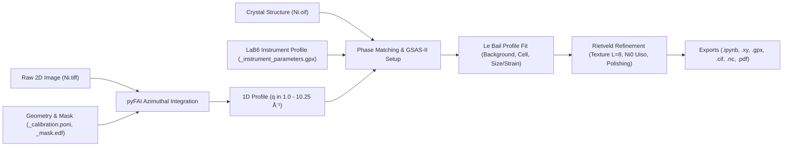
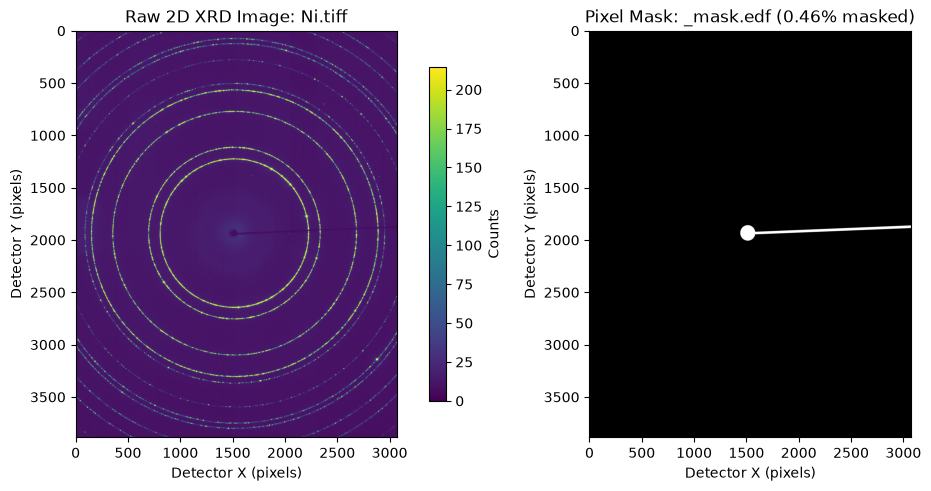
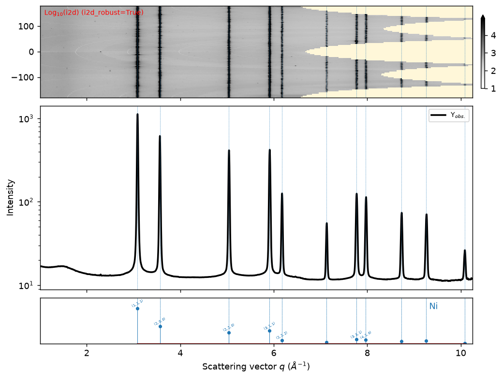
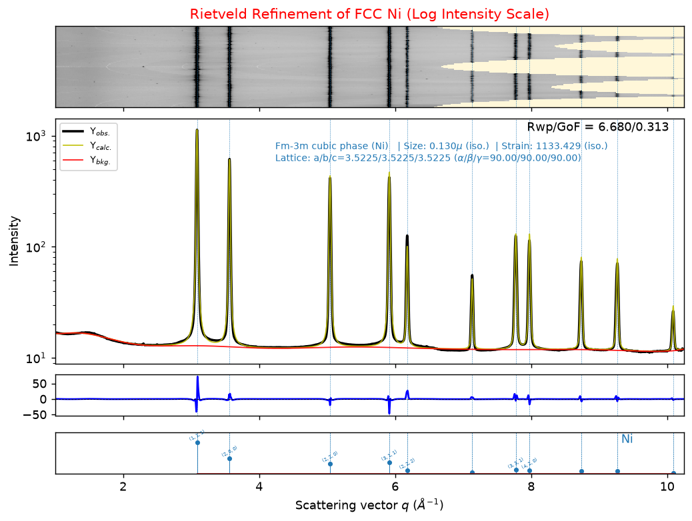
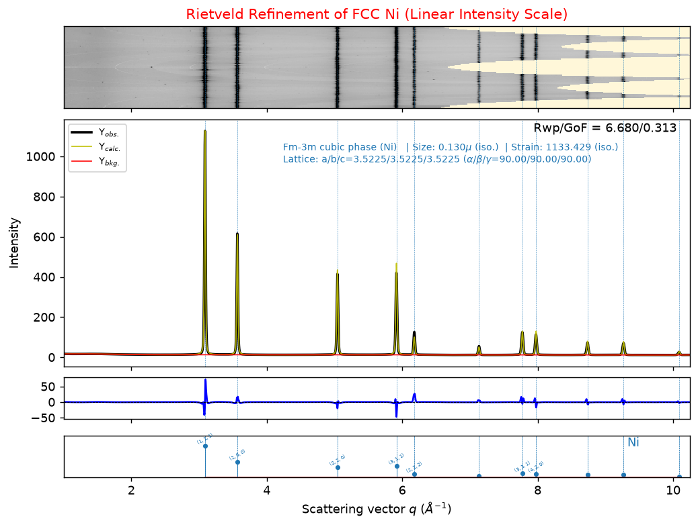

# 2D XRD Integration & Rietveld Refinement Walkthrough (`Ni.tiff`)

This walkthrough documents the end-to-end processing of the 2D synchrotron X-ray diffraction image [`Ni.tiff`](Ni.tiff) into a 1D powder profile and its structural **Rietveld refinement** using `easyxrd` (`exrd`), `pyFAI`, `fabio`, and `GSAS-II`, saved and executed in [`Ni_Rietveld_Refinement.ipynb`](Ni_Rietveld_Refinement.ipynb).

---

## 1. Workflow Architecture

---

## 2. Input Inspection & Detector Calibration

- **2D Diffraction Image ([`Ni.tiff`](Ni.tiff))**: `3888 × 3072` float32 frame recorded on a Dexela 2923 area detector (`75 µm` pixel pitch), displaying sharp concentric Debye–Scherrer rings of polycrystalline FCC Nickel alongside a central beamstop and horizontal support arm shadow.
- **Bad-Pixel & Beamstop Mask ([`_mask.edf`](_mask.edf))**: Masks `0.46%` of pixels corresponding to the beamstop shadow and defective detector pixels.
- **Geometric Calibration ([`_calibration.poni`](_calibration.poni))**: Synchrotron wavelength `λ = 0.1799 Å` (`E ≈ 68.92 keV`), sample-to-detector distance `D = 0.5995 m`.
- **GSAS-II Instrument Profile ([`_instrument_parameters.gpx`](_instrument_parameters.gpx))**: Pre-calibrated `LaB₆` standard parameters (`U = -29.4296`, `V = 13.7913`, `W = 0.8709`, `X = 0.0752`, `Y = -1.0844`, `Z = 0.0408`, `SH/L = 0.00554`, `Zero = 0.0`).

> [!IMPORTANT]
> Because instrumental broadening was pre-calibrated on `LaB₆` in [`_instrument_parameters.gpx`](_instrument_parameters.gpx), all instrumental profile parameters (`U`, `V`, `W`, `X`, `Y`, `Z`, `SH/L`) were held fixed during sample refinement. This prevents parameter correlation and ensures excess peak width is accurately assigned to intrinsic sample crystallite size and microstrain.

---

## 3. 2D-to-1D `pyFAI` Integration & Phase Matching

Full-detector azimuthal integration via `sample.load_xrd_data(...)` spans `q ∈ [0.304, 10.472] Å⁻¹` (`10,168` bins), where scattering vector magnitude is related to Bragg angle by:

$$q = \frac{4\pi \sin\theta}{\lambda}$$

Inspecting the 2D azimuthal cake (`i2d`) identified:
1. **Low-`q` beamstop shadow (`q < 1.0 Å⁻¹`)**: Direct-beam stop cutoff followed by a smooth diffuse sample-holder background hump near `q ≈ 1.48 Å⁻¹`.
2. **High-`q` detector corners (`q > 10.25 Å⁻¹`)**: Reduced azimuthal pixel coverage in the extreme rectangular corners beyond the `(440)` peak at `q ≈ 10.09 Å⁻¹`.
3. **Azimuthal intensity modulation**: Mild grain-orientation texture along vertical Bragg lines in `i2d`.

Re-integrating with `radial_range=[1.0, 10.25]` Å⁻¹ (`9250` points) and matching against [`Ni.cif`](Ni.cif) via `sample.load_phases(...)` indexed all 11 observed Bragg reflections — `(111)`, `(200)`, `(220)`, `(311)`, `(222)`, `(400)`, `(331)`, `(420)`, `(422)`, `(511)/(333)`, and `(440)` — to single-phase FCC Nickel (`Fm-3m`, space group #225) with zero impurity peaks.

![Integrated 2D cake and 1D profile in q ∈ [1.0, 10.25] Å⁻¹](figures/02_pyfai_integration.png)

---

## 4. Progressive Refinement Protocol & Key Physics

Refinement was initialized via `sample.setup_gsas2_refiner(instprm_from_gpx="_instrument_parameters.gpx", ...)` and executed sequentially to guarantee stable convergence:

| Stage | `easyxrd` Method | Key Parameters Varied | `Rwp` (%) | `GoF` |
| :--- | :--- | :--- | :---: | :---: |
| **1. Initial Setup** | `setup_gsas2_refiner` | Histogram scale + 3-term Chebyshev background (Le Bail) | `29.386` | `1.379` |
| **2. Background** | `refine_background` | Chebyshev polynomial escalated `5 → 10` terms | `26.929` | `1.264` |
| **3. Unit Cell** | `refine_cell_parameters` | Cubic lattice parameter `a` (`3.52558 → 3.52248 Å`) | `20.119` | `0.944` |
| **4. Microstructure** | `refine_size_broadening`, `refine_strain_broadening` | Isotropic domain size + microstrain + cell re-alignment | `6.977` | `0.328` |
| **5. Switch to Rietveld** | `set_LeBail` | `to=False` (structure-factor intensities `\|F_hkl\|²`) | `15.247` | `0.715` |
| **6. Texture (`L = 8`)** | `refine_preferred_orientation` | Cubic `m-3m` spherical harmonics `C(4,1)`, `C(6,1)`, `C(8,1)` | `9.708` | `0.456` |
| **7. Thermal Motion** | `refine_site_property` | `Ni0` (`4a`) isotropic `Uiso` (`0.01000 → 0.00376 Ų`) | `7.116` | `0.334` |
| **8. Final Polishing** | Multi-step pass | `15`-term background, size, strain, cell `a`, `L=8` texture, `Uiso` | **`6.680`** | **`0.313`** |

> [!NOTE]
> **Why `harmonics_order=8` and `Uiso` are coupled in FCC Ni:** When switching from Le Bail (`Rwp = 6.977%`) to untextured Rietveld (`Rwp = 15.247%`), two effects cause `(hkl)` intensity mismatch: (1) azimuthal grain texture on the 2D detector, where cubic `m-3m` Laue symmetry allows zero `L = 2` harmonics and requires orders `L = 4, 6, 8` (`C(4,1)`, `C(6,1)`, `C(8,1)`), and (2) GSAS-II's default `Uiso = 0.010 Ų`, which over-damps high-`q` structure factors relative to metallic Nickel's room-temperature Debye–Waller factor. Refining `harmonics_order=8` followed by `Ni0` `Uiso` drops `Rwp` from `15.247%` to `6.680%` and yields a textbook room-temperature `Uiso = 0.00376(6) Ų` (`Biso = 0.297 Ų`).

### Final Rietveld Fit (Logarithmic Intensity Scale)

### Final Rietveld Fit (Linear Intensity Scale)

---

## 5. Final Refined Parameters

$$R_{\text{wp}} = \sqrt{ \frac{\sum_i w_i (y_i - y_{c,i})^2}{\sum_i w_i y_i^2} } \times 100\% = 6.680\%, \qquad R_{\text{p}} = \frac{\sum_i |y_i - y_{c,i}|}{\sum_i y_i} \times 100\% = 4.292\%$$

| Quantity | Refined Result | Notes / Reference Comparison |
| :--- | :--- | :--- |
| **Convergence / Data Points** | `True` (`Nobs = 9250`) | `q ∈ [1.000, 10.250] Å⁻¹`, `λ = 0.1799 Å` |
| **Fit Residuals** | `Rwp = 6.680%`, `Rp = 4.292%` | Matches structure-free Le Bail limit (`6.977%`) |
| **Goodness of Fit** | `GoF = 0.313` (`χ² = 908.89`) | Azimuthally averaged 2D area-detector counts |
| **Crystal System & Space Group** | Cubic, `Fm-3m` (#225) | `Z = 4`, `Ni0` at Wyckoff `4a` `(0, 0, 0)`, `occ = 1.0` |
| **Cubic Lattice Constant (`a`)** | `3.52249 Å` | Initial DFT CIF: `3.52558 Å`; lit. RT Ni: `~3.5238 Å` |
| **Unit Cell Volume & Density** | `V = 43.7067 ų`, `ρ_X = 8.921 g/cm³` | Standard bulk Ni density: `8.908 g/cm³` |
| **Isotropic Thermal Parameter** | `Uiso = 0.00376(6) Ų` (`Biso = 0.297 Ų`) | Lit. RT metallic Ni: `0.0038 – 0.0042 Ų` |
| **Isotropic Domain Size** | `0.1295 µm` (`129.5 nm`) | Sub-micron coherent diffraction domain size |
| **Isotropic Microstrain** | `1133.43 × 10⁻⁶` (`~0.113%`) | Residual lattice microstrain broadening |
| **Spherical Harmonics (`L = 8`)** | `C(4,1) = 0.1030`, `C(6,1) = 0.2596`, `C(8,1) = -0.2159` | Cubic `m-3m` preferred orientation coefficients |

---

## 6. Verification & Saved Deliverables

All 16 code cells in [`Ni_Rietveld_Refinement.ipynb`](Ni_Rietveld_Refinement.ipynb) were executed end-to-end via `jupyter nbconvert --execute` with zero errors or warnings:

- [`Ni_Rietveld_Refinement.ipynb`](Ni_Rietveld_Refinement.ipynb) (`2.6 MB`) — Executed Jupyter notebook with markdown documentation and 13 embedded inline figures.
- [`walkthrough.md`](walkthrough.md) — This Markdown walkthrough alongside extracted diagnostic plots in [`figures/`](figures/).
- [`Ni_1D_tth.xy`](Ni_1D_tth.xy) & [`Ni_1D_q.xy`](Ni_1D_q.xy) (`199 KB` each) — Exported 1D integrated profiles (`2θ` vs. `I` and `q` vs. `I`).
- [`Ni_refined.gpx`](Ni_refined.gpx) (`694 KB`) — Final converged GSAS-II project file.
- [`Ni_refined.cif`](Ni_refined.cif) (`4.9 KB`) — Refined crystallographic CIF (`a = 3.52249 Å`, `Uiso = 0.00376(6) Ų`).
- [`Ni_refined.nc`](Ni_refined.nc) (`2.4 MB`) — Complete `easyXRD` NetCDF dataset (`i2d`, `i1d`, `i1d_refined`, `i1d_gsas_background`).
- [`Ni_Rietveld_plot.pdf`](Ni_Rietveld_plot.pdf) (`79 KB`) — High-resolution vector PDF of the final 4-panel Rietveld fit.
