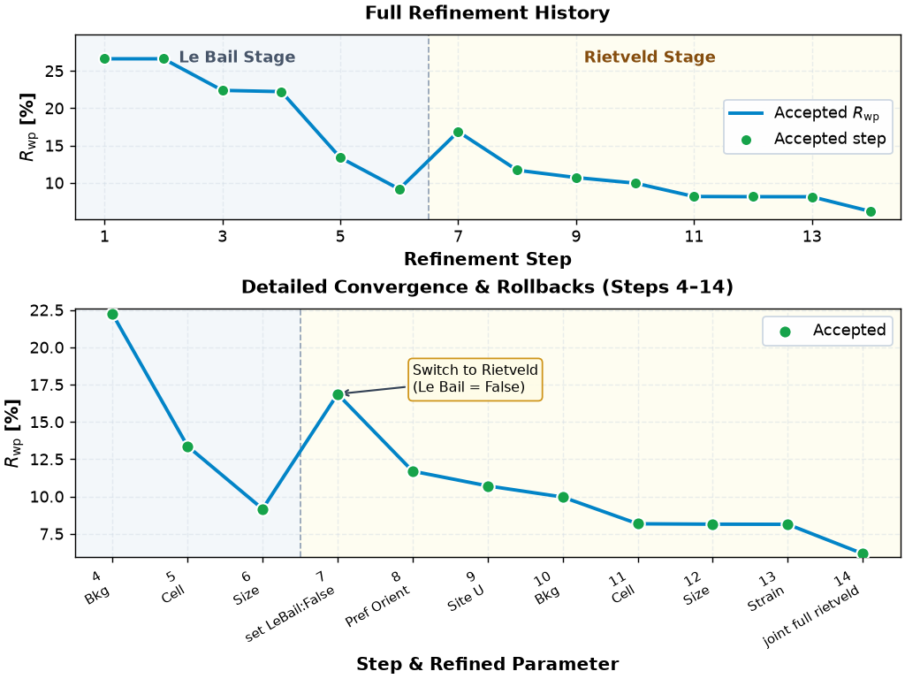
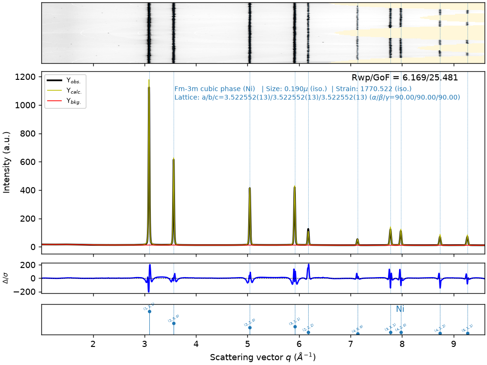

# Walkthrough: 2D Synchrotron XRD Integration & Rietveld Refinement of FCC Nickel (`Ni.tiff`)

## 1. Overview

This walkthrough documents the end-to-end processing of the 2D synchrotron X-ray diffraction image `Ni.tiff` into a 1D radial diffraction profile and subsequent structural Rietveld refinement using **`easyxrd`** (`v2026.11.4`), **`pyFAI`** (`v2026.9.0`), **`fabio`** (`v2026.6.0`), and **`GSAS-II`** (`v2.0.0`) inside the Pixi environment at `/home/mt/mpixi`.

All code, diagnostics, figures, and covariance analyses are saved and fully executed in [`Ni_rietveld_refinement.ipynb`](Ni_rietveld_refinement.ipynb).

---

## 2. Input Data & Experimental Geometry

| File | Role | Key Properties |
| :--- | :--- | :--- |
| `Ni.tiff` | Raw 2D diffraction image | Dexela 2923 detector (`3888 × 3072` pixels, `float32`, $75 \times 75\text{ }\mu\text{m}$ pixel size) |
| `_calibration.poni` | `pyFAI` geometry calibration | $D = 599.497\text{ mm}$, $\text{PONI}_1 = 140.657\text{ mm}$, $\text{PONI}_2 = 99.346\text{ mm}$, $\lambda = 0.1799\text{ }\text{\AA}$ ($68.92\text{ keV}$) |
| `_mask.edf` | Bad-pixel & beamstop mask | $54{,}514 / 11{,}943{,}936$ pixels masked ($0.46\%$) |
| `Ni.cif` | Candidate crystal structure | FCC Nickel, space group $Fm\bar{3}m$ (No. 225, $Z = 4$), `Ni0` at $4a$ $(0, 0, 0)$, $0\text{ K}$ DFT $a = 3.52558\text{ }\text{\AA}$ |
| `_instrument_parameters.gpx` | GSAS-II instrument resolution | Calibrated on $\text{LaB}_6$ ($R_{wp} = 2.733\%$) at $\lambda = 0.1799\text{ }\text{\AA}$ |

---

## 3. Step-by-Step Workflow & Key Diagnostics

### Step 1: 2D Azimuthal Cake & 1D Radial Integration (`pyFAI` via `easyxrd`)

`Ni.tiff` was integrated using `exrd.load_xrd_data` with $\Delta q = 0.001\text{ }\text{\AA}^{-1}$, $91$ azimuthal bins (`integrate2d=True`), mask `_mask.edf`, and propagated Poisson counting uncertainties (`error_model="poisson"`):

- **Full detector radial coverage**: $q \in [0.304, 10.472]\text{ }\text{\AA}^{-1}$ ($10{,}169$ points), exported to [`Ni_1d_q.qxye`](Ni_1d_q.qxye) ($q$ in $\text{\AA}^{-1}$) and [`Ni_1d_2theta.xye`](Ni_1d_2theta.xye) ($2\theta$ in degrees).
- **Active refinement range ($q \in [1.0, 9.6]\text{ }\text{\AA}^{-1}$, $8{,}600$ points)**:
  - Below $q = 1.0\text{ }\text{\AA}^{-1}$, only beamstop-adjacent air scatter is present (first Bragg reflection `(111)` is at $q = 3.090\text{ }\text{\AA}^{-1}$).
  - Complete $360^\circ$ Debye–Scherrer rings (`91/91` azimuthal bins) fit on the rectangular detector up to $q \approx 6.53\text{ }\text{\AA}^{-1}$; detector edges reach $q \approx 8.26\text{ }\text{\AA}^{-1}$ and corners extend to $q = 10.47\text{ }\text{\AA}^{-1}$, where counting uncertainty spikes sharply above $q = 9.6\text{ }\text{\AA}^{-1}$ ($\sigma_{\max} = 3.583$ vs. $0.141$ in $[6.5, 9.6)\text{ }\text{\AA}^{-1}$).
  - Selecting `radial_range=(1.0, 9.6)` cleanly retains **all 10 FCC Ni Bragg peaks**: `(111)`, `(200)`, `(220)`, `(311)`, `(222)`, `(400)`, `(331)`, `(420)`, `(422)`, and `(511)/(333)` ($q = 9.271\text{ }\text{\AA}^{-1}$).
- **Strong sheet/rolling texture diagnosed in `i2d`**:
  - Continuous, non-spotty Debye–Scherrer rings exhibit smooth **$3.7\times\text{--}9.7\times$ azimuthal intensity modulation** around $\chi$ (e.g., `(200)` varies from $167$ to $1{,}405$ counts, $8.4\times$; `(222)` varies $9.7\times$; `(111)` varies $3.8\times$).
  - This immediately indicates a fine-grained polycrystalline Ni foil/sheet with strong crystallographic preferred orientation that must be modeled during structural Rietveld refinement.

---

### Step 2: Phase Screening & Matching (`Ni.cif`)

Running `sample.screen_phases(candidate_structures={"Ni": "Ni.cif"}, tolerance_q=0.03)` confirmed single-phase FCC Nickel with no impurity peaks:

- **Figure of Merit (`FOM`)**: `0.9855` ($9/10$ prominent peaks matched within $\Delta q = 0.03\text{ }\text{\AA}^{-1}$; all 10 crystallographic reflections indexed once loaded).
- **Suggested lattice scale**: `0.999582`, reflecting room-temperature lattice contraction ($a \approx 3.5225\text{ }\text{\AA}$) relative to the $0\text{ K}$ GGA-relaxed `Ni.cif` value ($a = 3.52558\text{ }\text{\AA}$).

---

### Step 3: Diagnosing GSAS-II Instrument Parameters (`_instrument_parameters.gpx`)

Inspecting `_instrument_parameters.gpx` via `GSASIIscriptable` revealed the following calibrated parameters:

| Parameter | Value | Description |
| :--- | ---: | :--- |
| `Lam` | `0.179900` | Wavelength ($\text{\AA}$) |
| `Polariz.` / `Azimuth` / `Zero` | `0.000000` | Polarization, azimuth, zero-point shift |
| `U`, `V`, `W` | `-29.429568`, `13.791336`, `0.870891` | Gaussian Caglioti variance ($\text{centideg}^2$) |
| `X`, `Y`, `Z` | `0.075170`, `-1.084402`, `0.040769` | Lorentzian width coefficients ($\text{centideg}$) |
| `SH/L` | `0.005541` | Axial divergence asymmetry |

**Critical high-$q$ safeguard diagnosis**:
- In `_instrument_parameters.gpx`, the $\text{LaB}_6$ calibrant phase retained active sample broadening (`Size = 0.44627 µm`, `Mustrain = 1000.0`), which contributed $+0.231/\cos\theta + 5.730\tan\theta\text{ centideg}$ of Lorentzian width during calibration while instrumental `Y = -1.084402` compensated slightly.
- Consequently, when `Ni.cif` is initialized with default GSAS-II phase parameters, the **bare** instrumental Lorentzian width $\gamma_L(\theta) = X/\cos\theta + Y\tan\theta + Z$ crosses zero at **$q = 7.463\text{ }\text{\AA}^{-1}$** ($2\theta = 12.27^\circ$), reaching $-0.0338\text{ centideg}$ ($-0.00034^\circ$) at $q = 9.6\text{ }\text{\AA}^{-1}$ and triggering `easyxrd`'s `_invalid_instrument_peak_widths` rejection past $q = 7.46\text{ }\text{\AA}^{-1}$.
- **Resolution**:
  1. For the full 10-peak refinement over $q \in [1.0, 9.6]\text{ }\text{\AA}^{-1}$, all parameters from `_instrument_parameters.gpx` (`Lam`, `Polariz.`, `Azimuth`, `Zero`, `U`, `V`, `W`, `X`, `Z`, `SH/L`) were kept verbatim while minimally clamping only `Y` from `-1.084402` to `-0.839789` centideg so $\gamma_L(q_{\max}) = +0.001\text{ centideg} > 0$ (a peak-width perturbation $< 0.00034^\circ$, well below one $\Delta(2\theta) \approx 0.0016^\circ$ bin).
  2. As an independent verification, `instprm_from_gpx="_instrument_parameters.gpx"` was also run **completely unmodified** on $q \in [1.0, 7.4]\text{ }\text{\AA}^{-1}$ (6 Bragg peaks, full azimuthal ring coverage), confirming $0.003\%$ agreement in refined lattice constant.

---

### Step 4: Progressive Le Bail $\rightarrow$ Rietveld Refinement

Following the staged strategy in `MehmetTopsakal/easyXRD_examples` (`2_lebail_to_rietveld.ipynb`), background, lattice parameter, and peak profile were first stabilized in structure-free Le Bail mode before switching to full structural Rietveld mode (`set_LeBail(to=False)`):

| Stage | Operation | $R_{wp}$ (%) | $\text{GoF}$ | Notes |
| :---: | :--- | ---: | ---: | :--- |
| 1 | `setup_gsas2_refiner` (initial Le Bail) | `26.631` | `109.85` | Initial 3-term Chebyshev background + `Ni.cif` cell |
| 2 | `refine_background(num_coeffs=6 -> 10)` | `22.231` | `91.76` | Captures diffuse baseline under Bragg peaks |
| 3 | `refine_cell_parameters()` | `13.375` | `55.17` | Cubic $a$: $3.52558 \rightarrow 3.52329(3)\text{ }\text{\AA}$ |
| 4 | `refine_size_broadening()` | `9.169` | `37.83` | Isotropic crystallite size stabilizes peak tails |
| 5 | `set_LeBail(to=False, refine=True)` | `16.870` | `69.59` | Untextured $F_{hkl}^2$ mismatches textured foil intensities |
| 6 | `refine_preferred_orientation(harmonics_order=10)` | `11.700` | `48.28` | Cubic $m\bar{3}m$ spherical harmonics ($C_{4,1}, C_{6,1}, C_{8,1}, C_{10,1}$) cut $R_{wp}$ by $30.6\%$ |
| 7 | `refine_site_property(refinement_flags="U")` | `10.713` | `44.20` | Positive `Ni0` $U_{\text{iso}}$ restored once texture is modeled |
| 8 | Sequential `bkg(15)` + `cell` + `size` + `strain` | `8.140` | `33.58` | Refines isotropic microstrain alongside size & cell |
| 9 | **Simultaneous full-matrix Rietveld polish** | **`6.169`** | **`25.48`** | 24 parameters refined simultaneously ($R_p = 3.921\%$) |





---

## 4. Final Refined Crystallographic & Microstructural Parameters

| Quantity | Initial (`Ni.cif`) | Full-Range Rietveld ($q \in [1.0, 9.6]\text{ }\text{\AA}^{-1}$) | Unmodified-GPX Check ($q \in [1.0, 7.4]\text{ }\text{\AA}^{-1}$) |
| :--- | :---: | :---: | :---: |
| Space group | $Fm\bar{3}m$ (No. 225) | $Fm\bar{3}m$ (No. 225) | $Fm\bar{3}m$ (No. 225) |
| Bragg reflections included | — | 10 (`111` to `511/333`) | 6 (`111` to `400`) |
| Weighted profile $R_{wp}$ | — | **$6.169\%$** | **$5.988\%$** |
| Unweighted profile $R_p$ | — | **$3.921\%$** | — |
| Goodness of Fit ($\text{GoF}$) | — | **$25.481$** | **$25.882$** |
| Lattice parameter $a$ ($\text{\AA}$) | $3.52558$ | **$3.522552(13)$** | **$3.522437(16)$** |
| Unit-cell volume $V$ ($\text{\AA}^3$) | $43.822$ | **$43.7091(5)$** | **$43.7049(6)$** |
| $\text{Ni–Ni}$ bond length $a/\sqrt{2}$ ($\text{\AA}$) | $2.49296$ | **$2.49082(1)$** | **$2.49074(1)$** |
| Calculated density $\rho$ ($\text{g/cm}^3$) | $8.896$ | **$8.91921(10)$** | **$8.92008(12)$** |
| `Ni0` $(0,0,0)$ $U_{\text{iso}}$ ($\text{\AA}^2$) | $0.00500$ (GSAS init) | **$0.00045(8)$** | **$0.00466$** |
| Isotropic crystallite size ($\text{nm}$) | $1000$ | **$189.9 \pm 4.8$** | **$132.2$** |
| Isotropic microstrain ($\times 10^{-6}$) | $1000$ | **$1770 \pm 40$** | $1000$ (fixed) |
| Spherical harmonics ($m\bar{3}m$) | $0$ | $C_{4,1}=-0.016(6)$, $C_{6,1}=0.136(4)$, $C_{8,1}=-0.068(4)$, $C_{10,1}=-0.109(8)$ | Refined ($m\bar{3}m$, order 10) |

### Physical Interpretation
- **Lattice parameter & density**: $a = 3.522552(13)\text{ }\text{\AA}$ ($\rho = 8.9192\text{ g/cm}^3$) is in close agreement with standard room-temperature pure FCC Nickel ($a_{\text{lit}} \approx 3.5238\text{ }\text{\AA}$, $\rho_{\text{lit}} = 8.908\text{ g/cm}^3$), with $0.003\%$ consistency between the full-range and unmodified-GPX mid-$q$ refinements.
- **Azimuthal truncation & $U_{\text{iso}}$**: Over the full/near-full $360^\circ$ ring region ($q \le 7.4\text{ }\text{\AA}^{-1}$), `Ni0` $U_{\text{iso}}$ refines to **$0.00466\text{ }\text{\AA}^2$**, closely matching room-temperature experimental values for Ni ($\sim 0.0056\text{ }\text{\AA}^2$). Above $q = 6.53\text{ }\text{\AA}^{-1}$, the rectangular detector samples only the diagonal corner azimuths ($24/91$ bins at `(511)/(333)`), partially coupling azimuthal texture sampling with apparent high-$q$ Debye–Waller attenuation ($U_{\text{iso}} = 0.00045(8)\text{ }\text{\AA}^2$).

---

## 5. Saved Output Files & Reproducibility

All artifacts are saved in `/home/mt/repos/easyXRD_with_agents/00-Ni/Gemini-4-Carbon-High/`:

- [`Ni_rietveld_refinement.ipynb`](Ni_rietveld_refinement.ipynb) — Executed 26-cell Jupyter notebook with complete code, narrative, diagnostics, and 9 embedded plots.
- [`walkthrough.md`](walkthrough.md) — This technical summary and walkthrough.
- [`Ni_1d_q.qxye`](Ni_1d_q.qxye) & [`Ni_1d_2theta.xye`](Ni_1d_2theta.xye) — Integrated 1D powder patterns ($q$ and $2\theta$) with Poisson standard uncertainties.
- [`Ni_refined.gpx`](Ni_refined.gpx) — Converged GSAS-II Rietveld project file.
- [`Ni_refined.nc`](Ni_refined.nc) — Exported `easyxrd` `xarray` NetCDF dataset (`i1d`, `i1d_variance`, `i2d`, `i1d_refined`, `i1d_gsas_background`, `i1d_phase_profiles`, `rwp_history`, and phase/instrument metadata).
- [`Ni_rietveld_fit.png`](Ni_rietveld_fit.png) & [`Ni_refinement_history.png`](Ni_refinement_history.png) — High-resolution Rietveld fit and $R_{wp}$ convergence history figures.

To re-run the notebook from scratch using the Pixi environment:

```bash
/home/mt/mpixi/.pixi/envs/default/bin/python -m jupyter nbconvert \
  --to notebook --execute --inplace Ni_rietveld_refinement.ipynb
```
