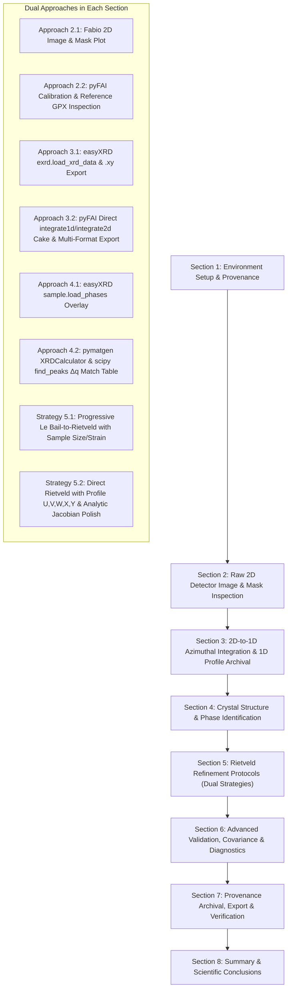

# Plan: Combined Ni Rietveld Refinement Notebook (`Ni_Rietveld_refinement_combined.ipynb`)

## 1. Objective & Scope
The objective is to combine two distinct Jupyter notebooks (`Ni_Rietveld_Refinement_a.ipynb` and `Ni_Rietveld_refinement_b.ipynb`) into a single, fully reproducible, self-contained, and comprehensive notebook:
**`Ni_Rietveld_refinement_combined.ipynb`**.

The combined notebook showcases the skills and methodologies of both notebooks side-by-side without benchmarking them competitively. For each step of the analysis, it first presents one approach (e.g., the high-level, idiomatic `easyXRD` workflow) and then shows the alternative approach (e.g., deep diagnostic scripting using `pyFAI`, `GSASIIscriptable`, `pymatgen`, and `scipy`).

---

## 2. Structural Design & Workflow Architecture

---

## 3. Detailed Section-by-Section Design

### Section 1: Environment Setup, Provenance, & File Integrity
- **Imports**: Comprehensive set of modules (`easyxrd`, `GSASIIscriptable`, `fabio`, `pyFAI`, `pymatgen`, `scipy`, `pandas`, `matplotlib`, `hashlib`, `json`).
- **Input Integrity Audit**: SHA-256 hash tracking for all 5 required input files (`Ni.tiff`, `_calibration.poni`, `_mask.edf`, `Ni.cif`, `_instrument_parameters.gpx`).
- **Environment & Directory Config**: Initialize output directory `Ni_combined_results/` and configure scratch environment variables (`EASYXRD_SCRATCH`, `NUMBA_CACHE_DIR`, `MPLCONFIGDIR`, `OMP_NUM_THREADS`).

### Section 2: Raw Detector Image & Mask Inspection
- **Approach 2.1 (Streamlined Fabio Visualization)**:
  - Reading `Ni.tiff` and `_mask.edf` with `fabio`.
  - Side-by-side display of raw detector counts ($3888 \times 3072$ pixels) and detector mask with labeled colorbars.
- **Approach 2.2 (Deep Diagnostic Inspection & Calibration Metadata)**:
  - Load `_calibration.poni` with `pyFAI.load`: inspect wavelength ($\lambda = 0.1799\text{ \AA}$), detector distance ($0.599\text{ m}$), PONI geometry.
  - Load `_instrument_parameters.gpx` via `G2sc.G2Project` and display initial instrument parameters table.
  - Compute exact percentage and counts of masked pixels, non-finite pixel handling.
  - Masked array visualization (`np.ma.array`) with percentile clipping (99.5%) to highlight faint high-$q$ powder rings.

### Section 3: 2D-to-1D Azimuthal Integration & Profile Archival
- **Approach 3.1 (easyXRD Streamlined Pipeline)**:
  - Initialize `sample_a = exrd(i1d_ylogscale=True, i2d_logscale=False)`.
  - Run `sample_a.load_xrd_data(...)` over $q \in [1.5, 9.5]\text{ \AA}^{-1}$.
  - Export 1D profile data using `sample_a.export_i1d_to(..., mode="xy")`.
- **Approach 3.2 (pyFAI Direct Integration, 2D Polar Cake, and Multi-Column Export)**:
  - Direct `ai.integrate1d` with $\Delta q = 0.004\text{ \AA}^{-1}$ over full range $[0.5, 10.4]\text{ \AA}^{-1}$ with solid-angle correction and azimuthal variance calculation.
  - Generate 2D polar cake $(q, \chi)$ via `ai.integrate2d` to inspect azimuthal uniformity and spotty/textured rings.
  - Dual plot: 2D cake map + 1D logarithmic curve highlighting the refinement window ($q \in [2.5, 9.5]\text{ \AA}^{-1}$).
  - Multi-format exports: CSV table (`Ni_integrated_profile.csv`), 2$\theta$ XY (`Ni_2theta.xy`), $q$ XY (`Ni_q.xy`), and weighted XYE (`Ni_2theta.xye`).

### Section 4: Crystal Structure & Phase Identification
- **Approach 4.1 (easyXRD Built-in Phase Loading & Visualization)**:
  - Load `Ni.cif` into `sample_a`: `sample_a.load_phases([{"cif": "Ni.cif", "label": "Ni"}], plot=True)`.
  - Native easyXRD reflection position markers overlaid on experimental data.
- **Approach 4.2 (Pymatgen Structure Analysis & Scipy Peak Indexing)**:
  - Load structure via `pymatgen.core.Structure` ($Fm\bar{3}m$, $a = 3.5256\text{ \AA}$).
  - Compute exact theoretical pattern with `XRDCalculator`.
  - Automatic experimental peak detection via `scipy.signal.find_peaks`.
  - Tabulate $(hkl)$ assignments, theoretical $q$, observed $q$, and peak shifts $\Delta q$ in a pandas DataFrame.
  - Comparative plot showing experimental pattern vs CIF theoretical line positions and intensities.

### Section 5: Rietveld Refinement Protocols (Dual Strategies)
- **Strategy 5.1 (Progressive Le Bail-to-Rietveld with Sample Microstructure)**:
  - Setup: `sample_a.setup_gsas2_refiner(instprm_from_gpx="_instrument_parameters.gpx", normalize=True, plot=False)`.
  - Progressive parameter escalation:
    1. Background (5 terms) + unit cell parameter ($a$).
    2. Background (10 terms) + sample size broadening (`refine_size_broadening`) + sample strain broadening (`refine_strain_broadening`).
    3. Structural transition: `sample_a.set_LeBail(to=False, refine=True)` + thermal displacement ($U_{iso}$) refinement on Ni site (`refine_site_property`).
    4. Background (15 terms) + final cell parameter convergence.
  - Extract and display Strategy 5.1 metrics ($R_{wp}$, GoF, $a$, volume, density).
  - Export project `Ni_refined_strategy_a.gpx` and plot `Ni_refinement_plot_strategy_a.png`.
- **Strategy 5.2 (Direct Rietveld with Profile U,V,W,X,Y, Diagnostic Uiso Check, & Analytic Jacobian Polish)**:
  - Initialize `sample_b = exrd()`, load data in $[2.5, 9.5]\text{ \AA}^{-1}$ from independent `full_b` dataset, load CIF.
  - Setup: `sample_b.setup_gsas2_refiner(instprm_from_gpx="_instrument_parameters.gpx", normalize=False, do_1st_refinement=False)`.
  - `sample_b.set_LeBail(to=False, refine=False)`.
  - Fix size to 10 $\mu\text{m}$ and strain to 0.0, set weights $w = 1/\max(I, 1)$.
  - Progressive stages with history recording:
    1. Scale + 8-term background + cell parameter.
    2. Gaussian profile parameters ($U, V, W$).
    3. Lorentzian profile parameters ($X, Y$).
    4. Diagnostic unconstrained $U_{iso}$ trial (clamp to 0.0 if negative).
    5. Joint model refinement + analytic Jacobian polishing (`deriv type = 'analytic Jacobian'`).
    6. Repeat-cycle stability check.
  - Tabulate step-by-step history DataFrame (`Ni_refinement_history.csv`).

### Section 6: Advanced Validation, Covariance Analysis & Multi-Panel Visualization
- **Residual Validation**: Recompute $R_{wp}$ and $R_p$ directly from raw GSAS-II histogram arrays (`y_obs`, `y_calc`, `y_bkg`, `weights`) via `hist_b.getdata(...)` and verify consistency.
- **Covariance & Correlation**: Extract covariance matrix, calculate correlation matrix, and identify strongly correlated parameters ($|r| \ge 0.9$).
- **Instrument Parameter Comparison**: Compare initial reference parameters with final refined parameters.
- **Publication Graphics**:
  - 3-panel figure: Observed/Calculated/Background with Bragg tick marks, difference curve ($I_{obs} - I_{calc}$), and log-scale profile.
  - 3-panel zoom inset figure inspecting peak profiles at low, mid, and high $q$.

### Section 7: Results Archiving, Provenance & Verification
- Save outputs: GPX project (`Ni_Rietveld_strategy_b.gpx`), CIF (`Ni_refined.cif`), fit profile table (`Ni_fit_profile.csv`).
- Save JSON records: `Ni_summary.json` and `Ni_provenance.json`.
- GPX project re-load verification assertions using `GSASIIscriptable`.

### Section 8: Summary & Scientific Conclusions
- Comparative markdown table synthesizing both approaches.
- Discussion of crystallographic parameters, agreement with literature, and microstructural implications.

---

## 4. Methodological Comparison Matrix

| Analytical Stage | Methodology A (easyXRD Streamlined) | Methodology B (Deep Diagnostic Pipeline) |
| :--- | :--- | :--- |
| **Data Inspection** | Fabio 2D intensity & mask image inspection | pyFAI geometry & instrument parameters table display |
| **Azimuthal Integration** | `exrd.load_xrd_data` over $[1.5, 9.5]\text{ \AA}^{-1}$ | Direct `ai.integrate1d` + 2D polar cake $(q, \chi)$ map |
| **Phase Indexing** | Built-in `sample.load_phases` marker overlay | Pymatgen `XRDCalculator` + Scipy `find_peaks` $\Delta q$ table |
| **Refinement Strategy** | Progressive Le Bail-to-Rietveld with Size & Strain | Direct Rietveld with profile $U, V, W, X, Y$ & analytic Jacobian |
| **$U_{iso}$ Handling** | Thermal parameter refined in Rietveld transition | Diagnostic trial with unphysical negative boundary clamping |
| **Validation** | Native easyXRD residuals & plot | Manual array $R_{wp}$ validation, covariance correlation matrix |
| **Output Archival** | `.xy`, `.gpx`, and `.png` | Multi-format `.csv`, `.xy`, `.xye`, `.cif`, `.json`, `.pdf` |

---

## 5. Verification & Execution Status
- [x] Combined notebook generated: `Ni_Rietveld_refinement_combined.ipynb` (24 cells).
- [x] Executed end-to-end via Jupyter nbconvert with exit code 0.
- [x] Verified all figures, data tables, and assertions execute cleanly.
- [x] All 25 output artifacts successfully produced in `Ni_combined_results/`.
